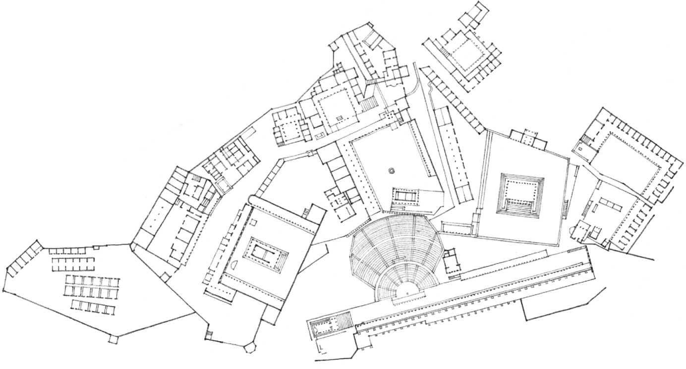
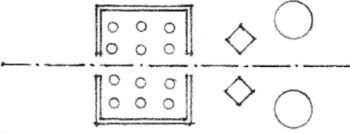
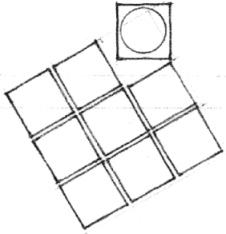
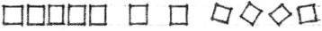
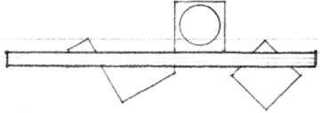
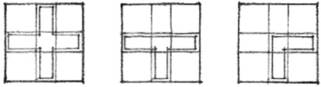

> [BREADCRUMB_CTX: 《Architecture》 > Ordering Principles]

## ORDERING PRINCIPLES

While Chapter 4 employed a geometric basis for organizing the forms and spaces of a building, this chapter discusses additional principles that can be utilized to create order in an architectural composition. Order refers not simply to geometric regularity, but rather to a condition in which each part of a whole is properly disposed with reference to other parts and to its purpose so as to produce a harmonious arrangement.

There exists a natural diversity and complexity in the program requirements for buildings. The forms and spaces of any building should acknowledge the hierarchy inherent in the functions they accommodate, the users they serve, the purposes or meaning they convey, and the scope or context they address. It is in recognition of this natural diversity, complexity, and hierarchy in the programming, designing, and making of buildings that ordering principles are discussed.

Order without diversity can result in monotony or boredom; diversity without order can produce chaos. A sense of unity with variety is the ideal. The following ordering principles are seen as visual devices that allow the varied and diverse forms and spaces of a building to coexist perceptually and conceptually within an ordered, unified, and harmonious whole.

**Pergamon**, Plan of Upper City, 2nd century B.C.

### Axis

A line established by two points in space, about which forms and spaces can be arranged in a symmetrical or balanced manner.

### Symmetry

The balanced distribution and arrangement of equivalent forms and spaces on opposite sides of a dividing line or plane, or about a center or axis.

### Hierarchy

The articulation of the importance or significance of a form or space by its size, shape, or placement relative to the other forms and spaces of the organization.

### Rhythm

A unifying movement characterized by a patterned repetition or alternation of formal elements or motifs in the same or a modified form.

### Datum

A line, plane, or volume that, by its continuity and regularity, serves to gather, measure, and organize a pattern of forms and spaces.

### Transformation

The principle that an architectural concept, structure, or organization can be altered through a series of discrete manipulations and permutations in response to a specific context or set of conditions without a loss of identity or concept.