> [BREADCRUMB_CTX: 《Architecture》 > Axis]

## AXIS

The axis is perhaps the most elementary means of organizing forms and spaces in architecture. It is a line established by two points in space, about which forms and spaces can be arranged in a regular or irregular manner. Although imaginary and not visible except to the mind’s eye, an axis can be a powerful, dominating, regulating device. Although it implies symmetry, it demands balance. The specific disposition of elements about an axis will determine whether the visual force of an axial organization is subtle or overpowering, loosely structured or formal, picturesque or monotonous.

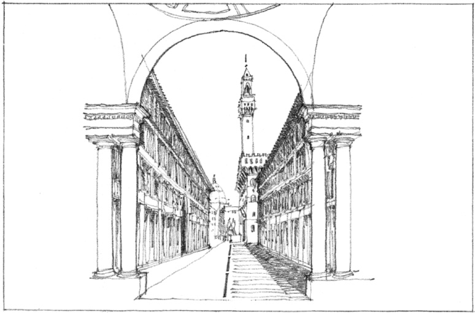

This Florentine street flanked by the **Uffizi Palace** links the River Arno to the Piazza della Signoria. See plan on pg. 354.

Since an axis is essentially a linear condition, it has qualities of length and direction, and induces movement and promotes views along its path.

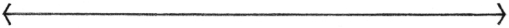

For its definition, an axis must be terminated at both of its ends by a significant form or space.

The notion of an axis can be reinforced by defining edges along its length. These edges can be simply lines on the ground plane, or vertical planes that define a linear space coincident with the axis.

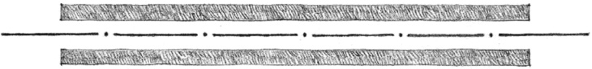

An axis can also be established simply by a symmetrical arrangement of forms and spaces.

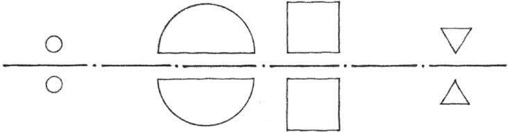
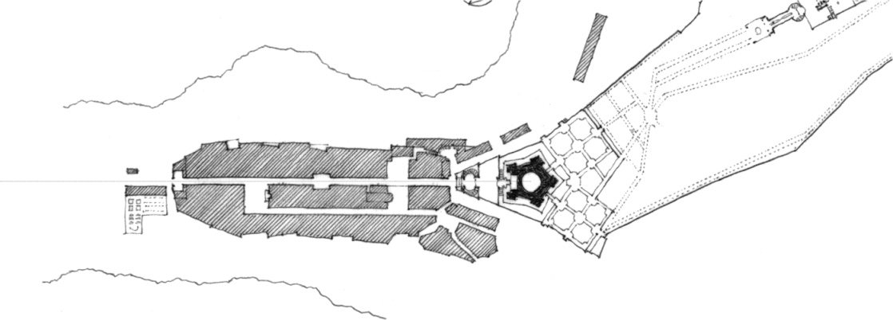

**Villa Farnese**, Caprarola, Italy, 1560, Giacomo Vignola

The terminating elements of an axis serve to both send and receive its visual thrust. These culminating elements can be any of the following:

* points in space established by vertical, linear elements or centralized building forms
* vertical planes, such as symmetrical building facades or fronts, preceded by a forecourt or similar open space
* well-defined spaces, generally centralized or regular in form
* gateways that open outward toward a view or vista beyond

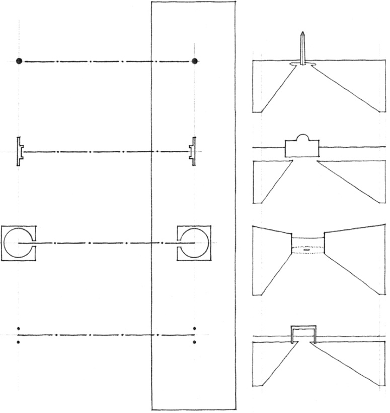
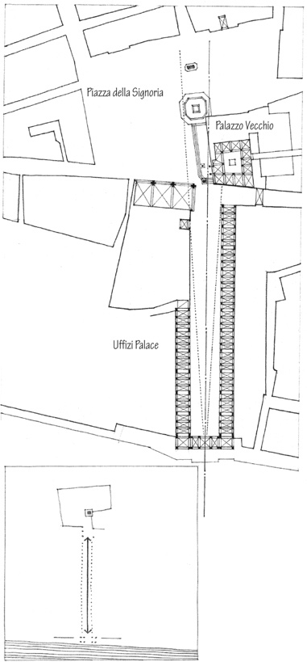

The wings of the **Uffizi Palace** in Florence, Italy, (1560, Giorgio Vasari) frame an axial space that leads from the River Arno, through the Uffizi arch, to the **Piazza della Signoria** and the **Palazzo Vecchio** (1298–1314, Arnolfo di Cambio).

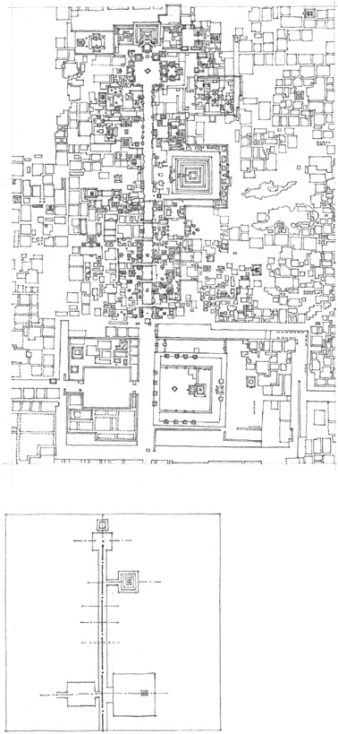

**Teotihuacan**, **City of the Gods**. Located near Mexico City, Teotihuacan was the largest and most influential ritual center of Mesoamerica, founded c. 100 B.C. and flourishing until about A.D. 750. The site was dominated by two massive temple-pyramids, the Pyramid of the Sun and the smaller Pyramid of the Moon, from which the Avenue of the Dead runs south to the citadel and market compound in the center of the city.

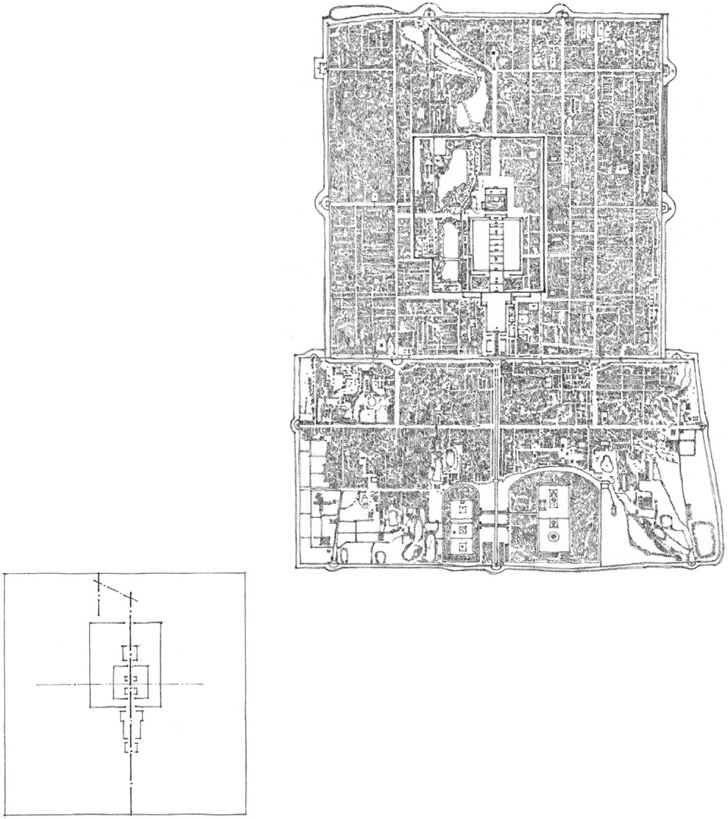

Plan of **Beijing** (formerly Peking), China. Located on its north-south axis is the **Forbidden City**, a walled section within the inner city, built in the 15th century and containing the Imperial Palace and other buildings of the imperial government of China. It was so named because it was formerly closed to the public.

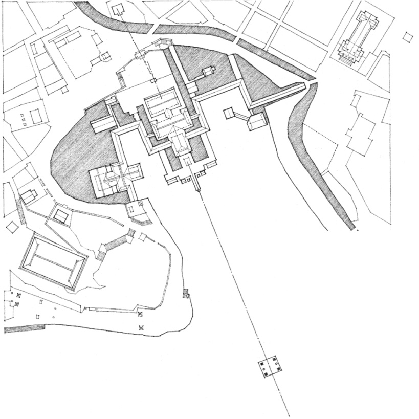

**Itsukushima Temple**, Hiroshima Prefecture, Japan, 13th century

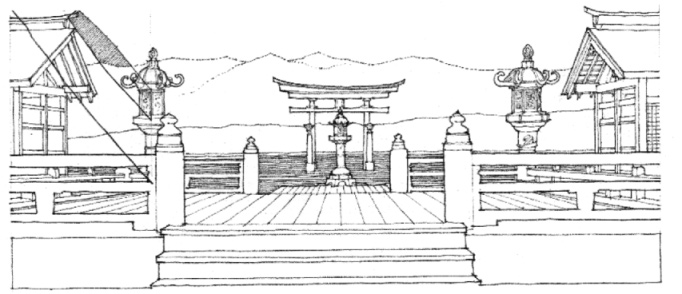

View from the Temple toward the Torii, a symbolic gateway in the sea.

**Torii** is a monumental, freestanding gateway on the approach to a Shinto shrine, consisting of two pillars connected at the top by a horizontal crosspiece and a lintel above it, usually curving upward.

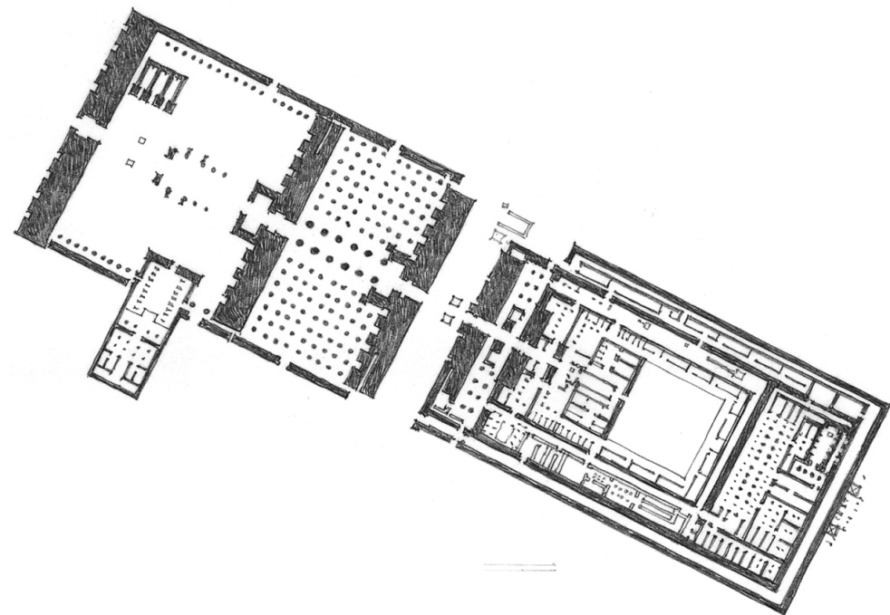

**Temple of Amun** at Karnak, Egypt, c. 1500–323 B.C.

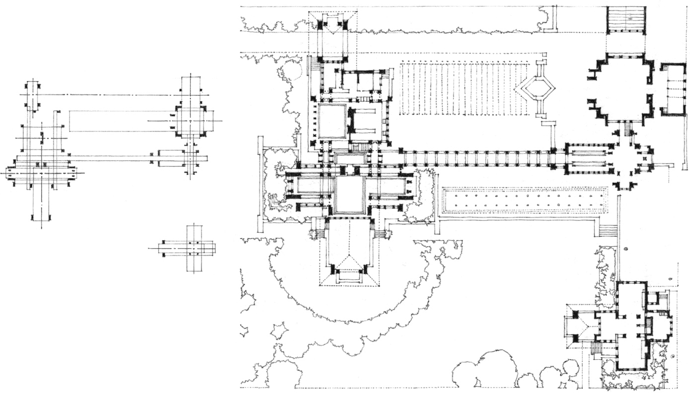

**Darwin D. Martin House and Estate**, Buffalo, New York, 1904, Frank Lloyd Wright

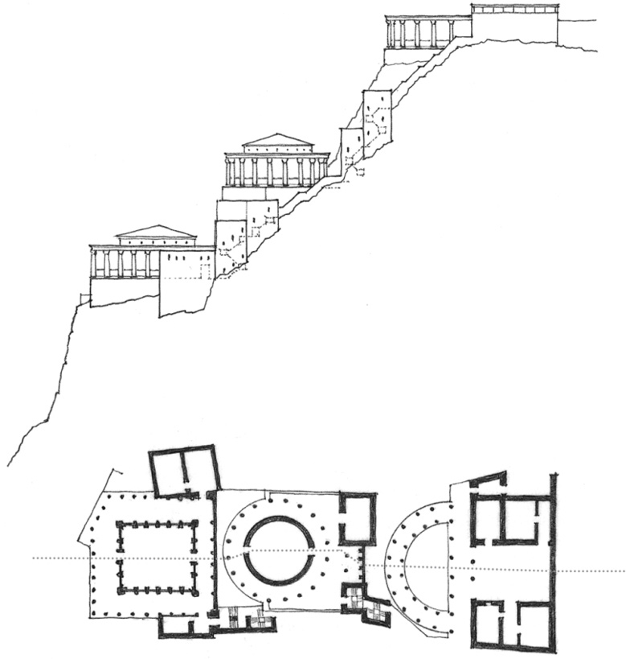

**Northern Palace at Masada**, Israel, c. 30–20 B.C.  
Axial conditions can persist across changes of topography and despite subtle shifts in alignment.

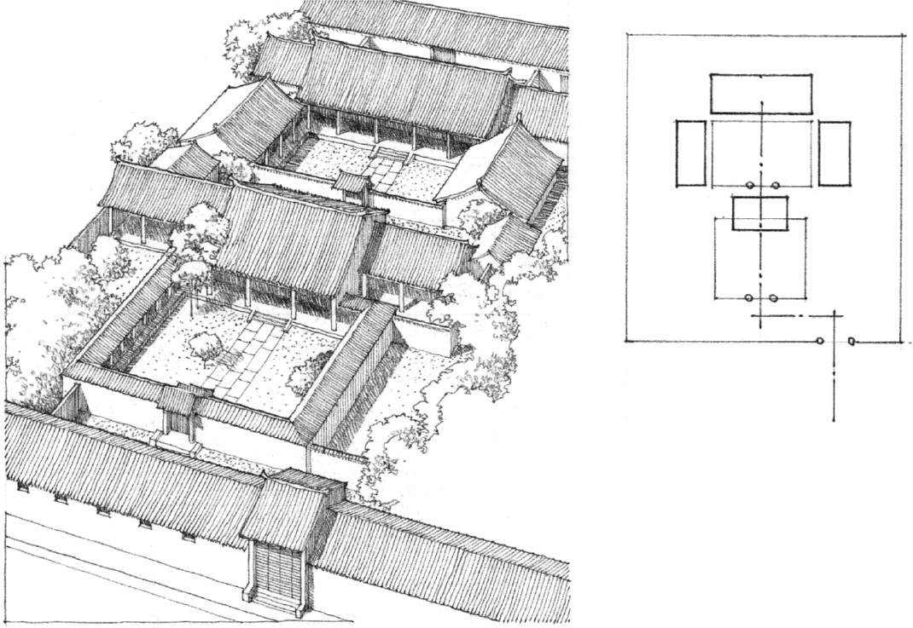

**Chinese Courtyard House**, Beijing, China

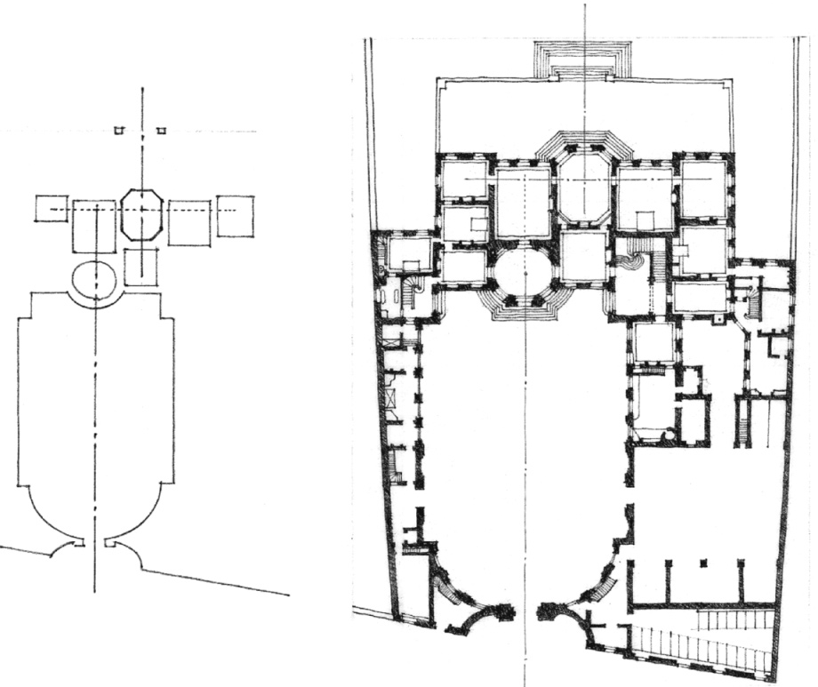

**Hôtel de Matignon**, Paris, 1721, Jean Courtonne

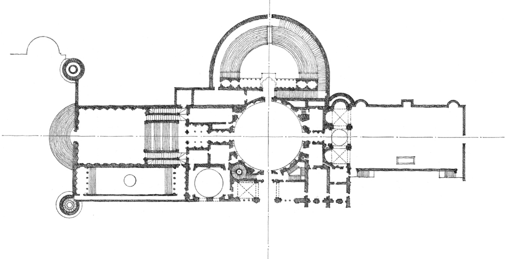

**Villa Madama**, Rome, 1517, Raphael Sanzio

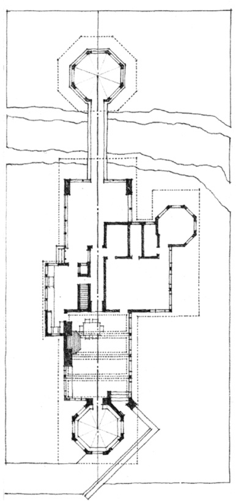

**W.A. Glasner House**, Glencoe, Illinois, 1905, Frank Lloyd Wright

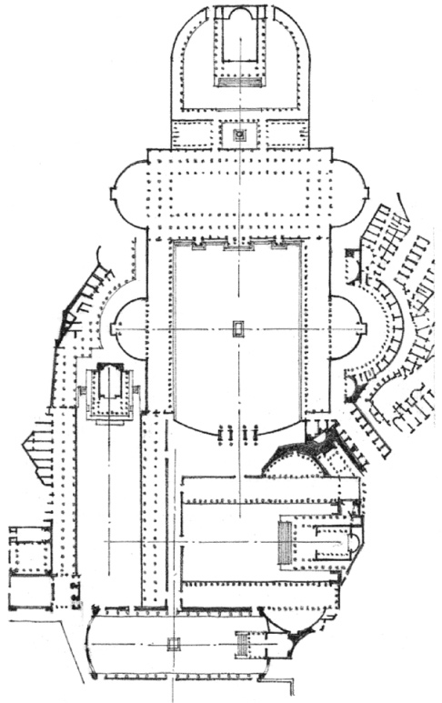

**Imperial Forums** of Trajan, Augustus, Caesar, and Nerva, Rome, 1st century B.C. to 2nd century A.D.