> [BREADCRUMB_CTX: 《Architecture》 > Symmetry]

## SYMMETRY

While an axial condition can exist without a symmetrical condition being simultaneously present, a symmetrical condition cannot exist without implying the existence of an axis or center about which it is structured. An axis is established by two points; a symmetrical condition requires the balanced arrangement of equivalent patterns of form and space on opposite sides of a dividing line or plane, or about a center or axis.

There are two fundamental types of symmetry:

1. Bilateral symmetry refers to the balanced arrangement of similar or equivalent elements on opposite sides of a median axis so that only one plane can divide the whole into essentially identical halves.
2. Radial symmetry refers to the balanced arrangement of similar, radiating elements such that the composition can be divided into similar halves by passing a plane at any angle around a centerpoint or along a central axis.

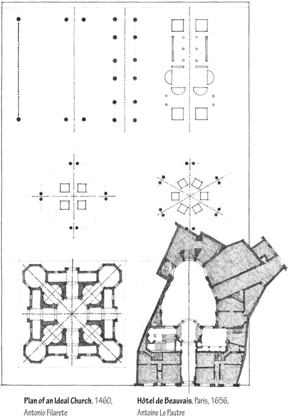

An architectural composition can utilize symmetry to organize its forms and spaces in two ways. An entire building organization can be made symmetrical. At some point, however, any totally symmetrical arrangement must confront and resolve the asymmetry of its site or context.

A symmetrical condition can occur in only a portion of the building and organize an irregular pattern of forms and spaces about itself. The latter case of local symmetry allows a building to respond to exceptional conditions of its site or program. The symmetrical condition itself can be reserved for significant or important spaces within the organization.

### Radial Symmetry

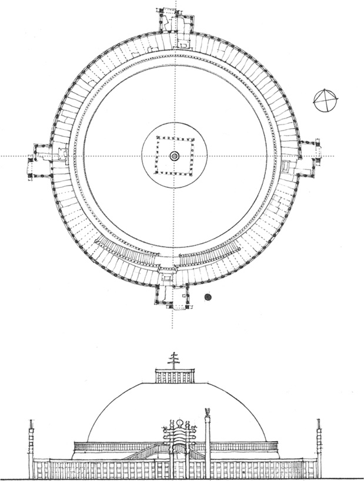

**Great Stupa at Sanchi**, India, c. 100 B.C.

### Bilateral Symmetry

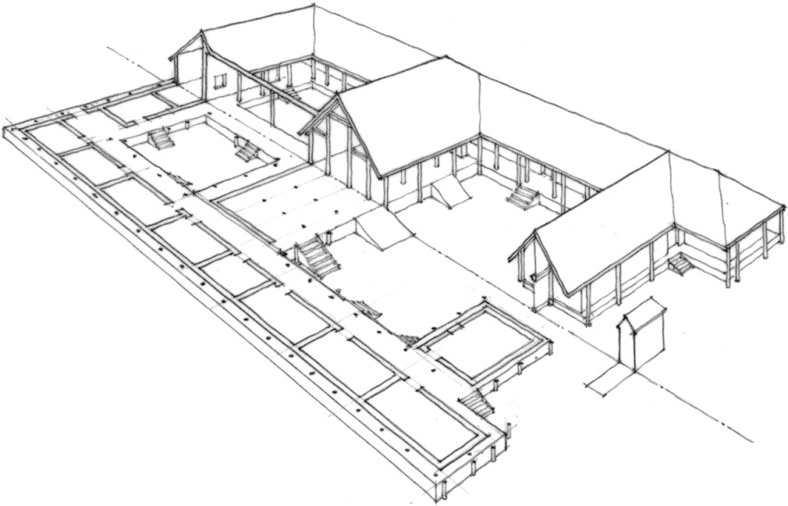

**Ritual Complex at Fengchu**, Shaanxi Province, China, c. 1100–1000 B.C.

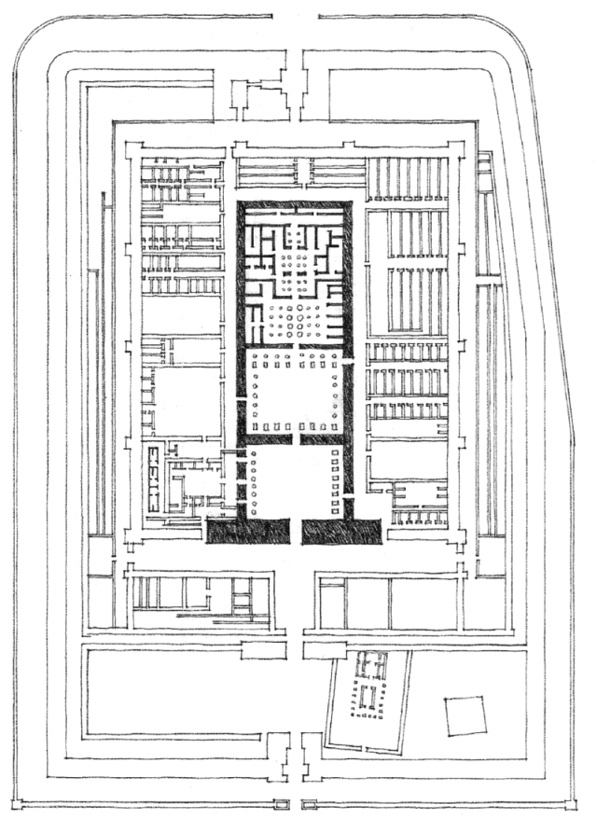

**Mortuary Temple of Rameses III**, Medînet-Habu, 1198 B.C.

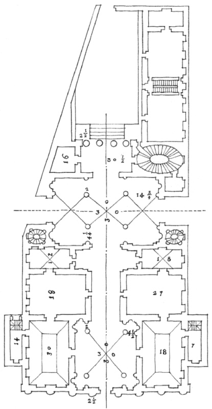

**Palazzo No. 52**, Andrea Palladio

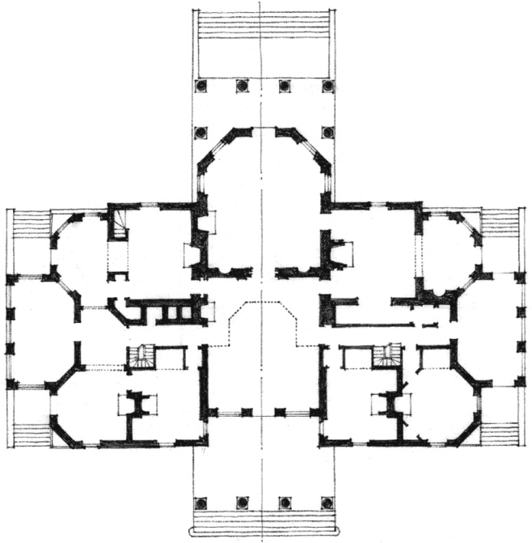

**Monticello**, near Charlottesville, Virginia, 1770-1808, Thomas Jefferson

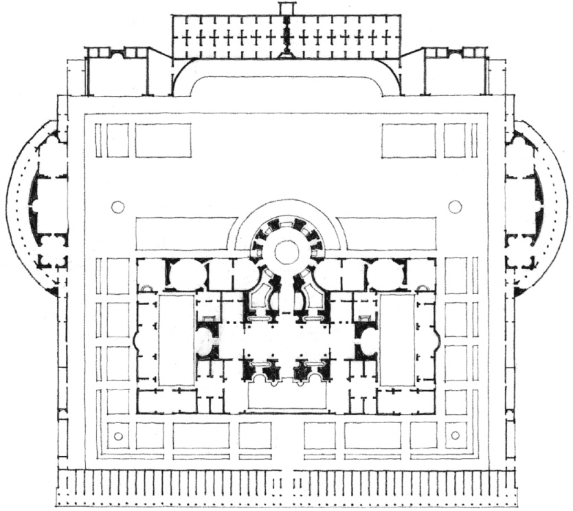

**Baths of Caracalla**, Rome, A.D. 211-217

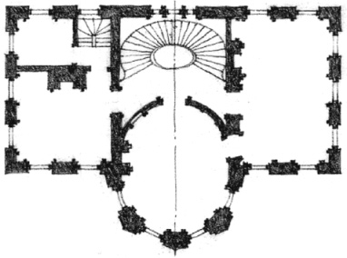

**Nathaniel Russell House**, Charleston, South Carolina, 1809

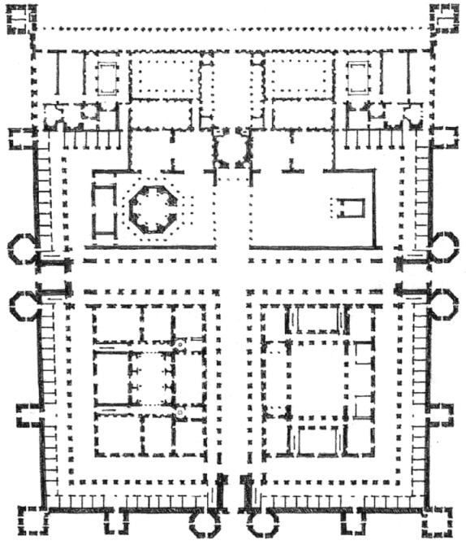

**Palace of Diocletian**, Spalato, Yugoslavia, c. A.D. 300

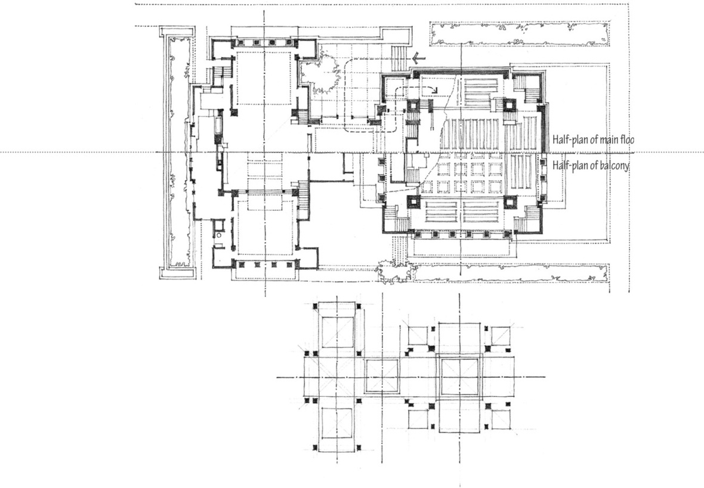

**Unity Temple**, Oak Park, Illinois, 1905–1907, Frank Lloyd Wright

Multiple symmetries, both major and minor, can add complexity and hierarchy to a composition as well as accommodate programmatic and contextual requirements.

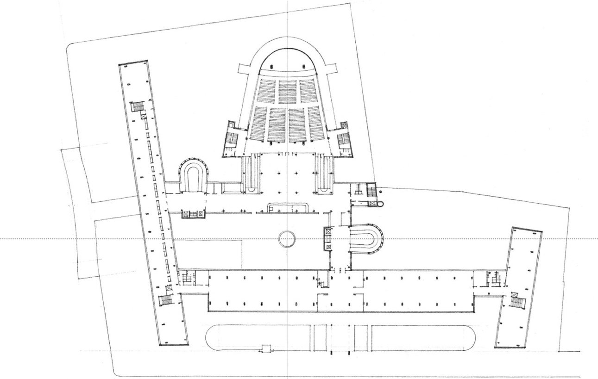

Third-floor plan, **Centrosoyus Building**, Kirova Ulitsa, Moscow, 1929–1933, Le Corbusier

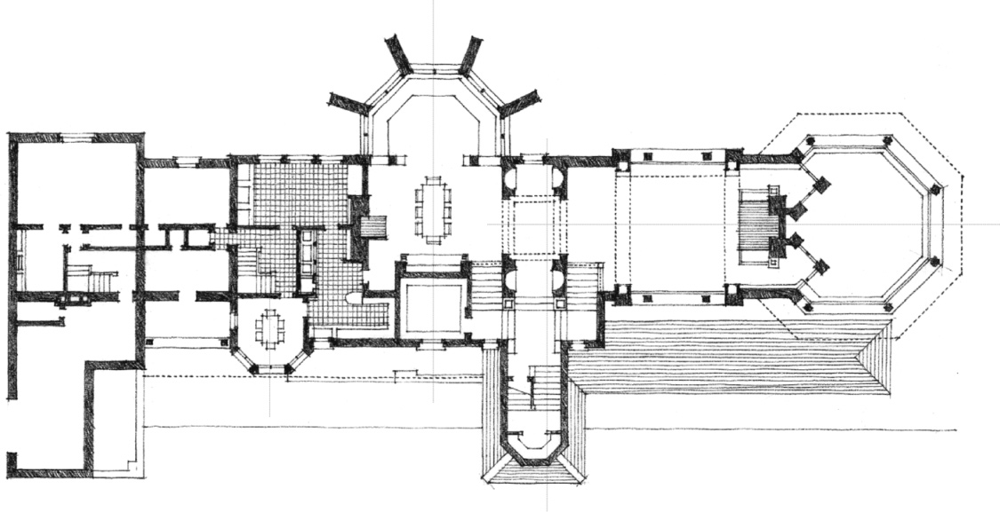

**Husser House**, Chicago, Illinois, 1899, Frank Lloyd Wright

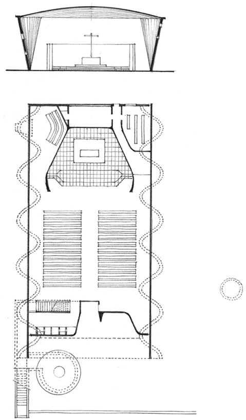

**Church of Christ the Worker**, Atlántida, Uruguay, Eladio Dieste, 1958–1960

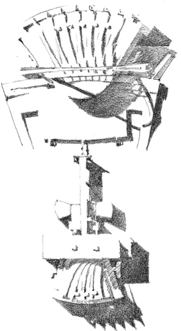

**Palace of the Soviets** (Competition), Le Corbusier, 1931

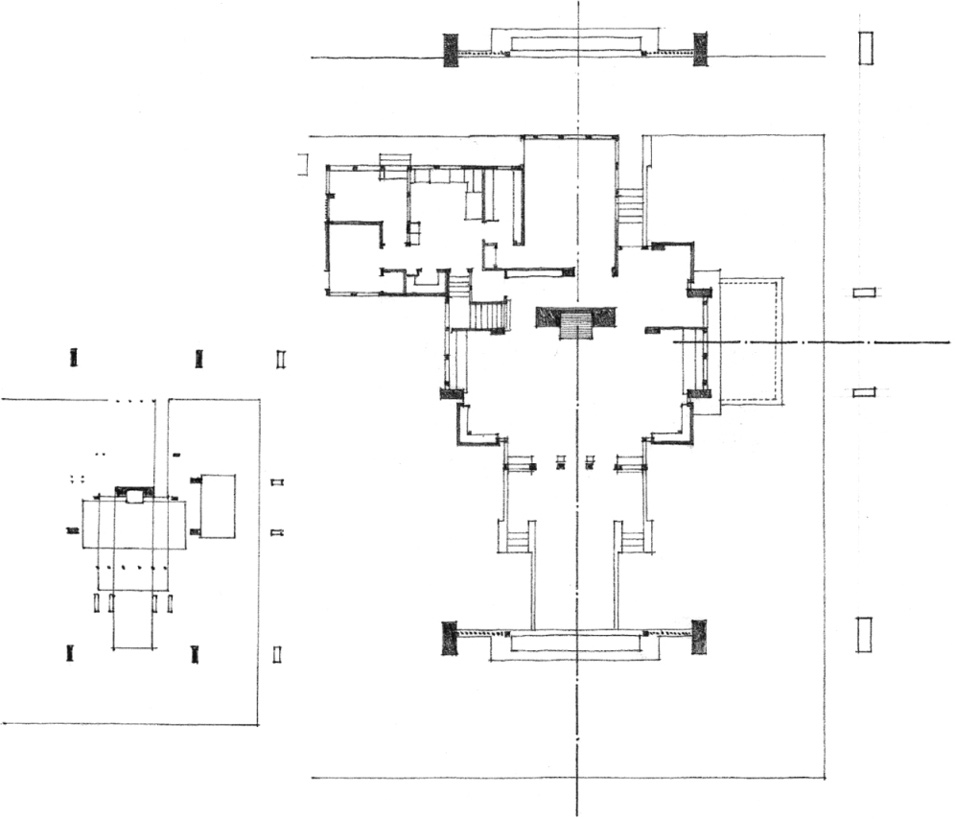

**Robert W. Evans House**, Chicago, Illinois, 1908, Frank Lloyd Wright

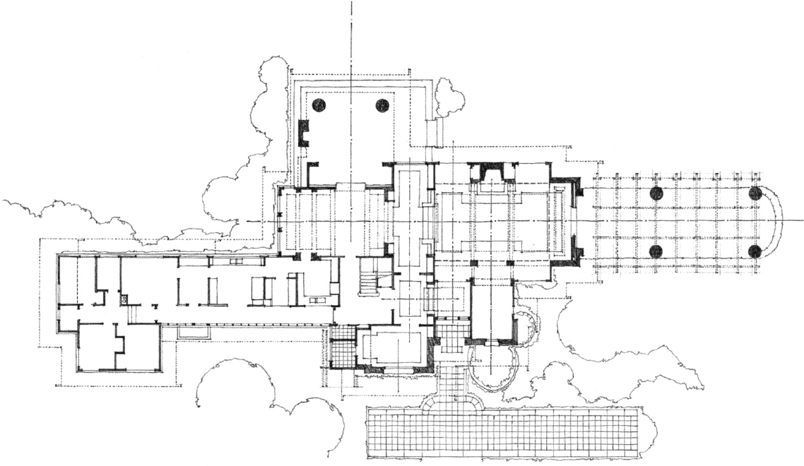

**A.E. Bingham House**, Near Santa Barbara, California, 1916, Bernard Maybeck

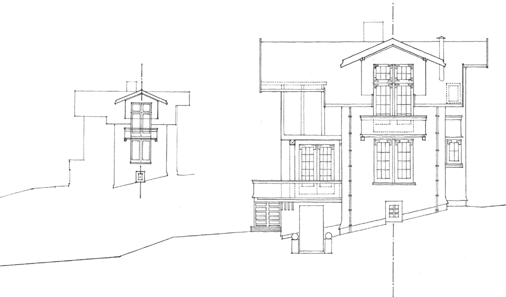

**Isaac Flagg House II**, Berkeley, California, 1912, Bernard Maybeck

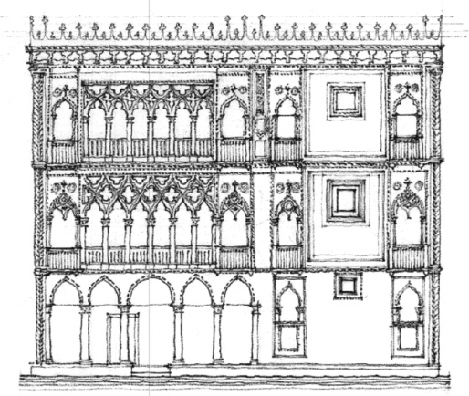

**Ca d’Oro**, Venice, 1428–1430, Giovanni and Bartolomeo Buon

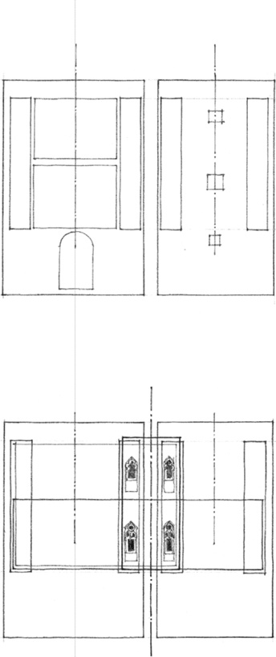
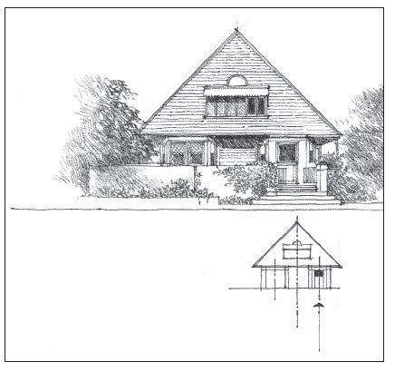

**Frank Lloyd Wright Studio**, Oak Park, Illinois, 1889

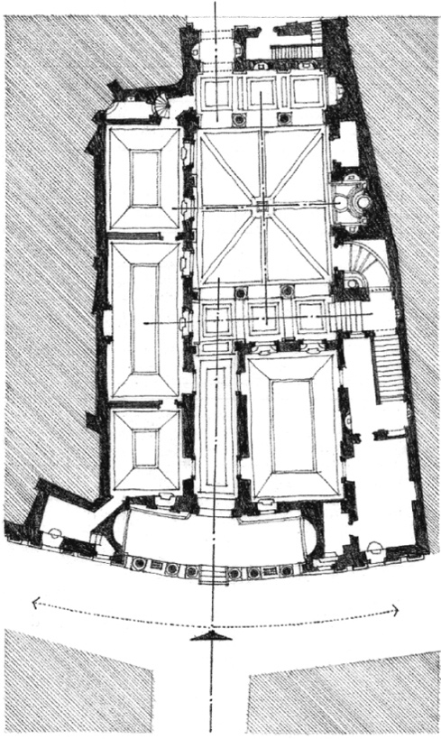

**Palazzo Pietro Massimi**, Rome, 1532–1536, Baldassare Peruzzi. A symmetrical facade leading into an asymmetrical interior.

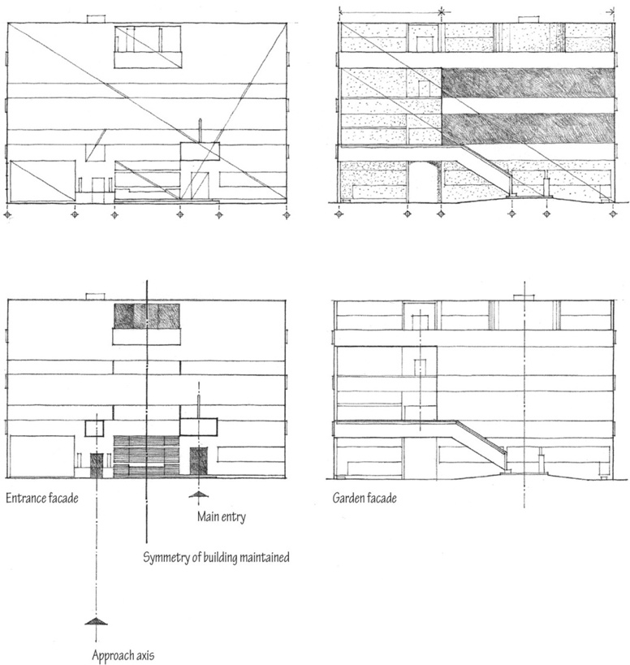

**Villa Garches**, Vaucresson, France, 1926–1927, Le Corbusier