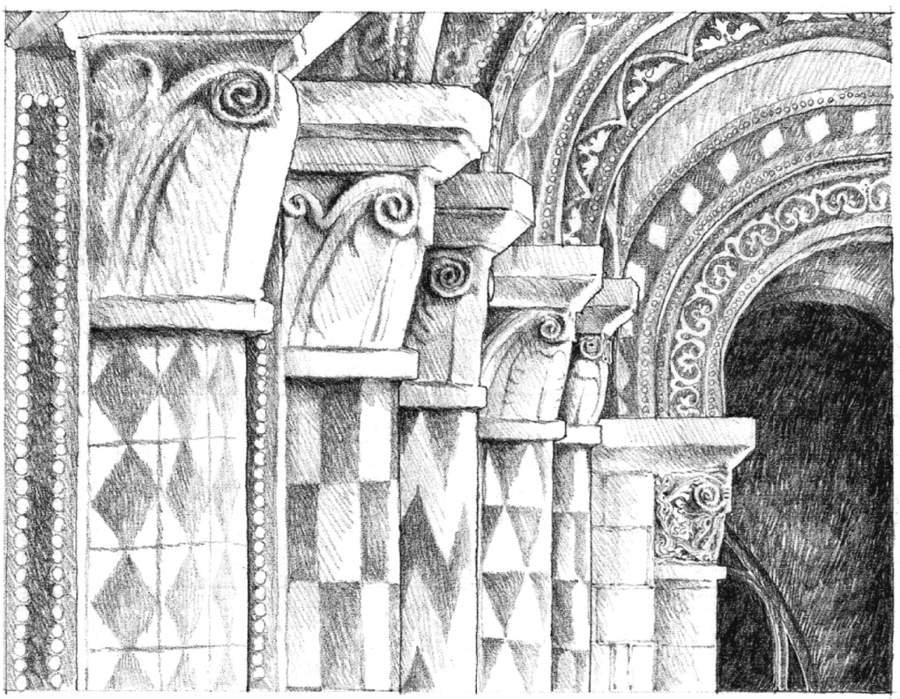
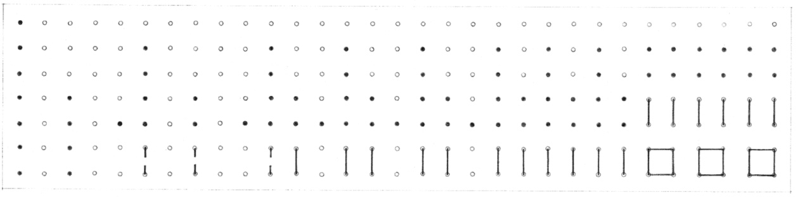

> [BREADCRUMB_CTX: 《Architecture》 > Rhythm]

## RHYTHM

Column Details, **Notre Dame la Grande**, Poitiers, France, 1130–1145

Rhythm refers to any movement characterized by a patterned recurrence of elements or motifs at regular or irregular intervals. The movement may be of our eyes as we follow recurring elements in a composition, or of our bodies as we advance through a sequence of spaces. In either case, rhythm incorporates the fundamental notion of repetition as a device to organize forms and spaces in architecture.

Almost all building types incorporate elements that are by their nature repetitive. Beams and columns repeat themselves to form repetitive structural bays and modules of space. Windows and doors repeatedly puncture the surfaces of a building to allow light, air, views, and people to enter the interior. Spaces often recur to accommodate similar or repetitive functional requirements in the building program. This section discusses the patterns of repetition that can be utilized to organize a series of recurring elements, and the resultant visual rhythms these patterns create.

