> [BREADCRUMB_CTX: 《Architecture》 > Transformation]

## TRANSFORMATION

The study of architecture, as with other disciplines, should legitimately involve the study of its past, of prior experiences, endeavors, and accom-plishments from which much can be learned and emulated. The principle of transformation accepts this notion; this book, and all of the examples it contains, is predicated on it.

The principle of transformation allows a designer to select a prototypical architectural model whose formal structure and ordering of elements might be appropriate and reasonable, and to transform it through a series of discrete manipulations in order to respond to the specific conditions and context of the design task at hand.

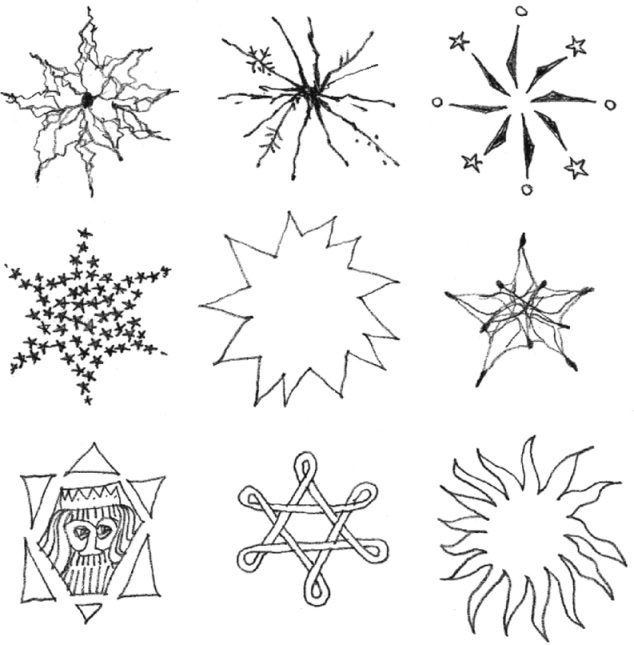

Design is a generative process of analysis and synthesis, of trial and error, of trying out possibilities and seizing opportunities. In the process of exploring an idea and probing its potential, it is essential that a designer understand the fundamental nature and structure of the concept. If the ordering system of a prototypical model is perceived and understood, then the original design concept can, through a series of finite permutations, be clarified, strengthened, and built upon, rather than destroyed.

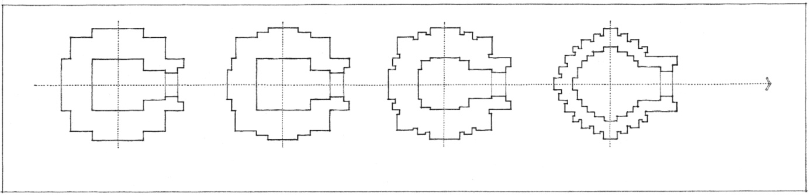

Plan development of the **North Indian Cella**

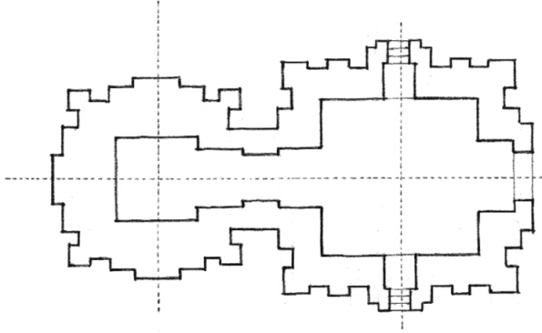
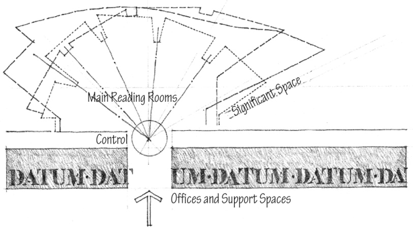

**Scheme for 3 libraries** by Alvar Aalto

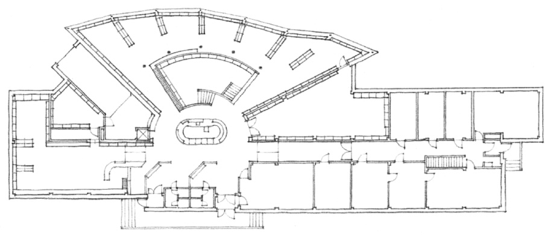

**Seinäjoki Public Library**, Seinäjoki, Finland, 1963–1965

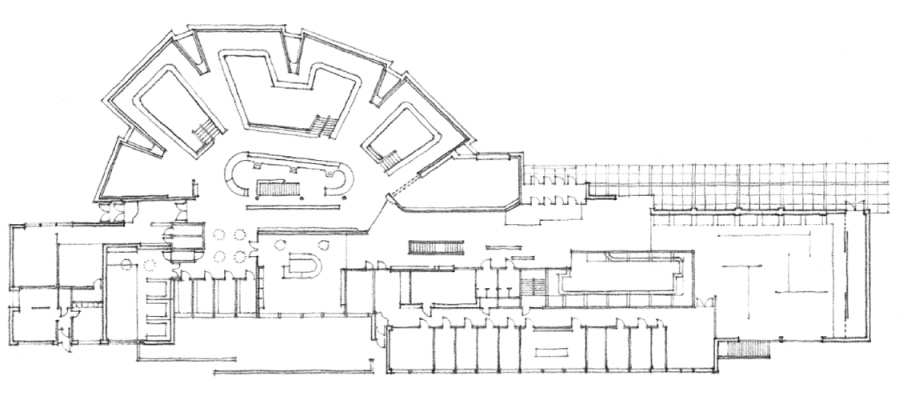

**Rovaniemi City Library**, Rovaniemi, Finland, 1963–1968

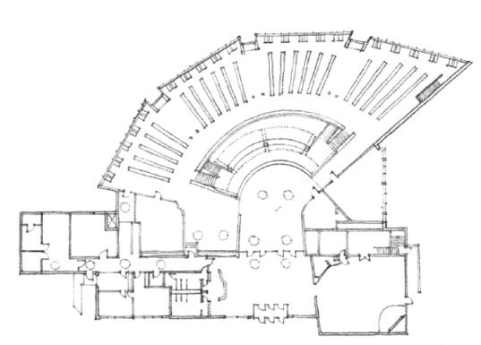

**Library of Mount Angel**, Benedictine College, Mount Angel, Oregon, 1965–1970

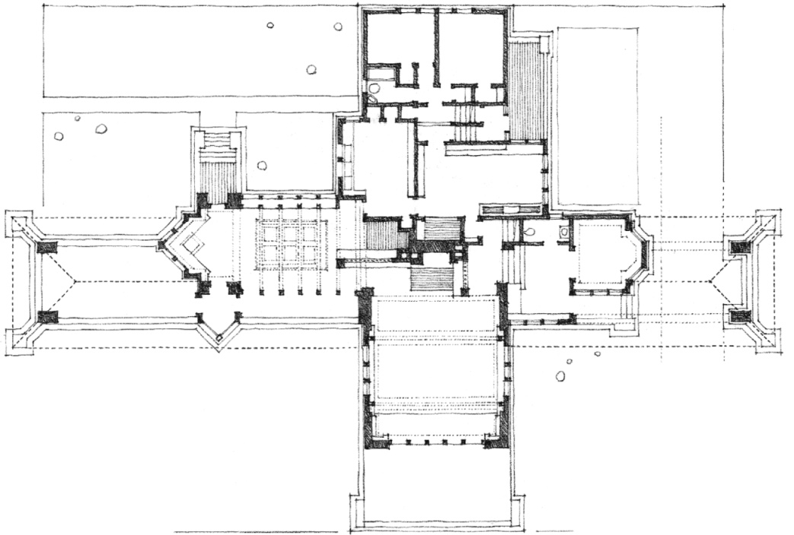

**Ward Willitts House**, Highland Park, Illinois, 1902

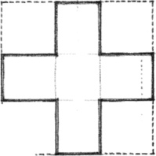

Transformation of a **Cruciform Plan Organization** by Frank Lloyd Wright

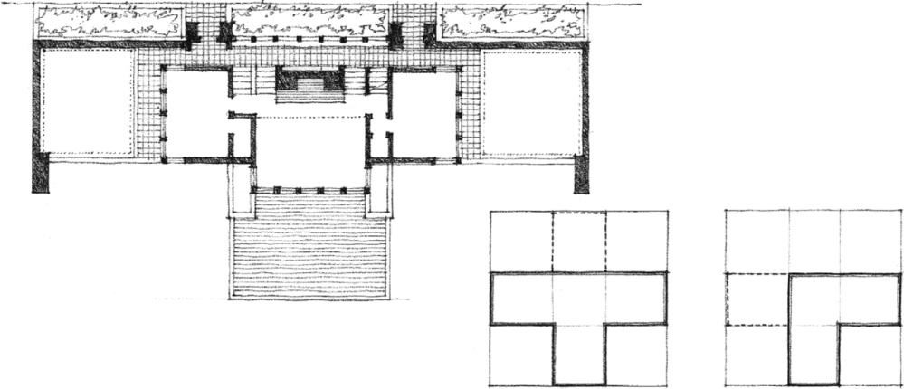

**Thomas Hardy House**, Racine, Wisconsin, 1905

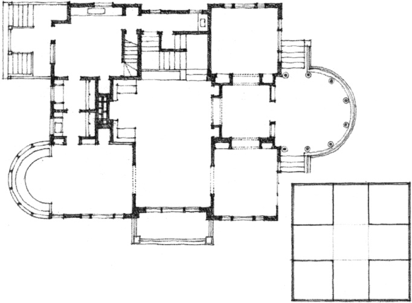

**George Blossom House**, Chicago, Illinois, 1882

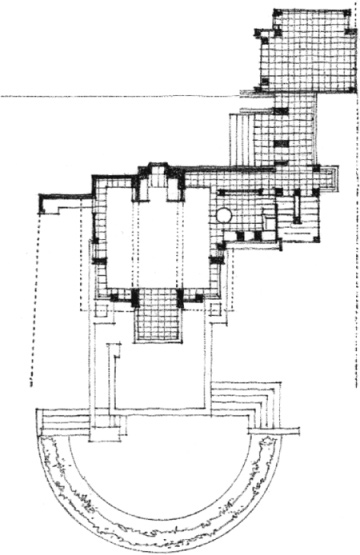

**Samuel Freeman House**, Los Angeles, California, 1924

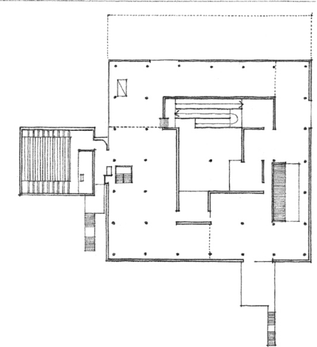

**Museum of Western Art**, Tokyo, 1957–1959

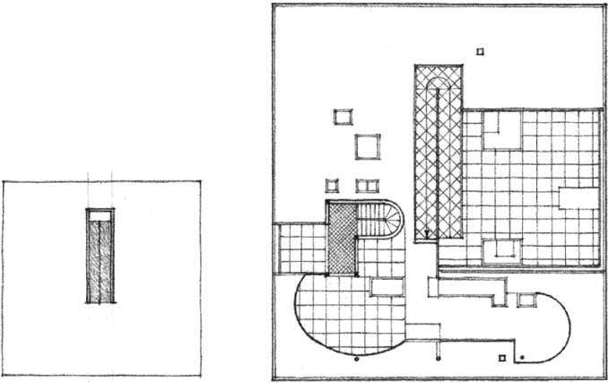

**Villa Savoye**, Poissy, France, 1928–1931

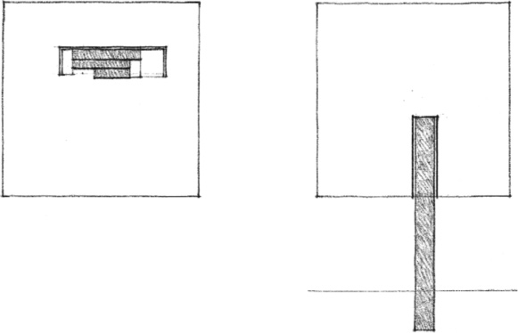

Transformation of a free-plan organization, the **Ramp-in-a-Square**, by Le Corbusier

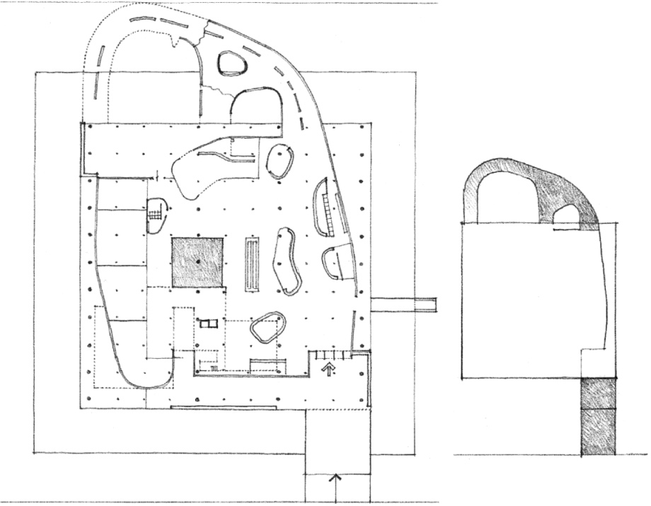

**Congress Hall** (Project), Strasbourg, 1964

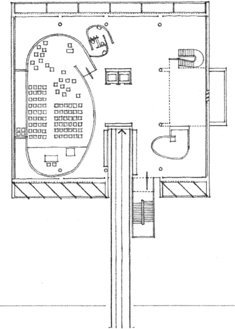

**Millowners’ Association Building**, Ahmedabad, India, 1954