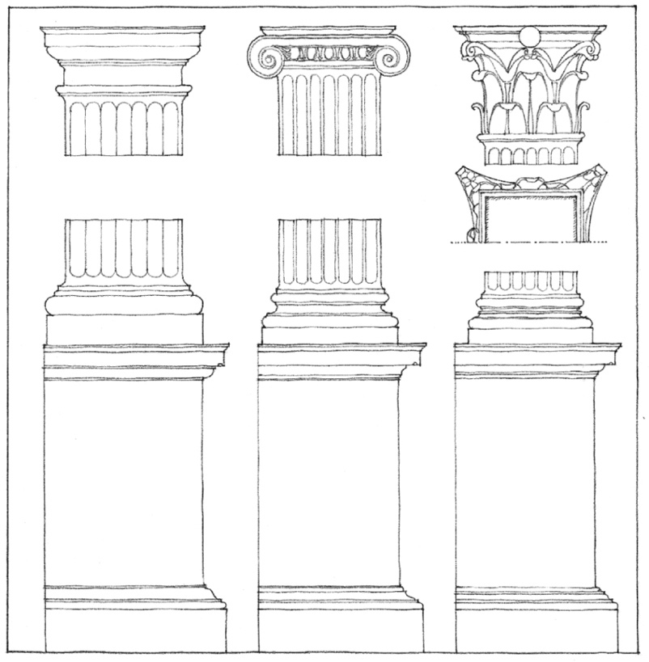
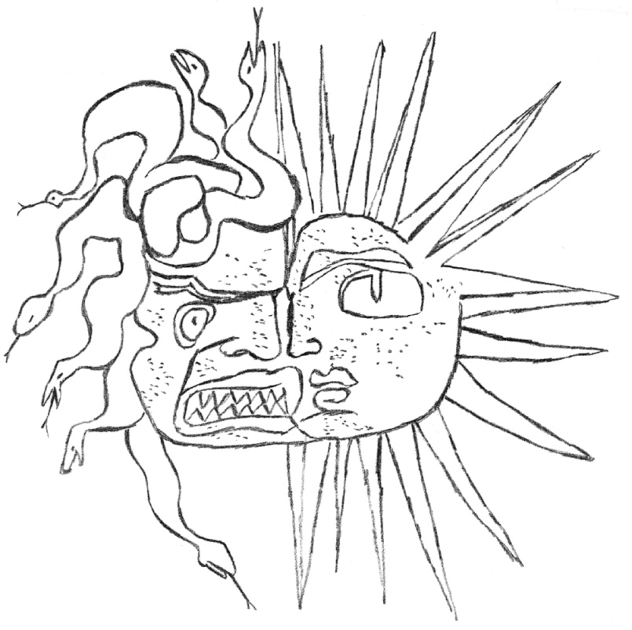

> [BREADCRUMB_CTX: 《Architecture》 > Conclusion]

## CONCLUSION

### Meaning in Architecture

This book, throughout its presentation of the elements of form and space, has been concerned primarily with the visual aspects of their physical reality in architecture. Points, moving through space and defining lines, lines defining planes, planes defining volumes of form and space. Beyond these visual functions, these elements, by their relationships to one another and the nature of their organization, also communicate notions of domain and place, entry and path of movement, hierarchy and order. These are presented as the literal, denotative meanings of form and space in architecture.

As in language, however, architectural forms and spaces also have connotative meanings: associative values and symbolic content that are subject to personal and cultural interpretation, which can change with time. The spires of a Gothic cathedral can stand for the realm, values, or goals of Christianity. The Greek column can convey the notion of democracy, or, as in America in the early 19th century, the presence of civilization in a new world.

Although the study of connotative meanings, of semiotics and symbology in architecture, is beyond the scope of this book, it should be noted here that architecture, in combining form and space into a single essence, not only facilitates purpose but communicates meaning. The art of architecture makes our existence not only visible but meaningful.

“You employ stone, wood, and concrete, and with these materials you build houses and palaces. That is construction. Ingenuity is at work.

“But suddenly, you touch my heart, you do me good. I am happy and I say: ‘This is beautiful.’ That is architecture. Art enters in.

“My house is practical. I thank you, as I might thank Railway engineers, or the Telephone service. You have not touched my heart.

“But suppose that walls rise toward heaven in such a way that I am moved. I perceive your intentions. Your mood has been gentle, brutal, charming, or noble. The stones you have erected tell me so. You fix me to the place and my eyes regard it. They behold something which expresses a thought. A thought which reveals itself without wood or sound, but solely by means of shapes which stand in a certain relationship to one another. These shapes are such that they are clearly revealed in light. The relationships between them have not necessarily any reference to what is practical or descriptive. They are a mathematical creation of our mind. They are the language of Architecture. By the use of raw materials and starting from conditions more or less utilitarian, you have established certain relationships which have aroused my emotions. This is Architecture.”

Le Corbusier  
*Towards a New Architecture*  
1927