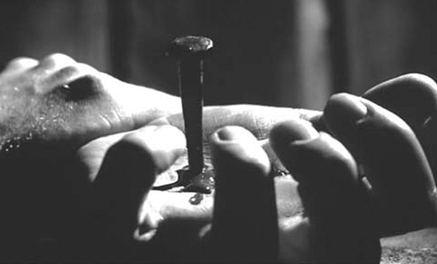
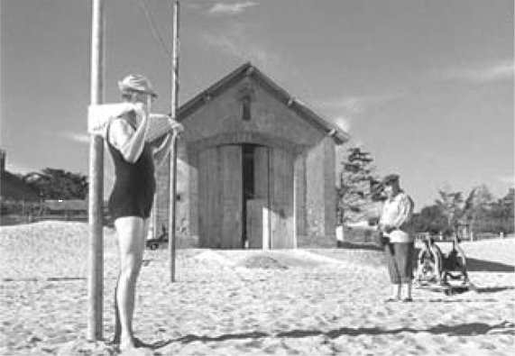

> [BREADCRUMB_CTX: 《Audio-Vision: Sound on Screen》 > 1. Projections of Sound on Image (Part 1)]

# 1. Projections of Sound on Image

1

PROJECTIONS OF SOUND ON IMAGE

The house lights go down, and the movie begins. Or at home or on a trip, we press PLAY. On the big or small screen, brutal and enigmatic images appear: a film projector running, a closeup of the film going through it, terrifying images of animal sacrifices, a nail being driven through a hand. Then, in more “normal” time, a mortuary. Here we see a young boy we take at first to be a corpse like the others, but who turns out to be alive—he moves, he reads a book, he reaches toward the screen surface, and under his hand there seems to form the face of a beautiful woman.

What we have seen so far is the prologue sequence of Bergman’s Persona (1967), a film that has been analyzed in books, in university courses, on internet sites. And the film might go on this way.

Stop! Let’s rewind Bergman’s film to the beginning and simply cut out the sound, try to forget what we’ve seen before, and watch the film afresh. Now we see something quite different.

First, the shot of the nail impaling the hand: played silent, it turns out to have consisted of three separate shots where we had seen one, because they had been linked by sound (figure 1.1). What’s more, the nailed hand in silence is abstract, whereas with sound, it is terrifying, real. As for the shots in the mortuary, without the sound of dripping water that connected them together we discover in them a series of stills, parts of isolated human bodies, out of space and time. And the boy’s right hand, without the vibrating tone that accompanies and structures its exploring gestures, no longer “forms” the face but just wanders aimlessly. The entire sequence has lost its rhythm and unity. Could Bergman be an overrated director? Did the sound merely conceal the images’ emptiness?

FIG. 1.1  Persona (1966). One of three shots of a nail hammered through a hand.

Next let us consider a well-known sequence in Tati’s Mr. Hulot’s Holiday (1953), where we laugh at the subtle gags taking place on a small beach (figure 1.2). The vacationers are so amusing in their uptightness, their lack of fun, their anxiety! This time, let’s cut out the visuals. Surprise: like the flipside of the image, another film appears that we now “see” with only our ears; there are shouts of children having fun, voices that resonate in an outdoor space, a whole world of play and vitality. It was all there in the sound, and at the same time it wasn’t.

Now if we give Bergman back his sounds and Tati his images, everything returns to normal. The nailed hand makes you sick to look at, the boy traces the shapes of faces, the summer vacationers seem quaint and droll, and sounds we didn’t especially hear when there was only sound emerge from the image like dialogue balloons in comics.

Only now we have read and heard differently.

Is the notion of cinema as the art of the image just an illusion? Of course: how, ultimately, can it be anything else? This book is about precisely this phenomenon of audiovisual illusion, an illusion located first and foremost in the heart of the most important of relations between sound and image, as I illustrated with Bergman: what I call added value.1

FIG. 1.2  Les vacances de Monsieur Hulot (1953). Suspicious looks onscreen, play and animated voices in the sound.

ADDED VALUE

By added value I mean the expressive and informative value with which a sound enriches a given image so as to create the definite impression, in the immediate or remembered experience one has of it, that this information or expression “naturally” comes from what is seen and is already contained in the image itself. Added value is what gives the (eminently incorrect) impression that sound is unnecessary, that sound merely duplicates a meaning that in reality it brings about, either all on its own or by discrepancies between it and the image.

The phenomenon of added value is especially at work in the case of sound/image synchronism, via the principle of synchresis (see chapter 3), the forging of an immediate and necessary relationship between something one sees and something one hears. Most falls, blows, and explosions on the screen, whether simulated or not, or created from the impact of nonresistant materials, only take on consistency and materiality through sound. But first, at the most basic level, added value is that of text, or language, on image.

Why speak of language so early on? Because the cinema is a vococentric, or, more precisely, a verbocentric phenomenon.

VALUE ADDED BY TEXT

Asserting that sound in the cinema is primarily vococentric is a reminder that it almost always privileges the voice, highlighting and setting the latter off from other sounds. During filming it is the voice that is collected in sound recording—which therefore is almost always voice recording—and it is the voice that is isolated in the sound mix like a solo instrument—for which the other sounds (music and noise) are merely the accompaniment.

I call vococentrism the process through which the voice spontaneously attracts and centers our attention in a mixture of sounds, in the same way that the human face directs our eyes in a movie shot. (Vococentrism can be diverted or attenuated by certain devices, to be discussed in chapter 8.) This is not to say that in classically vococentric films other sounds—noise and music—aren’t important, but they often act on a less conscious level.

By the same token, the historical development of synch sound-recording technology (for example, the invention of new kinds of microphones and sound systems) has concentrated essentially on speech, since of course we are not talking about the voice of shouts and moans but the voice as the medium of verbal expression. Thus what we mean by vococentrism is almost always verbocentrism.

Sound in film is voco- and verbocentric, above all, because human beings in their habitual behavior are as well. When in any given sound environment you hear voices, those voices capture and focus your attention before any other sound (wind blowing, music, traffic, a roomful of conversation). Only afterward, if you know very well who is speaking and what they’re talking about, might you turn your attention from the voices to the rest of the sounds you hear. So if these voices speak in an accessible language, you will first seek the meaning of the words, moving on to interpret the other sounds only when your interest in meaning has been satisfied.

If you are reading subtitles (which, in an effort to be concise and readable in a short time, cannot hope to match the original dialogue in style or completeness), they structure your vision, or rather your “audio-logo-vision.”

Subtitling plays an increasingly large part in film, for a variety of reasons. DVDs have menus that allow access to different languages, the internet circulates films throughout the world, and more and more films contain several languages that spectators need to distinguish in order to follow the story.

TEXT STRUCTURES VISION

An eloquent example that I used to use in teaching to demonstrate value added by text is a TV broadcast from 1984, a transmission of an air show in England, anchored from a French studio for French audiences by Léon Zitrone.2 Visibly thrown by these images coming to him over the wire with no explanation and in no special order, the valiant anchor nevertheless does his job as well as he can. At a certain point, he affirms, “Here are three small airplanes,” as we see an image with, yes, three little airplanes against a blue sky, and the outrageous redundancy never fails to provoke laughter in the classroom.