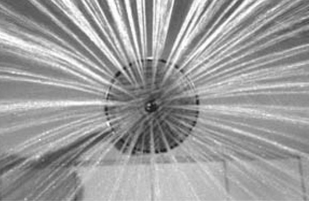

## 1. Projections of Sound on Image (Part 2)

> [BREADCRUMB_CTX: 《Audio-Vision: Sound on Screen》 > 1. Projections of Sound on Image (Part 2)]

Zitrone could just as well have said, “The weather is magnificent today,” and that’s what we would have seen in the image, where there are in fact no clouds. Or: “The first two planes are ahead of the third,” and then everyone would have seen that. Or else: “Where did the fourth plane go?” and the fourth airplane’s absence, this plane pulled out of Zitrone’s hat by the sheer power of the Word, would have jumped to our eyes. In short, the anchor could have made fifty other “redundant” comments, but their redundancy is illusory, since in each case these statements would have guided and structured our vision so that we would have seen them “naturally” in the image.

The weakness of Chris Marker’s famous demonstration in his 1958 documentary Letter from Siberia, where he dubs voiceovers of different political persuasions (Stalinist, anticommunist, etc.) over the same sequence of innocuous images, is that through his exaggerated examples he leads us to believe that the issue is solely one of political ideology, and that otherwise there exists some neutral way of speaking. But the added value that words bring to the image goes far beyond the simple situation of a political opinion slapped onto images. Added value engages the very structuring of vision by rigorously framing it. In any case, the evanescent film image does not give us much time to look (until videocassettes and then DVDs and digital files did), unlike a painting on a wall or a photograph in a book, which we can explore at our own pace and more easily detach from their captions or their commentary.

Thus if the film or TV image seems to “speak” for itself, it is actually a ventriloquist’s speech. When the shot of the three small airplanes in a blue sky declares “three small airplanes,” it is a puppet animated by the anchorman’s voice.

VALUE ADDED BY MUSIC: EMPATHETIC AND ANEMPATHETIC EFFECTS

There are two primary ways for music in film to create a specific emotion in relation to the situation depicted on screen.3 On one hand, music can directly express its participation in the feeling of the scene by taking on the scene’s rhythm, tone, and phrasing; obviously such music participates in cultural codes for things like sadness, happiness, and movement. In this case we can speak of empathetic music, from the word “empathy,” the ability to feel the feelings of others. This is the well-known effect created by a kind of music that is, or appears to be, in harmony with the tone of the scene—dramatic, tragic, melancholic. It may have nothing at all to do with the music taken in itself and only be produced in the particular relationship between the music and the situation onscreen, in which it then has added value. For this reason, music, too, is not “redundant” in any way.

On the other hand, music can also exhibit conspicuous indifference to the situation, by progressing in a steady, undaunted, and ineluctable manner, like a written text or a machine that’s running: the scene takes place against this very backdrop of “indifference.” This juxtaposition of scene with indifferent music has the effect not of freezing emotion but rather of intensifying it, by inscribing it on a cosmic background. I call this second kind of music anempathetic (with the privative a-). The anempathetic impulse in the cinema produces those countless musical bits from player pianos, merry-go-rounds, music boxes, and dance bands, whose studied frivolity and naiveté reinforce the individual emotion of the characters and of the spectator even as the music pretends not to notice them.

To be sure, this effect of cosmic indifference was already present in opera, for example at the end of Bizet’s Carmen, when Don Jose stabs the heroine as we hear the joyous crowd cheering the toreador in the arena nearby. But on the screen, the anempathetic effect has taken on such prominence that it seems to bear an intimate relation to the essence of cinema, which is its (well-disguised) mechanical nature.

FIG. 1.3  Psycho (1960). Anempathetic sound of the shower, which continues after the murder.

For, indeed, all films proceed in the form of an indifferent and automatic unwinding, that of the projection, which on the screen and through the loudspeakers produces simulacra of movement and life—and this unwinding must hide itself and be forgotten. What does anempathetic music do, if not to unveil this reality of cinema, its robotic face?

There also exist cases of music that is neither empathetic nor anempathetic, which has either an abstract meaning or a simple function of presence, a value as a signpost: at any rate, no precise emotional resonance (here we can speak of didactic counterpoint).

The anempathetic effect is most often produced by music, but it can also occur with noise—when, for example, in a very violent scene or after the death of a character, some sonic process continues, such as the noise of a machine, the hum of a fan, a shower running, as if nothing had happened. Examples of these can be found in Hitchcock’s Psycho (1960; figure 1.3) and Antonioni’s The Passenger (1975) or in the ongoing noise of the world in “musicless” dramatic films such as the Coen brothers’ No Country for Old Men (2007) or Bruno Dumont’s Flanders (2006).

INFLUENCES OF SOUND ON PERCEPTIONS OF MOVEMENT AND SPEED

Visual perception and auditory perception have much more disparate natures than one might think. The reason we are only dimly aware of this is that these two perceptions mutually influence each other in the audiovisual contract, lending each other their respective properties by contamination and projection.4

For one thing, each kind of perception bears a fundamentally different relationship to motion and stasis, since sound, contrary to sight, presupposes movement from the outset. In a film image that contains movement, many other things in the frame may remain fixed. But sound by its very nature necessarily implies a displacement or agitation, however minimal. Sound does have ways to suggest stasis, but only in limited cases.

One could say that “fixed sound” is sound that entails no variations whatever as it is heard. This characteristic is only found in certain sounds of artificial origin: a telephone dial tone, the hum of a speaker. Some natural sounds such as heavy rain or waterfalls can produce a rumbling close to white noise, too, but it is rare not to hear at least some trace of irregularity and motion. The effect of a fixed sound can also be created by taking a variation or evolution and infinitely repeating it in a loop.

DIFFERENCE IN SPEED OF PERCEPTION

Sound perception and visual perception have their own average pace by their very nature; basically, the ear analyzes, processes, and synthesizes faster than the eye. Take a rapid visual movement—a hand gesture—and compare it to an abrupt sound trajectory of the same duration. The fast visual movement will not form a distinct figure; its trajectory will not enter memory in a precise picture. But in the same length of time, the sound trajectory will succeed in outlining a clear and definite form, individuated, recognizable, distinguishable from others.

This is not a matter of attention. We might watch the shot of visual movement ten times attentively (say, a character making a complicated arm gesture) and still not be able to discern its line clearly. Listen ten times to the rapid sound sequence, and your perception of it will be confirmed with more and more precision.