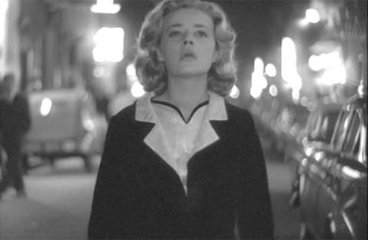

## 2. The Three Listening Modes (Part 3)

> [BREADCRUMB_CTX: 《Audio-Vision: Sound on Screen》 > 2. The Three Listening Modes (Part 3)]

First, let us clarify that this distinction is based on context and the listener’s competence. Nevertheless, in most cases everyone recognizes speech, even when we do not understand it (due to indistinct sound recording or foreign languages), because of certain properties that are apparently universal: the presence of a sequence of articulations we identify as vocal sounds. But sometimes the conventional terms we use make us forget that the object of our focus includes speech: those who study what they consider “music” in a film, for example, often forget—and neglect—that vocal music is sung with words.

Take the “In Paradisum” from Fauré’s Requiem, which plays for several seconds at the opening of Terrence Malick’s The Thin Red Line (1999). Is it important to recognize this French composer’s work? If you do, you affirm your cultural competence, but you will not be particularly enlightened regarding the meaning of the scene. What matters is that we are hearing sweet soft choral music, sung by the treble voices of women or children, with words singing something in Latin about paradise (the choir isn’t just engaged in a singing exercise). So we’re hearing collective speech in musical form, which we don’t have to understand so much as recognize as such, for it introduces another dimension.

Then if we wish to analyze the scene in closer detail, we must take into account not the “score” itself but the recorded sound that the director incorporated into his film.

Clearly, the distinction between music and noise relies very much on context, based on a system of values and knowledge both conscious and unconscious. Often the film sets the rules of the game, sometimes drawing clear boundaries between the two domains and making them impossible to confuse, at other times placing them along a continuum. In a science-fiction or action movie we might vacillate between recognizing a given audio element as noise issuing from the action or music coming from the composer. In another scene from the very same film there might be no doubt at all: recognizing an orchestra and melody points us squarely at music, even if we cannot identify it, because the “action noises” synched with concrete images are completely distinct from it. (George Lucas adopted the latter strategy for his Star Wars films, radically separating John Williams’s orchestral music from Ben Burtt’s sound effects.)

In summary, speech is identified as such by a cause perceived to be a voice, a gendered voice (gendered, that is, unless it’s that of a prepubescent child), and perceived to have a specific kind of output, a vocal modulation of articulations and continuities (what we call consonants and vowels in English). These factors lead us to recognize as speech the utterance of languages we don’t know, including invented languages such as that of the Na’avi in James Cameron’s Avatar (2009).

As for music, it is understood as such based on various factors. One results from causal listening (when we recognize musical instruments, even if we cannot always identify what they are), another from reduced listening (when we hear sounds of precise pitch, heard in sequence and/or together, in pitch and rhythmic relationships we feel are organized). Again, such perception depends on each spectator’s points of reference. The moment at the very beginning of Persona when the string instruments play rising glissandi is identified as music by those who recognize violins and by others as the sound of a siren.

Finally, we recognize a sound as a noise mainly through causal listening, especially by elimination: we say the source is neither vocal nor instrumental. Noises or sound effects constitute a kind of catchall category, being neither speech nor music.

THE MAIN PIVOT-DIMENSIONS AND THEIR USE

What I call a pivot-dimension is a property shared by sound elements of different categories (speech, music, noise); the common property allows a passage from one category to the other, or makes them resemble one another. The main pivot-dimensions and the easiest to identify are the sound’s pitch (when there is an identifiable pitch), rhythm (particularly when it has a regular beat), and register.

Pitch: A film can link diegetic noises and nondiegetic musical sounds because they sing on a common or closely similar tonic note. This is found in many transitions in musicals. In Minnelli’s The Band Wagon (1953), a tone from a steam locomotive braking at a train station leads into the orchestra that’s about to accompany Fred Astaire’s performance of “By Myself.”

Rhythm, when regular: An orchestral cue in a film can arise from a machine noise that has the same rhythmic beat as the music. In the many noise-to-music transitions heard in Lars von Trier’s Dancer in the Dark (2000), it’s the rhythm of physical objects in the diegetic space (machine, train, water, and, famously at the end, footsteps) that gives Selma access to her choreographic reverie and signals the beginning of a musical number.

Register: A film can make use of register (a sound’s position in the high-low range), especially extreme registers. A sequence can get us to hear, as quite proximate or even identical, very high or very low sounds in the diegetic environment or in the music. At the beginning of Casablanca (Curtiz, 1942), Max Steiner’s symphonic music dives into the bass register to become one with the engines of an airplane that has landed; during the shower murder in Hitchcock’s Psycho (1960), the screechingly high violin sounds evoke both bird cries and human shrieks.

THE NOTE AS PIVOT-DIMENSION BETWEEN NOISE AND MUSIC

Music may emerge from a noise, as in Louis Malle’s Elevator to the Gallows (1958), where Jeanne Moreau, who thinks her lover has abandoned her (he is actually stuck in an elevator), walks, beautiful and lost, through Paris streets at night while we hear the trumpet of Miles Davis. This brief sequence, which may well have spawned so many 1960s art films where elegantly dressed women mix with people in city streets (Anouk Aimée in La dolce vita, 1963; Jeanne Moreau again in Antonioni’s La notte, 1961; and Monica Vitti in L’eclisse, 1962), does not give us the feeling of a forced juxtaposition between the image of a woman walking and the sound of a solo trumpet—it simply works. As I see it, there are three reasons for this, specific to this film and to the directing of the sequence.

FIG. 2.1  Elevator to the Gallows (1958). Jeanne Moreau appears to sing to herself, along with the trumpet solo that accompanies her wandering.

The first has to do with the film’s lyrical structure. Right at the beginning, before the opening credits, adulterous bourgeoise Florence and her lover Julien exchange poetic intimacies on the phone. Florence says “Shut up,” and at that moment, we stop hearing the couple’s lines, and Davis’s trumpet begins playing. A simple idea: the trumpet takes over from speech, transposing onto a lyrical and musical plane the love-talk launched by the characters—it is a voice. So in the sequence where Florence walks alone at night, when the trumpet starts up anew, it evokes their previous amorous “duet.”

Second, if we watch Jeanne Moreau closely, at times we see her nod her head, like those grooving jazz aficionados of the era who did so to show their involvement in the music. Florence isn’t just roaming; she carries the music within her (figure 2.1).