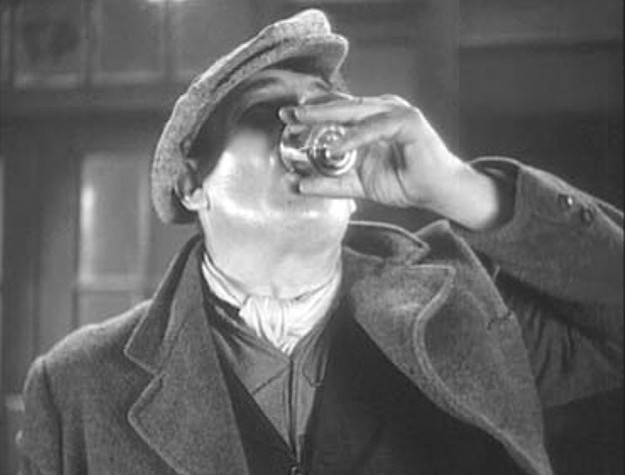

## 3. Lines and Points: Horizontal and Vertical Perspectives on Audiovisual Relations (Part 5)

> [BREADCRUMB_CTX: 《Audio-Vision: Sound on Screen》 > 3. Lines and Points: Horizontal and Vertical Perspectives on Audiovisual Relations (Part 5)]

Hailed as an event in the film world on its release in 1935, John Ford’s The Informer appeared for many years on numerous lists of movie masterpieces. Curiously enough, The Informer does not hold its place in film history so much for its own merits as for the legendary story of some gulps of beer.

I am referring to the anecdote, often cited as the height of ridiculousness in film-music aesthetics, about a drinker’s swallowing that The Informer’s composer, in a frenzy of mickeymousing, dared to imitate musically. (The Informer certainly had no monopoly on such imitative use of music—think of Gone with the Wind [Victor Fleming, 1938] and many others as well.) As early as 1937 we find the composer Maurice Jaubert claiming in an oft-quoted essay: “In The Informer, the technique [of synchronism] is carried to its highest point of perfection, in the cue which is supposed to imitate the sound of coins falling to the floor, and even—with a suggestive little arpeggio—the trickling of a glass of beer down the gullet of a drinker.”4

We can trace the lineage of this story through books on film music—including my own Le Son au cinéma, where, not having yet seen the film, I followed tradition and passed it on (which you should never do).5 But when Ford’s biographer Tag Gallagher tells the same anecdote and uses almost the same words (“beer gurgling in a man’s throat”), I suspect that he too is indebted to Jaubert. Here one witnesses the spontaneous formation of a legend.

The reality verified by watching the movie is that there is indeed a moment when the protagonist drinks, accompanied by a musical theme. But first, it’s a glass of whiskey, and second, the music at that moment couldn’t be less imitative (figure 3.1). Far from being a so-called suggestive little descending arpeggio, it is actually a resolute melody played on a solo French horn, ending with an upward jump of a diminished fifth, conveying something at once heroic and interrogative. It simply can’t be taken for gurgling. In fact, the viewer recognizes it as one of the score’s main themes—it is the first five notes of Gypo’s theme, which has already been heard during the opening credits. This motif accompanies the hero and is wedded to his fate throughout the film, in an expressive way rather than an imitative one.

FIG. 3.1  The Informer (1935). Victor McLaglen downs whiskey in one gulp, accompanied by a musical theme that has been much debated.

Max Steiner based his Informer music on a principle that would subsequently dominate nine out of ten film scores: the leitmotif. Each main character or key thematic idea of the narrative is assigned a musical motif that marks the character or idea and acts as its musical guardian angel. The main motifs belong to Gypo (expressively rather neutral and rather energetic and marcato, evoking Irish popular song) and to Katie, the prostitute with a heart of gold whom Gypo loves (espressivo and legato). Other leitmotifs include one for the symbolic character of the Blind Man, and so on. These musical themes are heard frequently in the orchestral score as “their” characters appear; they undergo changes that reflect variations in the characters’ external circumstances and internal states. The theorizing and systematizing of the leitmotif of course goes back to Wagner, but if there is one opera in particular that inspired Steiner for The Informer, it must be Debussy’s Pelléas et Mélisande. Despite his own caustic denunciation of leitmotif technique, Debussy too used it, trying to make it subtler by using more laconic, less pompous themes. Other Debussyesque touches in The Informer (as we shall see) are an insistence on silences and a penchant for interruptions—when music halts and speech comes to fill the vacuum.

The tendency here is to try to make a sound film into spoken opera, and in this endeavor we can see the hand of John Ford in an unusually close collaboration with the composer and set designer. The Informer has a predilection for stylization and symbolic expression, at a time when film had just suffered the assault of naturalism with the arrival of sound. Its stylization seeks to recapture the spirit of the silent film, perhaps even to achieve what the silent film could only dream of. The orchestra’s punctuation of gestures and dialogue aims to undermine their purely realist and concrete aspects in favor of making them into signifying elements in an overall mise-en-scène.

In fact, Steiner’s score hardly ever imitates the immediate materiality of the events. It does not emphasize the roar of the elements, doors closing or bodies falling, and when it is heard with a particular movement on screen, its contours carefully avoid imitating the visual movement’s form. Consider for example the scene to which Jaubert alludes from memory.

Let us recall that Gypo, the brutish outcast, has just turned in his friend Frankie, an Irish independence fighter wanted by the police, and he has received the reward money. He soon finds out that Frankie was killed upon arrest. When he enters a bar, orders a whiskey, and raises his head to drink, it’s because he is trying to forget. Gypo’s musical theme plays at this moment, suggesting that even in his absence to himself, his identity insistently hangs on. Gypo, the grieving partner in the couple he formed with Frankie—who treated him with affectionate condescension, as if he were the brain and Gypo the body—the incomplete Gypo will find himself only by sacrificing himself, and the film tells the story of his coming to consciousness.

Already in Wagner’s work there are themes in the orchestral fabric that embody a character’s unconscious, giving voice to what the character does not know about himself. For example, in the first act of Die Walküre, there is the sword motif, which (through the orchestra) works on Siegmund’s unconscious, even before he finds the weapon in the hut where he has taken refuge. The barroom scene in The Informer also seems replete with a sense of meditation, of the stirring of dark things, and of foretelling. It conveys something quite similar to Wagner’s opening act, which has a fragmented and discontinuous musical fabric that includes stops, reprises, and silences.

When the barkeeper returns the change to Gypo, four instrumental notes punctuate the coins’ falling. We might be tempted to consider this synchronism silly, but we must not forget that these coins are the money of betrayal, the money of Judas. The falling of the four coins is fatal: they open a running account that will culminate in the informer’s condemnation. (It’s by adding up all of Gypo’s expenditures and realizing their total equals the amount of the reward for Frankie that the independence fighters confirm their suspicions about Gypo.) All Max Steiner does here is adopt a common technique from opera that uses music for expressive symbolization of actions. Note first that the music does not substitute for the sound of the falling coins—the coins are heard diegetically at the same time (more or less). Second, the melodic shape here is precisely that of one of the score’s leitmotifs, the betrayal motif.

So what is there about these musical interventions that nevertheless feels like imitation? The answer is that they are isolated, singular moments that are synchronous. In opera the frequent synchronizing of music and action poses no problem, since it is an integral part of an overall gestural and decorative stylization. In the cinema such synchronization must be handled more discreetly, so as not to be taken as exclusively imitative or slip over into the mode of the cartoon gag.