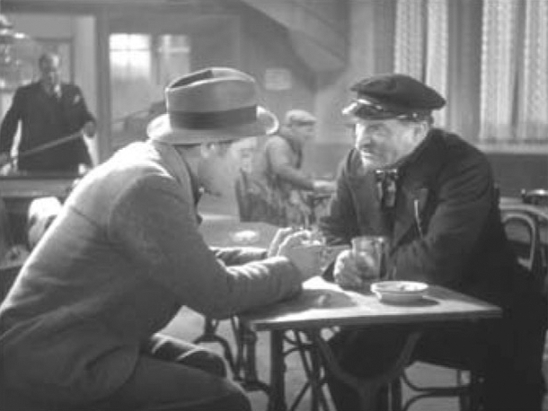
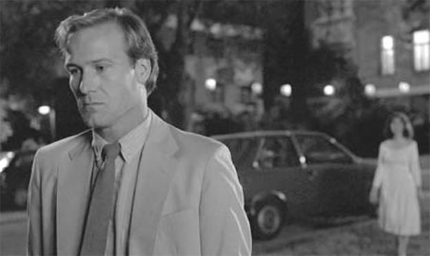

## 3. Lines and Points: Horizontal and Vertical Perspectives on Audiovisual Relations (Part 6)

> [BREADCRUMB_CTX: 《Audio-Vision: Sound on Screen》 > 3. Lines and Points: Horizontal and Vertical Perspectives on Audiovisual Relations (Part 6)]

What makes the use of music unique in certain scenes of The Informer, and what makes us notice it? It’s the way the music stops. Music cues do not get eclipsed by such things as doors opening or closing, as they would learn to do later in the 1930s. Instead, music in The Informer often gets interrupted bluntly and suddenly, in mid-phrase, producing a silence in which the subsequent dialogue resonates oddly. By stopping and passing the baton to speech, it seems as if the music is pointedly referring to itself rather than remaining unobtrusive. The cinema would henceforth tend to avoid this abrupt and conspicuous transition, preferring a more fluid relationship wherein music and scene were mixed more thoroughly together; music became more constant and at the same time more indistinct.

PUNCTUATION: ELEMENTS OF AUDITORY SETTING

I call elements of auditory setting (EAS), as opposed to ambient sounds (see chapter 4), sounds with a more or less singular source, which appear more or less intermittently and which help create and define a film’s space by means of specific, distinct small touches. Typical sounds of the auditory setting are the distant barking of a dog, a phone ringing in the office next door, or a police car’s siren. The EAS inhabits and defines a space, unlike a “permanent” sound such as the continuous chirping of birds or the noise of ocean surf that is the space itself.

FIG. 3.2  Le Quai des brumes (1938). The camera is about to change position and show the billiard ball being hit, its sound punctuating the silence between the two characters.

In a scene in Quai des brumes (Marcel Carné, 1938), characters are seated near a billiard table in a café in Le Havre. The captain of a freighter headed for Venezuela has a drink with protagonist Jean (Jean Gabin). Jean is an army deserter, but the captain believes he’s a painter and takes him on as a paying passenger. Amazed that Jean is going so far away with nothing but a suitcase, he ends by asking him, “And naturally you don’t know anyone?” (read: in France). Right after this line, the camera changes position, allowing us a clearer view of the billiard table behind the two men, where a player is preparing to make a shot. When the man hits the ball, the percussive sound serves both as punctuation to the captain’s question and to Jean’s answer: “No, no one.” At the same time, it signals the interval between the question and the response (figure 3.2).

Grace Kelly is introduced in Hitchcock’s Rear Window (1954) gliding around her photographer lover (James Stewart) and showing off the elegant gown she has donned to bring him his supper. Pretending to be meeting him for the first time, she kisses him; he plays along with, “Who are you?” She states her whole name as she walks through the apartment: “Lisa” (she turns a lamp on), “Carol” (she lights a second lamp), “Fremont” (a third). If you listen closely, you can hear after each light switch and each name, standing out in the distant muffled background noise of traffic, three small honks coming from the street. These horn sounds (tonic sounds in Pierre Schaeffer’s terms) function as musical notes and represent the equivalent of punctuation in an opera score, but they have been edited so as to appear fortuitous and natural. Hitchcock’s scene eloquently illustrates the punctuative and not just trivial role of sound—an esthetic of “organized fortuitousness.”

EASs are rarely noticed as such by critics, cinephiles, or scholars, in large part because they are not perceived as conventional rhetorical devices. It is difficult to pick them out unless one attends to them repeatedly.

The multiplicity of functions of elements of auditory setting reminds us that soundtrack analysis must constantly take into account the likelihood of overdetermination: that is, a filmic element often signifies on several different levels at once.

ANTICIPATION: CONVERGENCE/DIVERGENCE

From a horizontal perspective, sounds and images are not uniform elements all lined up like slats in a picket fence. They trend, they indicate directions, and they follow patterns of change and repetition that create a sense of expectation, hope, and plenitude to be broken or emptiness to be filled.

This effect is best known in connection with music. Musical form leads the listener to expect cadences; the listener’s anticipation of the cadence comes to subtend his or her perception. Speech can also work this way, when we await the end of a sentence, that final word that can topple the overall meaning of what has been uttered … or when the sentence goes unfinished. Similarly, there can be expectation with a sound classified as a noise—the sound of a car or of a train that approaches or recedes, a rhythm that speeds up or slows down.

For the eye as well: a camera movement, the rhythmic blinking of a light, a progression in an actor’s behavior can put the spectator in a state of anticipation. What follows either confirms or surprises the expectations established—and thus an audiovisual sequence functions according to this dynamic of anticipation and outcome.

We consciously or unconsciously recognize in an audiovisual sequence the beginnings of a pattern (e.g., a crescendo or accelerando) and then verify whether it evolves as anticipated. It is obviously more interesting when the expectation is subverted. And at other times, when everything ensues as anticipated, the sweetness and perfection of the rendering of the anticipation alone are sufficient to move us.

In Children of a Lesser God, just after William Hurt has left the dance and walks out into the night air, he turns and sees Marlee Matlin, dressed all in white, coming to join him. The volume of the music from the dance gradually decreases, fading in the mix. Consciously the spectator expects them to meet; less consciously, the spectactor expects the music to disappear when the lovers join—for there to be silence when they touch. This indeed is what happens, the convergence of a joining and a disappearance, but so precisely and subtly done that I am always moved when the disco music fades into silence and the reunited couple become still, all in one breath (figure 3.3).

Likewise, in Birdman, the many camera movements following in the footsteps of one character or another combine with changes in sound and musical ambience to crisscross the temporal convergence lines.

We never stop anticipating, and surprising anticipation, for this is the movement of desire itself.

SEPARATING: SILENCE

Bresson reminded us in a famous aphorism that the sound film is what made silence possible. This statement illuminates a paradox: it was necessary to have noises and voices so that their interruption could probe more deeply into this thing called silence, whereas in silent cinema, everything suggested sounds.

FIG. 3.3  Children of a Lesser God (1987). While Marlee Matlin talks with William Hurt outside, the sound of the party inside diminishes: two temporal convergence lines meet.

However, this zero-degree (or is it?) element of film sound that is silence is not so simple to achieve, even on a technical level. You cannot just interrupt the auditory flow and insert a few inches of blank leader. The spectator would have the impression of a technical break, which of course Godard used to full effect, particularly in Vivre sa vie (1962). Every locale has its own unique silence, and for this reason when sound is recorded on exterior locations, in a studio, or in an auditorium, care is taken to record several seconds of the “silence” or room tone specific to that place. This can be used later if needed behind dialogue, and it will create the desired sense that the space of the action is temporarily silent.