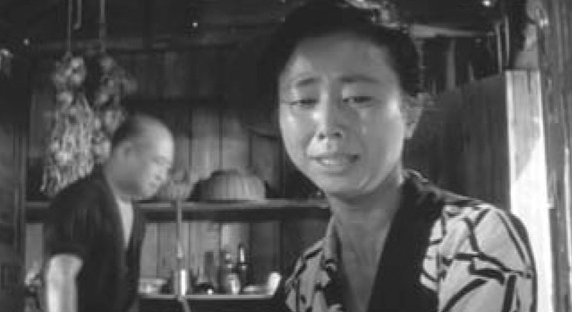
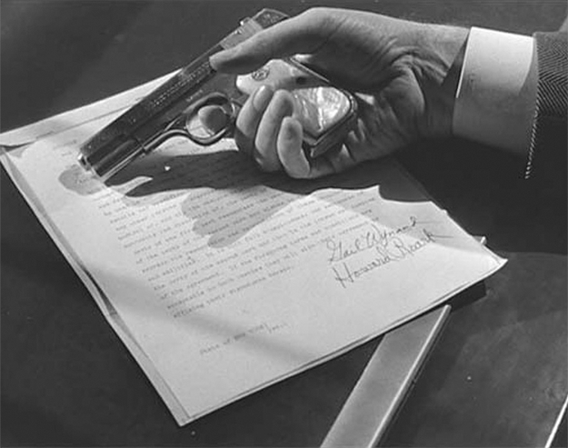

## 3. Lines and Points: Horizontal and Vertical Perspectives on Audiovisual Relations (Part 7)

> [BREADCRUMB_CTX: 《Audio-Vision: Sound on Screen》 > 3. Lines and Points: Horizontal and Vertical Perspectives on Audiovisual Relations (Part 7)]

The impression of silence in a film scene does not simply arise from an absence of noise. It results from a whole context, and from preparation—the simplest of which involves preceding it with a noise-filled sequence. In other words, silence is never a neutral void: it is the negative of sound we’ve heard beforehand or imagined, the product of a contrast.

Another way to express silence, which might or might not be associated with the procedures I have just described, has us hear … sounds. I mean here the subtle kind of sounds associated with calm. These do not attract attention; they are not even audible unless other sounds (of traffic, conversation, the workplace) cease.

There is a good example in Alien (1979), when Ridley Scott gives a closeup of the cat who is the spaceship’s mascot, in order to create a disconcerting silence to precede sinister developments. The shots leading up to this are sonically rich, preparing for the void that follows, but care has been taken that the silence doesn’t strike too suddenly. During the first three seconds of the shot of the cat we can hear a small unidentified tick-tock sound. Its presence on the soundtrack and then its rapid fadeout help form a bridge to total emptiness.

In Face to Face (1976), Bergman gets a very different effect by treating a ticking sound in the opposite way. A deeply depressed woman is preparing for bed. The ticking of the alarm clock on the night table, which had previously gone unnoticed, becomes louder and louder. Paradoxically we end up with an anxiety-producing impression of silence, which is all the stronger because the only sound there is is so intense and heightened by the lack of other sounds, bringing out this emptiness in a terrible way.

Film uses other sounds as synonyms for silence: faraway animal calls, a grandfather clock in a neighboring room, rustlings, and all the intimate noises of immediate space. Also, and somewhat strangely, a hint of reverb added to isolated sounds (for example, footsteps in a street) can reinforce the sense of emptiness and silence. Such reverb cannot be perceived when other sounds (e.g., daytime traffic) are heard at the same time.

The word silence really has two meanings: the absence or cessation of all sound, and the absence or cessation of speaking. The latter case defines entire films, which I call mutist.

MUTISM AND CONVERSATIONAL LULLS

Films such as The Thief (Russell Rouse, 1952), Kaneto Shindo’s The Naked Island (1960), Hukkle (Gyorgi Palfi, 2002), Le quattro volte (Michelangelo Frammartino, 2010), Alain Cavalier’s Libera Me (1993), and La Petite Bande by Michel Deville (1983) have very little dialogue or none at all, even while there are plenty of other diegetic sounds. The characters implicitly have vocalized speech at their disposal, but they do not use it. Sometimes this absence highlights a moment when someone for the first time emits a vocal sound, a laugh or a sob (figure 3.4). We can call these films mutist, as opposed to neo–silent films, in which the characters speak but we don’t hear them, as in the “silent” film era. These latter works, most of them in black and white, would include Sidewalk Stories (Charles Lane, 1989), Juha (Aki Kaurismaki, 1999), Telepolis (Esteban Sapir, 2007), and Biancanieves (Pablo Berger, 2012). An intermediate option is the laconic film, which for a while in France was popular in crime and detective films—where the characters weren’t completely without speech but have economized on the use of their vocal cords.

FIG. 3.4  The Naked Island (1960). The woman sobs at the loss of her child—a rare moment of vocal expression in this mutist film.

The second half of Tabu, by the Portuguese director Miguel Gomes (2012), is unique among the many neo–silent films that have appeared over the past thirty years. Unlike the others I have mentioned, it has numerous voices, but the voices are narrators. An iconogenic narrative voice (clearly textual speech, as I define it in chapter 8) takes over the story, which unfolds concurrently with what is said. Even if we do not hear the dialogue we see characters having, we do hear, at a lower volume than the voiceover, ambient sound and music (including vocal music) that the characters make or hear. For example, when the heroine swishes her hand in a pool while a man talks to her, we hear the rippling water but not the man’s voice (figure 3.5). Oddly, this sound design works perfectly well.

Let me add a case that is often overlooked: the silences between the remarks during a conversation, those moments, as we say in French, when an angel passes over. Think of Lynch’s Lost Highway (1997) and the first conversation between the husband and wife in the evening, in their bare, stylized surroundings. A good number of angels pass over during the weighty silences between Bill Pullman and Patricia Arquette, lulls that allow us to better hear the emptiness around and between them. It’s an emptiness embodied by very low instrumental sounds and suggested both by the restraint in their voices and by the restraint in the image, the darkness around the luminous points of the lamps.

FIG. 3.5  Tabu (2012). We hear the water being moved by Ana Moreira’s hand but not the voice of the man who is speaking to her.

POINT OF SYNCHRONIZATION AND SYNCHRESIS

A point of synchronization, or synch point, is a salient moment of an audiovisual sequence during which a sound event and a visual event meet in synchrony. It is a point where the effect of synchresis is particularly prominent, rather like a strongly accented chord in music.

The phenomenon of significant synch points generally obeys laws of gestalt psychology. A synch point sometimes emerges more specially in a sequence:

* As an unexpected double break in the audiovisual flow, a synchronous cut in both sound and image. This is characteristic of external logic.
* As a form of punctuation at the end of a sequence whose audio and visual tracks seemed separate until they end up together (synch point of temporal convergence lines).
* Purely by its physical character: for example, when the synch point falls on a closeup that creates an effect of visual fortissimo, or when one sound is louder than the rest.
* But also by its affective or semantic character: a word of dialogue that bears a strong meaning and is spoken in a certain way can be the locus of an important point of synchronization with the image.

A point of synchronization can stage the meeting of elements of quite disparate natures. For example, a visual cut can be coordinated with a word or group of words specially emphasized by the voiceover commentary.

Synch points naturally signify in relation to the content of the scene and the film’s overall dynamics. As such, they give the audiovisual flow its phrasing.

FIG. 3.6  The Fountainhead (1949). The hand of the man who has committed suicide falls. We do not see the gun go off, but we hear it.

FALSE SYNCH POINT

The deceptive or false cadence in Western music is a cadence that a particular melodic or harmonic progression sets us up for but that suddenly goes in a different direction and does not resolve as anticipated. In much the same way, audiovisual texts can have false synch points, which can be more striking than synch points that actually do occur. The typical example is the suicide scene of a corrupt and compromised official in John Huston’s The Asphalt Jungle (1950) or of the journalist who realizes he has lost his integrity in The Fountainhead (King Vidor, 1949), who shuts himself in his office, opens a drawer, takes out a pistol, and … All we get is the sound of a gunshot, since the picture editing takes us away from the action. We see only a hand fall (figure 3.6). To preserve good taste? Not entirely …

THROWAWAY SYNCH POINT