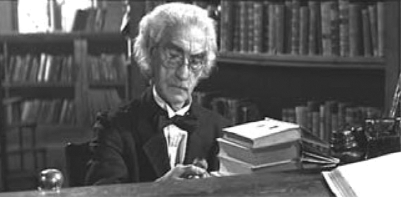
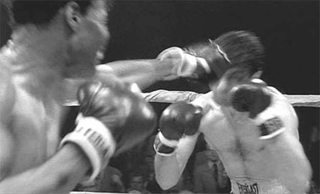

## 3. Lines and Points: Horizontal and Vertical Perspectives on Audiovisual Relations (Part 8)

> [BREADCRUMB_CTX: 《Audio-Vision: Sound on Screen》 > 3. Lines and Points: Horizontal and Vertical Perspectives on Audiovisual Relations (Part 8)]

In a lovely sequence in Death in Venice (1971), set in the early twentieth century, the composer von Aschenbach (Dirk Bogarde) sits down in his reserved spot on the Lido and looks around. The editing alternates between long shots of him and lengthy pans, zooms, and wide shots showing clusters of people on the luxurious cosmopolitan beach. The handsome young man who has piqued his interest appears and disappears among the bathers. At the same time we hear snippets of conversations in various languages, some heard close up (by whom, we might wonder?). Because we hear these acousmatic voices while the camera nonchalantly pivots and zooms, like the looking of a stationary person who is turning his head about, we expect to see what those chatty Poles whose voices are droning on look like. What’s beautiful is that there is only one synch point, which occurs very briefly, on the image of a female bather to whom an itinerant trader is trying to sell jewelry. The woman starts to laugh, and for a second the laughter we hear synchronizes with the sight of the woman’s face, before the camera turns away and she disappears from the frame. We may speak of a throwaway synch point, rather like the meeting of two melodic lines briefly forming a unison.

EMBLEMATIC SYNCH POINT: THE PUNCH

In real life a punch does not necessarily make noise, even if it hurts someone. In film or TV the sound of the impact is well-nigh obligatory—if it weren’t heard, no one would believe the punch, even if it were really inflicted. So punches are accompanied by sound effects as a matter of course. This momentary, abrupt co-incidence of a single sound and a visible impact is thus the most direct and immediate representation of the audiovisual synch point, in its role as the sequence’s punctuation. The punch becomes the moment around which the narration’s time is constructed: beforehand, it is announced, it is dreaded; afterward, we feel its shock waves, we confront its reverberations. It’s the audiovisual point toward which everything converges and out from which everything radiates. It is also the privileged expression of instantaneity in the audio-image.

The ultrabrief image of the punch all by itself would not be engraved into memory—it would tend to get lost. However, an ultrabrief but clearly delineated sound has the advantage of etching its form and tone directly into consciousness, where it can repeat as an echo. Sound is the rubber stamp that marks the image with the seal of instantaneity. Incidentally, to follow up on this very metaphor, think of the gag in Spielberg’s Indiana Jones and the Last Crusade (1989), when Harrison Ford finds himself in a library and needs to smash through a tile in the stone floor. Knowing his action will make noise, he takes advantage of an oblivious librarian who’s stamping dates into books—Indy synchronizes his heavy blows with the thumps of the fellow’s stamping. The librarian, duped by synchresis, marvels, thinking he is the one producing these huge sounds (figure 3.7).

FIG. 3.7  Indiana Jones and the Last Crusade (1989). The librarian looks at his stamp, marveling at how much noise it is making: Indiana Jones has used synchresis as a ruse.

But the most important object in audiovisual representation: the human body. What can the most immediate and brief meeting between two of these objects be? The physical blow. And what is the most immediate audiovisual relationship? The synchronization between a blow heard and a blow seen—or one that we believe we have seen. For, in fact, we do not really see the punch; you can confirm this by cutting the sound from a scene. What we hear is what we haven’t had time to see.

ACCENTED SYNCH POINTS AND TEMPORAL ELASTICITY

This audiovisual scenario of collisions has characterized many live-action films, notably in all martial-arts and fight movies. But 1980s Japanese animated films (the ones that I could see on French television) introduced an additional feature: a jerky breakdown of movement (as in Muybridge and Marey’s famous photos that lie at cinema’s origins), the use of slow motion and radical stylization of time. These diverse techniques derived inspiration from the slow motion and freeze-frames of sports replays but also directly from Japanese comic books or mangas. In these rudimentary animated adventures the synch point constituted by the punch, this moment when auditory continuity hitches up to visual continuity, is what allows time on either side of it to swell, fold, puff up, tighten, stretch, or, on the contrary, to gape or hang loosely like fabric. Otherwise put, on either side of a synch point such as a punch the capacity for temporal elasticity can become almost limitless. In certain Hong Kong action films (which in turn inspired so many films, including the Wachowskis’ Matrix trilogy, 1999–2003), the fighters can freeze in midair and midmovement and converse interminably, slowing down, speeding up, and changing poses like a series of separate photo slides, before resuming new flurries of kicks and punches at one another.

FIG. 3.8  Raging Bull (1980). The match where Sugar Ray Robinson beats Jake LaMotta: rendering of Foleyed punches.

The punch with sound effects is to audiovisual language as the chord is to music, mobilizing the vertical dimension and allowing for the stretching-out of time. In 1980, in the brutal boxing scenes in Scorsese’s Raging Bull (figure 3.8), punches with sound effects help create a maximum degree of temporal elasticity, with slow motion, repeated images, and so forth.

The paradox is that in the beginning, temporal elasticity was an inherent characteristic of silent film. Since the silents did not have to be dubbed point by point and second by second with synchronous sound, they could dilate and contract time with ease. With the arrival of sound this elasticity disappeared. And though it may have succeeded in reentering a few realist sound films, note that it shows up most insistently in action and combat sequences, such as those of Sam Peckinpah. In other words, temporal flexibility was not introduced into a sound-image relationship that is vague and asynchronous, but, on the contrary, it appears in scenes that have forceful points of synchronization, where blows, impacts, and explosions serve as strong reference points.

SYNCHRESIS

Synchresis (a word I forged in 1990 by combining synchronism and synthesis) is the spontaneous and irresistible weld produced between a particular sound event and a particular visual event when they occur at the same time. This join results independently of any rational logic.

Synchresis is responsible for our conviction that the sounds heard over the shots of the hands in the prologue of Persona are indeed the sounds of the hammer pounding nails into them. Synchresis is also what makes dubbing, postsynchronization, and sound-effects mixing possible, and it is what enables such a wide array of choice in these processes. For a single body and a single face on the screen, thanks to synchresis there are dozens of allowable voices—just as, for the bang of a hammer in the image or for the footsteps of someone we see walking, any one of hundreds of sounds will do.

Certain experimental videos and films demonstrate that synchresis can even work out of thin air—that is, with images and sounds that strictly speaking have nothing to do with one another, forming monstrous yet inevitable and irresistible agglomerations in our perception. The syllable fa is heard over a shot of a barking dog—synchresis is Pavlovian.