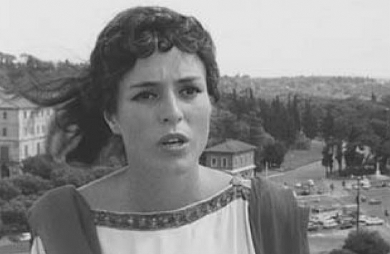

> [BREADCRUMB_CTX: 《Audio-Vision: Sound on Screen》 > 4. The Audiovisual Scene (Part 1)]

# 4. The Audiovisual Scene

4

THE AUDIOVISUAL SCENE

IS THERE A SONIC SCENE?

“THE IMAGE” = THE FRAME

Why in cinema do we speak of “the image” in the singular, when a film has thousands of them (only several hundred if it’s shots we’re counting, but these too are ceaselessly changing)?1 The reason is that even if films had millions, there would still be only one container for them. What “the image” designates in the cinema is not content but container: the frame.

The frame can start out black and empty for a few seconds (Ophuls’s Le Plaisir, 1952; Preminger’s Laura, 1944), for several minutes (L’Homme atlantique, Marguerite Duras, 1981), or, very rarely, from beginning to end (Blue, Derek Jarman, 1993, whose “image” is nothing but an empty blue screen throughout). But it nevertheless remains perceivable and present for the spectator as the visible four-sided rectangular place of the projection. The frame thus affirms itself as a preexisting container, which was there before the images came on and will remain after the images disappear (end credits reaffirm this role in a certain way).

What is specific to cinema is that it has just one place for images—as opposed to video installations, slide shows, Sound and Light shows, and other multimedia genres, which can have several. This accounts for why we speak of the image in the singular.

Let us recall that the early years of the cinematograph sought to soften the hard borders of the frame through irising, masking, or haloing, similar to such effects practiced in photography. But these techniques were gradually abandoned, and aside from the odd experiment with changing frame dimensions within a single film (Max Ophuls in Lola Montes, 1955), the principle of the full-frame image came to dominate in 99.9 percent of movies. Today also, very few films change their screen ratio during the projection; a rare one that does is Jia Zhangke’s Mountains May Depart (2015).

Experiments with multiscreen films, such as Abel Gance’s Napoleon (1927) and Michael Wadleigh’s Woodstock (1970), have not spawned many descendants either. The same goes for divided-screen films. Films with divided screens, such as Paul Morissey’s Forty Deuce (1982), Mike Figgis’s Timecode (2000), and split-screen sequences by directors including Norman Jewison and Brian De Palma—as well as in some musicals (It’s Always Fair Weather, Stanley Donen, 1955) and comedies (Annie Hall, Woody Allen, 1977)—make only occasional appearances. As exceptions, they reinforce the rule of the classical frame.

This visual frame for the visible exists even in the increasingly frequent 3D films watched with glasses. On one hand, this is because the image can extend into the theater only along the contours of a kind of parallelepiped tunnel; on the other hand, these films will most often be seen, discovered, and exploited only in two-dimensional viewing conditions, on computer or tablet screens with which they are “compatible.”

A case that’s still very marginal for cinema is the so-called immersive 360-degree image, which is experienced with a helmet or wraparound mask allowing you to see in front of and behind yourself by moving your head or turning. It, too, makes us conscious of the existence of another limited frame, even if the edges are indistinct. This frame, beyond which we cannot go, is that of our own vision.

THERE IS NO AUDITORY CONTAINER FOR SOUNDS

But in cinema as well as in life, there is no auditory container for sounds analogous to this visual container for images that is the frame. The frame has the dual properties of spatially delimiting what is in the work and of structuring that content. For sound, there is neither frame nor preexisting container.

What do sounds do when put together with a film image? They arrange themselves in relation to the frame and its content. Some are embraced as synchronous and onscreen; others meander at the surface and on the edges as offscreen. Still others position themselves clearly outside the diegesis, in an imaginary orchestra pit (nondiegetic music), or on a balcony of sorts, the place of voiceovers. In short, sounds are triaged in relation to what we see in the image, and these assignments are constantly subject to revision depending on changes in what we see. This is why I define cinema generally as “a place of images, plus sounds,” with sound being “that which seeks its place.”

We constantly see this distinction demonstrated in contemporary films when a cell phone starts ringing. At first it is impossible to tell if the ringing is coming from a moviegoer in the theater or from the action on screen. There is no parallel situation for the image, no equivalent possibility for confusion.

If we can speak of an audiovisual “stage” or scene, it is because the scenic space has boundaries; it is structured by the edges of the visual frame. Film sound is that which is contained (or not contained) in an image; there is no place of the sounds, no auditory scene already preexisting the soundtrack—and therefore, in both the perceptual and aesthetic senses, there is no soundtrack.

In the context of the monaural film, however, such an idiosyncratic work as Jean-Marie Straub’s and Danièle Huillet’s 1969 Othon, which acts out a Roman tragedy by Corneille in a modern-day Roman location, demonstrated what a sound scene or an auditory container of sounds might be. One might consider that the sounds are the actors’ voices declaiming their lines, and the “container” is the hum of distant traffic in which their speech is heard. Actors in Othon declaiming Corneille’s text in verse often speak offscreen, yet such voices are not perceived as the traditional offscreen voice entirely determined by the image. Their voices seem to be “in the same place” as the voices of actors we do see, a space defined by the background noise. A related effect can be felt more subtly in Jacques Rivette’s La Religieuse (1967). Here, the reverb on voices, resulting from direct sound as with Straub and Huillet, has a similar function of enveloping and homogenizing the voices; it inscribes them in a space, just like the medium of city traffic noise does in Othon. The price each film pays is a relative loss of intelligibility, heightened in Othon by the foreign accents of some of the actors (figure 4.1).

FIG. 4.1  Othon (1969). Nineteen centuries after the fact, in direct sound on the real location, a Roman tragedy by Corneille.

At least all this held true until the arrival of Dolby, which now creates a space with fluid borders, a sort of superscreen enveloping the screen—the superfield, which I will discuss further in chapter 7. But the superfield does not altogether upset the structure I have described, even if it has set it tottering on its base.

THE IMAGE “MAGNETIZES” MONAURAL SOUND IN SPACE

What does a sound typically lead us to ask about space? Not “where is it?”—for the sound “is” in the air we breathe, or, if you will, as a perception it’s in your head (tinnitus for example)—but rather, “where does it come from?” The problem of localizing a sound therefore most often translates as the problem of locating its source.