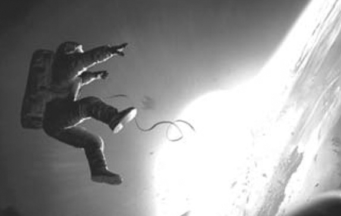

## 4. The Audiovisual Scene (Part 2)

> [BREADCRUMB_CTX: 《Audio-Vision: Sound on Screen》 > 4. The Audiovisual Scene (Part 2)]

Traditional monaural film (the vast majority of films made until the mid-1980s) presents a strange sensory experience in this regard. The point from which sounds physically issue is often not the same as the point on the screen where these sounds are supposedly coming from, but the spectator nevertheless perceives the sounds as arising from these “sources” on the screen. In the case of footsteps, for example, if the character is walking across the screen, the sound of the footsteps seems to follow his image, even though in the real space of the movie theater they continue to issue from the same stationary loudspeaker. If the character is offscreen, the footsteps are perceived as being outside the field of vision, an “outside” that’s more mental than physical. In any case, we experience the sound of the steps as not coming from the screen.

Moreover, if under particular screening conditions the loudspeaker is not located behind the screen but placed somewhere else in the room, or in an outdoor setting (at a drive-in, for example), or if the soundtrack resonates in our head by means of earphones (watching a movie on an airplane or train), these sounds will be perceived no less as coming from the screen, in spite of the evidence of our own senses, which should easily be able to determine that in reality they’re coming from an entirely different place. Except—and this is an important exception—if the sound moves from one speaker to another.

Thus in the cinema there is spatial magnetization of sound by image. When we perceive a sound as being offscreen or located at screen right, this is a mental phenomenon, at least in the case of monaural projection.

Spatial magnetization does not work when sounds are actually moving among the loudspeakers in the auditorium. It does function if the sound comes from a speaker placed outside the screen but does not move from it.

The problem with efforts at real spatialization made during the first years of multitrack sound—wherein the sound is really situated to the left of the screen or in its left section—is precisely that these efforts collided with mental spatialization. Mental spatialization had been a blessing for sound film because it allowed movies to function quite well for over forty years. We only need imagine the chaos that would have arisen if filmmakers had had to make sounds issue from the points where the sound sources were shown. They would have had to install beehives of speakers behind the screen and along its perimeter (this strategy was actually attempted), not to mention the headaches of audiovisual matching that would have ensued.

Modern filmmakers using Dolby learned from these first efforts in realistic spatialization and their “in-the-wings” effects (see the “Multitrack Cinema” section in this chapter). Today’s multitrack mixes often strike a compromise between mental and real localization.

Even in the classic case of a single loudspeaker, there is nevertheless one real sonic dimension to which the sound cinema had recourse and that it often neglected later: depth, the sense of distance from the sound source. The ear detects depth from such indices as a reduced harmonic spectrum, softened attacks and transitions, a different blend of direct sound and reflected sound, the presence of reverb, and diminished volume.

This factor of depth is what struck critics about experiments with sound perspective in a number of early sound films, including René Clair’s Sous les toits de Paris (1930), Howard Hawks’s Scarface (1932), Raymond Bernard’s Wooden Crosses (1932), and Fritz Lang’s M (1931). It should be noted, however, that this sound perspective was not so much a real depth (necessarily situating the sound source to the rear of the spatial plane of the screen) as a distance interpreted by the spectator in different directions depending on what she or he saw on the screen and could infer about the location of the sound source.2

Thus to mental localization, which is determined more by what we see than by what we hear (or rather by the relationship between the two), we may oppose the absolute spatialization made possible by multitrack film sound. The latter is spatialization of which the spectator is physically aware and accepts its conventions. Gravity (Alfonso Cuarón, 2013) illustrates this well: as Dong Liang has remarked, the sounds continue offscreen to follow the place where the characters are supposedly situated in the vacuum of space—when there is really no sound in space and what we hear is only what resonates in the heads of these characters, linked by radio communication (figure 4.2).3

FIG. 4.2  Gravity (2013). Where in the theater should you situate the voice of a character in a spacesuit orbiting Earth?

THE ACOUSMATIC

Acousmatic, a word of Greek origin found by Jérôme Peignot and theorized by Pierre Schaeffer, describes “sounds one hears without seeing their originating cause.”4 Radio, records, and telephone, all of which transmit sounds without displaying their emitter, are acousmatic media by definition, unlike Skype, for example.

What can we call the opposite of acousmatic sound? Schaeffer proposed “direct,” but since this word lends itself to so much ambiguity, I prefer visualized sound, that is, sound accompanied by the sight of its source or cause.

There are cases where a sound is acousmatic even though logically we know that it comes from a source inside the frame but hidden by a wall, fence, banner, or simply darkness (in fantasy or science fiction it might really be “inside the frame” but invisible). We should avoid confusing acousmatic with offscreen; the latter means outside the field included in the film frame. A sound coming from offscreen is always acousmatic, but the opposite is not necessarily true.

Let me repeat that cause depends on context. A character is surprised to hear a voice; she then identifies this voice as coming from a radio. If the fact of the radio as source (no one is there physically to threaten her) is more important for the character than the identity or face of the person speaking, the relevant cause is the radio, and the sound can be considered “visualized.”

VISUALIZED OR ACOUSMATIC

In a film an acousmatic situation can develop along two different scenarios: either a sound is visualized first and subsequently acousmatized, or it is acousmatic to start with and is visualized only afterward.

The first case associates a sound with a precise image from the outset. This image can then reappear with greater or lesser distinctness in the spectator’s mind each time the sound is heard acousmatically. It will be an “embodied” sound, identified with an image, demythologized, classified. A good example would be the tram’s bell in Bresson’s A Man Escaped (1956).

The second case, common to moody mystery movies, keeps the sound’s cause a long-held secret before finally revealing it. The acousmatic sound maintains suspense, constituting a dramatic technique in itself. A theatrical analogy to this treatment of sound might be to announce and then to delay a stage entrance; think of Tartuffe, who finally enters in the third act of Molière’s play. Cinema gives us the famous example of M; for as long as possible, the film conceals the physical appearance of the child-murderer whose voice and maniacal whistling are heard from the outset. Lang preserves the mystery of the character as long as he can before deacousmatizing him.

A sound or voice that remains acousmatic creates a mystery of the nature of its source, its properties, and its powers, given that causal listening cannot supply complete information about the sound’s nature and the events taking place.

It is fairly common in films to see evil, awe-inspiring, or otherwise powerful characters introduced through sound before they are subsequently thrown out into the pasture of visibility, deacousmatized.