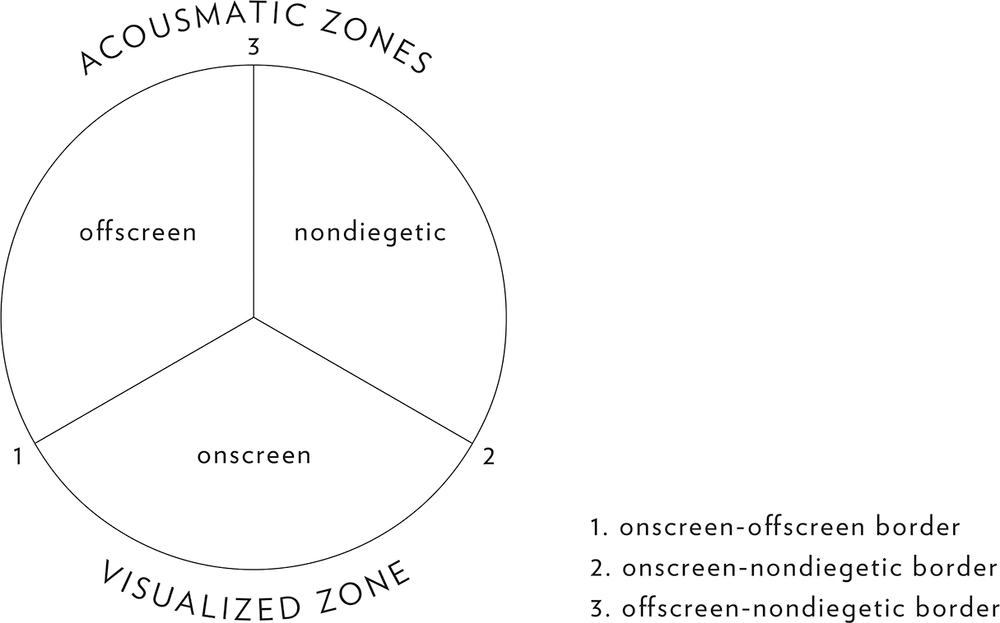

## 4. The Audiovisual Scene (Part 3)

> [BREADCRUMB_CTX: 《Audio-Vision: Sound on Screen》 > 4. The Audiovisual Scene (Part 3)]

The opposition between visualized and acousmatic provides a basis for the fundamental audiovisual notion of offscreen space.

OFFSCREEN SOUND

ONSCREEN, OFFSCREEN, NONDIEGETIC

The issue of offscreen sound has long dominated an entire field of thinking and theorizing about film sound, and it occupies a central place in my first two books on sound as well. Although we can see now that it seems to have been privileged at the expense of other avenues of investigation, it has yet to lose its importance as a central problem—even if the recent evolution of film sound, involving mainly multitrack sound and the superfield it establishes, has modified some of its basic traits.

In the narrow sense, offscreen sound in film is sound that is acousmatic relative to what is shown in the shot: sound whose source is invisible, whether temporarily or not. We call onscreen sound that whose source appears in the image and belongs to the reality represented therein.

I shall use the term nondiegetic to designate sound whose supposed source is not only absent from the image but also external to the story world.5 This is the widespread case of voiceover commentary and narration and, of course, of musical underscoring.

DO EXCEPTIONS DISPROVE THE RULE?

In Le Son au cinéma (1985) I pictured onscreen, offscreen, and nondiegetic as three zones of a circle, wherein each communicates with the other two (figure 4.3).

The basic distinction of onscreen-offscreen-nondiegetic has been criticized as being obsolete and reductive, largely because of the exceptions and special cases it doesn’t seem to account for.

For example, where should we situate sounds (usually voices) that come from electrical devices located in the action and that the image suggests or directly shows: telephone receivers, radios, public-address systems? For me, the answer remains tied to the contextual aspect of figurative-causal listening in cinema.

What about a character who speaks with his back to us, so we don’t actually see him speak? Is his voice acousmatic (offscreen)? And what can we say about the so-called internal voice of a character seen in the image—the voices of his conscience, of his memory, of his imaginings and fantasies?6 My answer remains the same.

FIG. 4.3  The three-zone circle.

Or take Amy Heckerling’s Look Who’s Talking, where an adult voice accompanies the facial expressions of a baby and articulates the baby’s thoughts and feelings, even though the baby obviously lacks the physical and intellectual abilities to do so. The voice is definitely connected to the present action, but it is not visualizable, so it seems unconcerned with these distinctions, being tied to the image via the loosest of synchronization.

How should we classify general background sounds such as birdsongs and wind, which are heard in conjunction with natural exteriors? It seems rather ridiculous to characterize them as offscreen on the basis that we don’t actually see little birds chirping or wind blowing.

All these exceptions, though slightly irksome, do not by any means negate the validity or interest of a basic distinction between onscreen, offscreen, and nondiegetic sound or of the basic division between acousmatic and visualized. Anyone who brings up such objections in order to claim the categories useless or trivial is throwing out the baby with the bathwater. Why reject a valuable distinction simply because it isn’t absolute? It is a mistake to view the matter in terms of all-or-nothing logic; the distinctions need to be considered in a geographical, topological, and spatial perspective, analogous to zones among which one finds many shades, degrees, and ambiguities. Of course we should continue to refine and fill in our typology of film sound. We must add new categories—not claiming thereby to exhaust all possibilities but at least to enlarge the scope, to recognize, define, and develop new areas.

AMBIENT SOUND (TERRITORY SOUND)

Ambient sound is sound that envelops a scene and inhabits its space without overtly raising the question of identifying or visually confirming its source: birdsong, the clatter of a cafeteria or buzz of a shopping mall, the roar of the engine room in a ship’s hold. We might also call these sounds territory sounds because they serve to identify a particular locale through their pervasive and continuous presence.

INTERNAL SOUND

Internal sound is sound that, although situated in the action, corresponds to the physical and/or mental interior of a character. Physiological sounds of breathing, moans, or heartbeats could also be called objective-internal sounds. The category of internal sounds also includes mental voices, memories, and so on, which I call subjective-internal or mental-internal sounds.

Bruce Willis’s voice in Look Who’s Talking is, then, an internal voice, partly externalized through gesture. The film establishes it as not being heard by the other characters. In the voice of the adult that the baby will become, it tells us what the baby might be thinking, even as this voice is associated with the gestures in a way faithful to codes of realism regarding the baby’s physical abilities.

Sounds of tinnitus (ringing, buzzing, roaring, hissing), which are certainly not imaginary for those who hear them, can be classified in the category of objective-internal sounds.

“ON-THE-AIR” SOUND

I refer to sounds in a scene that are supposedly transmitted electronically as on-the-air—transmitted by radio, mobile phone or landline, intercom, public-address system, and so on—sounds that consequently are not subject to “natural” mechanical laws of sound propagation and can thus freely travel through space even while remaining in the real time of a scene. Music of this sort can also travel easily between screen-music and pit-music status. Often the film plays a kind of game with the spectator, who is made to vacillate between hypotheses about it (is it from a radio? is it pit music?); the hypotheses do not cancel out, since they all can be true or possible at a given moment.

A particular case of on-the-air sound is recorded or broadcast music. Depending on the particular weight given by such factors as mixing, levels, use of filters, and conditions of music recording—i.e., whether the emphasis is on the sound’s initial source (the real instruments that play, the voice that sings) or on the end source (the loudspeaker present in the story, whose material presence is felt through the use of equalization, static, and reverb), the sound of on-the-air music can transcend or blur the zones of onscreen, offscreen, and nondiegetic. It can also be read, to greater or lesser degrees, as screen music or pit music. Road movies such as Barry Levinson’s Rain Man (1988) constantly play with this oscillation. George Lucas’s American Graffiti, with the help of its sound designer Walter Murch, as early as 1973 explored the entire range of possibilities between these two poles. The film was based on the simple setup of placing its characters in their cars for much of the action, all listening to a single rock-’n’-roll station.