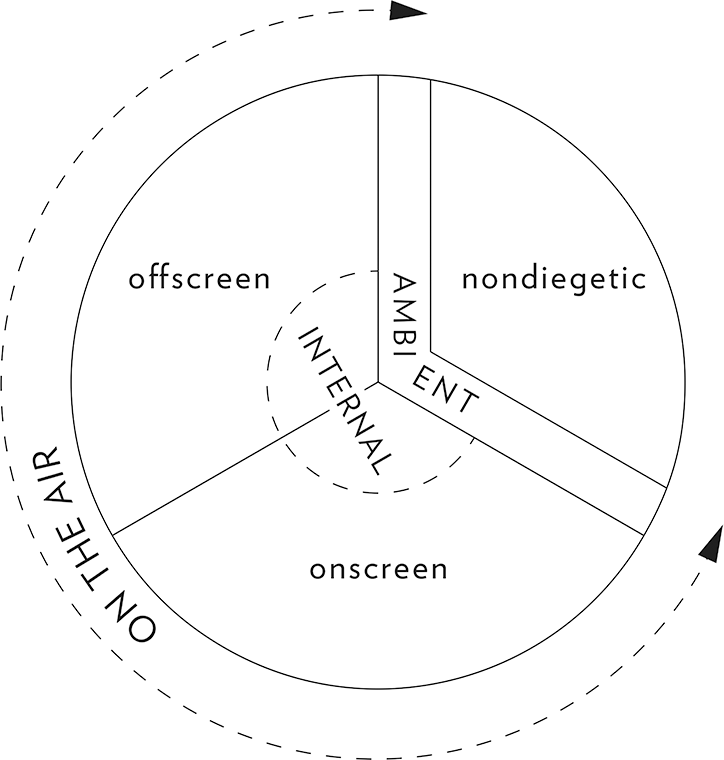

## 4. The Audiovisual Scene (Part 4)

> [BREADCRUMB_CTX: 《Audio-Vision: Sound on Screen》 > 4. The Audiovisual Scene (Part 4)]

The same problem obtains for dialogue that the story presents as being recorded: are we attending to the moment of its production or the moment when we are hearing it? Imagine a scene in a film where a man is listening to a taped interview. If the sound has technical qualities of directness and presence, it refers back to the circumstances of its original state. If it has aural qualities that highlight its recordedness, and if there is emphasis on the acoustic properties of the place where it is being listened to in the diegesis, we tend to focus on the moment where the recording is being heard. The Passenger has a sequence where Jack Nicholson listens to the recording of a conversation he had with a man he met. Antonioni shuttles from one position to the other and in this way leads into a flashback. The interview Nicholson is listening to becomes real, becomes the scene of the interview itself.

So our tripartite circle is becoming more complicated but also richer (figure 4.4). Through the very exceptions introduced, it continues to illustrate the dimensions and oppositions involved:

* the opposition between acousmatic and visualized;
* the opposition between objective and subjective or real and imagined;
* the differences between past, present, and future.

It is important to see the circle as consisting of interlocking sectors. (This might be better expressed with a topological model in three dimensions.) We also return to the question of the source, which conditions such distinctions.

FIG. 4.4  The three-zone circle, refined.

PLACE OF THE SOUND, PLACE OF THE SOURCE

The place of a sound and the place of its source are not the same. In a film the emphasis may fall on one or the other, and the onscreen-offscreen question will arise differently, according to which thing—the sound or its cause—the spectator reads as being “in” the image or “outside” it. For sound and cause, though quite distinct, are almost always confused. But surely this confusion is also located at the very heart of our experience, an unsettling knot of problems.

For example, the sound of a shoe’s high heel striking the floor in a reverberant room has a very particular source. But as a sound that’s an agglomerate of many reflections on different surfaces, it can fill as big a volume as the room in which it resonates. Indeed, no matter how precisely a sound’s source can be identified, the sound itself is by definition a phenomenon that tends to spread out, like a gas, into all the available space.

In the case of ambient sounds, which are often the product of multiple specific and local sources (a brook, bird songs), what’s important is the space inhabited and defined by the sound more than the sound’s multisource origin. The same goes for films of musical performances. Depending on choices in the editing and technical directing of sound and image, the emphasis can fall either on the specific material source of the sound (the instrument, the singer) or on the sound as it fills the auditory space, considered independently from the source.

Generally, the more reverberant the sound, the more it expresses the space that contains it. The deader it is, the more it tends to refer to its material source. The voice represents a special case. When the voice in a film is heard in sound closeup without reverb, it can be a voice the spectator internalizes as his or her own.

THE EXCEPTION OF MUSIC

I have given the name pit music to music that accompanies the image from a nondiegetic position, that is, outside the space and time of the action. The term refers to the classical opera’s orchestra pit. I call screen music music that arises from a source located directly or indirectly in the space and time of the action, even if this source is a radio, an offscreen musician, or a character’s headphones.

These terms, which I developed over the course of my writings on sound film, accord with a distinction that has long been noted and that bears a variety of names. Some say nondiegetic for the first and diegetic for the second, or commentative and actual, or subjective and objective. Rather than prejudge the music’s effect on the situation on screen, I prefer to use terms that simply designate the place where each (supposedly) comes from. Besides, a music cue within the action can be just as “commentative” as a nondiegetic cue (as Hitchcock’s Rear Window demonstrates).

Once this distinction is established, it is relatively simple to describe ambiguous or mixed cases.

Consider the case of screen music framed by a pit-music cue that amplifies the sound: someone sings or plays a piano in the action, and the pit orchestra accompanies the scene or transitions it to the next scene. This occurs in many musicals as well as in many moments in dramatic films (a beautiful example is heard in Varda’s Cleo from 5 to 7, 1962, in the scene where the heroine and her composer rehearse a new song).

In another kind of case, music begins as screen music and continues as pit music, separating off from the story space. Or, inversely, a grand pit-music cue can narrow into screen music being played by an instrument onscreen, for example in older movies when opening-credit music segues into the start of the action.

Not to mention the numerous cases in present-day films where music established as on-the-air freely circulates between the two levels.

MUSIC AS SPATIOTEMPORAL TURNTABLE

Any music in a film, especially pit music, can function like the spatiotemporal equivalent of a railroad switch or turntable. This is to say that music enjoys the status of being freer of barriers of time and space than the other sound and visual elements. The latter are obliged to remain clearly defined in their relation to diegetic space and to a linear and chronological notion of time. Another way to put it: music is cinema’s passe-muraille par excellence, capable of communicating instantly with the other elements of the action.7 For example, it can accompany from the nondiegetic realm a character who is speaking onscreen. Music can swing over from pit to screen at a moment’s notice, without in the least throwing into question the integrity of the diegesis, as might a voiceover intervening in the action. No other auditory element can claim this privilege. Out of time and out of space, music communicates with all of a film’s times and spaces, even as it leaves them to their separate and distinct existences.

Music can aid characters in crossing great distances and long stretches of time almost instantaneously. Movies have used music in this way ever since Vidor’s Hallelujah (1929), whose protagonist, Zeke, is on probation after having spent several years on a chain gang for a murder. Accompanying himself on guitar, he sings the spiritual “Going Home” as we see him first on a boat, then atop a train he has hopped, then walking on the road taking him home toward his family—all in continuity. The sequence prefigures the formula of music videos. The music is what organizes the music video, its only constraint being to synch up audio and video at certain points to solder the image to the music: this way the image can move around at will in time and space. In the limit case of the music video, there is no audiovisual scene to speak of, that is, no scene anchored in a coherent spatiotemporal continuum.

In Hallelujah music gives the characters winged feet; it functions to contract both space and time. Music generally makes space and time pliable, subject to contraction or distention. In suspense scenes, it is music that makes us accept the convention of a frozen moment, drawn out into an eternity by editing. Music is a softener of space and time.