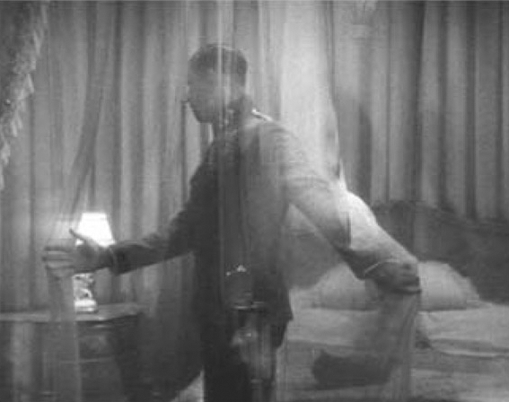

## 4. The Audiovisual Scene (Part 7)

> [BREADCRUMB_CTX: 《Audio-Vision: Sound on Screen》 > 4. The Audiovisual Scene (Part 7)]

Before Birdman, and shot in a real single take without digital aid, Alexander Sokurov’s Russian Ark (2002) travels in continuity through St. Petersburg’s great Hermitage Museum. The camera follows a character inspired by the Marquis de Custine as he moves through the museum; he is accompanied by a closeup internal (more or less) voice, which is that of the director; his monologue provides a point of reference with respect to the changes in extension (all the sound was clearly redone in postproduction).

POINT OF AUDITION

SPATIAL AND SUBJECTIVE POINT OF AUDITION

The notion of point of audition is a particularly tricky and ambiguous one. It might be useful here to consider it with greater precision.

Let us first note that critics have come up with the concept of a point of audition based on the model of point of view. Here begins the problem, since cinematic point of view can refer to two different things, not always related:

1. The place from which I the spectator see; from what spatial location the scene is presented—from above, from below, from the ceiling, from inside a refrigerator. This is the strictly spatial designation of the term.
2. Which character in the story is (apparently) seeing what I see. This is the subjective designation.

In most shots of a contemporary film the camera’s point of view is not that of a specific character, which does not mean that the point of view is necessarily arbitrary, for it still tends to obey certain laws and constraints. For example, the filmmakers can decide that the camera will never be located where the eye of a normal human character couldn’t be (on the ceiling, in a closet, etc.). Or it might shoot only along certain privileged axes, excluding others.

The notion of point of view in this first spatial sense rests on the possibility of inferring with greater or lesser precision the position of an “eye,” based on the image’s composition and perspective.

Remember also that point of view in the subjective sense may be a pure effect of editing. If I cut from a shot of a character looking out the window to a shot of an exterior scene, it is highly likely that the second shot will be perceived as the character’s point of view, as long as the information in shot B doesn’t contradict anything in shot A.

Now, by comparison, let us examine the notion of a point of audition. This too can have two meanings, not necessarily related:

1. A spatial sense: from where do I hear, from what point in the space represented on the screen or on the soundtrack?
2. A subjective sense: which character, at a given moment of the story, is (apparently) hearing what I hear?

One scene in Sternberg’s Dishonored (1931) makes use of the contradiction between the spatial point of audition represented by the camera and the subjective point of audition. The lady spy played by Marlene Dietrich plays the Adagio of Beethoven’s “Moonlight Sonata” on the piano in her living room, while an enemy colonel (Victor McLaglen) is rummaging through the adjoining room without her knowledge. Crosscutting allows us to see the action in both rooms—and the sound “cuts” too, from the piano heard close up to the same piano as heard by the colonel. These jumps from audio closeup to audio long shot made a splash with audiences at the time (and to which I’ve assigned the name the X 27 effect).9 Sternberg quite probably had the entire Beethoven piece recorded with three microphones at different distances (the farthest one used when the colonel passes behind a curtain) and edited on optical film to cut between versions. It goes without saying that we don’t see Dietrich’s hands as she “plays” to the recording.

Something remarkable happens when the colonel moves behind a curtain in the room he is searching. At the beginning of the shot, we already hear the attenuated sound of the piano. When he goes behind the translucent curtain, moving away from the static camera, the sound is even more muffled because we have moved from an objective point of audition to a subjective one—that of the colonel—while visually remaining in long shot, watching him move farther away. If this effect were to be reproduced today, it would seem every bit as strange (figure 4.5).

But the big difference for sound, in contrast to the image, is that you can mix together two versions of a single audio phenomenon recorded from different points in space—here, the different points of audition for the piano—and this mixing will yield a new audio phenomenon that is homogeneous and realistic. Today’s films often mix together the closely miked actor’s voice with the same voice recorded with a boom, to set the voice in a larger ambience. The combination results in a new sound of the single voice—just as in acoustic reality, where our ear fabricates the sound of the voice of a speaker lecturing into a microphone from several distinct reflections or amplifications of this voice coming from different directions. So point of audition is not comparable to point of view.

FIG. 4.5  Dishonored (1931). When Victor McLaglen goes behind a curtain, the piano music we hear gets softer: mysteries of the point of audition.

PROBLEMS OF DEFINING ACOUSTIC CRITERIA FOR A POINT OF AUDITION

The specific nature of aural perception prevents us in most cases from inferring, based on one or more sounds, a main point of audition in space. This is because of the omnidirectional nature of sound (which, unlike light, travels in many directions) and also of listening (which picks up sounds from all around), as well as of reflected-sound phenomena.

Consider a violinist playing in the center of a large round room, her audience grouped at various spots against the wall. Most of the listeners standing at diametrically opposite points of the room will hear roughly the same sound, with minimal differences in reverberation. These differences, related to the acoustics of the space, are not sufficient to locate specific points of audition. Every view of the violinist, on the other hand, can immediately situate the point from which she is being seen.

So it is not often possible to speak of a point of audition in the sense of a precise position in space but rather of a place of audition or, better yet, a zone of audition. (It’s for this reason that I sometimes speak of the uncertain extent of the field of audition.)

In the second, subjective sense of point of audition, we find the same phenomenon as that which operates for vision. It is the visual representation of a character in closeup that, in simultaneous association with the hearing of sound, identifies this sound as being heard by the character shown.10

A special case of point of audition involves sounds that “don’t carry,” supposedly of such a nature that one needs to be right up close in order to hear them. Upon hearing these sounds or indices of proximity (e.g., the breaths that accompany speech), the spectator can locate the point of audition as that of a character in the scene—provided of course that the image, the editing, and the acting all confirm the spectator’s hunch. Phone conversations are the most common example. When the spectator hears the voice of the unseen person speaking clearly in sound closeup, with its characteristic filtering, she or he can identify the point of audition as that of the character seen receiving the call. Unless, of course, we are in an “on-the-air” situation, which unhooks the sound from its point of departure or arrival and accordingly renders the notion of point of audition no longer pertinent.

POINT OF AUDITION AND EDITING IN TELEPHEMES