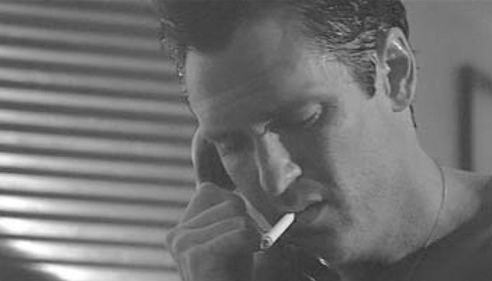
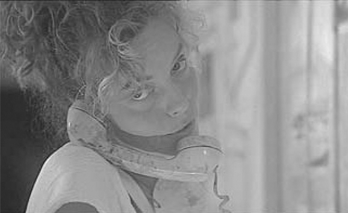

## 4. The Audiovisual Scene (Part 8)

> [BREADCRUMB_CTX: 《Audio-Vision: Sound on Screen》 > 4. The Audiovisual Scene (Part 8)]

The cinema owes a big debt to the telephone, an invention that has created plot situations of separation and suspense exploited by cinema almost since its beginning (Griffith’s The Lonely Villa, 1909, and Lois Weber and Phillips Smalley’s appropriately titled Suspense, 1913, are early examples). Thinking about this led me to dust off an old journalistic term that designated a “unit of telephonic conversation”: the telepheme.

Here is my list of the main types of telephemes:

(a) Type 0 telepheme, seen mainly in silent film but also found in silent sequences in a sound film: the image places us alternately on each side of the connection. Particularly dramatic scenes of this type can be found in Chaplin’s A Woman of Paris (1923) and Eisenstein’s Strike (1925).

(b) Type 1, still used quite frequently, consists of the same alternation but includes the sound of the voices. We see each person speaking as he or she speaks. The beginning of the conversation between Inspector Lohmann and Hofmeister, in The Testament of Dr. Mabuse, illustrates this type.

(c) In type 2, the camera remains with just one of the two people on the phone, and we do not hear the voice in the receiver—it’s as if we are in the room. This figure is found in many early sound films, but it also appears throughout film history to the present day. In Cristian Mungiu’s Graduation (2016), for example, the protagonist makes and receives a plethora of calls on his cell phone; we can guess what they’re about because of the narrative context and what he says, but we do not hear what he hears.

(d) With type 3, which seems to have appeared later—one of its first examples was in Hitchcock’s original Man Who Knew Too Much (1934) when the kidnappers call the girl’s parents—we stay in one of the two spaces, but contrary to type 2, we hear what the interlocutor onscreen hears on his or her phone. This is the figure favored by many films about persecution via telephone, the Scream trilogy (1997–2000) being just one set of examples. Buried (Rodrigo Cortès, 2010), which obliges us to stay with a character who is buried alive in a coffin with a charged cell phone at his disposal, pushes type 3 to its limit.

(e) Type 4 gives us everything: we can see each interlocutor in alternation and also hear what each hears in his or her own receiver, generally with a typically tinny filtering. It has been in use for many years; see, for example, the scene from Thelma and Louise discussed at the end of this chapter.

(f) Type 5 uses the split screen, which appeared spectacularly in 1913 with Suspense and then reappeared most often in comedies and romantic detective films starting in the 1940s. With split-screen phone conversations we can hear what no one else can: two unfiltered voices, each with as much clarity and presence as the other, and we are in two spaces at once, to boot.

(g) Let us reserve a slot for type 6 to encompass different or “aberrant” cases, ones no stranger than the split screen but found less frequently. For example, in Anne-Marie Miéville’s Lou n’a pas dit non (1994), we are in type 3 except that the voice of the person in the receiver is not filtered for us.

DIALOGUE BETWEEN SUBJECTIVE POINT OF AUDITION AND POINT OF VIEW IN TELEPHEMES

This case arises briefly in a telepheme that’s mainly of type 4, in a conversation in Thelma and Louise (Ridley Scott, 1991). Louise (Susan Sarandon) calls her lover Jimmy (Michael Madsen) to ask him to wire her all the money in her bank account. The crosscutting lets us see Jimmy pronouncing the “yes” she hopes for and thus gives this “yes” the weight of confirmation. When a bit later she asks him, “You love me?” we see him, again through crosscutting, hesitate before responding; then as he answers “yes,” we cut to Louise and only hear Jimmy, without seeing him, his voice mediated through Louise’s receiver. This audiovisual editing gives the second “yes” a certain poignant distance. In between, there is a moment that runs counter to any linear logic of the sound-image relationship—when we see Louise sob with relief, then Jimmy in closeup listening to her (figure 4.6); in this latter shot, the voice of Louise is unmediated as it comes through Jimmy’s phone, sounding for him (and for us) as if she’s in the room with him. This violation of the unwritten rule by which “sound should remain with the camera” seems so incredible to many of my students that often they either don’t hear it or they mistakenly claim that Louise’s voice is mediated.

FIG. 4.6  Thelma and Louise (1991). Michael Madsen hears Susan Sarandon’s relieved sobs as if she were in the same space and not at the other end of a phone line.

However, the effect works because it makes us feel the fleeting closeness that unites the two lovers at that moment. Psychologically speaking it is totally coherent: when we feel close to someone we are talking with on the phone, we do not hear the mediated quality of their voice; they are with us.

The cell phone has updated some story situations but has not really altered the types of telephemes. To analyze scenes with cell phones we must take care to situate them historically. Everyone notices (often with amusement) the size and model of cell phone used by a movie’s characters without necessarily recalling that only well-off people had access to such a phone in a given year. Take Robert Altman’s The Player, from 1992. In the pre-internet era in which The Player takes place, ownership of a mobile phone was still the privilege of the rich and a symbol of power; in six or seven years this would no longer be the case. So when we see Griffin (Tim Robbins) call June (Greta Scacchi) on his mobile phone as he’s watching her from outside her house in the dark (she is alone, illuminated, her landline in the crook of her neck), she cannot guess that he can call from any point in space, let alone from just outside her window.

The scene takes part in a long cinematic tradition that associates telephones with horror and the stalking of vulnerable women. However, it does so in order to turn the trope on its head. June shows no fear whatever—in fact, she uses the nickname for Griffin that’s going around, “the Dead Man.” From then on, we see him more like an inoffensive ghost prowling around a lit-up house. To tell the truth, in the screenplay (what I call diegetic reality), June has no reason to be alarmed, because the man is speaking normally and not breathing heavily. It is the viewer who, in cinematic reality, worries: we see a house on a dark empty street; a woman painting at her easel, exposed to anyone looking through the window; there’s a prowler and unsettling music. Even the viewer watching it today projects onto this scene the classic trope of the woman in danger.

But the viewer here inhabits the point of view of the “stalker” Griffin: June supposedly doesn’t see him, nor does she know where he’s calling from. For her he is an acousmatic voice (without a visible source), while he sees what she is doing. It is his unmediated voice that we hear, and it is the woman’s voice that is mediated. But since this latter voice is not threatening, it sounds cold and distant for Griffin … and for us.

FIG. 4.7  The Player (1992). Does Greta Scacchi see Tim Robbins outside in the dark or not, calling her on his portable phone?

By taking us twice into the house, the editing cleverly suggests that June could see Griffin through the window but that she is pretending not to see him, as if he were transparent for her (figure 4.7). He becomes a voice yearning for a home. In addition, when the camera is inside June’s house, we continue to hear June’s voice mediated through the phone, from Griffin’s point of audition, which also contributes to flipping the usual relation whereby a mediated acousmatic male voice threatens a woman onscreen whose voice is heard unmediated.

FRONTAL VOICE, BACK VOICE