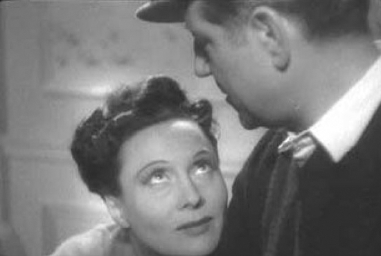

## 5. The Real and the Rendered (Part 2)

> [BREADCRUMB_CTX: 《Audio-Vision: Sound on Screen》 > 5. The Real and the Rendered (Part 2)]

Now, in modern theaters graced with a succession of systems including THX (created by George Lucas) and Dolby Atmos, one finds the exact opposite: stable sound, extremely well defined in the high frequencies, powerful in volume, with superb dynamic contrasts (though these contrasts, fortunately for our ears, are less violent than they are in the reality of the situations depicted), and also, despite its strength and the large size of the theater, a sound that is not very reverberant at all. Sound in today’s theaters fulfills the modern ideal of a great “dry” strength.

New or refurbished theaters whose acoustics are conceived with luxury sound projection in mind have indeed mercilessly vanquished reverb through the choice of building materials and architectural planning. The resulting sound feels very present and neutral. But suddenly we no longer have the feeling of the real dimensions of the room, no matter how big it is. What we get is the enlargement, without any modification in tone, of a good home-stereo sound.

At the start of each show in the 1980s and 1990s, some movie theaters played a short whose title reminded you “you are in a THX theater.” You’d hear an electronic sound effect for about thirty seconds: a bunch of glissandi falling deep into the bass register, others rising into the treble, spiraling spatially around the room from speaker to speaker, all of them ending triumphantly on one enormous chord. It was all played at an overwhelming volume that sometimes led the audience instinctively to applaud as a sort of physical release.

The demo conveyed a new sensibility in two ways. First, the bass sound that the glissando ended on was clean of all distortion and secondary vibrations, even though very low sounds in the real world have the inevitable consequence of causing small objects to vibrate—for example, a passing semi truck sets the furniture or the dishes to rattling. What the demo did to stir the audience’s admiration, far from any idea of fidelity, was show off the technical capacity to isolate and purify the sound elements (acoustic disconnection).

Second, in the demo there was no trace of the reverberation that normally accompanies loud sounds in an enclosed space. In “real life,” sound characteristics always vary in association with one another: if a sound event’s volume increases, the sound changes nature, color, resonance. In the sonic world before the age of electronic amplification, the presence of reverb prolonging the sound marked a change in spatial properties, just as the presence of secondary vibrations from the principal sound signaled a change to greater intensity. Here on the contrary, volume aside (volume too has become a sound property as isolated or independent as the others), the sound event remains as clear and distinct as if we were hearing it on the small speaker of a compact home stereo. Now, in the type of sound projection preferred today in movie houses, where the real size of the auditorium is immaterial, amplification no longer has a true scale of reference.

PHONOGENY AND TECHNICAL MEDIATION

The sound media of the 1920s through 1940s (records, talking pictures, radio) subscribed to a notion virtually forgotten today: phonogeny. Phonogeny refers to the rather mysterious propensity of certain voices to sound good when recorded and played over loudspeakers, to inscribe themselves in the record’s grooves better than other voices, in short to make up for the absence of the sound’s real source by means of another kind of presence specific to the medium.

This idea rose to popularity when sound engineers for early talkies, men who came from the recording and radio industries, sought to subject the choice of actors to phonogenic criteria, decreeing that actor X had a terrific voice while Y was deplorably unphonogenic. The concept obviously came out of the technical conditions that prevailed at the time: equipment much less sensitive and precise than that of today favored the timbres of certain voices. The phonogenic voice articulated itself clearly through the microphone’s filter; in a word, it “meshed” well with the sensitivity of the system.

In retrospect we dare say that the voices of a Gérard Depardieu or Catherine Deneuve wouldn’t have been judged sufficiently phonogenic according to the criteria of the day, as not sufficiently articulated or sonorous.

As it happens, technical conditions evolved—resulting in greater sensitivity in microphones, the option of hiding the mic on set, and improvements in postsynchronization—and consequently voices were no longer obliged to articulate or project as well. Jean Grémillon in Gueule d’amour (1937) and Marcel Carné in Le Jour se lève each asked Jean Gabin to whisper at various points (figure 5.1). They could not have made such requests several years earlier, unless they had arranged for Gabin to whisper during postsynchronization.

FIG. 5.1  Le Jour se lève (1939). Arletty and Jean Gabin: one of the film’s whispered duets.

But already by then the term had an irrational element: a voice was said to be phonogenic in the same way that a person was said to have oomph or sex appeal or other ineffable qualities of communication and seduction.

It appears that the means of sound collection and reproduction were implicitly considered to be transparent, so that there was no prior requirement for an acoustic event to be favorable to the recording process. In this, of course, people are mistaken. The most highly perfected digital recordings are certainly quantitatively richer in detail than those of yesteryear, but they are no less colored by technical mediation.

What is the disappearance of the idea of phonogeny the symptom of? Perhaps it signals an important mutation—to our total daily immersion in mediated acoustical reality (even for a course in a lecture hall, sound is transmitted through mics, amplifiers, earbuds, loudspeakers). The new sonic reality has no difficulty supplanting unmediated acoustical reality in strength, presence, and impact, and little by little it is becoming the standard form of listening. It’s a form of listening no longer perceived as a reproduction, as an image (with all this usually implies in terms of loss and distortion of reality), but as a more direct and immediate contact with the event. When an image is more vivid than reality, it tends to take its place, even as it denies its own status as a representation.

The more unmediated acoustical reality loses its value as real experience, the less it is the lived standard to which we compare what we hear, and the more it becomes the abstract reference we call on conceptually—for example, regarding the notion of acoustic fidelity that the cinema also demands.

SILENCES OF DIRECT SOUND

Many people consider location sound (direct sound) not only the sole morally acceptable solution in filmmaking but also the simplest, since it eliminates the problem of having to make choices. In the 1970s and 1980s, Eric Rohmer’s films were invoked most often to proclaim the virtues of location sound and to frame it as a simple, obvious, rigorous, and irrefutable option. However, Rohmer’s own choices for direct sound involved conscious sacrifices and difficulties in the process of subjecting location sound to his purposes.

Take The Aviator’s Wife, shot in Paris on location in 1980 with radio mics. In its acoustic design, ambient sound takes on great neutrality. There is nothing to disturb our concentration on the characters and their lines. All the events that usually intrude on sound recording in a city or in the countryside have been completely eliminated; the life that can come with them has also been eliminated in the process.