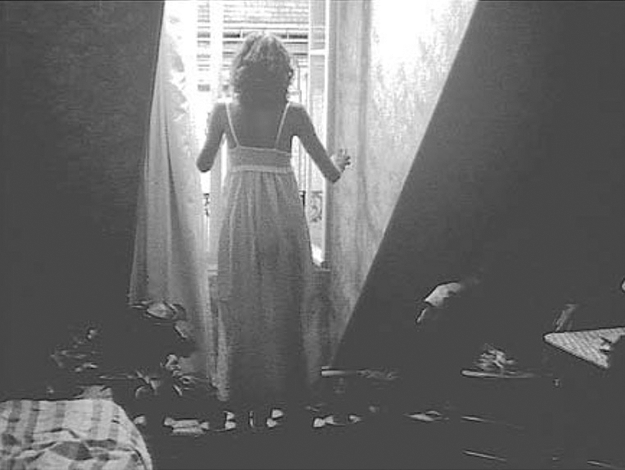

## 5. The Real and the Rendered (Part 3)

> [BREADCRUMB_CTX: 《Audio-Vision: Sound on Screen》 > 5. The Real and the Rendered (Part 3)]

At the beginning of the film, when Philippe Marlaud and then Mathieu Carrière climb the stairs leading to Marie Rivière’s small gabled apartment, we hear no sound but their footsteps. Later, when Marie Rivière opens her windows, that’s when films set in Paris normally bring in the cooing of pigeons to complete the picture, to flesh out the city and its rooftops, and to enliven the soundtrack with a conventional decorative touch. Nothing of the sort happens here (figure 5.2).

FIG. 5.2  The Aviator’s Wife (1981). When Marie Rivière opens the garret window in her Paris apartment, we hear the abstract rumble of the city.

The risk of spontaneous aural intrusions during shooting with location sound is not only that they present problems during the editing stage. Such intrusions can also place unwanted emphasis or meaning on a word of dialogue or an actor’s gesture, even if it’s only a small random punctuation. A motorbike that revs offscreen or a radio or TV whose sound comes through the window can drown out a line or at least inflect it, make it mean something else.3

To get this ambient background sound, this silence around the characters, Rohmer and his audio engineer Georges Prat had to shoot and record at very precise times of day and reject takes marred by undesirable intrusions. In other words, through choice and elimination they had to reconstitute the sonic milieu the director envisioned. So the idea of location sound does not imply any less of a reconstruction of the environment, even if by simple subtraction, than does the idea of postsynchronized sound.

The most noticeable and anecdotal sound at the beginning of The Aviator’s Wife is Marie Rivière’s sink, which vibrates when she turns on the faucet. Even this noise was not introduced or kept on the soundtrack for a purely comical or picturesque effect. It has a precise function in the scenario: a suitor uses the necessary repairs in her apartment as a pretext to plague the young woman (who will continue to reject him). Neither does the noise go uncommented upon; Mathieu Carrière refers to it directly. It is thus integrated into the dialogue, into the sensory named verbal flow.

Since technical advances have allowed for very small wireless mics and digital recording, many more films are shot today using at least some direct sound. Direct sound, if not mitigated (as it often is) with sound from a boom microphone further away, or else by digital treatment during mixing, has the effect of suppressing a felt auditory space: the voice tends to be heard in a more abstract, less grounded way.

Italian cinema was long known for its system of postsynchronization of dialogue as well as all other sound. Thanks to wireless mics, the credits in more and more Italian movies since the 1980s have touted that they’re shot in suono diretto. But unlike the Rohmer films just mentioned, these films add numerous sounds, such as ambience and music, during the audio editing and mixing, and the overall effect is therefore quite different.

SOUND TRUTH AND SOUND VERISIMILITUDE

Another issue regarding sonic reality, the issue of verisimilitude, is ambiguous and complicated. Allow me to make just a few points.

First of all, sound that rings true for a spectator in one milieu, era, and country and sound that is true are two very different things. To assess the truth of a sound, we refer much more to codes established by cinema itself, as well as by television and narrative-representational arts in general, than to our hypothetical lived experience. Besides, quite often we have no personal memory to rely on regarding a scene we see. With a war film or a sequence of a storm at sea, what idea did most of us actually have of the sounds of war or of the high seas before hearing such sounds in films?

And in the case of scenes we might experience in everyday life, hardly ever have we paid focused attention to those particular sounds, either. We retain impressions of such sounds only if they carry material and emotional significance; those that don’t interest or surprise us get wiped from memory. Because context so strongly influences perception, everyday reality hardly places us in a position to listen to its sounds for themselves and to focus on their intrinsic acoustical qualities.

The codes of theater, television, and cinema have created very strong conventions of realism, determined by a concern for the rendering more than for the literal truth. These conventions, which have varied during the course of film history (and history), easily override our own experience and substitute for it.

For one thing, film as a recording art has developed specific codes of realism, codes tied to its technical nature. Of two war reports that come back from a very real war, the one in which the image is rough and jerky will seem more true than the one with impeccable framing. In much the same way for sound, the impression of realism is often tied to a sense of discomfort, of an uneven signal, interference and microphone noise, and so forth. These effects can of course be simulated during postproduction.

For another thing, when the spectator hears a so-called realistic sound, she is not in a position to compare it with the real sound she might hear were she standing in that actual place. Rather, in order to judge its “truth,” the spectator refers to her memory of this type of sound, a memory resynthesized from data that are not solely acoustical, a memory that too has been influenced by films.

Naturally criteria for auditory verisimilitude differ according to the specific competences and experiences of the individual. A nature lover expressed dismay upon hearing certain birds sing in wintertime in Bertrand Blier’s Trop belle pour toi (1989) because those birds are known to sing neither in that season nor in that region (Béziers). This evidence exposed the fabricated nature of the soundtrack and its trumped-up sound effects and prevented him from “believing” the scene. Of course, he can speak only for himself. The same spectator who is finicky about sound effects might be indifferent to aberrant light (incoherent lighting setups given the light sources depicted), which might disturb the photography buff. In other words, every film is predicated on our accepting the rules of the game—not least of which is agreeing to see flat images in depth!

Even the “relief” of 3D movies, which can currently be seen only with special glasses in the theater or at home, is based on a convention. What we see can come out of the frame toward us or sink back into depth, but it does not fill the theater entirely. It instead seems to inhabit the interior of a wide tunnel with clear boundaries. To which must be added that these films are made to be seen in merely two dimensions as well, on screens of all sizes, from non-3D movie screens to TVs to tablets and phones, and thus continue to employ the same grammar of editing in order to be compatible with as many different viewing options as possible.

RENDERING AND REPRODUCTION

WHAT IS A RENDERING?

In considering the realist and narrative function of diegetic sounds (voices, music, noise), we must distinguish between the notions of rendering and reproduction. The film spectator recognizes sounds to be truthful, effective, and fitting not so much if they reproduce what would be heard in the same situation in reality but if they render (convey, express) the feelings associated with the situation.