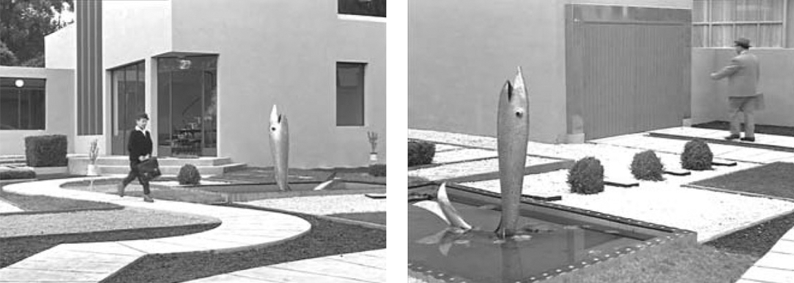

## 5. The Real and the Rendered (Part 5)

> [BREADCRUMB_CTX: 《Audio-Vision: Sound on Screen》 > 5. The Real and the Rendered (Part 5)]

The materializing indices are the sound’s details that cause us to “feel” the material conditions of the sound source and refer to the concrete process of the sound’s production. They can give information about the substance causing the sound—wood, metal, paper, cloth—as well as the way the sound is produced—by friction, impact, uneven oscillations, periodic movement back and forth, and so on. (In the sequence of Bergman’s The Silence analyzed in chapter 9, MSIs are the sole indicator of the rickety condition of a vehicle.) Among the most common noises surrounding us are some poor in materializing indices, which when heard apart from their source (acousmatized) become enigmas: a motor’s noise or a creak can acquire an abstract quality deprived of referentiality.

In many musical traditions perfection is defined by an absence of MSIs: the musician’s or singer’s goal is to purify the voice or instrument of all noises of breathing, scratching, or any other adventitious friction or vibration linked to producing the musical tone. Even if she takes care to conserve at least an exquisite hint of materiality and noise in the release of the sound, the musician’s effort lies in detaching the latter from its causality. Other musical cultures, other eras or musical genres, strive for the opposite effect: the “perfect” instrumental or vocal performance enriches the sound with supplementary noises that bring out rather than dissimulate the material origin of the sound. From this contrast we see that the composite and culture-bound notion of noise is closely related to the questions of materializing indices.

The dosing of materializing sound indices is controlled either at the source, by the ways in which noises are produced during filming or how they are recorded, or during mixing and in postsynchronization, and in contemporary film, in sound design in general. In the audiovisual contract the way MSIs are apportioned plays a preeminent part in mise-en-scène, dramatization, and the film’s structuring.

A sound of a footstep, for example, can contain a minimum of MSIs (it can be as abstract as the unobtrusive clicking in older serial TV dramas) or, on the contrary, many textural details, giving impressions of leather, cloth, and cues about the composition of what is being walked on—crunching gravel, a creaking wood floor. Either option may be chosen in connection with any image, and synchresis predisposes the spectator to hear and accept the sounds he hears.

At the beginning of Mon oncle (Jacques Tati, 1958), in the scene of the Arpels starting their day, the footsteps of little Gérard on the cement of the front yard make a pleasant, embodied, palpable squeaky crunch, while the footsteps of his father, an overweight, uptight, and unhappy man, make a thin and unreal little ding; the clicks of his mother’s steps, combined with the rustle of her large housedress, take up a lot of space because of her constant to-and-froing between the house and the yard (figure 5.3).

With the opening titles of Once Upon a Time in America (Sergio Leone, 1984), we hear regular footsteps over the black screen on which the first credits appear. The footsteps cannot in any way be described as either male or female, outside or indoors, so they keep a surprise in store for the viewer when the first image of the story appears.

Materializing sound indices frequently consist of unevennesses in the course of a sound, which denote a resistance, breach, or hitch in the movement of the mechanical process producing the sound. MSIs in a voice might also consist of the presence of breathing, mouth and throat sounds, and also any changes in timbre (if the voice breaks, goes off-key, is scratchy). For the sound of a musical instrument, MSIs would include the attack of a note, wavering pitch or intensity, friction, breath, or fingernails on piano keys. An out-of-tune chord in a piano piece or uneven voicing in a choral piece have a materializing effect on the sound heard. They return the sound to the sender, so to speak, in accentuating the work of the sound’s emitter and its faults instead of allowing us to forget the emitter in favor of the sound or the note itself.

FIG. 5.3  Mon oncle (1958). The lively footsteps of little Gérard and the timid jingling steps of his father.

In the communion mass in Le Plaisir (1952) Ophuls sets up a contrast between the strongly materialized vocalizing of the priests (dense, throaty, off-key voices) and the faultlessly pure voices of the little communicants. We don’t even see the children singing, unlike the officiants, from whose crude perspiring faces we are not spared.

Take one image and compare the effect of a music cue played on a well-tuned piano with the effect of a cue played on a slightly out-of-tune piano with a few bad keys. We tend to read the first cue more readily as “pit music”; with the second, even if the instrument isn’t identified or shown in the image, we will sense its tangible presence in the setting.

In Jane Campion’s The Piano (1993), the real piano the heroine plays on is deliberately made to sound like a concert instrument. Even when outdoors, in the wild, where it would certainly go out of tune, it does not let us hear MSIs such as bad notes; it sounds ideal and abstract. This gives all the greater power to the final scene—whose surprise I will not spoil for the viewer—where for the first time, the pianist herself introduces an MSI into her playing.

Effects of spatial acoustics (the sensation of distance between sound source and microphone and the presence of a characteristic reverberation that exposes the sound as produced in a felt space) can also contribute toward materializing sound. But not systematically: a certain type of unrealistic reverb, one not commensurate with the place shown in the image, can also be coded as dematerializing and symbolizing.

Reinforcement with materializing indices (or, on the other hand, erasing them) contributes to the creation of a world and can take on metaphysical meaning. Bresson and Tarkovsky have a predilection for MSIs that immerse us in the here-and-now—dragging footsteps with clogs or old shoes in Bresson’s films, agonized coughing and painful breathing in Tarkovsky’s. Tati, by suppressing MSIs (or by playing with them), subtly gives us an ethereal perception of the world: think of the abstract, dematerialized clunk of the dining room’s swinging door in Mr. Hulot’s Holiday.

Let us return to Grace Kelly’s appearance in Rear Window, when she arrives unannounced at James Stewart’s apartment. A gorgeous woman in a designer dress glides, with silent footsteps, toward a man sleeping in his wheelchair, his leg in a cast. She draws her face close to his to kiss him—all in a magical quasi-silence (suspension effect) underlined only by the singing of a neighbor who is practicing scales and with a visual effect of a slightly saccadic slow-motion. What appears coherently glamorous—she’s framed in medium closeup, and we do not see her feet—becomes a kind of silent magic fairy whose shadow covers the man’s face (figure 5.4). But a moment later, a small sound effect (either “furnished” on set by the stars themselves or created afterward during editing), mixes into the image of their tender kiss some little humid sounds, discreetly physiological noises of mouths and lips. A contradiction of the image, which is all glamour? No, for in that moment another element intervenes, their dialogue. Lisa and Jeff exchange no ethereal or poetic words but rather something Hitchcock loves to do, a contrast between the said and the shown, between the trivial and the romantic: things like “How’s your leg?” and “How’s your stomach?” (She brings not only her divine presence but also something to eat.)

In The Wayward Cloud (Tsai Ming-liang, 2005) the image shows simulated porn, but the sound, for its part, imitates and makes palpable the organic dimension of the sex act.