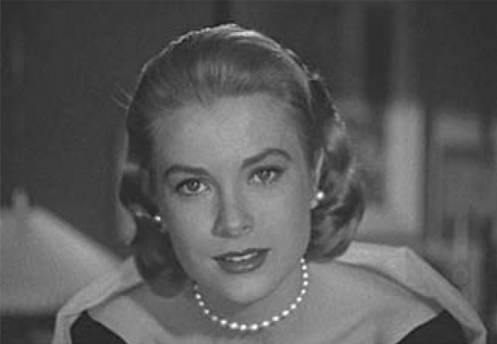
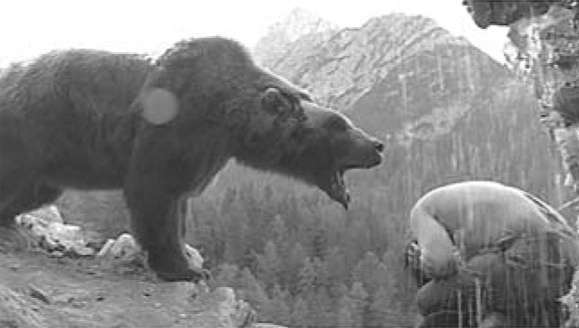

## 5. The Real and the Rendered (Part 6)

> [BREADCRUMB_CTX: 《Audio-Vision: Sound on Screen》 > 5. The Real and the Rendered (Part 6)]

FIG. 5.4  Rear Window (1954). Grace Kelly comes silently to James Stewart like an evening fairy.

In films shot with direct sound the changes in voice color resulting from sound-recording conditions (microphone placement at a person’s face or back) also count as materializing indices, since they localize the voice in question in a physical space and anchor the sound in a more tangible quadrant of reality.

EXAMPLES OF RENDERING: THE BEAR AND WHO FRAMED ROGER RABBIT?

You might recall that in anticipation of the Christmas holidays, the autumn 1988 movie season witnessed animal species stealing the show from the usual human stars. On our left, there was a cartoon rabbit who chatted with real characters and became ensconced in fleshy human space, projecting shadows, smashing against real walls, manipulating solid objects. This was Robert Zemeckis’s Who Framed Roger Rabbit? To our right, several hundred pounds of decidedly real and endangered wildlife were framed as artfully as John Wayne, in Jean-Jacques Annaud’s The Bear. As is customary, the publicity campaigns surrounding these two releases revealed several “secrets” about their production; rarely, however, was there any mention of the issues involved in creating the films’ sound.

How, for one, did Roger Rabbit’s sound artists (Charles L. Campbell and Louis Edemann) conceive of the sounds their rabbit-hero would make? Apparently—but this is only a hypothesis, based on my audio-viewing of the film—they started out with what is paradoxical about the cartoon medium: it is graphic, ostentatiously drawn, but at the same time it’s modeled in three dimensions, through the play of shadows and volumes added onto flat drawing. They must have wondered what sounds could convincingly make this creature seem to maneuver in a physically realistic universe when it walked, slid, or banged into something.

No one ever had to ask these questions about the noisy world of the traditional animated cartoon. Filmmakers used stylized synch sound effects analogous to those in the circus, presenting sounds that followed the action as sonic symbols for impacts and movement without needing to specify what substances the moving beings were made out of. Note that certain comedy directors like Jacques Tati and Blake Edwards have enjoyed treating humans in a similar way through sound.

But we find the opposite in Roger Rabbit, whose sound effects discreetly confer material solidity on a graphic being. The noises of the cartoon character’ bodies remain light, and the single moment in the film involving a sound effect designed to be consciously noticed is where the pulpy Jessica rubs up against the human detective played by Bob Hoskins. When the latter’s very solid skull bumps into the voluminous cartoon breasts, we hear a hollow clang, which never fails to get a laugh.

So through sound, the effects experts of Roger Rabbit let us know that the toons are hollow, lightweight beings. If the spectator pays little attention to these sounds, that doesn’t mean by any stretch of the imagination that he doesn’t hear them or isn’t influenced by them in his perception of the visuals. Watching the screen, he believes he simply sees what in fact he hears-sees, owing to the phenomenon of added value.

The various creators and technicians who worked with Jean-Jacques Annaud on The Bear might not have had such a different plan than the creators of Roger Rabbit. Of course they had a different point of departure—real-life (trained) bears being filmed as human actors would be. Except the crew of The Bear knew that you can’t just film shots of a bear and thereby automatically convey the bear’s strength, its odor, weight, and animality, and they knew to draw on sound to aid in rendering all these qualities.

Annaud chose not to keep the direct sound he obtained during filming. There are obvious material reasons for such a choice, not the least of which is that the beasts could only be directed by means of profuse injunctions and vociferations from their trainers offscreen. The animal cries of the film were recorded in a zoo and reworked to various extents. Some were even dubbed by humans, especially the noises that help the baby bear express a whole range of anthropocentric emotions: all this under the supervision of the sound designer Laurent Quaglio (figure 5.5).

FIG. 5.5  The Bear (1988). How to render the sounds of the footsteps and cries of a wild animal?

Another behind-the-scenes artisan who seems to have played a key part in the “rendering” of the bear was the eminent Foley artist Jean-Pierre Lelong, who recreated the animal’s footsteps in the studio. He is probably responsible for the success of the first appearance of Bart, the big bear. The impression of a crushing mass results largely from the cavernous sounds we hear in synch with the monster’s stride. It is interesting, by the way, to compare these sounds to those of the grizzly attack in The Revenant (Alejandro Gonzalez Iñárritu, 2015).

In the digitally animated film WALL-E (Andrew Stanton, 2008), the sound designer Ben Burtt, to whom we owe the famous sounds of the Star Wars movies, contributed to endowing the little robot with both mechanical materiality and humanity.

SOUND IN ANIMATION: PUTTING SOUND TO MOVEMENTS

In a book on the origins of musicality in children, the researchers François Delalande, Bernadette Céleste, and Elisabeth Dumaurier investigated a common yet misunderstood phenomenon.5 They studied the vocalizing with which children at play punctuate their movements of objects, dolls, toy cars, and so on. I am not speaking of the dialogue that children confer on their toy friends but the sound effects they produce with their mouths to accompany these activities. The authors’ observations are highly interesting for our inquiry here because their research applies to the questions involved in putting sounds into films, in particular the matter of how to do sound for cartoons and other kinds of animated film.

Delalande, Céleste, and Dumaurier determined that sometimes these vocal productions “partake in a code of expression of feelings” (the descending “ooooh” from a little girl when the toy character she’s playing with gets a rip in her dress), and sometimes, particularly in boys’ play, noises such as “brrrr,” “vrrrr,” “bzzhhh,” and other labial and pharyngial vocalizations function as sound effects and punctuations to accompany the actions and movements of vehicles, robots, and machines.

The researchers attempted to map out the functions of such vocal expressions. These include the “representation” of movements and dynamics of characters and machines involved in playing—not so much in line with a strategy of literal reproduction, as in terms of a “mechanical and even mainly kinematic (movement-oriented) symbolism.” Children do not imitate the noise produced by the thing; rather, they apparently evoke the thing’s movement by means of isomorphism, that is, by “a similarity of movement between the sound and the movement it represents.” When one of the boys at play stops rolling his little car around, he makes a sliding sound with his mouth that recalls an airplane diving. “The descending part of the sound probably represents the slowing down of the vehicle.” The sound here conveys movement and its trajectory rather than the timbre of the noise that supposedly issues from a car. “The substance of the sound has nothing to do with resemblance; it’s the sound’s trajectory that does.” It is not difficult to see that this kind of relation between sound and movement is the very same relation used in animated films, especially cartoons.