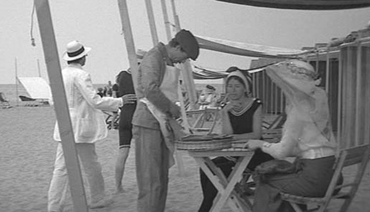

> [BREADCRUMB_CTX: 《Audio-Vision: Sound on Screen》 > 6. Phantom Audio-Vision; or, The Audio-Divisual (Part 1)]

# 6. Phantom Audio-Vision; or, The Audio-Divisual

6

PHANTOM AUDIO-VISION; OR, THE AUDIO-DIVISUAL

THE OTHER SIDE OF THE IMAGE

In Tarkovsky’s final film, The Sacrifice (1986), one can hear sounds that seem already to come from the other side, as if they’re heard by an immaterial ear, liberated from the hurly-burly of our human world.1 Sung by sweet young human voices, they seem to be calling to us, resonating in a limpid atmosphere. They lead us far back to childhood, to an age when it felt as if we were by nature immortal. A spectator might hear these songs without consciously realizing it; nothing in the image points to or engages with them. It is as if they are the afterlife of the image, like what we’d discover if the screen were a hill and we could go see what was on the other side. The closing credits inform us that they are traditional Swedish songs: hardly songs, more like invocations.

This is fairly typical of the sound of Tarkovsky’s feature films: it summons another dimension; it has taken off to another place, disengaged from the present. It can also whisper like the babble of the world, at once close and disquieting. Tarkovsky, whom some call a painter of the earth—an earth furrowed by streams and roads like the convolutions of a living brain—knew how to make magnificent use of sound in his films: sometimes muffled, diffuse, often bordering on silence, the oppressive horizon of our life; sometimes noises of presence, cracklings, irregular plip-plops of water. Sound is also deployed in grand rhythms or in vast sheets. Swallows or swifts pass over the Swedish house of The Sacrifice every few minutes; the image never shows them, and no character speaks of them (c/omission between the said and shown). Perhaps the person who hears these bird calls is the child in the film, a recumbent convalescent—someone who has all the time in the world to await them, to watch for them, to come to know the rhythm of their returning.

The other side of the image also appears in Mr. Hulot’s Holiday (1953), in that scene at the beach I mentioned in chapter 1, where what we see—awkward vacationers, with pinched expressions and cramped gestures—finds its opposite in what we hear. The soundtrack gives us excited children playing and shouting in a beautiful reverb-filled texture; the sound seems to have been collected on a real visit to a bathing beach. So basically characters in the image seem annoyed, and those on the soundtrack are having fun. Which, as I have already pointed out, becomes obvious only when we mask out the image—which reveals an entire world of lively adults and children lurking just beneath the surface, a world much more animated than the one we see.

What we have in Mr. Hulot’s Holiday is two superimposed sensory phantoms (Merleau-Ponty named the kind of perception made by only one sense a “phantom”),2 even if part of the sound—some of the very specific sound effects—are present to give life to certain visual details and actions on screen. The two phantom worlds are far from symmetrical. There is the world in the frame where we can identify things; Tati invites spectators in to point out gags to one another from our imaginary seats on the cafe terrace. Then there is the other world, that of sound, which is not named or identified. Children’s or bathers’ voices cry, “Go on, Robert!” or “Wow, is this water cold!” but no one in the image responds to the voices or acknowledges their existence—the voices become literally and immediately etched in our memory.

What is the effect of this strange contrast? Does Tati’s audiovisual strategy yield added value—which is to say, are we dealing with sound that enlivens the image and its movement and deepens it in spatial terms? I don’t think so, for in this particular case the image contrasts too greatly with the sonic environment, even though it belongs to the same world.

Rather, in Tati’s film, as in Tarkovsky’s Sacrifice, we encounter a mysterious effect of audiovisual form being “hollowed out,” as if sonic and visual perceptions were divided one by the other instead of mutually multiplying, and in this quotient another form of reality, of combination, emerges. This is what I call the audio-divisual.

“Fragole! fragole fresche!” (“Strawberries! fresh strawberries!”). In Death in Venice, these vendors’ shouts occupy a good part of the soundtrack during the sequence that takes place on the Grand Hotel’s beach (figure 6.1).

I often use this sequence in my film courses. I begin by playing the sound without the image, without revealing what film it comes from. Students invariably identify it as a scene in a colorful market in a Mediterranean town. Then I show it with the image: it’s a beach at the turn of the last century, populated by men, women, and children of various nationalities, stretched out on the sand or seated. No doubt because they are rich, they’re being solicited by swarms of vendors hawking their wares. How is it possible that without the image we could believe it’s a marketplace and that the cries of the strawberry sellers—the very fruit that will contaminate Aschenbach with cholera—suffice to put the audience on the wrong track? Because Visconti does not include the sounds of lapping or breaking waves, or of feet in the sand, or of shore or sea birds.

In the audiovisual contract, there are a certain number of relations of absence or emptiness that set the audiovisual tones to vibrating in a distinct and profound way. These relations are what the present chapter sets out to describe.

FIG. 6.1  Death in Venice (1971). Without the image, the calls of the ambulant strawberry peddler evoke a scene in a market.

A PHANTOM BODY: THE INVISIBLE MAN

It is no coincidence that one of the greatest early sound films was the one about the invisible man. Some of the world’s oldest stories tell us of invisible men and creatures; it was to be expected that the cinema, the art of illusion and conjuring, would seize upon this theme with particular relish. Méliès is probably the one who inaugurated the trend in 1904 with his Siva l’invisible, a trick-film that would be imitated in other silents. It is easy to see why the talkies would give a big boost to the invisible-man theme, and indeed, very soon after the coming of sound James Whale’s beautiful 1933 film achieved tremendous success. Radio exploited the subject as well.

The sound film made it possible to create the character through his voice and thereby give him an entirely new dimension and presence. In Whale’s film he is rather talkative, even bombastic, as if intoxicated by the new talkies. His loquaciousness might also reflect the filmmakers’ desire to give Claude Rains (who does not visibly appear until the very last shot—the rest of the time he’s completely covered in clothing and bandages) some room to show off his acting.

The impact of The Invisible Man derives from the cinema’s discovery of the powers of the invisible voice. This film is a special case: compare it to the invisible voice in a contemporaneous film such as Fritz Lang’s Testament of Dr. Mabuse. The speaking body of H. G. Wells’s 1897 hero Griffin is not invisible by virtue of being offscreen or hidden behind a curtain but apparently really in the image, even—and especially—when we don’t see him there (figure 6.2).

So Griffin is a singular form of acousmêtre (which I will describe in more detail presently): along with the other invisible voices who will populate the sound cinema he shares certain privileges and certain powers, notably a surprising ability to move around and slip through the traps set for him. If he ends up caught and defeated, it’s only because it snows and his footsteps become visible in the snow as he imprints them.