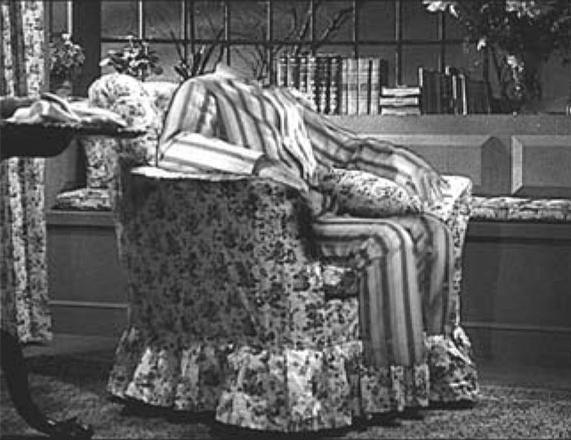
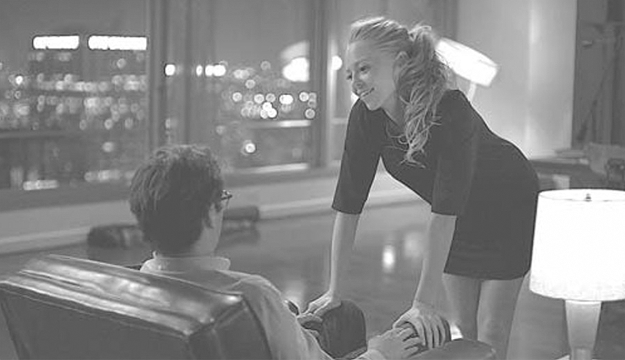

## 6. Phantom Audio-Vision; or, The Audio-Divisual (Part 2)

> [BREADCRUMB_CTX: 《Audio-Vision: Sound on Screen》 > 6. Phantom Audio-Vision; or, The Audio-Divisual (Part 2)]

Although Griffin is invisible, the screenplay doesn’t construct his body as immaterial; he can be nabbed. He has other constraints that visible beings do not have: he must go naked when he does not want to be seen, hide in order to eat (since the food he takes in remains visible until completely digested), and so on. Everything in this character, from the disguise he must assume when he wishes to appear without giving himself away, which makes him look somewhat like a gravely wounded man, to the complaints he makes during his frequent tirades to say that he’s cold or hungry or sleepy, everything shows us that what we have here is not a hero with superpowers but a suffering body, a “phantom” body whose organic character is accentuated rather than taken away.

FIG. 6.2  The Invisible Man (1933). In his pajamas, the body of an invisible man, feeling the cold.

There would not be many more occasions on which the sound film would recapture the strangeness and above all the conviction with which this half-embodied voice was elaborated in The Invisible Man. More often, the invisible man would become the stuff of comedies and parodies. On the other hand, the cinema would indeed develop an original form of “phantom” character specific to the art of film and to which we owe some of the greatest films of the 1930s through to the 1970s: the acousmêtre.

THE ACOUSMÊTRE

The acousmêtre is that acousmatic character whose relationship to the screen involves a specific kind of ambiguity and oscillation that I analyzed extensively in The Voice in Cinema.3 We may define it as neither inside nor outside the image. It is not inside, because the image of the voice’s source—the body, the mouth—is not included. Nor is it outside, since it is not clearly positioned offscreen in an imaginary “wing,” like a master of ceremonies or a witness, and it is implicated in the action and constantly liable to be part of it. This is why the voices of clearly detached narrators are not acousmêtres.

Why invent such a term? Because the idea is not to talk about images or sound but rather about a whole category of characters specific to sound cinema, characters whose wholly unique presence is based on their very absence from the heart of the image.

We can describe as acousmêtres many of the mysterious and talkative characters hidden behind curtains, in rooms or hideouts, which the sound film has given us: the master criminal of Lang’s Testament of Dr. Mabuse, the mother in Hitchcock’s Psycho, and the fake wizard in The Wizard of Oz (Victor Fleming, 1939); innumerable voice-characters: robots, computers (Kubrick’s 2001, A Space Odyssey, 1968); ghosts (Ophuls’s La Tendre Ennemie, 1936); and certain voiceover narrators with mysterious properties (Mankiewicz’s A Letter to Three Wives, 1949; Welles’s The Magnificent Ambersons, 1942; Sternberg’s Anatahan, 1953; the beginning of Preminger’s Laura, 1944; Raul Ruiz’s Le Borgne, 1980; and the beggar woman in Marguerite Duras’s India Song, 1975).

In Spike Jonze’s futuristic science-fiction film Her (2013), the protagonist Theodore (Joaquin Phoenix) falls in love with “Samantha,” the synthetic female voice that serves as his laptop’s operating system. If you ask a question out loud, the invisible woman will answer, in the first person. We never see the face or body of this virtual, synthesized voice. Is it an acousmêtre? Yes and no. The director chose a well-known, popular actress, one whose voice allows us to assign to it a familiar face and body—Scarlett Johansson, whose name appears in the credits but remains unseen on screen. This case is quite different from the mother in Psycho or HAL in 2001, both played by completely unknown actors. (Actually in Psycho, multiple actors are doing the mother’s voice.) When in City of Lost Children (1995) Jean-Pierre Jeunet and Marc Caro give to a brain in a jar the recognizable voice of the famous actor Jean-Louis Trintignant, they, too, deliberately defuse the mystery, at least for French speakers. The effect changes in a dubbed version of the same film if the dubbing actor’s voice is less known by the audience. This is precisely what happens with the French version of Her, in which Samantha is played by Audrey Fleurot—who’s known for the hit comedy Les Intouchables (Olivier Nakache and Eric Toledano, 2011) but whose voice is less recognizable than Johansson’s.

In the original-language version, the acousmêtre effect is particularly disturbing (even if only for brief moments) in the scene where Samantha invites Theodore to project her voice onto the body of a real woman to give her flesh (figure 6.3).

FIG. 6.3  Her (2014). A young woman offers to be the body of the computer voice with whom Joaquin Phoenix is in love.

To the acousmêtre, the voice that speaks over the image but is also forever on the verge of appearing in it, fiction films tend to grant three powers and one gift. First, the acousmêtre has the power of seeing all; second, the power of omniscience; and third, the omnipotence to act on the situation. Let us add that in many cases there is also a gift of ubiquity—the acousmêtre seems to be able to be anywhere it wishes. These powers, however, often have limits whose nature we do not know and are thereby all the more unsettling.

First, this voice that speaks over the images can see everything therein. This power arises from the notion that in a sense the acousmêtre is the very voice of what is called primary identification with the camera. The power manifests itself vividly in stories of the harassing phone caller whose “voice” sees everything—Wes Craven’s Scream series is only one among dozens of examples old and new. The second power, omniscience, definitely derives from the first. As for the third, this is precisely the power of textual speech (see chapter 8), intimately connected to the idea of magic, where the words one utters have the power to become things.

I call paradoxical acousmêtres those deprived of some of the powers usually accorded to the acousmêtre; their lack is the very thing that makes them special. These include “partial” acousmêtres, which are found in India Song and Anatahan. Also, for example, in two of Terrence Malick’s films, Badlands (1973) and Days of Heaven (1978), the female narrators do not see or understand everything about the images over which they are speaking. As we know, Malick subsequently evolved, from The Thin Red Line (1998) to Knight of Cups (2015), toward what some call “internal voices,” which meditate, say their prayers, and relate their feelings but do not actually narrate. I prefer to say that some call them internal voices because these voices are not understood to be in the present of the images we see but rather float lyrically in time.

One inherent quality of the acousmêtre is that it can be instantly dispossessed of its mysterious powers (seeing all, omniscience, omnipotence, ubiquity) when it is deacousmatized, when the film reveals the face that is the source of the voice. At this point, through synchronism, the voice finds itself attributed to and confined to a body. Why is the sight of the face necessary to deacousmatization? For one thing, because the face represents the individual in his or her uniqueness. For another, the sight of the speaking face attests through the synchrony of audition/vision that the voice really belongs to that character and thus is able to capture, domesticate, and “embody” her (and humanize her as well).

Deacousmatization is an unveiling process that is unfailingly dramatic. Its most typical form occurs in detective and mystery films, when the “big boss” who pulls all the strings—a character we haven’t seen but only heard, and perhaps glimpsed the shoes of—is finally revealed. This unmasking occurs, for example, in Aldrich’s Kiss Me Deadly (figure 6.4) and Terence Young’s Dr. No (1962).