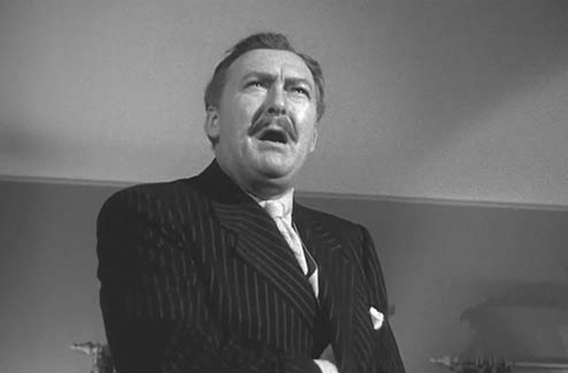
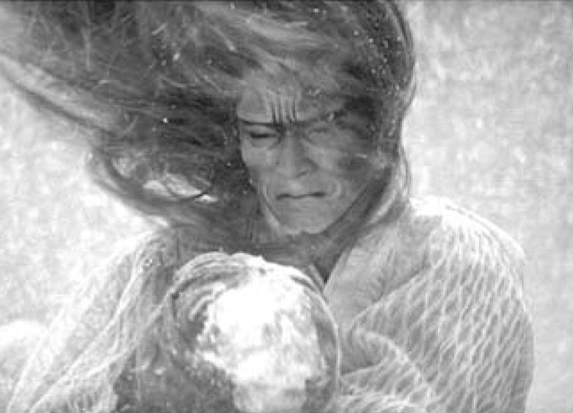

## 6. Phantom Audio-Vision; or, The Audio-Divisual (Part 3)

> [BREADCRUMB_CTX: 《Audio-Vision: Sound on Screen》 > 6. Phantom Audio-Vision; or, The Audio-Divisual (Part 3)]

Deacousmatization can also be called embodiment: the voice becomes enclosed in the circumscribed limits of a body. The absolute anacousmêtre, however, is impossible, as I have shown in The Voice in Cinema.4

FIG. 6.4  Kiss Me Deadly (1955). As soon as Dr. Soberin (Albert Dekker) reveals his face, he is no longer an acousmêtre and is destroyed.

The acousmêtre’s character seems to inhabit the image, thus by its nature blurring the boundaries between onscreen and offscreen. But it can maintain its particular status only as long as this onscreen-offscreen distinction prevails in a meaningful way. The acousmêtre’s existence by no means constitutes a refutation of the onscreen-offscreen duality; quite to the contrary, it draws its very force from that opposition and from the way it transgresses it.

Logically enough, recent modifications in cinematic space—transformed as it has been by multitrack sound and a wraparound superfield, which problematize older and simpler notions of onscreen and offscreen—are putting the acousmêtre on shakier ground and, in a certain way, has weakened its capacity to fascinate.

SUSPENSION

Suspension occurs when a sound naturally expected from a situation (which we usually hear at first) is absent or becomes suppressed either insidiously or suddenly. This creates a sense of emptiness or mystery, most often without the spectator knowing it; the spectator feels its effect but does not consciously pinpoint its origin. In Shohei Imamura’s Ballad of Narayama (1984) the son, who is carrying his mother to the mountains so she can die according to proper custom, has paused along the way, and he stands drinking water from a spring flowing from a rock. He looks around and suddenly freezes: his mother seems to have vanished into thin air. At this moment, the spring we continue to see flowing nearby abruptly ceases making any sound: aurally, it has dried up. This is an example of suspension.

In many films of the 1960s Japanese New Wave that were entirely postsynchronized (for example, Nagisa Oshima’s Boy, 1969), “realistic” sounds are rare. It is entirely typical to see a family beside a busy city street but hear hardly one out of ten vehicles we see go by, while the dialogue continues to be quite audible. Should this be considered a case of suspension? No, because here the film maintains stylized and cursory sound from beginning to end; only occasionally does it add a “sonic pencil mark,” in the way you might daub a couple of spots of color onto a black-and-white drawing.

Suspension effects owe much of their magic to how well they’re created—how artfully the (real or virtual) potentiometer is dialed up or down to make them either disappear or perhaps eventually return. A great moment in mixing in this regard is the suspension of Miles Davis’s trumpet in Elevator to the Gallows (Louis Malle, 1958). For just a second Jeanne Moreau, in the street, thinks she recognizes the man she believes has abandoned her. Then when her illusion dissipates, the nagging monotonous melody that had momentarily ceased resumes, as the sound of traffic, which too had been suspended, surges back up in a wonderful way.

Suspension is specific to the sound film, and one could say it represents an extreme case of null extension.

Now and then, as in the dream of the snowstorm in Kurosawa’s Dreams (1990), suspension may be more overt, emphasized for the spectator. Over the closeup of an exhausted hiker who has lain down in the snow, the howling of the wind disappears while snowflakes continue to blow about silently in the image. We see a woman’s long black hair twisted about by the wind in a tempest that makes no sound, and all we hear now is a preternaturally beautiful voice singing (figure 6.5).

An effect of phantom (or c/omitted) sound is then created: our perception becomes filled with an overall massive sound, which is mentally associated with all the micromovements in the image. The pullulating and vibrating surface that we see produces something like a noise-of-the-image. We perceive large currents or waves in the swirling of the snowflakes on the screen surface. The fadeout of sound from the tempest has led us to invest the image differently, to interrogate the image where sound answered before, to “hear” it in a more spatial sense.

FIG. 6.5  Dreams (1990). For the hiker lost in a snowstorm, a woman’s face transforms into a frightening mask, while the sound of the storm is suspended.

Suspension often involves suppressing one audio element of the soundscape, with the result of heightening one moment in the scene, giving it a striking, disquieting, or magical impact: for example, when crickets suddenly stop chirping. Generally the effect relies on the film’s characters not noticing or alluding to it. Hence the comedy in the scene of Bertrand Blier’s Buffet froid (1979), when a grumpy fellow (played by the director’s own father), after raging on about the discomforts of life in the country, becomes aware that the birds whose peeping has annoyed him have stopped making any sound.

At the end of Fellini’s Nights of Cabiria (1957), the prostitute with a heart of gold played by Giulietta Masina believes she has finally found her Prince Charming in a traveling salesman (François Périer). They go for a romantic walk together at sunset in the woods next to a cliff. The spectator experiences a vague anxiety about what is going to happen: we will discover that all the man wanted was Cabiria’s money and that he was planning to push her over the cliff to her death. Where did our premonitory anxiety come from? From the fact that in this magical landscape not a single birdsong is heard.

Suspension in the Cabiria scene functions according to such a common audiovisual convention (sun-dappled woods = birdsong) that to perturb it is all that’s needed to generate strangeness (Fellini, unlike Kurosawa, does not begin the scene with chirping). Chabrol also used this device in his fantasy film Alice or the Last Escapade (1977). The lovely woodland landscape through which Sylvia Krystel moves is often emptied, sucked out from within by the suspenseful silence that reigns there and by the absence of natural murmurings of birds or wind—an absence that only exists as such because we hear over these images the heroine’s voice and footsteps. Chabrol uses this effect more sporadically in L’Enfer (1994), among the richest French films in terms of audiovisual ideas, for example, in the persecutory use of diegetic sounds of insects, motors, and airplanes to render the obsessional jealousy that eats at and ultimately destroys the principal character (played by François Cluzet).

“VISUALISTS” OF THE EAR, “AUDITIVES” OF THE EYE

Sound and image should not be confused with the ear and sight. There’s proof of this in filmmakers who can be called auditives of the eye. What does this mean? Far beyond Rimbaldian correspondences (“Black A, white E, red I”), cinema can create veritable intersensory reciprocity. Into a film image you can inject a sense of the auditory, as Orson Welles or Ridley Scott have. And you can infuse the soundtrack with visuality, as Godard has. Thinking in sound, being an auditive, means thinking in terms of sensations addressed to the ear.