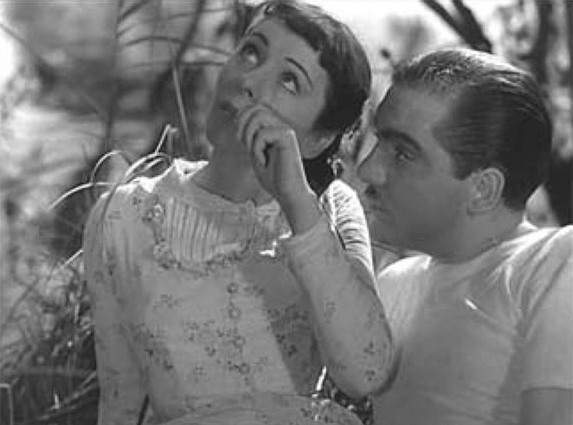

## 7. Sound Film Worthy of the Name (Part 2)

> [BREADCRUMB_CTX: 《Audio-Vision: Sound on Screen》 > 7. Sound Film Worthy of the Name (Part 2)]

Some changes came in the late 1940s, when film sounds were recorded on magnetic tape and not directly in optical sound. This allowed for the creation of richer sonic ambiences, both natural and urban, which can be heard by 1950 in American films such as Executive Suite (Robert Wise, 1954). But for noises to be made really audible, dialogue and music had to give them some room. Jacques Tati, Robert Bresson, and Jean-Pierre Melville in France; Jerzy Kawalerwicz in Poland; Andrei Tarkovsky in the USSR; and Ingmar Bergman in Sweden created rich and varied soundscapes. Some American films noirs, to which we can add some of Hitchcock’s movies, also included sequences that foregrounded noises. Nonetheless, noises that were finely created and mixed in mag sound eventually had to be rerecorded onto optical soundtracks and were consequently limited in their richness and sonorousness.

FIG. 7.1  A Day in the Country (1936). Sylvia Bataille and her seducer listen to a nightingale.

Not until the arrival of Dolby did soundtracks get a wider bandwidth and a greater number of tracks, allowing well-defined noises to coexist with dialogue. Only then could noises have a living corporeal identity rather than exist largely as stereotypes.

The greatest sonic inventiveness went into genre films—science-fiction, fantasy, action, and adventure movies. For a very long time, most others, including auteur films, did not give noises the status of an integral cinematic element and recognize that above and beyond their directly figurative function they might have the same expressive capacity as lighting, framing, and acting.

GAINS IN DEFINITION

For the image, everyone knows that in the 1960s and 1970s black and white was progressively replaced by color. This led in turn to a new status for black and white: no longer the norm, it became something unusual, an aesthetic option. For sound, by comparison, technical developments occurred that were just as decisive, although much more gradually. Imagine that on the visual side there had been a history of almost imperceptible stages from an image consisting of absolute contrasting black and white to an image having all gradations of color and light at its disposal: this would provide a fair analogy to what has happened on the sound side.

So at the beginning of sound the frequency range was still rather limited. This meant, first, that sounds could not be mixed together too much, for fear of losing their intelligibility; second, when the soundtrack did require superimposed sounds, one sound had to be featured clearly above the others. As bandwidth increased—and this occurred very gradually with refinements in optical sound, the introduction of magnetic recording, and developments in mixing technologies—it became easier to produce sounds that were well defined and individuated in the mix. The means became available to produce sounds other than conventionally coded ones, sounds that could have their own materiality and density, presence, and sensuality.

SPEED, TEXTURE, SILENCES

One might say that sound’s greatest influence on film is manifested at the heart of the image. The clearer treble you hear, the faster your perception of sound and the keener your sensation of presence. So as film sound became increasingly better defined in the high-frequency range, it induced a more rapid perception of what was on screen, for vision relies heavily on hearing. This evolution consequently favored a cinematic rhythm composed of multiple fleeting sensations, of collisions and spasmodic events, instead of a continuous and homogenous flow of events. We owe the hypertense rhythm and speed of much current cinema to the influence of sound, an influence you might say has seeped into the heart of modern-day movies.

Further, the standardization of Dolby in the late 1970s introduced a sudden leap in the older and more gradual process that had paved the way for it. There is perhaps as much difference between the sound of a Renoir film of the early 1930s and that of a 1950s Bresson film as there is between the Bresson and a Scorsese in 1980s Dolby, whose sound vibrates, gushes, trembles, and cracks (think of the crackling of flashbulbs in Raging Bull, 1980, and clicking of billiard balls in The Color of Money, 1986).

Was any such radical change introduced in the 1990s by the standardization of digital recording? Hard to say. It seems to me that, paradoxically, digital has rather introduced something like the sense of a vacuum, of gaps between sounds, through the drastic reduction of background noise to zero. One feels this void in certain films by Kieslowski (The Double Life of Véronique, 1991; Three Colors: Blue, 1993), David Lynch (since Lost Highway, 1997), Kiyoshi Kurosawa (Pulse, 2001), and Bruno Dumont (Flanders, 2006), not to mention numerous science-fiction movies. The emptiness is obviously created by the possibility of fullness, just as the frail flute solo in a Bruckner symphony is created by the momentary silence of the enormous orchestra that might thunderously explode at any instant.

This silence in the loudspeakers was anticipated in certain 1970s films, like Terrence Malick’s Days of Heaven (1978), but we should also highlight the restraint and subtlety of the sonic ambiences that, thanks in part to digital, are found in the work of filmmakers such as the Turkish Nuri Bilge Ceylan, the Palestinian Elia Suleiman, the Chinese Jia Zhangke, the Thai Apichatpong Weerasethakul, the Austrian Michael Haneke, the Dane Lars von Trier, the Russian Alexander Sokurov, and the Argentine Lucrecia Martel, just to name a few.

The fact remains, though, that Dolby stereo has altered the balance of sounds, especially by taking a great leap forward in the reproduction of noises. At the same time it has changed the perception of space and thereby the rules of scene construction.

THE SUPERFIELD

I call the superfield3 the space marked out in multitrack films by ambient natural sounds, rumblings of the city, music, and all sorts of rustlings that surround the visual field and that can issue from loudspeakers outside the physical boundaries of the screen (and, now, even on the ceiling). By virtue of its acoustical precision and relative stability this ensemble of sound has taken on a kind of quasi-autonomous existence with relation to the visual field in that it does not depend moment by moment on what we see onscreen. But structurally speaking the sounds of the superfield also do not acquire any real autonomy, with salient relations of the sounds among themselves, which would earn the name of a true soundtrack (see chapter 3). What the superfield of multitrack cinema has done is progressively modify the structure of editing and scene construction.

Scene construction has for a long time been based on a dramaturgy of the establishing shot. By this I mean that in editing, the shot showing the whole setting was a strategic element of great dramatic and visual importance, since whether it was placed at the beginning, middle, or end of a given scene, it forcefully conveyed (established or reestablished) the ambient space and at the same time re-presented the characters in the frame, striking a particular resonance at the moment it intervened.

The superfield logically had the effect of undermining the narrative importance of the establishing shot. This is because in a more concrete and tangible manner than in monaural films, the superfield makes spectators constantly conscious of all the space surrounding the dramatic action.

Through a spontaneous process of differentiation and complementarity favored by this superfield, we have seen the establishing shot give way to the multiplication of closeup shots of parts and fragments of dramatic space such that the image now plays a sort of solo part, seemingly in dialogue with the sonic orchestra in the audiovisual concerto.4 The vaster the sound, the more intimate the shots can be.