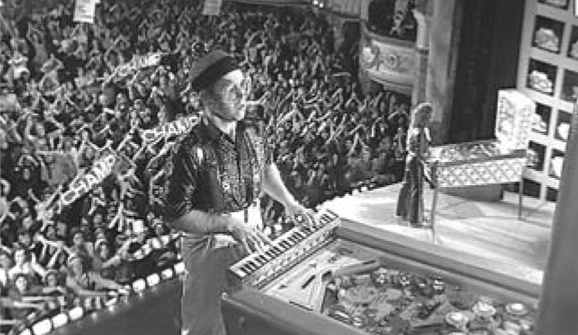

## 7. Sound Film Worthy of the Name (Part 3)

> [BREADCRUMB_CTX: 《Audio-Vision: Sound on Screen》 > 7. Sound Film Worthy of the Name (Part 3)]

We must also not forget that the definitive adoption of multitrack sound occurred in the context of musical films like Michael Wadleigh’s Woodstock and Ken Russell’s Tommy (figure 7.2). These rock movies aimed to revitalize the movie experience by fostering a kind of participation, a communication between the audience shown in the film and the audience in the movie theater. The space of the film, no longer confined to the screen, in a way became the entire auditorium, via the loudspeakers that broadcast the cheers and hubbub of the crowd. In relation to this overall sound the image tended to become a sort of reporting-at-a-distance—a transmission by the intermediary of the camera—of things normally situated outside the range of our own vision. The image showed its voyeuristic side, acting like a pair of binoculars—in the same way that at a live rock concert cameras allow fans to see otherwise inaccessible details projected on a giant screen.

When multitrack sound spread into nonmusical films and eventually into smaller dramas with no trace of grand spectacle, filmmakers retained this principle of the “surveillance-camera image.” This development obviously might shock those who uphold traditional principles of scene construction, who point an accusing finger at what they call a music-video style. Music-video style, with its collision editing, is certainly a new development in the linear and rhythmic dimensions of the image, possibly at the expense of the spatial dimension. The temporal enrichment of the image, which is becoming more fluid, filled with motion and teeming with details, has the image’s spatial impoverishment as its inevitable correlate—bringing us back at the same time to the end of the silent-cinema era.

FIG. 7.2  Tommy (1975). Thanks to Dolby, the crowd onscreen watching a pinball championship is heard also in the movie theater.

In a logical reaction, recently some filmmakers have rehabilitated the wide shot, for example in the films of Wes Anderson (The Life Aquatic with Steve Zissou, 2004), Cristian Mungiu (Beyond the Hills, 2012), and Quentin Tarantino. But directors as varied as Jim Jarmusch and Aki Kaurismaki had already long rooted their styles in a predilection for the wide shot. The transition to super-high-definition digital cameras for film (and for TV and computer screens, and increasingly even tablets) has played an equally significant role.

TOWARD A SENSORY CINEMA

Cinema does not merely show sounds and images. It also generates rhythmic, dynamic, temporal, tactile, and kinetic sensations that make use of the auditory and visual channels. And as each technical revolution brings a sensory surge to cinema, it revitalizes the sensations of matter, speed, movement, and space. At such historical junctures these sensations are perceived for themselves and not merely as coded elements in a language, a discourse, a narration.

Toward the end of the 1920s most of the great filmmakers, such as Eisenstein, Epstein, and Murnau, were interested in sensations; with their physical and sensory apprehension of film, they were excited about technical experimentation. Now the same thing has occurred with Dolby.

Many European directors simply ignored the amazing mutation brought on by the standardization of Dolby, at least at first. Fellini, for example, made use of Dolby in Intervista (1987) in order to fashion a soundtrack … exactly like the ones he had made before. Kubrick’s late films show no particularly imaginative use of Dolby, either. With Wings of Desire, Wenders put Dolby to a kind of radiophonic use, in the great German Hörspiel tradition.5

But this is no longer the case now. In chapter 5 I compared techniques in Who Framed Roger Rabbit? and The Bear. Both of those films share the impulse to bring to the general family audience an attempt to render sensations—a preoccupation formerly reserved to the more limited audience of sci-fi and horror. This pursuit of sensations (of weight, speed, resistance, matter, and texture) may well be one of the most novel and strongest aspects of current cinema.

Popular American productions like those of Steven Spielberg, James Cameron, Michael Bay, and Bryan Singer have further contributed toward this renewal of the senses in film through the playful extravagance of their stories. Matter—glass, fire, metal, water, tar—resists, surges, lives, explodes in infinite variations, with an eloquence that shows the invigorating influence of sound on the overall vocabulary of modern-day film language.

The sound of noises, for a long time relegated to the background like a troublesome relative in the attic, has therefore benefited from the recent improvements in definition brought by Dolby. Noises are reintroducing an acute sense of the materiality of things and beings, and they aid and abet a sensory cinema that rejoins a basic tendency of … silent film.

The paradox is only apparent. With the new position occupied by noises, speech is no longer central to films. Speech tends to be reinscribed in a global sensory continuum that envelops it and that occupies both kinds of space, auditory and visual. This represents a turnaround from ninety years ago: the acoustical poverty of the soundtrack during the earliest stage of sound film led to the privileging of precoded sound elements, that is, language and music, at the expense of the sounds that were pure indices of reality and materiality—noises.

The cinema has been the talking film for a long time. But only for a short while has it been worthy of the name it was a bit hastily given: sound film.