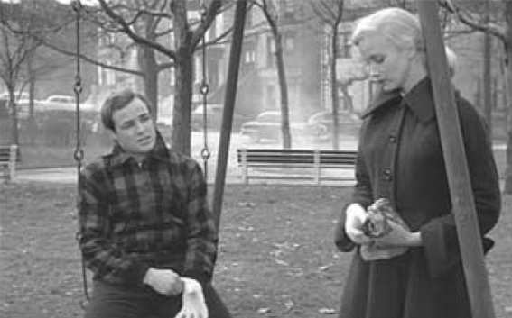

> [BREADCRUMB_CTX: 《Audio-Vision: Sound on Screen》 > 8. Toward an Audio-Logo-Visual Poetics (Part 1)]

# 8. Toward an Audio-Logo-Visual Poetics

8

TOWARD AN AUDIO-LOGO-VISUAL POETICS

The world is in motion and in chiaroscuro. We can see only one side of things at once, only halfway, and they are always changing. Their outline dissolves into shadow, reemerges in movement, then disappears in darkness or a surfeit of light. Our attention, too, is in chiaroscuro. It flits from one object to another, now grasping a succession of details and then the whole.

The cinema seems to have been invented to represent all of this. It shows us bodies in shadow and light; it abandons an object only to find it again, and isolates it with a dolly-in or resituates it in a zoom out.

There is only one element that the cinema has not been able to treat this way, one element that remains constrained to perpetual clarity and stability, and that is dialogue. We seem to have to understand each and every word, from beginning to end, and not one word had better be skipped. Why? What would it matter if we lost three words of what the hero says? Yet this has remained almost taboo in cinema. We are only beginning to learn how, for, as we shall see, in sound film there is a lot riding on those three lost words.

Before the sound film, the silent film—in spite of its name—was by no means without language. Language was doubly present: explicitly, in the text of intertitles, and implicitly, in the very way the images were conceived, filmed, and edited to constitute a discourse, in which a shot or a gesture was the equivalent of a word or a syntagma. Shots or gestures said “Here is the house” or “Pierre opens the door.”

The intertitle had an inherent limitation: it interrupted the images; it implied the conspicuous presence in the film of a foreign body. At the same time it allowed great narrative flexibility, since title cards could be used to establish the story’s setting, to sum up some action, to issue judgments about the characters, and of course, to give a free transcription of the spoken dialogue. Generally the text merely summarized what was being said; it made no pretense to exhaustiveness. Dialogue could be presented in direct discourse or indirect discourse (“she explains to him that …”). In short, the silent film had the entire narrative arsenal of writing at its disposal, which I have discussed at length in Words on Screen.1

The sound film put an end to all that, in its early stages at least, by reducing text in the film virtually to one single form: dialogue spoken in the present tense by characters. This remains the predominant mode today, although a good number of contemporary films have voiceover narration as well. One sees numerous variations, too—for example, verbal chiaroscuro favored in some French auteur films and a recent predilection for multiple languages or accents in a single film.

The transition from the plural functions of intertitles to direct dialogue did not occur overnight. Over a five- or six-year period various formulas were tried before almost all films settled definitively into this paradigm of the dialogue film. Direct dialogue was not the only possible model, however, and I wish to explore its two exceptions.

Let me distinguish three modes of speech in film (in the cases where speech is really heard and not just suggested or hinted at). I call them theatrical speech, textual speech, and emanation speech.

THEATRICAL SPEECH

In theatrical speech, which is the most common, the dialogue heard has dramatic, psychological, informative, and affective functions. It is perceived as dialogue issuing from characters in the action, it has no power over the course of the images, and it is wholly intelligible, heard clearly word for word. It is to theatrical speech that the early talking film resorted and continues to resort on a massive scale. In special cases we may hear a character’s internal voice in the present tense, analogous to a theatrical aside. But even here, the text we hear remains a concrete element of the action, with no power over the reality shown in the image (a power that does belong to textual speech, as we will see).

Theatrical speech conditions not just the soundtrack but the film’s mise-en-scène in the broadest sense. From screenplay to editing, by way of setting, acting, lighting, camera movements, and of course acting, everything is in fact conceived, almost unconsciously, to make the characters’ speech into the central action and at the same time to make us forget that this speech is what structures the film. This explains the paradox whereby certain films we remember as action films, like many American productions, are in fact dialogue films nine times out of ten. (Such films treat the dialogue as action, in the way it interacts with visual and acoustic rhythms and stresses: we will discuss this scansion of the said and shown presently.) A striking example is Howard Hawks’s Rio Bravo (1959) and also most of Hitchcock’s sound films, despite his reputed disdain for dialogue.

The device in classical cinema of having characters speak while engaging in some physical business serves to restructure the film through and around speech. A character closing a door or mixing a drink or making a hand gesture or lighting a cigarette, or a camera movement or a reframing—everything can become punctuation and thereby a heightening of speech. This makes it easier to listen to dialogue and to focus attention on its content. What is important where characters often have something useful or pleasurable in their hands to occupy them is that what they do, interrupt, or resume doing has no relation to the content of their speech (or else it’s a subtext, as when Marlon Brando plays with Eva Marie Saint’s gloves in Kazan’s On the Waterfront [figure 8.1]).

In films conceived on this model even the moments when characters don’t speak take on meaning as interruptions in the verbal continuum. The kiss, for example, stops characters from speaking; by interrupting the confrontation or discussion or string of justifications it can break a verbal impasse. This effect is much more cinematic than theatrical or operatic.

I call braided films those in which physical actions and verbal remarks interweave. These would include most classical American films and contemporary action films. In unbraided cinema, small actions by speaking characters serve much more rarely to punctuate their dialogue; some films go so far as to have characters do nothing at all but speak or listen. For example, in much of Manoel de Oliveira’s work, or in Rohmer’s My Night at Maud’s (1969), the spectator has the impression of watching “talky” films, while she does not tend to feel the same way with respect to a braided scene that might actually contain more dialogue.

FIG. 8.1  On the Waterfront (1954). Terry (Marlon Brando) distractedly dons the glove of the attractive young Edie (Eva Marie Saint), in one of the most famous scansions of dialogue in the cinema.

Filmmakers might choose to alternate static dialogue scenes with violent action scenes that are much more laconic. This is one of Quentin Tarantino’s trademarks.

TEXTUAL SPEECH

In textual speech, the sound of speech has a power of its own: the mere enunciation of a word or sentence can mobilize images or entire scenes. Textual speech—generally that of voiceover commentaries—inherits certain attributes of the intertitles of silent films, since unlike theatrical speech it acts upon the images. This iconogenic speech of a voiceover or a character in the action might threaten to nullify the consistency of the diegetic world, so that the film becomes little but images to page through, at the will of sentences or words. If it is overused, there no longer remains an autonomous audiovisual scene, no notion whatever of spatial and temporal continuity. The realistic images and sounds are at its mercy.