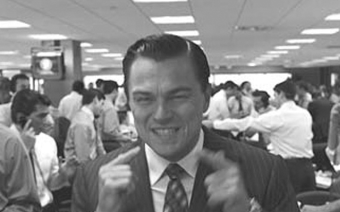
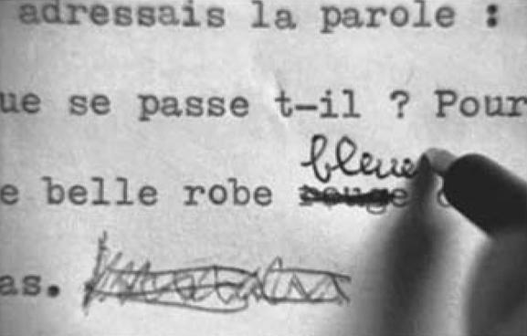

## 8. Toward an Audio-Logo-Visual Poetics (Part 2)

> [BREADCRUMB_CTX: 《Audio-Vision: Sound on Screen》 > 8. Toward an Audio-Logo-Visual Poetics (Part 2)]

Since textual speech can invalidate the notion of an audiovisual scene, though, the cinema generally tends to impose a strict quota on its use. This great power is generally reserved for certain privileged characters and is granted only for a limited time.

Early talking films were fascinated by its possibilities. Fritz Lang was one of those tempted to give textual speech free play, endowing almost any character at any moment with it in M and The Testament of Dr. Mabuse. In the 1930s Sacha Guitry played most daringly with omnipotent textual speech in Story of a Cheat (1936).2 But in time, as other films took it up, they learned to deploy it in a more prudent and limited way (with some famous exceptions). Even with Welles, textual speech takes over for only a few minutes at a time, for example in the opening sequences of The Magnificent Ambersons (1942) and The Lady from Shanghai (1948). It appeared with some frequency in literary adaptations (Robert Bresson’s Diary of a Country Priest [1951], Alexandre Astruc’s The Crimson Curtain [1953]) and at the beginning of many American films noirs of the 1940s and 1950s. There it was either the voice of the protagonist or, in the “neorealist” American crime film, the voice of an objective external narrator, as in Kubrick’s The Killing (1956).

After several decades of being on the back burner, textual speech made a spectacular return in the 1990s, often in big movies like Scorsese’s Goodfellas (1990) and more recently The Wolf of Wall Street (2013 [figure 8.2]), Toto the Hero (Jaco van Dormael, 1991), Trainspotting (Danny Boyle, 1996), Fight Club (David Fincher, 1999), Magnolia (Paul Thomas Anderson, 1999), Amélie (Jean-Pierre Jeunet, 2001), Dogville (Lars von Trier, 2003), Tabu (Miguel Gomes, 2012), and Irrational Man (Woody Allen, 2015). Each of these more recent films presents a specific case; in some, the narrative voice is heterodiegetic, which is to say that the disembodied narrator is not a person in the story (Dogville, Amélie); in Irrational Man, the two or three main characters alternate their diegetic narrative voices.

FIG. 8.2  The Wolf of Wall Street (2013). Drunk with his power to tell the story, the main character Jordan Belfort (Leonardo Di Caprio) directly addresses the viewer.

In many films, therefore, the textual speech of a voiceover narrator engenders images with its own logic just long enough to establish the film’s narrative framework and setting. Then it disappears, allowing us to enter the diegetic world with a continuous sense of time and place (think of Preminger’s Laura). We might not be reminded of the narrator’s presence again until a whole hour or more into the film, and often the story in between has become completely autonomous from the textual speech in creating its own dramatic time, showing us scenes that the voiceover narrator could not possibly have seen. This “contradiction” works quite well in movies, strangely enough: for example, Journey to Greenland (Sébastien Betbeder, 2016). The narrator can be a protagonist, a secondary character as witness (Truffaut’s The Woman Next Door, 1981), or, alternatively, an external, all-seeing novelistic narrator. The third case bears obvious similarities to the position of the narrator in the traditional novel, the primary difference being that here words become actualized.

Textual speech is inseparable from an archaic power: the pure and original pleasure of transforming the world through language and of ruling over one’s creation by naming it.

TEXTUAL SPEECH VERSUS THE IMAGE

Textual speech in film is granted an additional power beyond the ones it enjoys in literature. It causes things to appear not only in the mind but right before our eyes and ears. This power is countered by another: no sooner is something evoked visually and aurally by words than immediately we see how that which arises escapes from the abstraction of language because it’s concrete, fortified with details. The image creates sensations that words could never evoke, no matter how much they might try. If for example the text-voice of the film evokes a woman by spelling her name, and if this woman happens to be seen wearing a scarf, this scarf not spoken by the text is what we will see. A sort of mutual challenge arises here. The text seems to create images as it wishes, but the image retorts, “you’re incapable of telling everything about me.” What follows from this is an effect I will discuss further on, which I call c/omission between the said and shown.

Several scenes in Truffaut’s The Man Who Loved Women (1977) play upon this reciprocal power struggle. As we listen to the memoir read aloud by the womanizer played by Charles Denner, the women passersby we see on screen correspond a little, or very little, or not at all with the inventory of women’s body types that the text is droning out at the same time. At other times in the film, the color of a dress worn by a little girl changes according to the narrator’s editing decisions (figure 8.3).

This may be why, in so many occurrences of textual speech in films, the mise-en-scène takes care to give the image a stylized, artificial, and general turn (by controlling lighting, setting, costumes, and also discreetly through ambient sound), as if to bring the image more closely in line with the text and partly close the gap between them. This happens in Lang’s M, where the abstract settings and the frequent absence of any clear reference to time, place, and weather render the image more docile. Other films attenuate the physical sound of the reality that’s described in textual speech (Miguel Gomes’s Tabu, 2012) or omit it altogether.

FIG. 8.3  The Man Who Loved Women (1977). Bertrand Morane has only to correct the color of a dress in his memoirs, and the color changes on screen.

Some filmmakers, on the contrary, like to accentuate the gulf between narrative speech and image and to create contradiction, lacunae, or grating discord between the two. Not surprisingly, these include Orson Welles (The Magnificent Ambersons) and Michel Deville (Le Voyage en douce, 1980; La Lectrice, 1988), directors who are particularly interested in the question of power. Indeed, in their films the point is to determine which has the upper hand: the word or the image, the said or the shown.

Finally, there are many films that use this confrontation playfully in the form of gags, old as the cinema itself, where the image gives the lie to the text—or rather, obeys it by making fun of it. Think of Don Lockwood (Gene Kelly)’s verbal account, at the beginning of Singin’ in the Rain, of his glorious career as a great artist—a story betrayed by the visuals that show him to have been a second-rate vaudevillian; better yet, we might say that the images follow along with his story but stick out their tongue at it. The same contradiction game, but now as the pinnacle of avant-gardism, appears in Robbe-Grillet’s L’Homme qui ment (1968).

A SPECIAL CASE: THE WANDERING TEXT

Godard’s video A Letter to Freddy Buache (1982) owes its renown no doubt to its concision and simplicity of means. Godard received a commission to celebrate the five-hundredth anniversary of the city of Lausanne (a request his resulting ten-minute video in fact refuses to honor). The ingredients of his piece: the author’s voice addressing Freddy Buache,3 telling how the film should have been made (not without a hint of complaint and regret), images of Godard operating camera and sound equipment (but we don’t see him speaking in synch sound), silent shots panning across Lausanne and the surrounding countryside, and musical accompaniment for the whole thing provided by Ravel’s Bolero. The video stands apart from ordinary documentary filmmaking because of the particular nature of the voice that runs alongside the images, by the distinctively “meandering” form of their interrelationship.