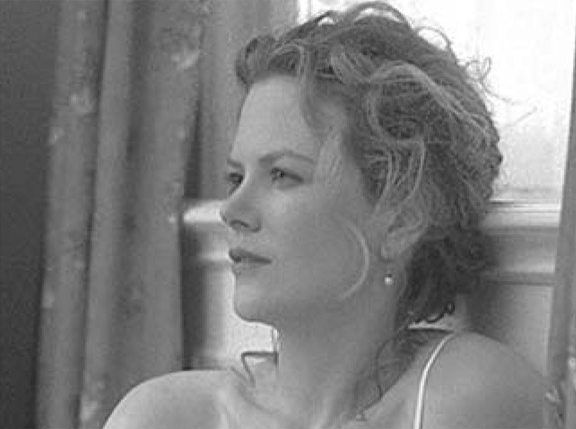

## 8. Toward an Audio-Logo-Visual Poetics (Part 3)

> [BREADCRUMB_CTX: 《Audio-Vision: Sound on Screen》 > 8. Toward an Audio-Logo-Visual Poetics (Part 3)]

Godard’s voice does not utter anything that sounds like a finished text. The voice speaks as if searching for words; it repeats them, hesitates, fumbles and starts up again, finds a phrasing that sounds right, good enough to write (“the sky and the water,” “the city is fiction”). Laterally tracking along the city and environs, the camera, too, seems to be searching, stopping, resuming, daydreaming, feeling its way. Between spoken discourse and image there is little direct synchronization of meaning, only several brief encounters and some overall convergences. Nevertheless, the affirmative tone taken by the voice finds itself suddenly coinciding with a visual cut now and then, as if something—meaning, coherence—had momentarily been found. These moments are like flashpoints, points of synchronization when something “jells” before becoming diluted once more in the flows of words and images.

Text as well as images refer both to the horizontal dimension (railroad tracks, surface of the water, ground) and to the vertical (the camera moves up and down trees and signs). Everything plays on hesitation and the diagonals between one and the other.

A Letter to Freddy Buache in fact has a precursor in a work I’d be very surprised if Godard didn’t know: Story of a Cheat. This 1936 film, which I have already mentioned, is narrated throughout by Guitry’s own voice in the first person and is practically devoid of any synch sound. One sequence consists of a description of the principality of Monaco, and much like Freddy Buache, it is based on rhetorical oppositions such as city/village and casino/palace. The camera emphasizes these binaries by dutifully flash-panning from one point to another, from city to village and casino to palace, expressing childish jubilation in submitting the look to the voice. Godard constructs similar rhetorical oscillations: ascending/descending, sky/water, city stones/natural rock formations, which to varying degrees are echoed in the image, in some edits and camera movements. A major difference, however, is that while Guitry’s camera quickly obeys and submits to the vocal text, Godard’s camera dawdles, seems prey to the temptation to linger on things it discovers along the way, such as the odd tree, sign, line on the ground. The camera stumbles, and sometimes in this stumbling it seems to make little discoveries. And all along, between the meandering speech and the equally wandering image, Ravel’s music implacably pursues its course, playing the part of a straight line of reference. This is textual speech that we can characterize as wandering.

THE OPPOSITE OF TEXTUAL SPEECH: NONICONOGENIC NARRATION

Textual speech, generating images as it does (and remember that it developed out of silent film intertitles), makes possible its opposite, noniconogenic narration.

Since the advent of the talking picture, once a character begins a lengthy voiceover narration, we commonly expect to see the scenes that the voiceover evokes. This evocation can be allusive—some fleeting imagery—or the voice can introduce a scene that then assumes the present tense and stops being part of a narration. That is, until the return of the voiceover brings us back.

What I call noniconogenic narration (literally: narration that does not create images) is a specific cinematic effect that is all the more striking. It’s the situation in which a character tells a story at length, which she says was told to her or which happened to her, and in which all we see in the image is the person speaking (plus anyone who may be listening). It has struck me that often this narration is fundamental to the film in some way: it plays the role of an absolute point of departure; it becomes the sole reality.

In Bergman’s Persona, the nurse’s long stories about her sexual orgies that she tells her silent patient rest solely on the narrator’s word. In Tarantino’s Pulp Fiction (1994), it’s the story of the lucky family watch, when Christopher Walken gives it as a gift to a little boy named Butch who as an adult has the features of Bruce Willis. And in Bob Rafelson’s The King of Marvin Gardens (1972), the scene occurs at the beginning of the film; it makes us think Jack Nicholson is confessing directly to us, while really he is speaking into a microphone, on air at a radio station.

In Alain Resnais’s Mélo (1986), the noniconogenic narration is the story of Marcel’s affairs with women that he tells his two friends. The film is an adaptation of a play by Henry Bernstein, and the director (who brings out the film’s theatrical nature via the look of the set, even though scenes are often shot in closeup) makes us even more aware of this decision not to “use” the narration to transport us into the story. For quite often it is because of a closeup on a character’s face that the spectator understands that his or her storytelling will soon take shape in sounds and images.

FIG. 8.4  Eyes Wide Shut (1999). Alice (Nicole Kidman) confesses to her stupefied husband that she has fantasized leaving him for an anonymous man she met. Nothing in the image shows or proves this; everything rests on speech.

Then there is Kubrick’s Eyes Wide Shut. Alice (Nicole Kidman) tells two stories to her husband, Bill (Tom Cruise)—her purported fantasy about a naval officer and a dream about a sex orgy. These are never shown visually, except for Bill’s own fantasy visualization of her accounts. Everything here hinges on a woman’s words (figure 8.4).

EMANATION SPEECH

Despite its relative infrequency, textual speech has been considerably discussed and theorized, often considered as an annex or outgrowth of literature. The third mode, which I call emanation speech, generally goes unnoticed, inasmuch as it is antiliterary and antitheatrical.

Emanation speech is speech that is not necessarily heard and understood fully and in any case is not causally connected to what we consider the movie’s action. The effect of emanation speech arises from two things. First, dialogue spoken by characters is not totally intelligible. Second, the director may direct the actors and use framing and editing in ways that run counter to the standard rules—avoiding emphasis on articulation, the play of questions and answers, important hesitations and words. Speech then becomes a kind of emanation or aspect of the characters akin to their silhouettes—significant but not essential to the mise-en-scène and action.

Emanation speech, while the most cinematic, is thus the rarest of the three types of speech, and the sound film has made very little use of it. Still, we find it in the films of Jacques Tati and filmmakers inspired by him and, in different ways, in Tarkovsky, Fellini, and Ophuls, as well as in smaller doses elsewhere.

The three types of speech—theatrical, textual, and emanation—could all be found in the silent cinema; emanation speech was present in that the characters expressed themselves abundantly but very little of what they said was “translated.” The visual depiction of speaking thus didn’t oblige the mise-en-scène and acting to illustrate or explain every word. With sound, this freedom disappeared little by little. As the cinema adopted and restructured itself around theatrical speech, it would increasingly align itself with the model of a linear verbal continuum.

Filmmakers were aware of this risk. From the very beginning of sound, many of them sought to relativize speech, to attempt to inscribe speech in a visual, rhythmic, gestural, and sensory totality where it would not have to be the central and determining element.