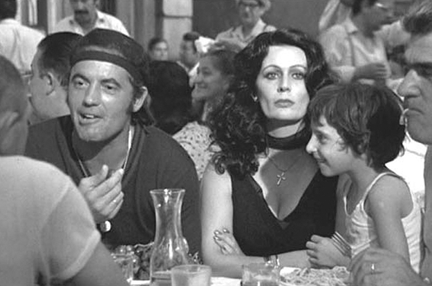
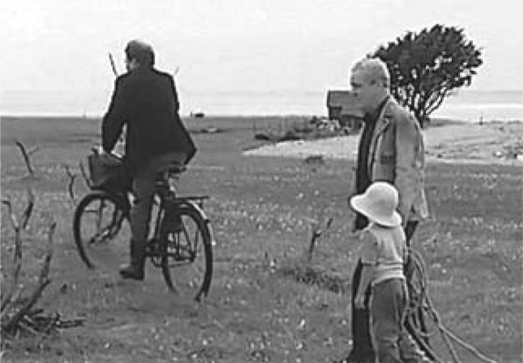

## 8. Toward an Audio-Logo-Visual Poetics (Part 6)

> [BREADCRUMB_CTX: 《Audio-Vision: Sound on Screen》 > 8. Toward an Audio-Logo-Visual Poetics (Part 6)]

What we might call the decentered talking film, using emanation speech, is something else again—a polyphonic cinema. Prefigurations and examples of it are found not only in the work of certain auteur directors but also in contemporary action or special-effects films. The use of different sensory effects and the presence of various sensations and rhythms in such films give us the feeling that the world is not reduced to the function of embodying dialogue.

Other filmmakers have aimed for a lyrical dimension, interweaving dialogue, poems, reflections, and sensations. In this mode, Terrence Malick’s The Thin Red Line (1999), above and beyond its emotional power (the suffering, doubts, and fears of American soldiers in the war of the Pacific), was influential.

FIG. 8.5  Fellini-Roma (1972). Comments fly at an outdoor restaurant in Rome’s Trastevere in the 1930s; the editing captures faces and looks without punctuating or explicating dialogue.

ENDLESS INTEGRATION

In a certain sense this new decentered talking film is like the silent cinema, but with the addition of sound. It might well mark the third period of narrative cinema, a period of reincorporating values that speech had led the cinema to throw onto the scrap heap. Of course, this “third cinema” can only exist in the form of promises, fragments, baby steps, as parts of films that generally stick to the conventions of traditional verbocentric cinematic écriture. Nonhomogeneity guarantees the cinema’s vitality and originality in the present era.

The history of film can thus be told as an endless movement of integrating the most disparate elements: sound and image, the sensory and the verbal. A given period might witness a successful fusion, but at the price of many simplifications and impasses and with the dictatorship of one element over the others. And there are other periods, like today, when we see new exploration and evolution, when the cinema explodes in its disparity but creates marvelous things in the process. This also happened in the 1950s with American musicals. Celebrated later on through fabulous excerpted clips, the musicals in their day were only bearable for the ten or twenty minutes of greatness in each (more than enough for those who loved them). Why? Because the intervention of song and music decentered the system, creating imbalances and awkward transitions between musical and nonmusical passages—but wonderful moments too. The situation today is similar for many action and special-effects films.

These films foreground an incongruity at their core, arising from the co-presence of new approaches with traditional editing and realist mise-en-scène in much the same way that opera, at a certain stage in its history, was obliged to accept the cohabitation of recitative and song. The journey is not yet over. The way is open to new Wagners, who will emerge in the context of auteur cinema or genre cinema and seek new solutions to the perpetual problem of integrating the real with the verbal.

Increasingly in recent films, the image has been partaking in the verbal, just as in our daily life our conversations through text messaging, Facebook, and email occur through writing. In Jim Jarmusch’s Paterson (2016), the protagonist, played by Adam Driver, refuses to own a cell phone, but the poems he writes in his head while driving his bus route appear on the screen at intervals, superimposed on his internal voice and on the image of the streets he drives through.

A kind of lyricism of visible writing is emerging in the movies, and it’s encountering the heard word in quite interesting ways. In Words on Screen, I showed how the visible and audible forms of language are profoundly different, in “counterpoint” with one another, and how they make fissures in the cinema as well.6

Yet the verbal in film, that which is named, is too often confined to its own sphere in film analysis. What’s interesting about cinema is the way it creates dialogue between a given, specific reality, recorded or reconstituted, visual or auditory—what I call the shown (auditory or visual)—and the word, read or heard, which is always general and pertains to the said. Where you might write or say the word “house,” which is a general category, the image always represents a specific house. Where the word “shout” stands for a wide range of sonic productions (man’s or woman’s shout? shout of joy or fear?), the sound in a film will always give us a specific shout to hear. This is why I would like to recall that in addition to the image-sound dichotomy, a second dichotomy cuts across the sound film: the said and the shown, given that almost all films include verbal language.

THE SAID AND THE SHOWN

On the basis of studying hundreds of films, I suggest six basic forms of the confrontation between what is verbalized (heard or read) and what we perceive as the physical world (through the auditory or visual channel). These are the six said/shown relationships enumerated here.

1. Scansion of the Said by the Shown

This form, which I have already mentioned in connection with theatrical speech, applies when what a character does (or does not) do while talking, or an event in the auditory setting (car horn, animal cry) or visual setting (a passing car), has the effect of punctuating, giving meter to speech, and helping the spectator hear it. Objects the characters hold and use, actions or gestures they make, vehicles they drive, scene construction through editing (having us see a character’s face when someone else’s comment touches or concerns her) or framing (changes in scale), and so forth all contribute to this scansion. The scansion of the said by the shown is central to most verbocentric cinema.

2. Contrast Between the Said and the Shown

What characters say can contrast with what they do or are about to do, without being contradictory. In Rear Window the sublimely dressed Lisa languorously kisses her lover while they talk about trivialities. Hitchcock often capitalizes on this contrast in romantic scenes.

3. Contradiction Between the Said and the Shown

In discussing Singin’ in the Rain and L’Homme qui ment I have already mentioned this rhetorical figure, when what is said by the voiceover or narrator is contradicted by what’s onscreen; the image generally tells us what has “really” taken place. The spectator consciously identifies and appreciates this. Orson Welles often played with this mismatch: think of the two (nondiegetic) narrative voices of The Magnificent Ambersons and the (diegetic) protagonist’s voice in The Lady from Shanghai.

4. Counterpoint Between the Said and the Shown

Counterpoint is the name we can give to what happens when what the characters do and what they say, or what they say and what is going on around them, are parallel, without the actions punctuating the words and without there being any particular contrast or contradiction. The lengthy initial sequence of Tarkovsky’s The Sacrifice is a good example. Protagonist Alexander (Erland Josephson) strolls about and makes declarations about life, faith, etc., while his young boy, who’s temporarily mute because of a throat operation he’s had, plays and moves around near him, without appearing to pay attention to what his father is saying. At the same time, a strange philosopher-postman, Otto, traces figure-eights on his bicycle around the man and boy while carrying on a disjointed, erudite dialogue with the father. Surrounding this trio is an indifferent nature, with the cries of birds flying overhead. This sequence makes for a fascinating example because the words the protagonist believes are fruitless will indeed leave a mark on his child, when the latter, left behind by his father, will find speech again in extremis at the very end of the film and will repeat his words.

