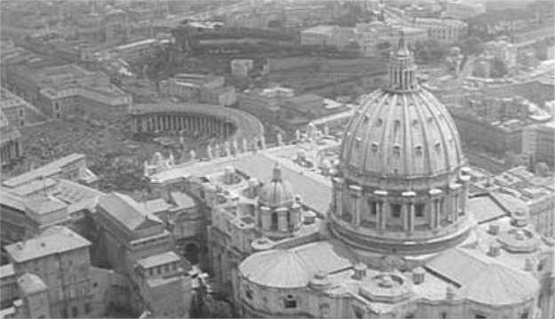
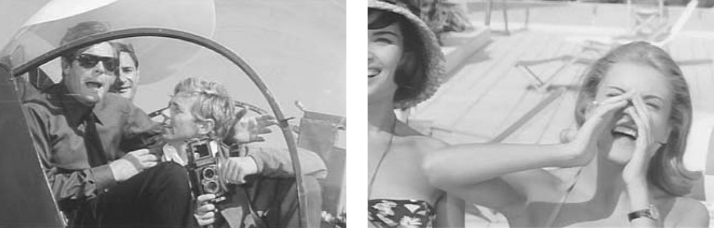

## 9. An Introduction to Audiovisual Analysis (Part 4)

> [BREADCRUMB_CTX: 《Audio-Vision: Sound on Screen》 > 9. An Introduction to Audiovisual Analysis (Part 4)]

Among many interesting remarks, I found in their essays a number of phenomena I’ll categorize as retrospective illusion, which eloquently attest to the workings of added value. For example, some radio music (on-the-air) is heard in the shot of the women tanning on the roof. Certain students described this music as “full of life, sun, and joy” or “reminiscent of the beach and the sun,” while what’s on the soundtrack is a pleasant swing tune with no special characteristics; this music might just as fittingly accompany a shot of a busy street at night. What happened is that the plot situation rubbed off on the music as the students remembered it.

There were also false memories, for example memories of sounds that were merely suggested by the image and the general tone of the sequence. In an aerial shot of St. Peter’s Square crammed with people, one student heard the “acclamations of a crowd.” This sound does not exist; it was created (as a phantom sound) by the sight of the crowd and by the grand clanging of church bells heard with the image (figure 9.1).

In addition, sounds that do exist and are even quite prominent seem to have evaporated in some students’ memories. One noted an abrupt silence in the shot of the women in bathing suits—having totally blocked out Nino Rota’s swing music; apparently all he retained from that moment was the fact that the helicopter’s thrumming is interrupted (external logic).

FIG. 9.1  La dolce vita (1960). St. Peter’s basilica in Rome, filmed from a helicopter; we hear the bells but not the crowd.

Some students “interpreted” aural fluctuations based on visual movements they observed. Having seen the helicopters very definitely approaching or receding from the camera, many “heard” the sound’s volume increase in what they felt was an exact parallel to the image (“the sonic world is in exact synch with the shots on the screen”). A few students, however, noticed that the sound in fact “follows” the image much more loosely. They recognized that the visual respirations of flying objects increasing and decreasing in screen size are sometimes answered by audio respirations, swelling and diminishing of sound, and noted that these two processes do not follow a point-by-point synchronism as much as a principle of deferred propagation (the sound swells early or with a delay with respect to what is seen). It’s precisely this time lag that makes everything seem natural, like a series of waves that spread out in intervals. (It should be noted that in real experience, variation in volume of a moving object is not exactly parallel to its variation in our field of vision, either.)

Another student astutely noticed that in the sequence “sounds vary with an uneven volume that does not seem to depend exclusively on their distance” (meaning the distance from their sources to the camera).

Some students felt the need to rationalize the modifications and anomalies in the sound-image relationship by attempting to apply the rule of point of audition to them mechanically. If we do not hear a sound implied by the image, they reasoned, this is either because the character in the image is for some reason not hearing it (subjective sense of point of audition) or because of the camera’s position (spatial sense of point of audition).

Thus some participants attempted to justify—while they were only asked to describe—variations in volume by making an ambiguous reference to subjective point of audition. For example, regarding the drowned-out dialogue between the men in the helicopter and the women on the terrace, one student proposed that “our hearing the women’s voices but not the men’s reflects perhaps that the men are used to the helicopter’s sound, and so for them, it has become background, rather than the noisy roar it is for the women.” The author of this comment interprets the images of the women (whose voices are heard) as being situated in the men’s points of view and audition, and vice versa, even though there is nothing in the film to indicate this. If we judge by the camera positions, much closer to the women than to the men, we would conclude rather that the whole scene is constructed from the female point of view, and so it would be logical that it’s the women who hear their own voices and not the men’s voices … So we can see all the ambiguity that inheres in the notion of point of audition, here, in its subjective sense (figure 9.2).

Regarding the same scene, another student frankly reversed the situation in his memory: “The sound of the women’s voices is covered up by the sound of the helicopter” (while in reality we do hear the women). Unless by “covered up” he means not that the sound is inaudible but that it is partially drowned. The same term can thus mean two opposite things, and we can never be too careful about being sufficiently precise, since the rigor of the perception depends strictly on the rigor of language used to describe it.

FIG. 9.2  La dolce vita (1960). Men and women try to talk to one another above the din of the helicopter: who hears whom and why?

Does this mean that audiovisual description must be limited to a sort of inventory of details, shying away from any reading or overall perspective? Certainly not. The most interesting essays were those that freed themselves from the causal yoke (the soundtrack has X because the image shows Y) in favor of a dynamic analysis—that is, an analysis that takes into account the evolving and changing nature of soundtrack and image in time. One student discerned in the sequence’s audiovisual structure a principle of perpetual movement and overlapping. He grasped this as a general principle from the outset and not event by event. For example, in the first sequence, we hear a group of children’s joyous shouts emerging like a wave from under the helicopters’ noise, then later the bells of St. Peter’s covering and absorbing in its turn the hum of the blades, and so on.

According to another student, the dynamics of this overlap pattern resembles wave dynamics. Indeed, the organic quality of a wave’s profile presides over the sonic organization of the first sequence. Appropriately, this scene revolves around a vibrating ovoid object that can follow less linear trajectories than airplanes do—something that can grow, fly around in all three dimensions, and hover in one place, like a living and breathing organism. There are many reasons why the helicopter is such an expressive audiovisual motif in film, even well before Coppola’s Apocalypse Now (1979).

The same student who discovered the overlap principle notes that each of the segment’s two parts centers on a particular sound: the helicopter’s drone in the first and the exotic music of the second. He further notes that while the first main sound, the hum of the propellers, is mobile, sound provides a fixed reference point in the second, in the form of the nightclub musicians.

A subtle observation, which seems acoustically false: the music in the nightclub in fact changes volume at various points and fades down as soon as the characters open their mouths. But at the same time it feels profoundly right. Why? Because the fluctuations of the helicopter sound in the first part and those of the music in the second do not obey the same logic, nor do they progress in the same direction.

In the first scene, sound, and its source that moves in all directions in space, fluctuates according to a logic that seems determined from within (internal logic). In the second, which is characterized by more traditional dialogue and structure, sound levels decrease by discontinuous thresholds. The changes appear to be imposed on the musical material from without (external logic) when we hear dialogue—as if obeying a change in point of view. Despite changes in volume, the sound of the nightclub music nevertheless remains the audio-viewer’s fixed point of reference in the scene.