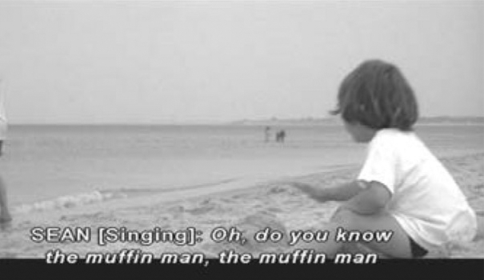
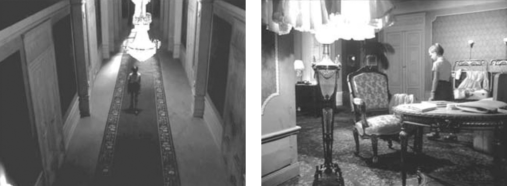

## 9. An Introduction to Audiovisual Analysis (Part 5)

> [BREADCRUMB_CTX: 《Audio-Vision: Sound on Screen》 > 9. An Introduction to Audiovisual Analysis (Part 5)]

CONTEXT AS THE KEY TO UNDERSTANDING THE EFFECT PRODUCED BY AN ISOLATED MOMENT

Take a scene that occurs about thirteen minutes into Steven Spielberg’s Jaws (1975), when the police chief played by Roy Scheider is on patrol. On Amity’s crowded beach, he gazes out at the water, watching for a shark—the shark—while carefree bathers of all ages enjoy themselves in the sun and sand. The end of this sequence frequently comes up when film students are asked to identify occasions where the “use” of music has struck them with particular force. I am referring to the moment when the shark attacks and John Williams’s cue strikes up, with a forceful mechanical rhythm in the strings strongly reminiscent of Stravinsky’s Le Sacre du printemps.

One might wonder why this mechanical rhythm has such a powerful effect on them. It seems to me that it’s because of what comes earlier in the scene. Just before the shark returns as feared, a little boy sings a familiar children’s song while he builds his sand castle: “Oh, have you seen the muffin man, the muffin man, the muffin man?” (figure 9.3). Cinema often deploys a child’s singsong tune to announce evil and danger, relishing the ironic clash of childhood innocence with horror. At the opening of Lang’s M, for example, a circle of little girls sings a tune as part of their elimination game, foreshadowing the disappearance of Elsie at the hand of the murderer.

FIG. 9.3  Jaws (1970). An innocent children’s song precedes the arrival of the shark … and of John Williams’s music.

Going still further back in the sequence, we realize that music from transistor radios on the beach also plays an important role. For example, there’s the minuet from Mozart’s Eine kleine Nachtmusik, especially the fact that this reassuring music is suspended from time to time, when something that might be disturbing grabs the police chief’s attention. We stop listening to Mozart at those moments to better hear only a splash or an unfamiliar sound.

This suspension of the music can be justified logically by the fact that we’re watching shots of distant objects magnified by telephoto lenses, therefore far from the beach. But that’s a bad reason, as if there needed to be a reason. What is important here is the effect of suspension. Voids can be created only by the fullness surrounding them. Okay, the primal musical effect is admirable—the mechanical rhythm for accompanying the arrival of a killer monster, such a cliché that composer Williams need not be proud of it—but what really should be admired is the art and subtlety it took in the editing of this sequence (the widely admired work of Verna Fields) to arrive at this moment: especially for sound, the presence of familiar harmless elements that disappear, reappear, and are suspended.

ANALYSIS OF A SEQUENCE IN BERGMAN’S THE SILENCE (1963)

What follows is an audiovisual analysis of a six-minute segment of The Silence. The excerpt is described here exactly as it appears in the film; no passages are omitted. It can be found between approximately 58:20 and 1:04:30 from the start in the DVD version.

The setting. A boy named Johan, his mother Anna, and his aunt Ester arrive by train in a big city where a language they don’t understand is spoken (and which is not subtitled for us). The three are staying in a suite in a large hotel that is practically empty, on a small street that’s busy by day and almost deserted by night. The sequence in question takes place at night. Ester, who is ill, has remained in her room. Anna has gone to another room in the hotel with a man she met in a café and who has come to meet her. Johan watches the couple through the keyhole, witnessing his mother undress before having sex.

Summary of the segment. At the beginning we see Johan, seen from above (this is shot in a studio); after observing his mother through the keyhole, he wanders, at loose ends, through the hotel’s empty corridors. He returns to the suite and tries to read but gets bored. He knocks and enters the bedroom where his aunt is sleeping with her mouth open. Without explanation, a small tinkling, then ringing, then rumbling leads to the nocturnal arrival of a small military tank, which abruptly stops in the empty street under the bedroom windows. Now awake, Ester starts to talk with her nephew and asks him to read to her. He offers to act out a little play for her instead and runs to fetch his hand puppets. His two puppets engage in a short, hectic argument. Ester encourages the unhappy boy to talk; he jumps onto the bed and cuddles up with her. We hear the tank leave. Finally we see Anna with the stranger she has slept with. They do not speak; their silence is heightened by the ticking of an alarm clock. Anna looks out the window, down and then up toward the sky, as the stranger absentmindedly jingles the bracelets Anna had taken off while undressing.

JOHAN WALKS IN THE HALLWAY (58:20–59:03)

Applying to this brief passage the two-part question I have offered for analysis—What do I hear of what I see? What do I see of what I hear?—we realize that not only does the child not speak but also that his footsteps make no sound. I call athorybal a visible phenomenon whose sound we do not hear (from the Greek athorybos). This gives Johan’s walking a mysterious air. It is beside the point to say it’s logical for us not to hear anything since Johan is walking on a carpet. The director could have assigned a subtle muffled sound to these footsteps, or of course he could have eliminated the carpet. This scene can thereby be described as having phantom sound (figure 9.4).

FIG. 9.4  The Silence (1963). Johan wanders through the hotel hallway as a distant alarm sound is heard. Bored, he decides to enter his aunt Ester’s room.

Along with the boy’s steady silent walking, seen in bird’s-eye view, we hear a mysterious repeated tone, distant and regular, which in the era of the film would be understood as diegetic (we’ve already heard this sound once before, near the beginning of the film). Sustained on one stable note, the sound resembles a boat’s foghorn but could also be some kind of alarm indicating danger. It is acousmatic—we do not see its cause. And interestingly, Johan does not react to it.

The relationship of characters to diegetic sounds that they don’t produce themselves is obviously an element of analysis: characters can react to them, or name them, or, as happens here, show no reaction at all.

Further, we have here a characteristic example of an exterior sound with vast extension, which enlarges our perception of the city even as it emphasizes the silence of the scene. The image, on the other hand, depicts a space that is enclosed, limited.

Note that the shot clearly shows an event that’s easy to identify (a boy walking), while the sound presents an uncertain event (narrative indeterminacy of an acousmatic sound).

Reduced listening helps us pinpoint the sonic form of this mysterious sound event: it is a continuous, prolonged G, a tonic sound repeated several times.

So this fragment presents a sound with no image and an image with no sound, brought together in one moment, constituted in the same world. Hence the superimposition of two sensory phantoms, to use the formulation of Maurice Merleau-Ponty, which may be a common occurrence in daily life but which yields a sense of mystery in film.

JOHAN IN THE SITTING ROOM OF THE HOTEL SUITE (59:03–59:36)