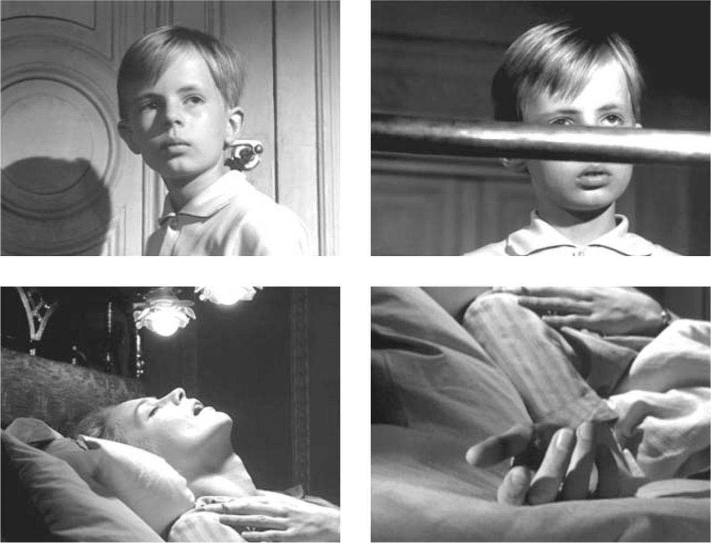
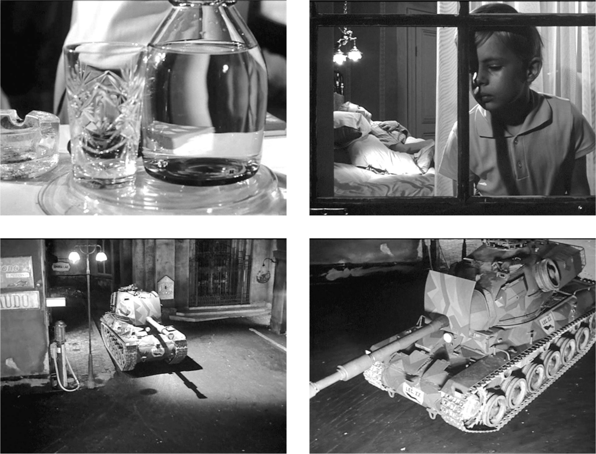
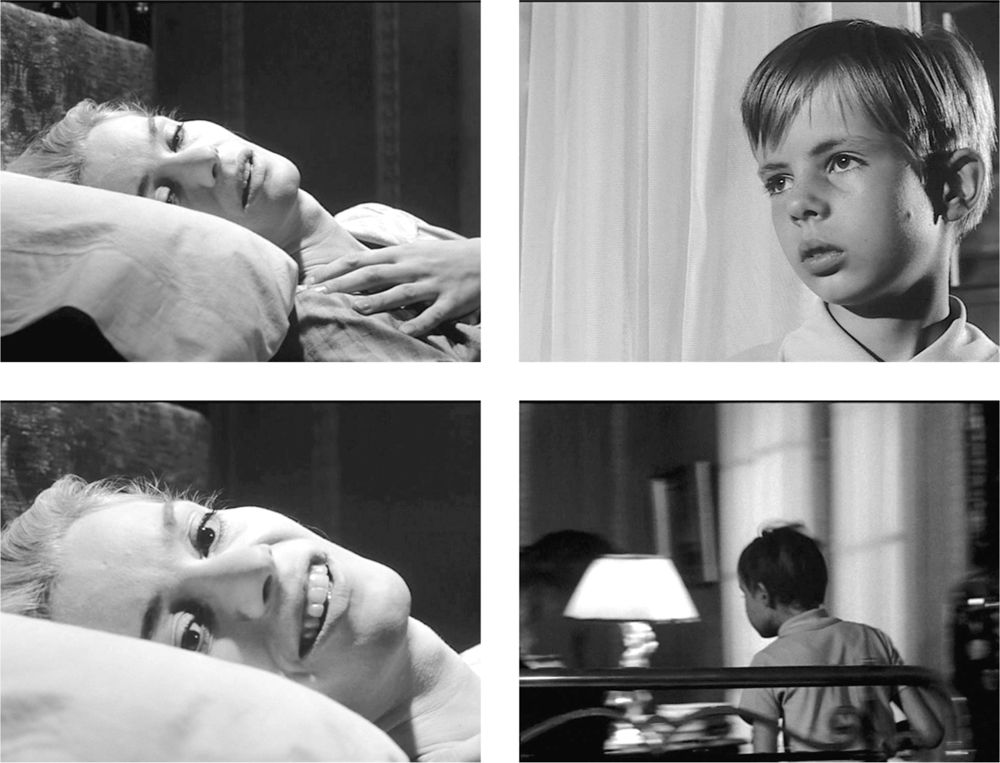

## 9. An Introduction to Audiovisual Analysis (Part 6)

> [BREADCRUMB_CTX: 《Audio-Vision: Sound on Screen》 > 9. An Introduction to Audiovisual Analysis (Part 6)]

In the next shot, Johan is in the suite he occupies with his mother and aunt, and, with a bored sigh, he throws down the book he was reading. We hear no exterior sound. Extension was wide a few seconds before, but now it is at zero. Only Johan’s movements produce specific sounds; we see him put his book down forcefully (thump), sigh, walk with irregular strides as if playing an imaginary game of hopscotch (figure 9.4), and knock quietly at a bedroom door, then carefully turn the handle. We are in the here and now, the hic et nunc, with synch sounds. Bergman often alternates moments like this, where we see what we hear and hear what we see, with others (such as the fragments before and after this one) that superimpose an athorybos onto an acousmatic sound. We might compare this to the superimposition of two instruments that sometimes play completely independently and sometimes (as here) play in synchronization, “homophonically.”

JOHAN IN ESTER’S BEDROOM, BEFORE THE SOUND EVENT (59:36–1:00:45)

Johan enters Ester’s room (figure 9.5a). We hear a strange uninterrupted acousmatic sound consisting of snoring, wheezing, and guttural breaths of unstable and uneven rhythm. Is Ester ill? More narrative indeterminacy.

After a mild squeaking of the door, we see Johan’s face in closeup, as the boy moves silently toward what he sees and what seems to be the source of the sound heard. His steps make no sound. Again the “marriage of phantoms” observed in the first fragment. While the boy moves, we are not aware of the space he traverses, and only when we see the bedpost do we understand that he has reached the bed (figure 9.5b).

Unlike the mysterious sound heard just beforehand, the acousmatic sound of the labored breaths is deacousmatized when we see the face of Ester sleeping with her mouth open—she does not seem ill (figure 9.5c)—and when the camera tilts down, we see her fingers silently stir (figure 9.5d).

FIG. 9.5A–D  The Silence (1963). As Johan noiselessly approaches the bed, a disturbing acousmatic death rattle is heard. It is his aunt sleeping, her mouth open and right hand twitching.

It could seem odd to emphasize that a movement that ordinarily makes no sound is also silent onscreen. I think that in film any movement shown in closeup, and which thus occupies a large part of the frame without emitting any sound, produces a specific effect, even if this absence of sound conforms to reality. The same goes for shadows that move around objects and characters, for gliding clouds, curls of cigarette smoke, many human gestures, and so forth. The mystery that issues from these “athorybi” in a film (while they cannot not create a specific impression in reality) is a specific property of what I call cinematic reality.

THE MYSTERIOUS EVENT (1:00:45–1:01:50)

A new sound appears—a light, rapid ringing—to attract our attention and that of Johan and the camera too. The camera tilts down rapidly to find the cause, the clinking of a glass against a glass pitcher (figure 9.6a). Along with the alarm sound and Ester’s snoring, then, we have a third mysterious acousmatic sound, one whose cause is quickly revealed. In addition, a low sound is heard; we recognize it as some kind of motor. The editing presently allows us to see what it is—a tank—but for the moment the tank is the sequence’s fourth acousmatic sound (figures 9.6b and 9.6c).

FIG. 9.6A–D  The Silence (1963). A glass clinking against a pitcher and then a dull rumbling: a tank rolls laboriously (with MSIs) in the empty street and comes to a stop in front of the hotel.

The small tinkling vibration gives way to a powerful low rumble, according to a logic whereby the enormous is preceded by the miniscule, the distant by the proximate. A similar logic obtains in some other films about war, like Rendez-vous à Bray (Appointment in Bray, André Delvaux, 1971), where distant bombing causes a chandelier to tinkle in a house at night, and Tarkovsky’s The Sacrifice (1986), in a passage that announces the approach of fighter jets by the clinking of cognac glasses.

This leads me to criticize the practice of identifying sounds by their causes, a notion that gets in the way of hearing. “I hear the sound of a tank” tells us nothing (figure 9.6d). What we hear by paying attention (if you mask the image, it works better) is several superimposed layers of sound that we recognize as all coming from the same vehicle:

* the rumble of a motor;
* irregular accelerations repeated in an insistent, furious way;
* high repeated metallic clicks and squeaks, which, combined with the throttle sounds, are real materializing sound indices: they convey the vehicle’s dilapidated condition, such that when the tank comes to a stop, it seems to be on its last legs. (Let’s note that the vehicle is opaque and we hear no sound coming from inside.)

So it is important to break down the sound we hear into its layers, because when the vehicle starts up again later, we will actually hear different sounds (without consciously noticing this change).

We only need cut the sound to demonstrate that here we have a typical effect of added value. Without sound, the tank appears to move regularly and without difficulty on its treads, aside from one brief pause. It’s the sound that makes us view, or rather, audio-view, a tank that’s seen better days and moves with difficulty.

The effect is felt as a direct literal perception, the same as we would have in reality, and not like a rhetorical figure.

ESTER AWAKE WITH JOHAN AND THE TANK’S DEPARTURE (1:01:50—1:03:40)

This fragment begins with a brief dialogue between Johan and Ester, who has opened her eyes. She asks her nephew to read to her (figure 9.7a); he tells her she looks strange (figure 9.7b); she repeats, “How about reading to me now?” (figure 9.7c); he answers that he’ll put on his Punch and Judy show and runs to the next room to get his puppets (figure 9.7d).

As with the tank (except for the tank’s visual introduction), we hear what we see. The camera is on the person speaking while he or she speaks. This gives a sense of familiarity and rootedness; until this point, most sounds were acousmatic, at least when they began.

But a second, different effect is produced in this sequence, which took me a while to identify. It belongs to the “audio-logo-visual,” the triple, not dual, combination of word, sound, and image. It’s a case in point of c/omission between the said and shown, when a surprising event happens or when an object is present in the field but the characters make no mention of it. In this case, Ester and Johan utter not a word about the tank and do not react to it.

FIG. 9.7A–D  The Silence (1963). Ester awakens and asks Johan to read to her; he runs to get his puppets instead. Neither of them says anything about the tank (c/omission of the said/shown).

In “Against Interpretation,” Susan Sontag mentions the tank’s arrival as an element of mystery in the film:

Ingmar Bergman may have meant the tank rumbling down the empty night street in The Silence as a phallic symbol. But if he did, it was a foolish thought.… Taken as a brute object, as an immediate sensation in itself, that sequence with the tank is the most striking moment in the film.2 Those who reach for a Freudian interpretation of the tank are only expressing their lack of response to what is there on the screen.

Sontag is right to say “immediate sensation,” but we can add, without doing any interpreting, that this effect arises not only from the way the tank enters but also from Ester and Johan’s silence regarding it. The silence contributes to the striking quality Sontag finds in the scene. The characters’ silence should of course itself not be interpreted. It is part of the dialogue between the said and the shown.