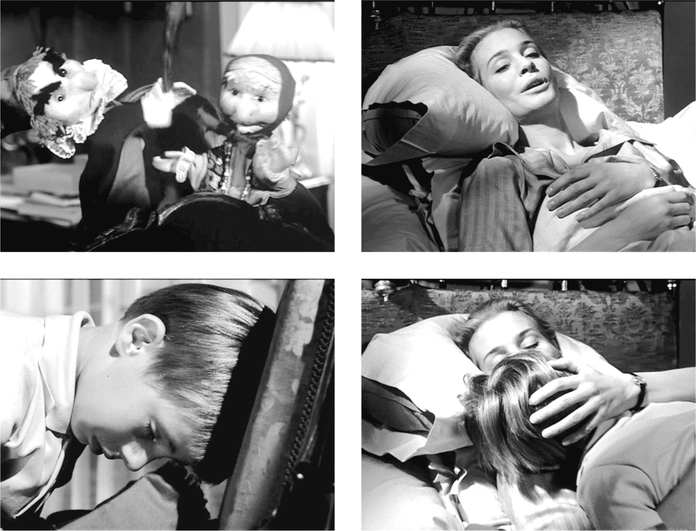
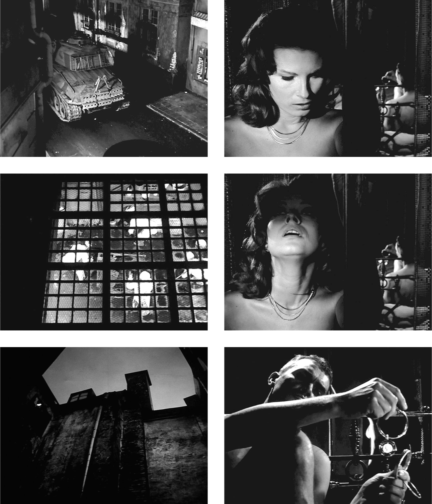

## 9. An Introduction to Audiovisual Analysis (Part 7)

> [BREADCRUMB_CTX: 《Audio-Vision: Sound on Screen》 > 9. An Introduction to Audiovisual Analysis (Part 7)]

Johan comes in with his puppets. One is a man with a pointed cap; the other is an old woman in a kerchief. He acts out a short comic scene of a violent argument (figure 9.8a). We do not see Johan’s face, but he does the puppet’s voices in an imaginary language, and as the sound-effects man too, he gives noises to the action (the man beats the woman with a stick, and she falls behind the bed frame, which is used as the puppet-theater floor) with onomatopoeia—whrrr, boom boom … The old woman pops up again, calls out (“Help! I’m dying!”), then falls for good. For several seconds, we thus experience in childish form this archetype of “ventriloquism,” whose importance in the history of sound cinema has been pointed out by the scholar Rick Altman.3

It’s a mistake to dismiss onomatopoeia as a descriptive mode. Many vocabulary words pertaining to sound have origins in onomatopoeia—just think of whistle in English, siffler in French, fischiare in Italian, pfeifen in German, sizein in ancient Greek.

This is followed again by filmed dialogue with each character seen as she or he is heard. Ester asks what the puppets are saying (figure 9.8b); he answers that’s it’s a foreign language and that the man is angry. But note a lovely detail of scansion: the noise of a tiny bell on one of the puppets when Johan who is silently crying wipes his eyes (figure 9.8c). Then, still holding the puppets, he throws himself on his aunt to be comforted.

There is a moment of silence while Johan is nestled in his aunt’s arms (figure 9.8d). Soon after, on this mute image of intimacy, we hear first the acousmatic sound of the tank, then we audio-view it as it departs down the narrow street. But it is not making the same sound it made when it arrived! We no longer hear the high shaking and squeaking noises or the revving sound (after one first acceleration). As the tank rolls away, its sound becomes even smoother and more continuous (figure 9.9a).

I have employed this excerpt many times as an exercise in observation. Never has any participant noticed, even after three viewings, that the tank makes a different sound as it leaves—as if it had been repaired. Why? Because they were using abstract thinking, they neglected actually to pay attention. In reality it wouldn’t have been logical for the sound to change so radically without a lengthy repair job on the tank—so it was not necessary to listen. This leads me to declare that in this case but also in all circumstances, whether scientific or artistic, a priori reasoning is the enemy of observation. We are not in the real world but in a world where, as in the Zone of Tarkovsky’s Stalker, everything can change. Observation must not let its guard down; otherwise it lets pass this difference between the sound of the arriving tank and the departing one whose materializing sound indices have disappeared. This difference creates a mystery and gives a form, just as in music in the so-called sonata form, when the development modifies and varies the exposition. No matter how you interpret it, it still has form.

FIG. 9.8A–D  The Silence (1963). The puppets argue in a playful imaginary language. Johan cries silently; he cannot explain what they are saying and jumps on the bed into the arms of his aunt.

ANNA AND THE MAN IN THE OTHER HOTEL ROOM (1:03:40–1:04:25)

During this silent segment that takes place in parallel with what we have just seen, we see the lovers, separate in space and not speaking. The man is seated on the edge of the bed, she occupies the foreground by a window (figure 9.9b), and all the while the loud, insistently fast ticking of an alarm clock underlines their silence (this same sound was heard with the film’s opening titles). Anna looks out the window and down into the hotel’s kitchen; a glass roof allows her to see the kitchen workers moving in silence (athorybal movement—figure 9.9c). She then looks up (figure 9.9d) at the night sky, a pool of dim light against dark buildings (figure 9.9e). But we hear, at first acousmatically, an isolated ringing on one note. It’s the man playing with Anna’s bracelets—this time not only as a soundman but a soundman for himself (figure 9.9f). There is no speech; the beginning of this fragment superimposes once more the athorybal (kitchen workers) and the acousmatic (ticking).

FIG. 9.9A–F  The Silence (1963). The tank leaves, making a different sound, without MSIs. In another room in the hotel, Anna, naked, to the oppressive ticking of an alarm clock, looks down at the (athorybal) movements of kitchen workers she sees through a glass roof; then she looks up at the silent night sky. A slight clinking joins the tick-tock—the man is distractedly playing with Anna’s bracelets. The tonic note of the tinkling feels like a light in the darkness.

The ringing produced by the man is the first sound that’s heard and then fades naturally: it brings on a kind of relaxation.

WITH REDUCED LISTENING: SIMILARITIES AND CONTRASTS IN THE SOUNDS’ FORM AND SONIC NATURE

Up to this point, I have spoken primarily about audiovisual effects and about one audio-logo-visual effect—in other words, about the relationship between what we see and what we hear. But we can posit that the sequence’s beauty and suggestive power also lie in the sounds themselves: in their great variety, the way they interact with one another, and the way they reciprocally highlight one another.

The interaction of sounds takes place in succession and not superimposition; the sequence only rarely features several simultaneous sound phenomena. The sounds of the segment of Bergman’s film I have chosen present themselves in succession, one by one; this is rarely the case in everyday experience (except at night), but it occurs frequently in cinema.

As I stated in chapter 2 of this book, certain sounds, whether musical, human, natural, or mechanical, are on one precise note, while others are not. Pierre Schaeffer would say that the former sounds are tonic or that they have tonic mass and that the latter are complex or that they have complex mass.

Human physiology allows the ear to easily identify tonic sounds in an ensemble or a succession of complex sounds; tonic sounds thus stand out expressively. What do we get in the Bergman excerpt (as I have chosen and delineated it)? There is one prolonged tonic sound at the beginning—the repeated alarm—and one tonic sound at the end—the jingling as the man plays with Anna’s bracelets. The jingling particularly stands out because it is preceded by a sound with complex mass, the regular, oppressive ticking of a clock. This alarm clock might be considered the reverse of the alarm sound at the beginning: the two sounds share a formal similarity—both consist of a regular repetition—but the ticking is complex whereas the other was tonic, and the pace of repetition is rapid as opposed to slow. Finally, the ticking is close to the ear (limited extension), while the other was far away (vast extension).

The first alarm sound and the alarm clock’s ticking contrast with the other sounds in this excerpt because they are the only regular and constant sounds; the others have unpredictable rhythms and are irregular. This is particularly true of the child’s footsteps in the sitting room and Ester’s snoring-breathing.

So I would say that the beauty of the sequence derives not only from the audiovisual and audio-logo-visual effects as I have described them but also from the way in which the sounds contrast and resemble one another, as sounds, which we discover through reduced listening: long or short, repeated slowly or rapidly, tonic or complex, proximate or distant, regular or irregular, predictable or unpredictable. Everyone perceives these distinctions, which form the basis of the sequence’s power for audiences around the world and of all generations.