> [BREADCRUMB_CTX: 《考工记：工匠·功能·风格 (中国传统雕塑的复制与当代中国美术教育体系的建立系列丛书)》 > 文前彩插]

# 文前彩插

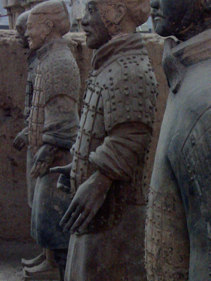

高真实度的手

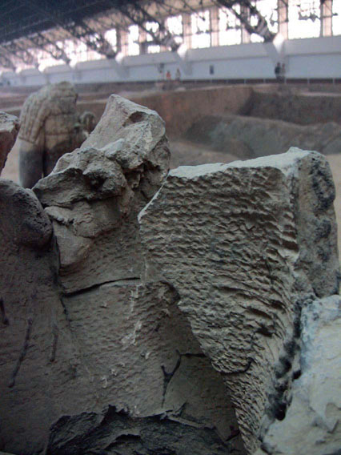

麻绳盘筑痕迹

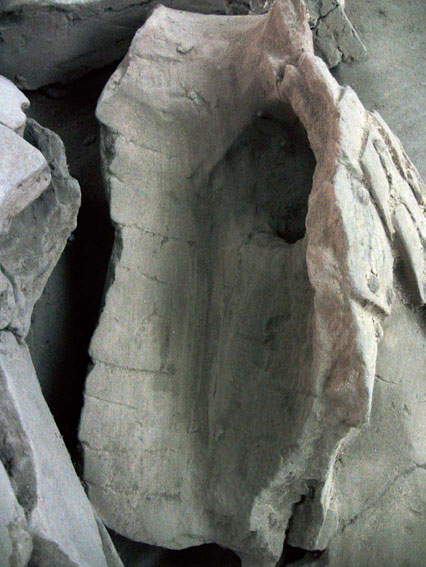

泥条盘筑痕迹

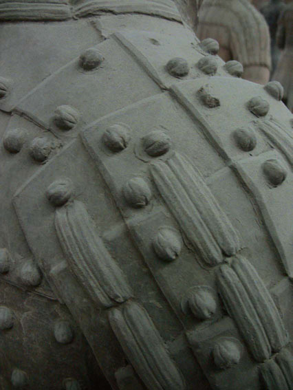

披膊特写

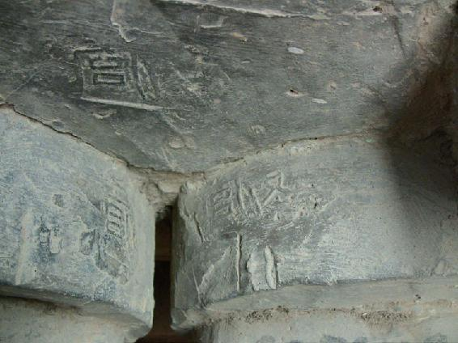

物勒工名

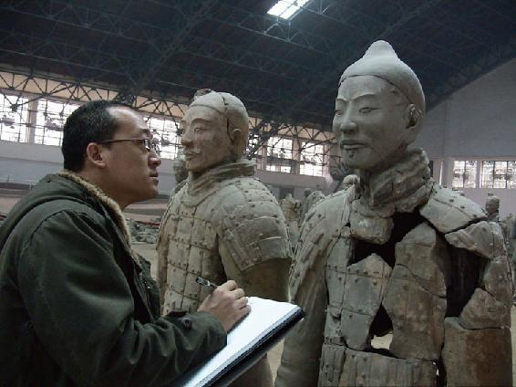

现场考察

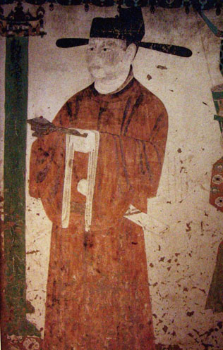

五代 榆16 甬道 曹议金官服

图片来源：《敦煌石窟全集·服饰画卷》，商务印书馆（香港）有限公司，页204

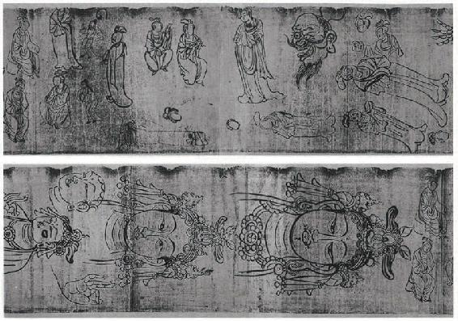

《画稿》Pel.chin.2002V°

图片来源：法国国家图书馆

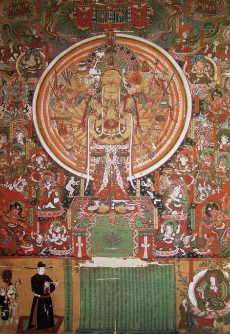

敦煌：绢画千手千眼观音图——施主樊继寿与仆从

图片来源：《敦煌石窟全集·藏经洞珍品卷》，商务印书馆（香港）有限公司，页148

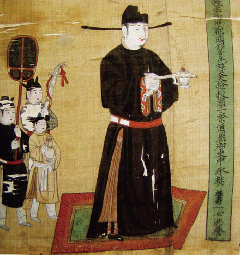

敦煌：绢画千手千眼观音图（局部）——施主樊继寿与仆从

图片来源：《敦煌石窟全集·藏经洞珍品卷》，商务印书馆（香港）有限公司，页148

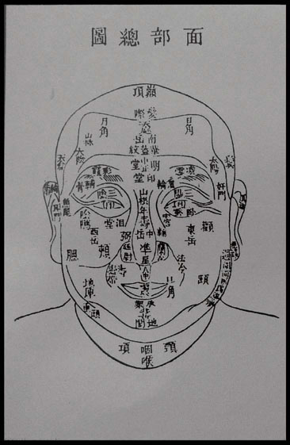

传真心领-浑元一圈图

图片来源：《徽州容像艺术》，安徽美术出版社

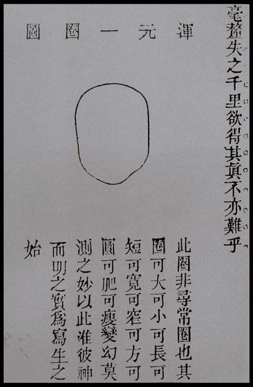

传真心领-面部总图

图片来源：《徽州容像艺术》，安徽美术出版社

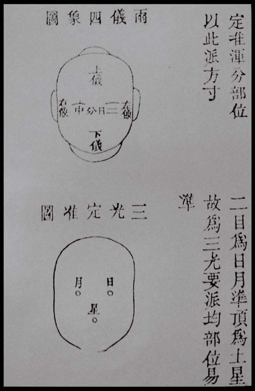

传真心领-两仪四象、三光定准图

图片来源：《徽州容像艺术》，安徽美术出版社

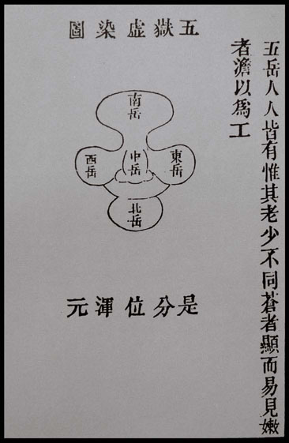

传真心领-五岳虚染图

图片来源：《徽州容像艺术》，安徽美术出版社

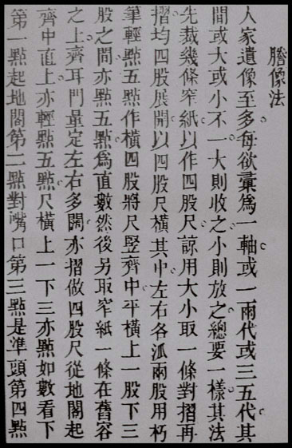

传真心领-謄像法

图片来源：《徽州容像艺术》，安徽美术出版社

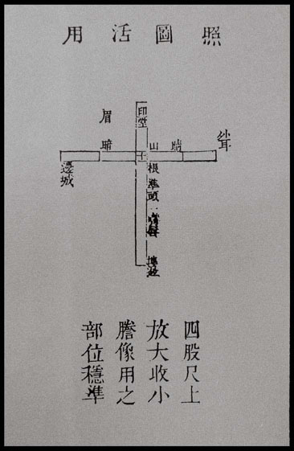

謄像法-四股尺

图片来源：《徽州容像艺术》，安徽美术出版社