> [BREADCRUMB_CTX: 《考工记：工匠·功能·风格 (中国传统雕塑的复制与当代中国美术教育体系的建立系列丛书)》 > 一 对秦俑外貌的观察]

## 一 对秦俑外貌的观察

在进入讨论前，对秦俑的观察是必要与重要的。笔者将对一号坑修复区的陶俑进行观察，然后列出一些问题并以实际考察所得的照片作为后续论证的依据。当我们直接面对一群类似真人大小的陶俑时，制作工艺的优劣是不容易立刻被辨识的，但是比例外观的差异却非常容易在第一时间被眼睛所察觉。王学理先生在其研究中曾经提及一些秦俑在造型比例上异常的例子，如短颈压肩、窄胸猿臂、手大特甚、臂短及腰之类，但可惜都没有图片参照。[5]《秦始皇陵兵马俑坑一号坑发掘报告》（上册）也提到了这种现象[6]，但是下册的图录在这一方面也只有少量的图片。目前对于这一类普遍被认为是瑕疵品的陶俑，人们似乎并没有给予特别关注，也没有发行系统的专门图录。笔者在一号坑的修复区进行考察时，发现三件在制作比例上差异极大的陶俑。第一件是编号为T22.G9∶12的中级军吏俑。它的头部制作并不细致，跟其他的陶俑比起来甚至可以说是简略，不过五官端正，颇有点儒士的气息。依照整体的比例来看，它的头部显得特别小，身体与头部在比例上失调，手臂也显得特别长（见图1-1）。第二件编号为T20.G11∶32的铠甲步兵俑则是手臂看起来相当短，下身则显得过长（见图1-2）。第三件编号为T22.G9∶9，同样是铠甲步兵俑。它有一个看起来过大的头、一对过短的双臂（尤其是上臂）和过大的双手，其左手掌平伸，手掌长度几乎占去手臂长度的八分之五。这三件陶俑虽然在某些部位的制作比例上显得极度不协调，但是从制作的细腻度而言，都相当用心，尤其是T22.G9∶9号陶俑那只平伸的左手掌在皮肤与骨骼的质感上表现得相当写实细致（见图1-3、图1-4）。

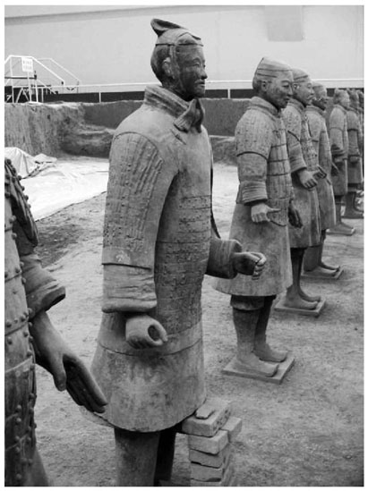

图1-1 中级军吏俑（编号T22.G9∶12）

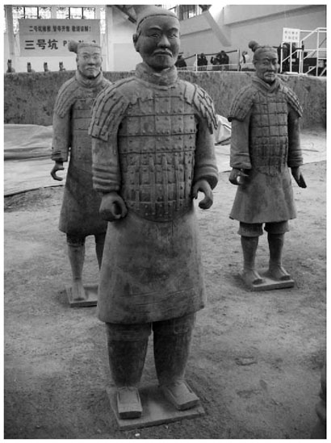

图1-2 铠甲步兵俑（编号T20.G11∶32）

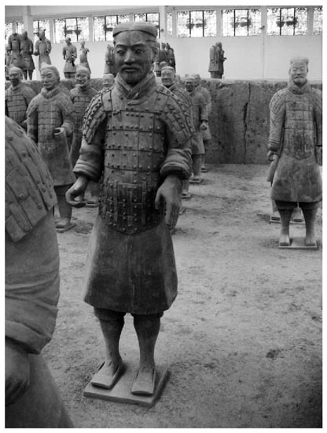

图1-3 铠甲步兵俑正面（编号T22.G9∶9）

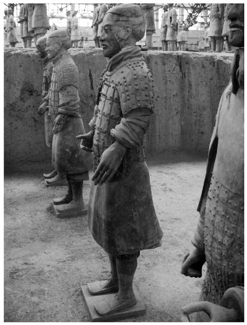

图1-4 铠甲步兵俑侧面（编号T22.G9∶9）

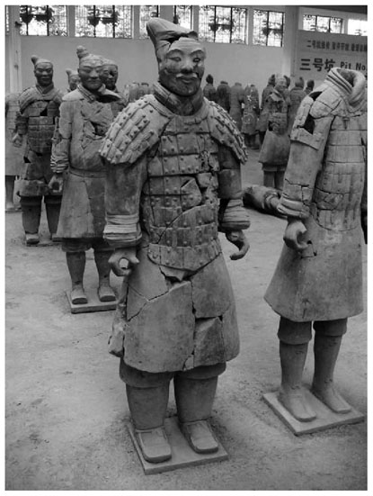

图1-5 铠甲步兵俑（编号T2.G7∶17）

在对俑体的比例进行观察和讨论前，我们不得不考虑俑坑曾经遭受人为及自然因素破坏的事实。[7]而这在发掘过程中，显然增加了考古工作人员对俑体破片进行重整与归类的困难，并连带影响了陶俑修复的结果。对一些破碎较严重的陶俑（例如T2.G7∶17号陶俑，见图1-5）进行观察，可以发现那些修复接合的痕迹很明显，而从破片与破片之间形状的吻合度来看，可以判定它们属于同一个陶俑。有些陶俑因为存在严重的残缺而由修复人员重新塑造补上，例如T.22∶97号陶俑的右臂（见图1-6），我们可以看出它与图1-5中陶俑的差异是十分明显的。前文提到的三个比例特异的陶俑，并没有重新塑造、接合的迹象，完整度较高，虽然也有破裂的痕迹，但破裂处并不在那些会直接影响比例的地方。此外，中级军吏俑在陶俑中并非多数，王学理先生在其研究中提到身着此类装束且披膊特长者仅有四尊。[8]从T22.G9∶12号陶俑所穿铠甲的特殊样式与头戴的单梁双板式长冠来看，这些是符合其身份的，所以错接的可能性并不大。基于以上理由，笔者认为因为修复因素而造成比例外观不合的可能性在此可以被排除。将可能在修复过程中出现的错接问题排除后，笔者关注的是：是什么原因造成了这种结果？从造型的角度来看，比例的不协调反映的是作者对比例的把握能力不强，属于技术层面的问题。但是，若从制作方式的角度进行思考，则可能涉及制作过程中的不同层面，并因此造成在比例外观上出现误差。《秦始皇陵兵马俑坑一号坑发掘报告》及袁仲一先生的研究，对秦俑的制作顺序已经有充分的说明。考古研究结果显示：秦俑大致分为头、躯干、四肢、手掌与足踏板五大部件，并采用分开制作的方式完成。[9]接下来，笔者将对秦俑可视的细部构件外观所显示的不同制作痕迹加以观察，并进一步提出假设。

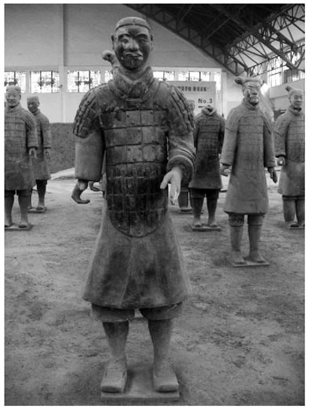

图1-6 铠甲步兵俑（编号T.22∶97）

笔者在一号坑修复区中发现，陶俑披膊部分采用了两种不同的制作方法。编号为005660的陶俑[10]（见图1-7）和编号为T1.G1∶54的陶俑（见图1-8）所穿着的铠甲都属于大方甲，前者的披膊采用长条陶板，以横向的方式一层一层地贴合而成；后者的披膊则采用整片陶板，直接粘在肩部及上臂以刻画的方式表现甲片。最明显的证据是，编号为005660的陶俑披膊的背面呈现与正面相同的阶梯状，而编号为T1.G1∶54的陶俑的披膊背面呈现的是一整块平面。分开制作的方式，最大的优点是易于塑型，而且可以避免陶板与臂膀粘接时因为被过度弯曲出现变形所产生的空隙。采用较薄的陶板则是为了降低重叠时由于陶板高度不同所出现的空隙。这都有助于陶板与肩、臂部更为紧密地接合，避免了将来容易脱落的问题。这种做法让披膊的面积可以比较大，并且也方便表现甲片的层次感。如果用整片陶板制作披膊，为了刻画甲片的层次，就必须使用比较厚的陶板，而为了接合的牢固性和降低重量就必须做得比较小。

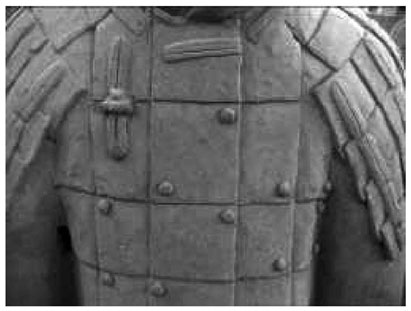

图1-7 铠甲步兵俑铠甲局部（编号005660）

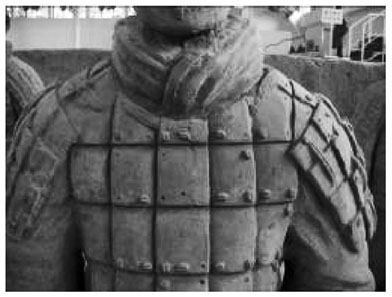

图1-8 铠甲步兵俑铠甲局部（编号T1.G1∶54）

陶俑铠甲甲片之间的连缀方式是用几股绳索串穿不同甲片，在陶俑上的呈现形式则为甲钉与连甲绳。不同陶俑铠甲上的甲钉显示出：有些甲钉是由多股绳索编缀而成，有些则由较少绳索编缀而成。这并非随意制作，而是依据特定的编缀方式与铠甲类型。[11]我们从陶俑身上可以发现，在多数铠甲上都遗留有甲钉脱落后的粘黏痕迹，显示出甲钉跟铠甲不是同一块材料制作的。甲钉的制作方式也有多种，经观察可知分为以下两种：一种是粘黏上去之后用模型压制成型（见图1-9、图1-10）。我们从陶俑身上可以明显地看到那些压印的痕迹。另一种方式是直接用手将甲钉捏成形，制作者遗留下来的指纹至今都还清晰可见（见图1-11）。那些脱落的痕迹显示甲钉的粘黏也采用了不同的方式：有些是用三角形或圆形的器物先在甲片上制造出一个洞（见图1-12）；有些则是先将甲钉做好再置入已经挖好的孔眼中（见图1-13）；或是用利器在上面刮出粗糙的痕迹以利于甲钉黏合（见图1-14）；甚至有些是什么都不做而直接将甲钉以按压的方式固定（见图1-15），采用这种按压方式粘黏的甲钉，脱落情况比较严重（见图1-16）。还有一些因为孔眼挖得太大，甲钉与甲片的附着面不够牢固而有大量脱落的情形（见图1-17）。过小而深的孔眼同样也会导致多数甲钉脱落（见图1-18）。

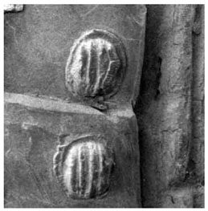

图1-9 编号T22∶97

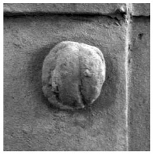

图1-10 编号T21.G10∶19

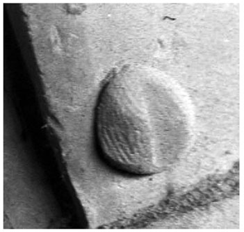

图1-11 编号T2.G1∶42

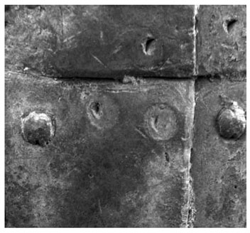

图1-12 编号005448

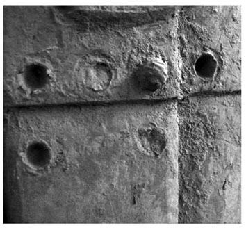

图1-13 编号T1.G1∶54

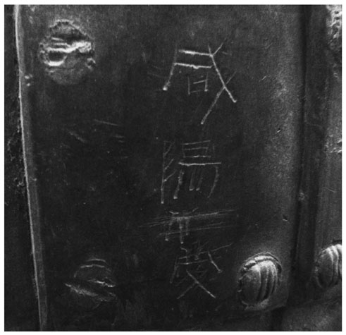

图1-14 编号T22∶97

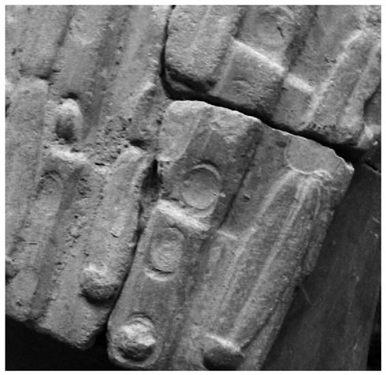

图1-15 编号T20.G7∶27

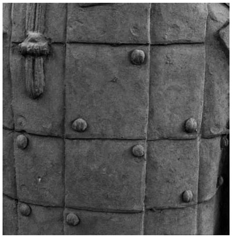

图1-16 编号T.21.10∶19

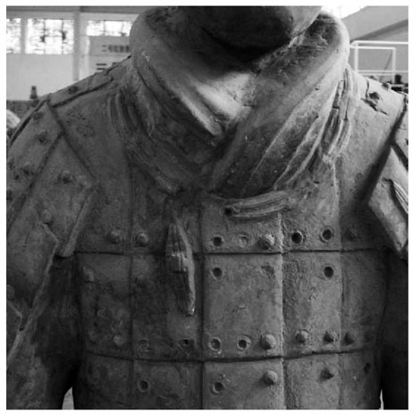

图1-17 编号T1.G1∶54

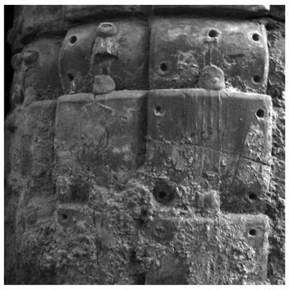

图1-18 编号T2.1.∶42

连甲带也是以粘黏的方式与铠甲分开制作的，这在很多陶俑身上可以看得很清楚（见图1-19、图1-20），采用不同的方式制作连甲带是非常明显的，而连甲带的不同样式牵涉到真实铠甲中所使用的不同材质。[12]有些连甲带是直接在泥条上面进行刻画（见图1-21），有些则明显是经由模具成型后再与铠甲黏结的（见图1-22）。制作者使用的模具也有精粗之分，一些依靠模具成型的连甲带在造型上已经脱离写实而倾向于图案化（见图1-23）。

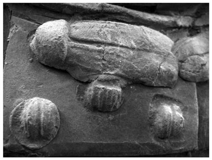

图1-19 缺编号

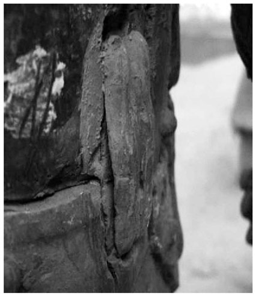

图1-20 缺编号

虽然以上仅就某些部件进行观察，对于秦俑制作的每个部分之间的关系未必都是清楚的，但从以上的观察可以发现：制作方式的差异直接影响到造型的精致度和是否坚固耐久。这些迹象显示出制作者为了制作的方便而发展出一套固定流程的可能性，例如：经过对铠甲与手臂的关系加以观察可以确认铠甲一定是先贴于躯干上，之后才将所有铠甲上的附件进行黏结。秦俑的手臂是最后才接上的，因为手臂跟铠甲的距离很近，如果不在接上手臂之前将甲钉、甲绳先行黏结，那么过于局促的空间将使制作者没有办法进行组装（见图1-24、图1-25）。

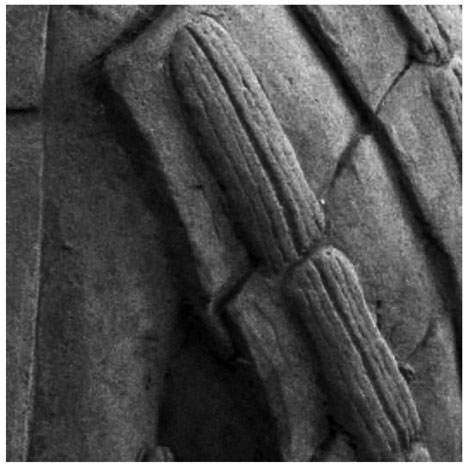

图1-21 编号T21.10∶19

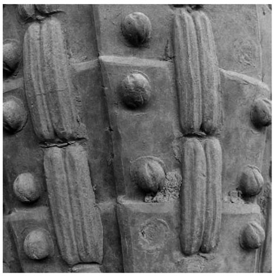

图1-22 编号T22.G9∶9

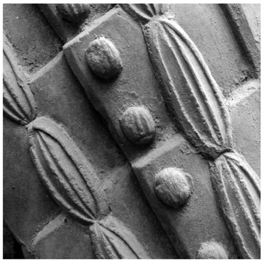

图1-23 编号T2.G7∶17

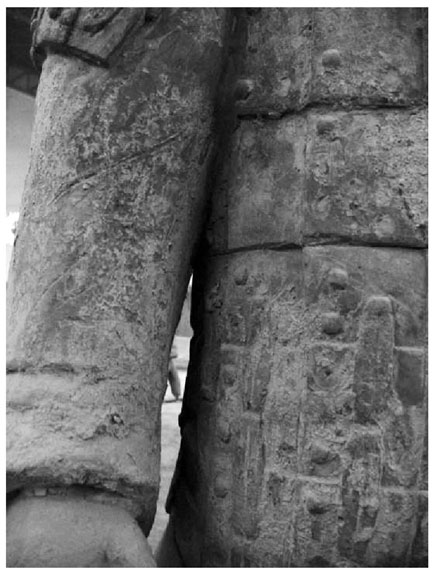

图1-24 编号005448

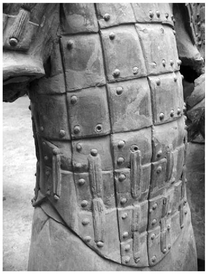

图1-25 编号005667