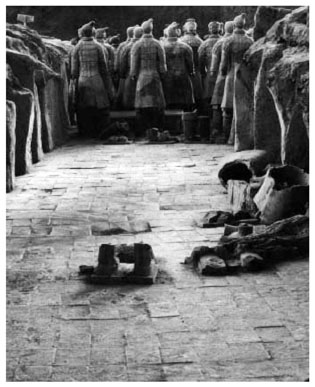
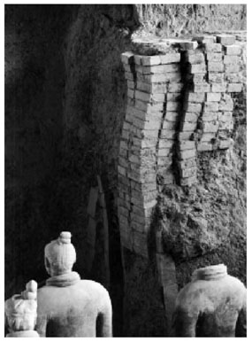
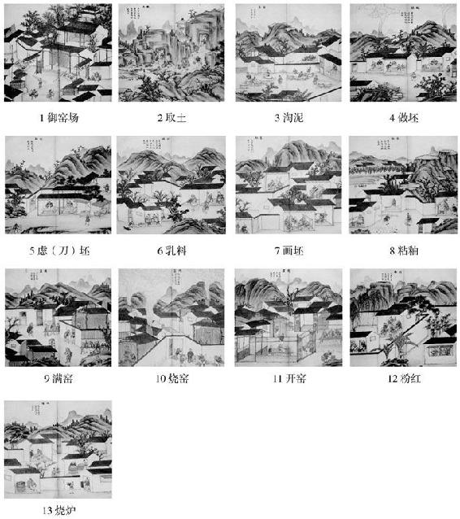

> [BREADCRUMB_CTX: 《考工记：工匠·功能·风格 (中国传统雕塑的复制与当代中国美术教育体系的建立系列丛书)》 > 三 制作者的选择与身份]

## 三 制作者的选择与身份

早在战国时代的文献就记载了为官方从事生产督造或制造的工匠为了质量的控管而必须“物勒工名”以示负责[26]，我们在秦俑身上也能发现一部分基于这种规定所遗留下来的作者信息。据目前的研究成果：在秦俑身上用印者多为官署的工匠，而冠以地名的工匠则可能是从地方征调而来。有些工匠姓名不仅出现在陶俑身上，也同时出现在俑坑或宫殿的砖瓦上，这显示出这些工匠是以制陶为主的陶工。[27]从上述官方需求的角度来看，之所以选择陶工来完成这项任务的理由是显而易见的。从制作材料的特质来看，陶是众多物质里面比较符合以上三个条件的最佳选择。其一，泥土取得容易，而且是相当廉价的材料，它不像金属那样昂贵难得，也不像木材与石料那样搬运困难。依据考古报告，陶俑所用的泥土和秦始皇陵附近骊山北麓的土和砂的成分相同[28]，这更证明陶土的方便易得性。其二，泥土不仅可塑性高，也易于修改，堆、捏、刻、划都不受限制，造型方法既可加又可减，而且省时省力，在制作过程中只要控制好陶土中的水分，就可以保持长时间持续地制作。它也不像木材、石料与金属那样难以修改。其三，秦始皇陵的建造共历时近40年，将近半个世纪的准备期已经足够使许多材料有自然损坏之虞；经由烧制而成的陶，除了容易破碎之外，既防火也防水，不像铜铁器容易锈蚀或木材易于腐烂，稳定性相当高，是保存时效相当长的物质。其四，嬴政在位的37年中[29]，在都城咸阳有一直持续不断的建筑工程。[30]例如：《史记》中提到的“秦每破诸侯，写放其宫室，作之咸阳北版上……”，始皇二十七年（前220年）“焉作信宫渭南，已更命信官为极庙，象天极。自极庙道通骊山，作甘泉前殿。筑甬道，自咸阳属之。是岁，赐爵一级。治驰道”，始皇三十五年（前212年）“乃营作朝宫渭南上林苑中。先作前殿阿房，东西五百步，南北五十丈，上可以坐万人，下可以建五丈旗”，“发北山石椁，乃写蜀、荊地材皆至。关中计宫三百，关外四百余”，都显示出秦国当时对建筑方面的工匠有大量的需求。其他研究者认为，秦陵的工程在当时动用到的工匠主要就是这些属于建筑专业的陶工，因为这些陶工必须提供秦陵所需的大量砖瓦（见图1-26、图1-27），所以他们有足够的人力、经验与专业来解决秦俑的烧制问题。[31]其五，中国自古对于使用陶土进行形塑或模制有极为丰富的经验。我们在仰韶文化遗址中的陶塑或是商、周时期的石雕、青铜器上，都能发现中国很早就有制作人像的传统；尤其是铸造青铜器所使用的陶范更与陶土的使用关系密切。这些技术有可能为制作者提供了很好的借鉴。《韩非子·显学》曰“象人百万，不可谓强”[32]，足可证明当时制作“象人”的明器已经非常兴盛。虽然同时代出土的俑在体量上并没有发现像秦俑这种规模的，但是工匠以人为对象进行制作的经验应该已经十分丰富，而这显然也有助于工匠们对于面部的刻画训练。其六，从制陶的流程来看，即使原料容易取得，整个过程也仍然是相当复杂的。后代专门描述官窑作业的《景德镇陶图记》描绘了陶工的不同分工流程：从取土开始直到最后烧炉（见图1-28）。[33]

图1-26 俑坑地面

资料来源：摘自《秦始皇陵兵马俑》。

图1-27 俑坑墙面

资料来源：摘自《秦始皇陵兵马俑》。

图1-28 《景德镇陶图记》

资料来源：摘自《中国陶瓷》（第1册）。

图1-28虽然以呈现瓷器的制造过程为主，与陶俑的制作分工并不完全一样，不过《秦始皇陵兵马俑坑一号坑发掘报告》对陶质、陶色的研究显示，兵马俑所用陶土似乎也经过了筛选、淘洗以去掉杂物的程序。[34]仅从这一层面上看，两者是大同小异的，而这些过程也并不容易。陶土的备制从取土开始，必须经过晾晒、破碎、筛分、混匀、加入适量的水分、搅拌等程序，软硬适度后，还必须反复拍打、搓揉，经过较长时间的定性后，才具备良好的成形性和湿强度[35]；实际制作时又必须分成好几个阶段进行，都不是一个人可以单独完成的。而且我们也知道，陶俑都曾经上过色，过程亦相当繁复细腻，并非如我们现在所见只是素烧的结果。借由《景德镇陶图记》至少说明了一点：即使陶土的使用具有许多优势，也并不代表制作过程是简单的，尤其是制作秦俑这样庞大的工程，由具有丰富分工经验的陶工来完成是很好的选择。遗留在陶俑身上的陶文表明，工匠不仅出自宫廷，也来自地方。[36]虽然我们目前不能确定这些陶文所代表的工匠是否实际参与了陶俑的制作，但是依照官方生产兵器的刻文惯例来看，一件器物上的铭文大多分为两类，一是督造者，一是制作者。从俑坑出土兵器的铭文可以发现，在器物的制作上有详细的权责区分：中央一级，由相邦代表国家监造；郡县一级，由郡守代表政府监造；领导工匠、主管生产者为“寺工”“工师”“丞”等；直接从事生产者则为“工”[37]（在《睡虎地秦墓竹简》中“丞”与“工”之间还有“曹长”[38]）。也就是说，对于官府生产的器物而言，其督造者都应该是具有官职者。我们在某些兵器上也会见到仅有制作者的名字，例如始皇三年、二十五年、二十七年的上郡守戈铭有“工城旦□”“工鬼薪戠”“工鬼薪”[39]。“城旦”“鬼薪”都是受刑服劳役人员的名称。既然这些人都是受刑人，当然他们不可能负责监工督造，而是实际的制作者。反过来看秦俑身上的刻文，有“咸阳衣”“栎阳重”“安邑□”“临晋”之类以地名为主的工匠刻文。若依照兵器上物勒铭文的惯例，这些地方征召而来的工匠既非刑徒，恐怕也非官员，应当是自由民。而从目前还没有在同一个陶俑身上发现两个不同刻名的情况来看，笔者认为那些刻上了地方名字的工匠既必须实际参与制作，又必须对整个陶俑的质量负责，而那些刻有官府单位名称者应该也都是实际参与制作并必须对其所做的每一个俑具体负责的官方工匠。此外，在秦俑中还发现一尊俑留有朱笔所书工匠名字的痕迹[40]，这或许可以解释为什么没有在每个陶俑身上都发现“物勒工名”的痕迹。