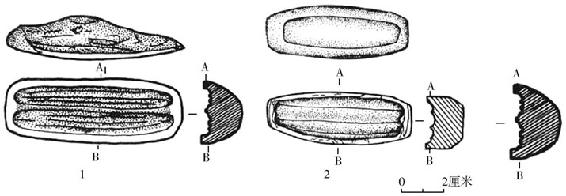
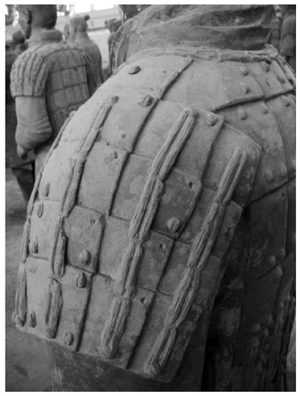
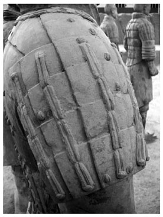
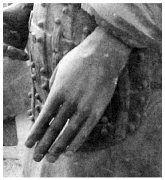
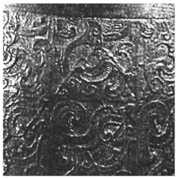
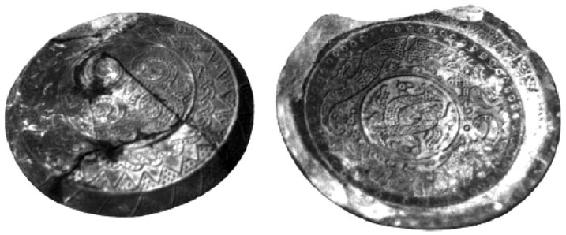

> [BREADCRUMB_CTX: 《考工记：工匠·功能·风格 (中国传统雕塑的复制与当代中国美术教育体系的建立系列丛书)》 > 四 秦俑的制作方式与工匠的造型意识]

## 四 秦俑的制作方式与工匠的造型意识

秦国当时在度量衡、文字、货币、车轨上的标准化追求足以表明，无论是在制造技术、管理制度还是在分工流程方面，秦国都拥有足够的经验。我们无法想象一个耗时近40年、动用70万人的浩大皇家工程会不从以上方方面面总结经验并加以运用。虽然从实际的秦俑制作痕迹来看，有些大型采取了模制的方式，但在这里我们或许也会提出一个质疑，即分工的细致程度与必要性到底是以什么为标准？直接对铠甲或是其他的细部进行完整的模制难道不会更简单、更省时？在这个问题上，我们可以借鉴古代青铜器的铸造工艺经验来作为思考的参照。[41]

从模制的技术来看，可以有两种方法：一是灌浆；二是压制。这中间还有三个关键因素：（1）“外范”的制作与材料的选择。（2）“卡模”与“脱膜”。（3）翻制后的具体成型。在使用以上两种制作方法时，都必须先有一个“模”作为原型。我们以陶范的“外范”为例。“外范”在成型前必须做出一个初胎（原型），也就是“模”，将泥覆盖于“模”上按照一定的方法将泥切开，取下之后还可以合在一起，这就成为“外范”。如果初胎过于复杂，内角部分过多，就会造成“卡模”，使得“范”无法取下；解决的办法是必须将“外范”分成许多不同的部分分别取下。我们在秦俑的外形上随处可见这种会造成“卡模”的地方，尤其是躯干或披膊铠甲的弧度甚至脸部都会造成“脱模”的困难。这表明要制作一个秦俑的“范”显然非常麻烦。即便“范”制作成功并用以制作秦俑，接下来的问题仍会层出不穷：首先，无法采用灌浆的方式，因为泥浆不像金属冷却以后就会变硬成型，它必须透过水分的挥发才会变硬，而陶范的吸水性不强，以秦俑这么大的体量，要等到泥浆的水分挥发到能够取出势必将花费相当长的时间，所以第一种灌浆的方式并不可行。其次，第二种压制的方式似乎更为实际些，但是采用较干的黏土直接就着单模进行部分的翻制后，再将每个部件加以组装也同样麻烦，因为“脱模”之后的“范”并不是规则与完整的，也就是说，这样做反而会增加接合面的总体面积量及接合的难度，直接影响接合后的美观，最后还得花费大量的时间处理合模留下来的痕迹（合模线），这就使得制作工序变得更加复杂。这种制作方式显然大大违背了“效率原则”。因此，与其利用单模制成粗胚再分别进行加工，倒不如直接以陶板或手塑成型的方式进行制作。而单模的使用只适合秦俑身上单纯且数量大的部件，并且是采用压印成型的方式才有意义。考古人员在发掘过程中就曾发现用来制作连甲带的陶模两件（见图1-29），但经由前文对秦俑的观察，我们发现并非所有的工匠都会选择采用这种压印的方式制作。[42]

图1-29 1.编号T19.G11∶01414 2.编号T19K∶01367

资料来源：摘自《秦始皇陵兵马俑坑一号坑发掘报告》（上册）。

秦俑的大型主要采用泥条盘筑法或大片陶板制作。从目前已发掘出土的秦俑断面处，可以得知其制作采用了组装的方式进行，大体可以分为“头”“躯干”“手臂”“手掌”“腿”“足踏板”六大部分。值得注意的是，我们不能将这种组装制作方式轻易地与多人分工生产的组装意识相等同（虽然后面将证明确有这种意识存在）。就整体大型而言，秦俑的制作方式是以材料的性质及最终是否烧制成功为主要考虑因素，而这关系到材料所能采用的最佳制作方式的选择。之所以采用组装的方式，是陶土本身的特质条件使然，因为湿泥较软而且比较重，如果不分开制作，那么手臂、腿部、躯干就会因为泥土过重而受压变形或脱落。另外，工匠们为了确保在烧制时温度分布均匀，对于某些过厚的地方就必须挖空，而分开制作也比较有利于挖空的动作。秦俑主要是依靠泥条盘筑或是泥板建构出来的[43]，这是一种从没有体量到逐渐成型的做法。它不像雕塑，雕塑可以先有一个整体或是一个骨架，然后在可预期的范围内进行符合比例的制作。秦俑的造型意识与雕塑存在着很大的不同。虽然它也采用像雕塑一样对细部进行修整的“雕”与“塑”的技巧，但是秦俑的整体基本上是采用层层加叠的观念制作的，这就如同积木之间的组合，它从个别的大型依序组装，然后加上衣服、铠甲、甲钉、甲绳、兵器等，最后才在外部加以更细腻的刻画，而这与雕刻的意识是截然不同的。秦俑的制作者所考虑的是如何经由陶土组装成一个“人”的外形，它是缺乏结构的。不同材料的制作者通常有不同的造型意识：石匠考虑的是如何利用石头本身的造型以最少的浪费达到最佳的造型；冶铸与制模师傅考虑的则是如何解决造型所造成的翻制的困难，以使其能顺利铸造成功；而秦俑的制作方式则符合陶工制作陶器时的造型意识。秦俑的表现方式基本上可以简单地分为两种：一种是“减法”，主要以刻、刮、削的方式处理，例如秦俑的绑腿与鞋底的针脚。另一种则是“加法”，以泥块、泥板粘黏的方式制作，例如领巾、铠甲、甲钉、甲带、腰带、带扣等。除了少数配件是用刻画的方式外，绝大多数都采用外加的方式。这显示出制作的意识是一种以外形为主的拼装理念。制作者先把构成一个秦俑的所有元素进行分解，再将每个部件依照恰当的程序加以组装。工匠们采取这种做法，当然有基于材料特性的必要性，但同时这种做法也非常利于分工合作。虽然至今还没有发现在同一个俑体上有两个不同工匠的陶文，但是从前文对秦俑制作痕迹的观察来对其制作过程和造型意识加以思考，秦俑很有可能是由不同的人对不同部分分别进行制作。笔者在编号T21.G10∶16陶俑上发现，该俑左、右披膊上的甲钉采用不同的方式粘接，左肩披膊上的甲钉是先以圆棒挖洞再粘上（见图1-30），而右肩披膊上的甲钉则不进行事前的加工直接往上粘（见图1-31）。两种完全不同的制作手法同时存在于一具陶俑的披膊上，这显示出当时的工匠在制作工序上不仅采用组装的方式，而且可能采取多人分别制作的方式。一个工匠同时制作好几个相同的部分或是每一个部分由不同的工匠分头进行制作，最后再加以组合拼装。虽然这个案例并不足以强而有力地证明秦俑必然由不同的工匠制作[44]，但是也确实增加了在对相同零件进行组装时多人分工的可能性，或者至少说明了工匠制作方式的复杂性。分工的方式确实能够提高效率，但是对于分头制作的人来说，在比例的掌握上显然也容易出现偏差，而秦俑在组装以后若要进行大的修改，除了重做以外没有其他的办法。更有利于这个推论的证据是，从制作工艺的精致度来看，我们可以发现前文提到的三尊比例怪异的陶俑在个别部位上显现的技巧与精细度的差别并不很大，有些部件甚至还制作得相当细致准确。例如T22.G9∶9号俑（见图1-3、图1-4），虽然手掌与手臂的比例关系非常怪异，但是从手掌的制作来看，制作者对于手部质感及造型的把握却极为细腻（见图1-32）。若要说一个具有熟练制作技巧的工匠会对这种比例上极端明显的不协调视而不见，相信这是不合情理的。从以上的分析来看，前文提及的那三尊比例格外不协调的陶俑会出现那样的错误，似乎就可以归因于分工制作。正是因为采取了分工制作的方式，所以有些秦俑的个别部位工艺精湛，但是整体看来却又比例失调。

图1-30 陶俑左肩（编号T21.G10∶16）

大批工匠对每一个部分进行分工制作的做法，虽然看起来麻烦、费事，但从造型意识角度而言，这在制作理念上反而是简单的。例如对铠甲进行制作时，第一道工序是将大片泥板附在躯干上，再以利器割划出甲片，然后贴上甲钉、甲带。制作者不需要一边刻画甲片一边思考预留甲钉的位置，也不用担心甲带的长度与数量；制作过程中所有的观念都是单纯而简单的。这种周到的设想就是专门为了在最短的时间内帮助一些技术含量不高的工匠而设计的。而从效率与质量控管的角度而言，分工不仅能够节省时间，还可以让每个人专心负责一种工作或是几种部件，尤其是像铠甲的编织方式未必每个人都能熟悉，若由一批固定的人专门对铠甲进行加工或许更加省事。分工与流水线生产，是在决策者确定采用陶土进行制作之后，工匠们为了因应“效率原则”所采取的最佳选择。

图1-31 陶俑右肩（编号T21.G10∶16）

图1-32 左手掌（编号T22.G9∶9）

在坚守“效率原则”的同时，制作者还必须兼顾“真实原则”。而当“真实原则”与“效率原则”相抵触时，“真实原则”往往是优先的选择。对于“真实原则”的必要性，我们可以在秦俑的各个部分发现，诸如前面章节提到的鞋底针脚、掌纹、铠甲的编制顺序与形制、甲钉的方向等。对于这些细部的制作显然相当花费工夫，但是这也的确让每一个俑更逼真，同时也连带增强了俑的“象人”功能。同时一号坑发掘出土的铜甬钟（见图1-33）上的精致花纹表明，当时制作“模”“范”的工匠有绝对的能力进行非常精细的制作，他们当然也具备将现实模拟得非常真实的能力。我们在其他地方所发现的同时代的陶模可以证实当时的工匠在制作水平上具有一定程度的普遍性（见图1-34）。有趣的是，当我们再次回顾那些秦俑铠甲的甲钉与连甲绳的多样性做法和那三尊比例不相称的陶俑时，却隐约感到当时秦国的规格化经验似乎更多的是反映在秦俑整体的制作程序和实用对象的形制上更甚于反映在秦俑本体上。

图1-33 铜甬钟（编号T19G9∶01302）

资料来源：摘自《秦始皇陵兵马俑坑一号坑发掘报告》（下册）。

图1-34 河南新郑冯庄东周制陶作坊遗址出土战国蛟龙文陶壶盖模与云纹壶盖

资料来源：摘自《中国重要考古发现（2003）》。

虽然外貌的“真”是必要的，但并不是绝对的，例如前文所列的不相称的比例与图案化的甲带之类。制作的像与不像以及存在精细度的差别，表明在一定的范围和前提下，差异是被容许的，“精”“粗”之分在这里或许并不是这项庞大工程所最关注的。同时，这些必要的部件并没有受到严格统一的造型规定约束也是显而易见的。无论是在造型上还是技法上，制作者们采取自己认为恰当的方式进行制作。这种自主性通过陶俑身上那些必不可少部件的粘黏及其制作方式上的明显差异表现得很清楚。这让我们感到，制作秦俑的工匠对于“真实原则”并不以表象的精致为主要诉求，而是以从“功能性”出发的真实感为主。以上所列举的这些部件并不同于脸部特征或是毛发样式能够经由不同的表现方式呈现出相应的具体个人特质。不同的做法与其说是对部件外观微妙差异的表现，不如说是工匠基于“时效”与“真实”两大需求对制作方式的把握。德国雷德侯（Lothar Ledderose）曾将秦俑的各部件进行类型化的比较，并对秦俑的制作提出了“模件”（module）的概念。[45]从某种程度来说，笔者认为“模件”的概念在这里并不完全意味着使用模具制作。因为当我们对实际的陶俑进行标准化的判断时，不能忽略部队的组成本身就是一个非常讲究标准化的事实。这种标准化的要求不仅仅是对军种的规定，而且是在整个制度上对标准化的普遍要求，例如《秦律杂抄》中对于供乘骑的军马要求高五尺八寸以上[46]（约1.34米）[47]。类似的这些标准化规定在同一个时代不只显现在秦军中，也显现在其他国家对部队的要求上。例如据传为依照齐国制度而著述的《考工记》[48]记载：“故兵车之轮六尺有六寸，田车之轮六尺有三寸，乘车之轮六尺有六寸。”[49]这种制度化要求有效地达到了方便管理、节省成本、提高效率的目的，“模件”概念在这里更可以扩大为一种“规范与制度”的意义。若我们将视野再扩大一点，秦俑所显示的庞大军阵规模、严密的布局、多样的兵种、森严的阶级及种类繁复的兵器等，都表明在制作过程中模拟的不仅仅是“表象”部分，而且是经由“表象”所显示出的制度与规范；而制度与规范的产生是为了保证整体运作机能的有效。当我们把秦俑坑中的每一个部分分开来看时（甚至可以包含整个秦始皇陵），工匠们似乎在“效率原则”与“真实原则”的规范下，无意识地被另一种更广义的“模件”概念所支配。

综合以上，可以看出工匠制作的方式在当时并不在官方标准化的范畴之列，官方所重视的标准化更多的是关注作为一个士兵所需具备的一切要素是否齐备。至于这些要素如何从制作的角度予以周全则是工匠的问题，虽然中间不乏一些失败的技术。