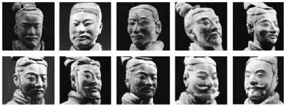
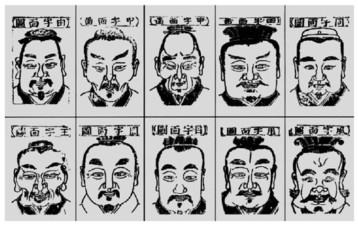
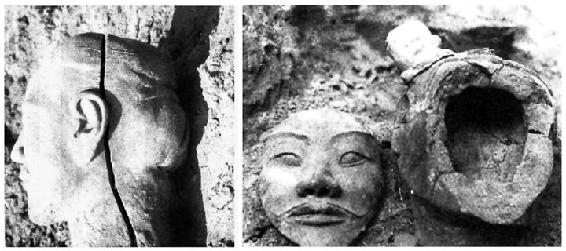
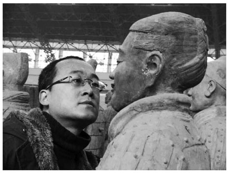
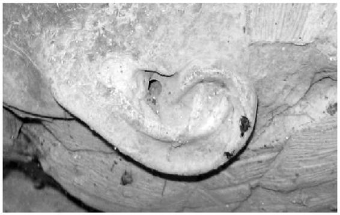
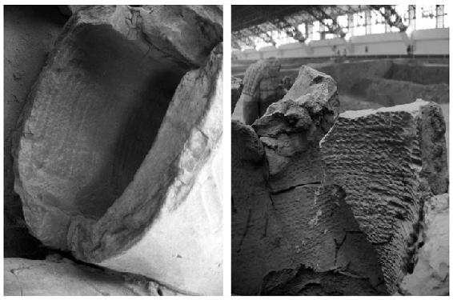
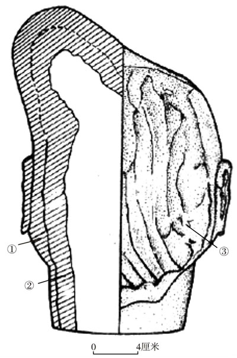

> [BREADCRUMB_CTX: 《考工记：工匠·功能·风格 (中国传统雕塑的复制与当代中国美术教育体系的建立系列丛书)》 > 五 关于秦俑“千人千面”及其制作方式的思考]

## 五 关于秦俑“千人千面”及其制作方式的思考

依照目前普遍的看法及对秦俑头部照片的比较（见图1-35）[50]，秦俑具有“千人千面”的特点。这个特点主要表现在两个层面：（1）头型的多样。（2）情态的多样。这样结果的产生是出于质量控管能力不足的意外还是有意的人为？作为秦始皇陵重要组成部分的兵马俑坑，其内含有将近6000尊数量庞大的陶武士俑[51]及相应的必要对象、设施等。从复原的结果来看，当时即使是一砖一瓦的制作也是很有制度与规范的。而督造者或是制作者以相似的思考模式，并选择采取系统流程与标准化方式对陶俑进行制作，来提高效率和保证质量也是很合理的；这也是秦人们所擅长的。虽然在多人分工的方式下，要维持固定的标准并不是一件容易的事情，但是从俑坑出土的兵器向我们所展示出的高度标准化与分工经验来看[52]，当时的秦国具备足够的能力与技术做出上千个一模一样的陶俑，可是他们并没有这么做。如果前文对官方需求的论证是合理的，那么笔者认为，官方对于制作的标准化要求就不会局限在斤斤计较于统一的造型层面，而是转向符合整体军阵的排列、大小、姿态、职能、比例、色彩，并最终以能够顺利进行烧制为主要关注的重点。就这一点来说，我们不能不承认这也是一种对于标准化的严格要求。从前文有关“真实原则”的观点而言，制作秦俑的工匠对于“真实原则”并不以表象的精致为主要条件，而是通过一种以“功能性”为出发点的真实感来加以理解的。尤其不容忽视的是，秦兵马俑中对于“俑”的需求不是一个，而是一群，不是满足于一种能力，而是群策群力，那么拥有具个人特征的面部或许就是很重要的，这也多少透露出原设计者并不希望所有陶俑看起来都相同的意图。以下，笔者将在前文论证的基础上对秦俑的“千人千面”现象进一步加以讨论。

图1-35 秦俑多样的头型与面型

资料来源：摘自《秦始皇陵兵马俑》。

《史记》中对于秦陵的记载为：“宫观百官奇器珍怪徙臧满之”，“以水银为百川江河大海，机相灌输，上具天文，下具地理”[53]。可见秦始皇对于其陵墓的要求之高、涉及的范围之广，尤其是对于模拟“现实”的坚持。从这个角度思考，对秦始皇而言，秦陵的每一个部分都代表着秦陵自身的完善，缺少任何一个环节都不能构成一个完整的现实世界，每一个迹象都暗示我们不能只从附属的概念来认识每一个组成部分，兵马俑虽然看似并非主体，也没有出现在任何史料与文献记载之中，但是就视线范围所及，秦俑坑本身仍是一个完整的部分。秦俑的存在是秦陵不可缺少的重要组成部分，它代表了秦始皇至高无上的皇权与强大的军事力量，而这正是现实世界中的秦始皇所最值得夸耀的。在这里，最不需要花费精力去要求的恐怕就是同一种面孔，它完全不需要在人像上要求统一的规格，因为它已经拥有了被视为一支“部队”所应具备的性格与特征。依据前贤研究者对秦俑的面型进行的分类归纳，秦俑符合中国民间画论中“像之大概，不外八格”[54]的说法及民间将人的脸形分为“国”“风”“目”“田”“由”“申”“甲”等基本形态的归纳（见图1-36），更显示出官方在“真实原则”下对不同面型、神态的要求是出于刻意。在这里，对于具有替代真人性质的俑而言，对每个俑在面相上所提出的“个性”要求并非是对“标准化”的削弱，反而是基于“真实原则”，对“标准化”概念的延伸与强化！而以上所言，正符合前文所论，官方对“真实原则”的需求是基于“功能性”而出发的，并不仅止于概念化的“象人”。

图1-36 “十格”《锲王氏秘传知人风鉴源理相法全书》

资料来源：王耀廷著《肖像·相势·相法》，载台湾艺术教育馆编《美育》（肖像画专辑）（第99期），台湾艺术教育馆，1998，第26页。

袁仲一先生在其研究中提到在一号兵马俑坑T1和T10探方出土的陶俑中，有10余件头型和面型基本相同的“冉字俑”。[55]虽然我们无法知道这个叫做“冉”的工匠所负责的到底是模型的制作还是整个制作流程，但是既然以“冉”作为记号，基于“物勒工名”的传统，可以知道当时确实存在着对于质量的控管。不过，目前在一号、二号俑坑出土的秦俑头部大型呈现明显的差异及其面部存在各种不同造型的胡子、眉毛、发髻和以上各部位有多种加工表现方式表明，秦陵兵马俑的设计者与监造者对于所有俑头的基本大型、制作方式、细部刻画并没有统一且严格的规范。因为“冉字俑”的存在，意味着不同于其他类型陶俑的秦俑却能够通过审查标准的事实是不容置疑的。如果说确实存在对于造型的标准化要求，那恐怕也仅止于以组为单位。在粗胎成型期，为了保证大型在长、宽、高上大致符合标准，或因为模型的关系及工匠自身对造型的惯性、高级工匠对一般工匠进行指导等原因所出现的初期的标准化，或许是一种看似经过质量管理的假象。无论如何，这一时期的标准化很显然不是秦俑设计者所最关切的，因为我们在细部加工方面对俑头进行观察时，仅从胡子造型的多样性，就可以发现他们有意打破了粗胎期的标准化。质量控管的目的或许并不在于规范他们制作得一样，而是出于对制作精度与最终烧制结果的考虑；同时或许也透露出主事者对于“千人千面”的要求是基于“真实原则”的刻意。笔者认为，虽然秦俑头部的制作是以“真实原则”为前提的，但是正如前文所述，它还必须兼顾“效率原则”。秦俑头部的制作流程可以简略地分为四个步骤：（1）制作粗胎；（2）对细部进行加工；（3）烧制；（4）上彩。依据考古报告的结果，制作方式有两种：（1）合模法（比较多）；（2）面部用粗模（外范），后脑壳为捏塑（仅见于一类俑：“冉字俑”）。[56]得出这种结论最主要的依据是，在挖掘过程中发现很多俑头面部与后脑壳分开的案例（见图1-37），头部内侧则有明显的指压及划抹痕迹。[57]我们从大量生产的条件需求来思考，制作者采用模制的方式似乎确实比较方便而且快速。

图1-37 T10.G5∶1俑头合模缝和T1.G4∶11俑脸与脑壳的粘接面

资料来源：摘自《秦始皇陵兵马俑坑一号坑发掘报告》（下册）。

从造型的角度来看，虽然我们也可以用分类的方式将秦俑的头型归纳为八类，并以此加强其采用模制的论证；不过这种对于面型的分类，即便是用在真人的脸上也能够成立，但我们却不能说真人是模制的结果。如果我们对陶俑的面型、胡须、发式、鞋子、盔甲进行分类的目的是对制作方式或样式加以归纳，那么这种分类的结果就容易偏向于一种失去个性并朝着标准化制作方向的结论。分类有助于我们对秦俑的样式进行归纳，但是若要以此对工匠是否采用“外模”翻制俑头的做法进行判断却是不足的。若从制作者的角度思考，对俑头进行严格意义的模制后再加以塑型与修整，使其形成不同的面貌，是相当困难与费事的，因为“模制”意味着“统一”，这样的结果显然会限制制作者对造型修改的随意性。这不禁令笔者对工匠们选择采用模制的方法产生怀疑。若是从制作者具有陶工的身份来考虑，如前所述，出土陶文表明，他们中间有许多是专门烧制砖瓦的宫廷匠人，而砖瓦大部分都是将炼好的土以陶板的形式制作或是采取模制的方式使之成型。但是不可忽略的是，就造型的经验而言，砖瓦上的图像经过模制完成后就等于完成，不需再刻意做得与众不同；秦俑的头部则不然，它们的最终目的是呈现秦俑面部各具特征。而前文提及的面部“卡模”与“脱模”问题则使得制作者只能采用粗模成型方法；那么我们不禁要问，经由模制成型的简单粗胚与揉好一块泥后直接以手塑而得的简单头型之间的差别与意义何在？这就好比砖瓦上的图案经由模制成功后，又要将其修改成各具特色一样令人感到麻烦，倒不如直接在砖瓦上造型来得简单有效率。正因如此，笔者不得不怀疑以模型制作面部粗胚的必要性。采用外范（外模）这种做法似乎并不是最好的选择，因为这显然不符合“效率原则”和“真实原则”；直接对俑的头部进行捏塑可能反而更简单。

秦始皇兵马俑一号坑共出土1087件各类武士俑，陶马32匹。截至1984年，共修复714件各类武士俑，陶马28匹。[58]总共发现192件有工匠的刻文或印文，排除相同的人名，共有64位工匠。依据2007年12月袁仲一先生提供的信息，到目前为止已经发现约93个工匠。[59]若将这些工匠与1087件武士俑取平均值（依据考古报告，目前已经出土的一号坑陶俑与工匠刻名的关系显示，不同工匠的制作在军阵中并没有相近的摆置区域），可以粗略地估算出一个工匠制作10～11尊陶俑（即使将32匹陶马全部加入，也不会对这个数值有太大的影响）。因此，虽然就整体而言，秦俑的数量是庞大的，但是经由平均值来看，对工匠而言似乎并不是很大的负担，因此数量的庞大，在这里似乎就并不能作为工匠们因此而采用模制方式来制作头部的有力理由。那么我们怎么解释脸部与后脑壳接合的事实与存留在其内部的指压的痕迹？一般陶土在烧制之前的收缩率为百分之十左右，烧制之后还会再缩小。[60]经过实际考察，秦俑的头部比常人的头部大[61]，所以在正常情况下，不太可能以真人的脸进行直接翻制（见图1-38）。

图1-38 笔者实地考察对比

直接手塑成型之后，为了避免头部陶土过厚导致的烧制失败，制作者必须再将做好的头部切开并加以挖空，这种做法当然会将指压的痕迹留在俑头内面。另一种制作方式是先在俑头内部埋藏一个内模（也可以是稻草或麻布之类），等塑型之后将其切开取出；如果不取出来，则容易在烧制过程中因为收缩率的不同而造成俑头表面的龟裂，从而导致失败。袁仲一先生在其研究中发现，为了使胎壁受火均匀排气方便，有些制作者在陶俑头顶开了一个1～1.5厘米的小孔，或把双耳窝挖成透孔与脑壳相通，以利于通气直接烧制[62]（见图1-39）。秦俑的烧制温度为900～1050℃[63]，在这样的温度下，麻绳类材质的内模将化为灰烬不复存在，烧制过程中空气的对流也会将灰烬排出陶俑体外。以上这种推论可以通过一号坑修复区中发现的陶俑手臂和躯干内侧得到证实（见图1-40）。从这件标本内侧可以看出明显且分布均匀的麻绳类材料的痕迹，然后从外部以陶板或陶土塑型之后再从外部或内部敲实陶土。这说明陶俑的躯干内部曾经采用类似内模的方式来控制躯干的体量。或许头部的制作也有一部分会采取这种方法。

图1-39 陶俑头部通气孔（编号5667）

图1-40 秦俑残片（秦兵马俑一号俑坑修复区）

在对陶俑的头部是否采用模制这一问题进行探讨时，陶土的特性与烧制之间的关系是不可回避的问题，毕竟陶俑最终由土烧制成为陶之后才算成功。俑头断面的痕迹显示，俑头内层采用粗泥，外部采用细泥。分成两种泥进行制作的理由很明确：首先，粗泥含硅量高，烧制时温度分散较为均匀，同时也能降低收缩率。其次，粗泥的结构性比较强，有利于制作大体积的陶器。大型采用粗泥成型显然是为了增强俑体的结构和提高烧制成功率。二次覆泥用的是细泥，泥土越细收缩率越大，但是细泥的质地细密、黏度大，可塑性高，可以弥补粗胚时期粗泥在造型细腻表现上的缺点。[64]考古报告中提到，从俑头面部侧面断裂的地方观察，里外为两层泥，外层为细泥，内层为粗泥（见图1-41）[65]，并且两层泥中间有明显的指痕。造成这种痕迹的做法是，先将细泥压进粗模内，然后再置入粗泥并用手按压桩实。按压桩实显然是为了将两种不同密度的陶土依靠压实的动作使空气含量均匀，以提高烧制的成功率。所以当面部细泥剥落时可以在细泥背面看见明显的指压痕迹，这当然有可能成为俑头采用模制方法的原因与证据。但是换一个角度来思考，二次覆泥剥落的事实意味着两层泥土的压实也有失败的结果，那么我们就不能因此将它视为曾经采用模制方法的充分证据。或许将这个失败看作不曾使用模制方法的证明反而更具说服力，因为在非模制的俑头上，二次覆泥时为了造型的需要，同样也可能在细泥背面留下指痕。

由于在现阶段的秦俑挖掘中，还未发现制作俑头的模具出土，所以以上对于俑头制作方法的分析也只是一种推测。探讨的目的并不在于否定模制的可能性，而是在于对制作痕迹所呈现出的有多种制作方式这一事实进行延伸思考。从陶塑技法来看，捏塑加锥画的方法是东周以来普遍沿袭的方法。[66]从所观察到的秦俑细部存在的各种制作方式来看，制作的“精致度”涵盖在两种不同的标准下：有些做法特别关注造型问题，有些则更重视烧制后是否坚固耐用。某些工匠采用烦琐的方式是希望使作品更耐用美观，但结果并不如预期，反而简单的方法效果更好。这是很有意思的事情，同时这也使我们不能排除某些工匠基于求好心切而采用模制的方法，但是这不表示所有的陶工都如此细心。[67]

图1-41 俑头剖视图（编号T20.G9∶103）

说明：①表层泥；②内部泥层；③内部泥层及指抹纹。

资料来源：摘自《秦始皇陵兵马俑坑一号坑发掘报告》。