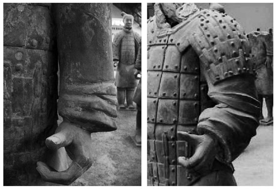
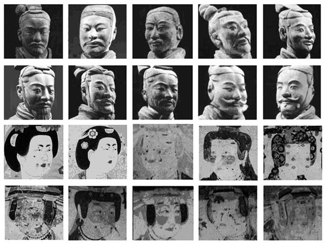

> [BREADCRUMB_CTX: 《考工记：工匠·功能·风格 (中国传统雕塑的复制与当代中国美术教育体系的建立系列丛书)》 > 六 小结]

## 六 小结

一般以文献为主的观点是，史料中并没有留下制作类似秦俑的先例的任何记录。关于当时秦国曾经制作类似人像的记载仅有少数几条，例如：秦统一六国后收天下兵器所铸的12金人与渭河桥上乌获、孟贲等力士的石制形象。而这些都是基于官方的需求才得以建造，对当时的百姓而言根本没有需求与能力制作这样的人像。很显然，工匠们也不会有太多经验与机会来制作这样大型的人像。对于秦俑的制作者，我们总是抱持一种疑问：陶工如何能够熟练地制作人像？对秦俑的制作痕迹进行观察的结果表明，这种忧虑在当时或许并不存在。从官方需求的角度进行思考，显示出官方依照需求选择合适的工匠，而工匠们则凭借自己对于材料特性的专业开创出符合需求的技术。不同做法的呈现，一方面反映出官方虽然有分工与规格化的经验，但是有关这样大型群像制作的标准还没有成熟。另一方面，失败的例子反映出制作者的预期与结果有差异，同时也让我们看到工匠们为此而开发新技术的各种案例。现实情况下所反映出来的是：制作秦俑的工匠们必须具有很强的适应能力，并具备过人的经验及解决问题的能力。即便这批工匠是专门为了制作秦俑而特意训练的，即便这批工匠存在的时间是短暂的，但是为了这种需求所开发出来的技术与经验，却不会因为不再有机会制作这样大型的陶俑而被舍弃。经由技艺的传承，工匠们不断地充实、积累各方面的经验，并随时准备面对将来可能会遇到的不同难题。

虽然以上对工匠的观察总是围绕着官方的需求而展开，但是从秦俑的制作结果来看，仍然可以发现一些制作的特例。例如在观察过程中发现有些秦俑的袖子衣纹做得非常简单，有些却折痕繁复而逼真（见图1-42）。从流水线生产制作的观点和以“效率原则”及“真实原则”为主轴的概念来看，无法解释工匠在配合整体工作时，为何愿意花费更多的心思对一个已经足以表明意义的袖管进行更多的描写。对于袖子来说，简单与烦琐都不阻碍其成为衣服的一部分，而且制作者也没有必要为了更突出地表现衣服的质感而花费更多的时间来增加自身的工作量。也就是说，在一个部分消耗过多的时间，必然连带影响到整个制作流程，会增加其他人的负担。这并不同于前文所讨论的诸如铠甲甲钉的多样化，因为这些配件的制作无法脱离铠甲的编制方式。秦代对工匠的制作与养成有明确的奖惩制度，在《秦律》中有：

新工初工事，一岁半红（功），其后岁赋红（功）与故等。工师善教之，故工一岁而成，新工二岁而成。能先期成学者谒上，上且有以赏之。盈期不成学者，籍书而上内史。[68]

图1-42 编号005448（左）和编号005667（右）

制作优异与学习快速者，师傅与徒弟都能因此受到奖励。或许这引发了工匠之间的相互竞争与各显技艺之心。此外，笔者认为也不能排除这些原本对制作人像并不熟悉的陶工们，在反复制作的过程中，将自身对于真实追求的理解与表现，最终反映在对各部分造型细腻化的追求上。以上显示了工匠的制作牵涉到许多更复杂的层面，毕竟当我们试图以群体的概念来理解工匠时，仍不能否定该整体是由众多不同个体组成的事实。而在高层（官方）意识绝对大于低层（工匠）意识的情况下，我们更不能忽略每个个体都拥有独立情感与审美判断的因素。即便秦俑的制作使用了模具概念与技巧，但是总的来说，整个过程仍然需要利用双手进行塑造与成型。而当我们企图对表象尽一切可能地进行复制、模拟时，“真实”这一概念所彰显的意义就不能仅被理解在单纯的表象上，它转而提醒我们这是一种对“存在”的态度与观念的显现。秦俑在此则成为了最好的写照。秦俑之所以长期以来受到众人的关注，原因不仅在于其制作的时间及动用的人力、物力，更在于其对“真”的实现，在于它引领我们从对表象的赞叹回归到对“存在”本身的再思考。

经由对秦俑“千人千面”现象的探讨，笔者联想到在另外一个时空另一批工匠却创造出了八千多个以“千人一面”著称的敦煌供养人画像。两者之间具有明显的风格差异（见图1-43），让我们无法以秦俑的分析结果来看待那些制作者和制作物。不过，有趣的是它们同样具有“象人”功能。这不禁令我们进一步思考，秦朝在官方的需求下创造了一批制作秦俑的工匠，而敦煌这样一个长期受到严格意义的制度化宗教影响的地区，又有可能对工匠造成什么影响？

图1-43 秦俑与敦煌供养人像比较

---

[1] 陕西省考古研究所、始皇陵秦俑坑考古发掘队编著《秦始皇陵兵马俑坑一号坑发掘报告》（上、下册），文物出版社，1988。

[2] 袁仲一著《秦始皇陵兵马俑研究》，文物出版社，1990。

[3] 张卫星、马宇著《秦甲胄研究》，陕西人民出版社，2004。

[4] 王学理著《秦俑专题研究》，三秦出版社，1994。

[5] 王学理著《秦俑专题研究》，三秦出版社，1994，第444页。

[6] 陕西省考古研究所、始皇陵秦俑坑考古发掘队编著《秦始皇陵兵马俑坑一号坑发掘报告》（上册），文物出版社，1988，第156页。

[7] 陕西省考古研究所、始皇陵秦俑坑考古发掘队编著《秦始皇陵兵马俑坑一号坑发掘报告》（上册），文物出版社，1988，第46～51页。

[8] 王学理著《秦俑专题研究》，三秦出版社，1994，第174～176页。

[9] 陕西省考古研究所、始皇陵秦俑坑考古发掘队编著《秦始皇陵兵马俑坑一号坑发掘报告》（上册），文物出版社，1988，第163～183页。袁仲一著《秦始皇陵兵马俑研究》，文物出版社，1990，第330～343页。

[10] 笔者在秦始皇兵马俑一号坑修复区进行标本采集时，发现陶俑身上标示有两种编号，一种是清楚注明陶俑出土时所在探方、过道的编号，另一种则仅以数字表示。因为有些注明陶俑所在确切位置的编号已经模糊不易辨识，所以笔者采用数字编号加以注明。

[11] 张卫星、马宇著《秦甲胄研究》，陕西人民出版社，2004，第327～334页。

[12] 张卫星、马宇著《秦甲胄研究》，陕西人民出版社，2004，第327～334页。

[13] 睡虎地秦墓竹简整理小组编《秦律十八种释文注释》，载睡虎地秦墓竹简整理小组编《睡虎地秦墓竹简》，文物出版社，1990，第43页。

[14] 王云五主编、史次耘注译《孟子今注今译》，台湾商务印书馆，1978，第9页。

[15] 袁仲一著《秦始皇陵兵马俑研究》，文物出版社，1990，第303页。

[16] 汤池著《齐讴女乐 曼舞轻歌——章丘女郎山战国乐舞陶俑赏析》，《文物》1993年第3期。

[17] 考古的实际发现显示，秦俑服色是多样的。参见王学理《秦俑专题研究》，三秦出版社，1994，第526～533页。另湖北省云梦县睡虎地四号秦墓出土的写在木牍上的家信，说明了秦军的服装由个人自备。信中写道：“遗黑夫钱，毋操夏衣来。今书节（即）到，母视安陆丝布贱，可以为禅裙襦者，母必为之，令与钱偕来。其丝布贵，徙（以）钱来，黑夫自以布此。黑夫等直佐淮阳，攻反城久，伤未可智（知）也，愿母遗黑夫用勿少。”参见湖北孝感地区第二期亦工亦农文物考古训练班《湖北云梦睡虎地十一座秦墓发掘简报》，《文物》1976年第9期。可见秦俑军阵中服饰颜色多样，并强烈地反映出官方对真实的需求。

[18] （汉）司马迁著《史记》（第8册），中华书局，1959，第2461页。

[19] （汉）司马迁著《史记》（第7册），中华书局，1959，第2293页。

[20] 例如《秦始皇本纪第六》《张仪列传第十》，参见（汉）司马迁《史记》（第1、7册），中华书局，1959。

[21] 据葛剑雄先生考据，秦始皇征南越行动可能开始于始皇二十八年，最迟不晚于始皇三十年；关于动用的部队人数，则在《淮南子·人间训》有详细记载。参见葛剑雄《先秦至魏晋南北朝时期》，载葛剑雄主编《中国移民史》（第2卷），福建人民出版社，1997，第71～74页。

[22] （汉）司马迁著《史记》（第1册），中华书局，1959，第252页。

[23] 陕西省考古研究所、始皇陵秦俑坑考古发掘队编著《秦始皇陵兵马俑坑一号坑发掘报告》（上册），文物出版社，1988，第1页。

[24] （汉）司马迁著《史记》（第1册），中华书局，1959，第236页。

[25] （汉）司马迁著《史记》（第1册），中华书局，1959，第263页。

[26] “物勒工名，以考其诚。工有不当，必行其罪，以究其情。”——《礼记·月令》。王云五主编、王梦鸥注译《礼记今注今译》（上册），台湾商务印书馆，1978，第234页。

[27] 秦陵出土砖瓦上发现“宫疆”“宫得”“宫系”三个名字和秦俑身上印文相同。参见陕西省考古研究所、始皇陵秦俑坑考古发掘队《秦始皇陵兵马俑坑一号坑发掘报告》（上册），文物出版社，1988，第199页。

[28] 陕西省考古研究所、始皇陵秦俑坑考古发掘队编著《秦始皇陵兵马俑坑一号坑发掘报告》（上册），文物出版社，1988，第193页。

[29] 万国鼎编《中国历史纪年表》，中华书局，1978，第18页。

[30] （汉）司马迁著《史记》（第1册），中华书局，1959，第239～256页。

[31] 袁仲一著《秦兵马俑的作者》，载袁仲一等编《秦俑研究文集》，陕西人民美术出版社，1990，第183～207页。德国雷德侯先生在其研究中认为，秦俑的制作者是专门制作秦宫室下水管道的陶工。参见〔德〕雷德侯（Lothar Ledderose）《神奇的始皇帝大军》，载〔德〕雷德侯著《万物》，张总、钟晓青、陈芳、韦正、赵州译，三联书店，2005，第98～101页。

[32] （清）王先慎撰《韩非子集解》，钟哲点校，中华书局，1998，第460页。

[33] 《景德镇陶图记》收录于台北“故宫博物院”书画处第九十号箱丽字一八六之2号陶瓷谱，首页为文字叙述，次页为御窑厂图，其后治瓷程序共计十二图。参见谭旦冏《中国陶瓷》（第1册），光复书局，1980，第11～24页。

[34] 陕西省考古研究所、始皇陵秦俑坑考古发掘队编著《秦始皇陵兵马俑坑一号坑发掘报告》（上册），文物出版社，1988，第192～193页。

[35] 刘诗中著《中国青铜时代采冶铸工艺》，江西科学技术出版社，1997，第120～121页。

[36] 陕西省考古研究所、始皇陵秦俑坑考古发掘队编著《秦始皇陵兵马俑坑一号坑发掘报告》（上册），文物出版社，1988，第199～203页。

[37] 王学理著《秦俑专题研究》，三秦出版社，1994，第386～387页。

[38] 袁仲一著《秦始皇陵兵马俑研究》，文物出版社，1990，第200页。原文参见《睡虎地秦墓竹简·秦律杂抄》：“省殿，赀工师一甲，丞及曹长一盾，徒络组廿给。省三岁比殿，赀工师二甲，丞、曹长一甲，徒络组五十给。”参见睡虎地秦墓竹简整理小组《秦律杂抄释文注释》，载睡虎地秦墓竹简整理小组编《睡虎地秦墓竹简》，文物出版社，1990，第83页。

[39] 袁仲一著《秦始皇陵兵马俑研究》，文物出版社，1990，第200页。

[40] 关于朱笔记名一事，在袁仲一先生的研究中有提及，但是在一号坑发掘报告中却没有记载。参见袁仲一《秦始皇陵兵马俑研究》，文物出版社，1990，第360页。

[41] 刘诗中著《中国青铜时代采冶铸工艺》，江西科学技术出版社，1997，第117～147页。

[42] 袁仲一先生的研究显示，光是手掌就分别存在翻制、捏塑、雕刻成型或是其中几种互相结合的方式制作。参见袁仲一《秦始皇陵兵马俑研究》，文物出版社，1990，第339页。

[43] 陕西省考古研究所、始皇陵秦俑坑考古发掘队编著《秦始皇陵兵马俑坑一号坑发掘报告》（上册），文物出版社，1988，第56页。

[44] 受研究条件的限制，笔者只能在一号坑的修复区进行观察，而这一案例是笔者在一号坑修复区所仅见。

[45] 〔德〕雷德侯（Lothar Ledderose）著《神奇的始皇帝大军》，载〔德〕雷德侯著《万物》，张总、钟晓青、陈芳、韦正、赵州译，三联书店，2005，第75～107页。

[46] 睡虎地秦墓竹简整理小组编《秦律杂抄释文注释》，载睡虎地秦墓竹简整理小组编《睡虎地秦墓竹简》，文物出版社，1990，第81页。

[47] 王学理著《秦俑专题研究》，三秦出版社，1994，第146页。

[48] 戴吾三编著《考工记图说》，山东画报出版社，2003，第1页。

[49] 闻人军译注《考工记译注》，上海古籍出版社，1993，第118页。

[50] 关于秦俑头部图片的选择依据的是秦俑面部的十种造型，图片取自于天为编著的《秦始皇陵兵马俑》（中国旅游出版社，1983）。图片的选择涉及笔者的论点或下意识，但是为了突显问题，选择面容差异大的标本是有必要的，而八种基本面型中同一种面型又存在极大差异，这也足以证明了秦俑面型的多样性。

[51] 陕西省考古研究所、始皇陵秦俑坑考古发掘队编著《秦始皇陵兵马俑坑一号坑发掘报告》（上册），文物出版社，1988，第159页。

[52] 王学理著《秦俑专题研究》，三秦出版社，1994，第386～388页。

[53] （汉）司马迁著《史记》（第1册），中华书局，1959，第265页。

[54] 陕西省考古研究所、始皇陵秦俑坑考古发掘队编著《秦始皇陵兵马俑坑一号坑发掘报告》（上册），文物出版社，1988，第142～143页。

[55] 袁仲一著《秦始皇陵兵马俑研究》，文物出版社，1990，第330页。

[56] 袁仲一著《秦始皇陵兵马俑研究》，文物出版社，1990，第330页。

[57] 陕西省考古研究所、始皇陵秦俑坑考古发掘队编著《秦始皇陵兵马俑坑一号坑发掘报告》（上册），文物出版社，1988，第177～181页。

[58] 陕西省考古研究所、始皇陵秦俑坑考古发掘队编著《秦始皇陵兵马俑坑一号坑发掘报告》（上册），文物出版社，1988，第10页。

[59] 笔者于2007年12月19日与袁仲一先生的访谈时，他说：“据现在初步统计发现的不同工匠大概93个，过去有80多个，后来又发现了一些。”

[60] 陶土的收缩率一般是以陶土的成分及掺和料的比例为判断的标准，10%左右的收缩率只能作为一般常识性的参考，在正式的考古发掘报告中并没有明确的数据。可以确定的是，陶土经过水分的挥发会有收缩的现象。这一点可以通过未烧制过的陶模在碰到水后会产生湿膨胀的现象得到证明。参见李文杰《中国古代制陶工艺研究》，科学出版社，1996，第32页。

[61] 笔者的身高为1.73米。按照比例来看，图1-38中陶俑的头部在烧制之前至少还必须再增加其大小。

[62] 袁仲一著《秦始皇陵兵马俑研究》，文物出版社，1990，第352页。

[63] 陕西省考古研究所、始皇陵秦俑坑考古发掘队编著《秦始皇陵兵马俑坑一号坑发掘报告》（上册），文物出版社，1988，第328页。另朱君孝、宋远茹的研究中提到了三种不同的结果：一为950～1050℃；二为800～900℃；三为利用“热膨胀法”测定一、二、三号坑共19个陶片烧成温度，结果为730～1000℃。参见朱君孝、宋远茹《试论秦始皇兵马俑的工艺技术渊源》，《考古与文物》2005年第2期。

[64] 李文杰著《中国古代制陶工艺研究》，科学出版社，1996，第1～2页。

[65] 陕西省考古研究所、始皇陵秦俑坑考古发掘队编著《秦始皇陵兵马俑坑一号坑发掘报告》（上册），文物出版社，1988，第178～179页。

[66] 汤池著《齐讴女乐 曼舞轻歌——章丘女郎山战国乐舞陶俑赏析》，《文物》1993年第3期。

[67] 李文杰先生在对甘肃秦安大地湾一期制陶工艺的研究中认为，模具敷泥法有两个优点：（1）借助模具可以克服成型的困难。（2）模具可以多次使用。同时他认为也有缺点：（1）生产效率低。（2）废品率较高。（3）器物型制单调。他还认为模具敷泥法是一种比泥条盘筑法更原始的成型方法。参见李文杰《中国古代制陶工艺研究》，科学出版社，1996，第35～36页。

[68] 睡虎地秦墓竹简整理小组编《秦律十八种释文注释》，载睡虎地秦墓竹简整理小组编《睡虎地秦墓竹简》，文物出版社，1990，第46页。