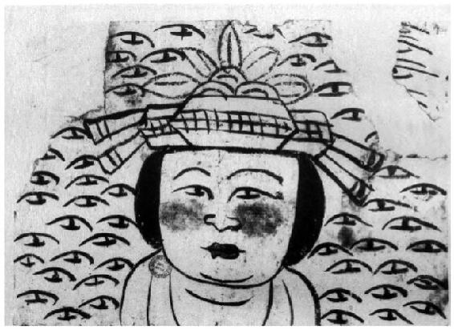

> [BREADCRUMB_CTX: 《考工记：工匠·功能·风格 (中国传统雕塑的复制与当代中国美术教育体系的建立系列丛书)》 > 一 敦煌遗画《头像》]

## 一 敦煌遗画《头像》[8]

图2-1 《头像》Pel.chin.4514（14）

资料来源：法国国家图书馆。

敦煌遗画《头像》Pel.chin.4514（14）的内容基本可以分成两大部分：一部分是女子的头像，另一部分则是围绕在女子周围众多的眼睛（见图2-1）。若排除因为画幅破损而缺失整体判断的因素，按照一般观画与绘画的习惯，女子处于画面中央，应该是主题。但有趣的是，整张画面中最引人注目的却是主题之外那些不断被反复描绘的眼睛。因为在敦煌遗画及敦煌的其他绘画中并没有发现相类似的组合。虽然在某些特定的菩萨或佛像、尊像绘画中，会出现多双眼睛，但这些特定造像的眼睛所依附的形象和形式与此画面有很大的差异。而从这张画面中的人物形象来看，描绘的显然并非尊像而是世俗常人。无论如何，从画面呈现的形态而论，笔者都比较倾向于它的习作特征更大于一件完整的作品。而依照女子像旁边画了这么多的眼睛来看，这似乎是一张专门针对绘制眼睛进行的习作。如果依绘画习惯与难度的大小，我们至少可以先做出一个粗略的判断，画面正中女子的外轮廓先完成的可能性比较大。因为外轮廓线的确立将有助于各部分的定位，而且从那些眼睛与女子像并没有明显重叠的痕迹来看，也更能增加此推测的合理性。至于女子的五官与周遭那些眼睛的绘成先后顺序就不太容易判断了，那些眼睛有可能是为了画女子眼睛而事先做的练习，也有可能是其他的原因。必须注意的是，我们不能排除作者先由女子的眼睛部分开始起笔，直到整个外形确定的可能性。不过，在这里讨论眼睛绘制的先后顺序已经没有多大意义，因为前面的分析只是为了更有力地证明它是一张习作。

如果我们对画面进行更深入的观察，就会发现一些有趣的事。首先，将女子与女子身旁的眼睛进行比较，可以很明显地发现这两部分眼睛的画法是不一样的（尤其是对于对毛笔的运用与线条的变化较有经验的人而言）。女子眼睛的大型比较准确地掌握了与脸部其他部位的关系，例如两只眼睛在靠近眼角时的弧度较大，往眼尾收的时候逐渐细小。眼角与眼尾的两个交接点连成一线时，眼睛的斜度稍稍偏上。从观者的角度看，右眼角与右鼻翼的线条比较细，左眼角与左鼻翼的线条比较粗，这或多或少有点暗示脸部阴面与阳面的意思。两只眼睛上眼皮的弧度在靠近眼角的地方有比较明显和强烈的转折，而且有分为两笔进行描绘的可能，这使得眼睛的形态与体量之间的结构关系比较明确。两只眼睛的眼珠显示出作者下笔时的落点偏上，笔尖稍微回锋或旋转并且稍作停顿，这样使得眼珠上方看起来有一部分被上眼皮覆盖。而对两边的下眼睑进行描绘时，作者则将两端略偏斜上，并且位置都不超过上眼睑的眼角，这使得眼皮的弧度增加并且增强了眼窝的深度，同时也使得鼻梁的高度增加了。以上的特点显示出，作者对眼睛的形态与面部的关系有深刻的认识，虽然画面简单，但有理有据，是知其然而为之。反观女子周遭的眼睛，虽然作者反复对眼睛进行描绘，但结果显示作者只着重对眼睛进行个体的练习，因此把握不好两只眼睛与面部整体的对称关系。每只眼睛几乎都缺少眼角与上眼皮的转折，使得眼睛只像是简单地由两条弧线构成，忽略了眼睛本身的体量感及其与鼻梁的关系。在对眼珠进行描绘时，也大部分是不得要领，落笔轻浮又草草收笔，有些甚至没有回锋，这使得眼珠总是画得偏长又歪歪斜斜，其结果是表现不出眼珠漆黑圆润的造型特征，甚至看上去并不像“人”眼。从这个方面来看，这也多少反映出古代画论中强调的“四体妍蚩，本无关妙处，传神写照，正在阿堵之中”[9]那种对于“点睛”重要性的讲究以及如何传“人”之“神”与现实技法间一些直接的关系。画面中与人物眼睛平行的左上部有较多的眼睛往右上倾斜，右下角有几只眼睛则往下倾斜，表明作画者与纸张之间的位置关系可能是固定的。画者没有因为其所画纸张部位的不同，而考虑移动身体或纸张，而是起笔与收笔时重时轻。这表示他对于用笔的力度掌控得并不熟练，证明他还没有足够的能力控制手腕与驾驭毛笔。从以上对现存画面的分析，可以做出一个假设，画女子眼睛的人与其他眼睛的作者并非同一人，而这个学习者为了练习描绘眼睛，花了相当的时间与心思。《头像》可能不是一张单纯的个人习作，而是一张遗留着指导者与学习者互动过程痕迹的重要文献。