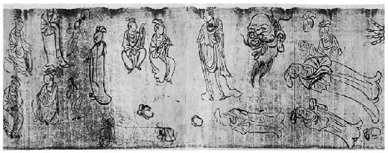
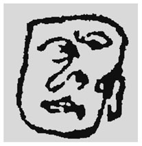
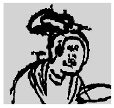
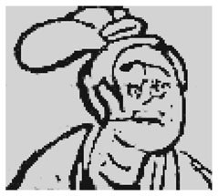
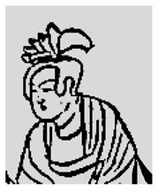
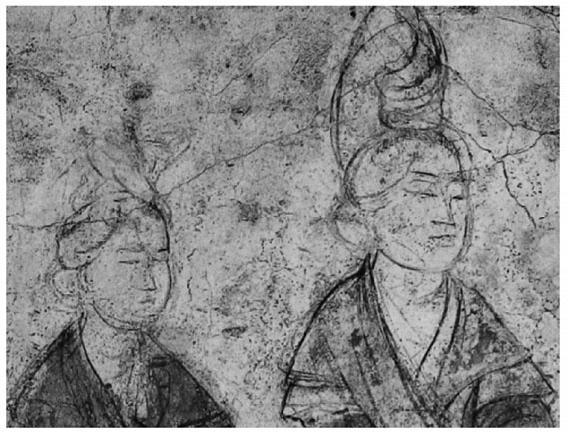

> [BREADCRUMB_CTX: 《考工记：工匠·功能·风格 (中国传统雕塑的复制与当代中国美术教育体系的建立系列丛书)》 > 二 敦煌遗画《白画供养人物稿》]

## 二 敦煌遗画《白画供养人物稿》[10]

由于敦煌遗画Pel.chin.2002V°篇幅过大，《法藏敦煌西域文献》将其分成7个部分，并依内容分为6个主题。《白画供养人物稿》实际上是整张画第3部分的第2个主题，内容以人物为主。画中人物或坐或站，姿态与角度都不相同，而且几乎有一半的人脸是空白的。画中有几个仅仅描绘出头像外轮线就不再继续画的头型，由此或可以推断作者是先将头型画出，然后才接着画其他部分的。头部是一个人物的重点部分，对画者而言其失败率很明显是比较高的，也因此导致某些人物还没画完就被放弃了。从整体来看，作者似乎试图针对人物不同的姿态进行描绘，而从各自独立的人物造型及空白的面部看，很明显此幅图画的很多部分有明显的习作特征。

图2-2 《白画供养人物稿》（7-3）Pel.chin.2002V°（2）

资料来源：法国国家图书馆。

经过仔细审视之后，我们发现画中存在两种差异极大的绘画风格。在画的右侧有三个五官与脸形方向极为怪异的人物出现。我们由图2-3、图2-4、图2-5所列出的三张脸孔来看，很明显，问题出在脸形与五官位置相互之间不协调。不管作者什么身份，这都说明画者对脸形与五官关系的掌握能力不足。从图2-3右边的耳朵来看，作者应该是要画一个侧面的脸，但是只有鼻子具备了侧面的造型特征，很显然作者对眼睛与嘴巴侧面造型的不熟悉使得整个脸看起来非常不自然。从画法上来看，作者更像是基于一种印象，将五官的造型特征以直观的方式如实描绘后填进轮廓里，并没有考虑到头部整体呈现是否合理的问题。图2-4与图2-5中的两个脸也都出现相似的问题。在以上三个怪异脸的上方还有一个另一种风格的女子半身像，其脸的画法明显不同于前面三个五官不协调的怪脸（见图2-6）。画者对人物脸形与五官方向的把握极为熟练，尤其对五官的描绘遵循同一个角度，对于五官侧面的造型采取了简约概括的方式，表现得非常准确。这两组风格差异极大的画像让我们没有办法相信是出自同一个人的手笔。

图2-3

图2-4

图2-5

图2-6

清人丁皋在其《写真秘诀·附起稿先圈说》[11]中提到：

画像先作一圈……则当未圈之先，必先以己之灵光与人之眉宇，互相凝结，然后因物赋物各肖其神。若但置一空圈于此，而后思若何安排？若何点缀？则所谓差之毫厘，失之千里，欲得其真，不亦难乎？

这段话旨在强调画像高手与一般画人的区别在于“起稿先圈”之前，作者不仅要对各部分与整体之间有足够的认识与理解，更要在画像之前与对象达成某种程度的共鸣才有可能得其所绘对象之“真”。这实际上已经涉及绘画过程中几个不同的层面，包含技术层面与心理层面。从技术层面来看，画家一般在对描绘对象的外部造型进行归纳与简化之后，采取“起稿先圈”的方式作画，以方便控制构图、避免整体的变形或是对象移动后对五官造型的掌握不当所造成的不合理性。这种“先圈”的技巧是一种沿用已久的普遍习惯，我们在一些唐代壁画留下来的起稿线中可以发现这种“先圈”方式的痕迹（见图2-7）。

通过Pel.chin.2002V°中的练习稿，我们可以明显地发现这种“起稿先圈”手法的应用。这种技巧最大的好处是能够帮助画者在短时间内把握对象的外貌共性及范围尺度，所难之处是把握了大型之后，如何处理人物五官外貌的特征及眉目神情之间的呼应关系。这种对人物的把握不是随机的或是被动的迁就画面需要的创造，而是必须先心存人物然后诉诸笔端、表现于纸上，从而达到心手合一的“写真”。这恐怕就是丁皋所认为的高手与一般画匠的差别。虽然我们很难判断这些头像是否为写真的目的而画，但是作为一种绘画入门的方法来说，却具有共通性。从以上Pel.chin.4514和Pel.chin.2002V°两件作品中练习者的痕迹来看，这些绝对不是立体主义（cubism）式的对艺术理念及观看方式的创新与修正，充其量只能说是刚开始对面部绘画的入门练习而已。再看看这些指导者（如果指导者确实存在），如果从精致度上看，似乎并不能说他们达到了高手的程度；但是若换一个角度，从画“理”来看，很显然，画面是很精微的。表象精致与否关涉的只是花费时间的多寡与熟练程度的问题，但是对于绘画的人来说，更重要的是对对象内在规律与外在呈现的把握与认识。这种“理”的重要性远胜于画的“工”（制作时间与制作精度）！指导者对细微部位的认识，让我们对他具备足够的能力将画面画得更细致这一点无法怀疑。当然，以上两件习作不能代表敦煌绘画工艺的水平，因为敦煌还有许多制作非常精湛的作品，而且风格与此迥然不同。对以上两张习作的分析向我们展示出一些可能的线索：

图2-7 （唐）懿德太子墓前室南壁东侧《宫女图》

资料来源：摘自《神韵与辉煌——陕西历史博物馆国宝鉴赏》（唐墓壁画卷）。

（1）敦煌的工匠是必须经过长时间循序渐进的训练的。

（2）训练的行为涉及“师傅”与“徒弟”的身份关系。

（3）暗示了专业工匠或工匠队伍存在的可能性。

（4）工匠们会基于不同需求及条件而采取不同的画法与练习方式的可能性。

以下笔者将根据敦煌遗画的实际情况、文献材料及前贤的研究成果对上述线索加以探讨。