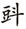
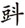
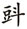

> [BREADCRUMB_CTX: 《考工记：工匠·功能·风格 (中国传统雕塑的复制与当代中国美术教育体系的建立系列丛书)》 > 四 工匠的经济状况与自我提升 (Part 1)]

## 四 工匠的经济状况与自我提升

从职业的角度来看，工匠的收入状况必然与其系统结构、制作方式密切相关，这当然也就成为对工匠与其所处社会关系进行观察所必须考虑的问题。据姜伯勤先生的研究，唐代中叶，内地已经出现将雇匠称为“博士”的情况，至归义军时期，敦煌地区的“寺户匠”已经逐渐消失于记载中，取而代之的是“博士”，以称呼具有特殊技艺的匠人。[45]而且姜先生认为在唐五代封建商品经济的发展下，工匠在完成配役或经由“纳资”代役后，也可在个人经营中收取雇价。[46]我们从文献中确实也可以发现敦煌有一部分工匠收取工价的记录（也就是文献中所载的“手功”“手工”或“缠盘”[47]），例如：

马都料方□且空，绳墨不遵师难。若得多少工价，进行布施与□。[48]（S.3905）（901年）

1-2“豆一石五斗史都料打佛艳手工用。”[49]（P.3234V°7）（10世纪中期）

13“博士手功价物柒。”[50]（S.4705）（10世纪）

16-17“六月二日，出粟七硕，付荣清等充仰泥手工。同日，出粟叁硕，麦壹硕伍与王庶子仰泥手功。”[51]（S.6829V°）（806年）

从敦煌遗书中的“马都料”“史都料”“博士”或其他称呼来看，这一类具有专门技术的工匠不管其等级、职称如何，都曾依靠工作来获取工价。另外，在许多寺院和官府的账籍中也记载着施工期间雇方提供饭食的证据。既然如此，笔者认为“供食”与“工价”理所当然地应该合在一起看，只有这样才能体现出工匠的总体工价。此外，在9～10世纪归义军时期，官府及寺院的各类“入历”“破历”中还留有许多雇方在施工期间供给食粮与酒水的记录，表明雇主到工地视察时往往不会空手而去，总会对工匠们有一些慰劳或招待（“屈”或“看”）。例如S.2474号文献有如下记载：

18-21“六日供城东园造作画匠五人，塑匠三人，逐日早上各面一升，午时各胡并两枚，至八日午时吃料断，中间三日，内一日塑匠三人全断，计给面四斗二升。”[52]（980～982年）

S.1366号文献记载：

4-5“八日，供造鼓床木匠九人，逐日早上各面一升，午时各胡并两枚，至十五日午时吃料断，中间八日，用面一石四斗四升。”[53]（980～982年）

八天的工程总共消耗1石4斗4升，合计为144升，每天消耗18升。每天供应木匠九人早、午两餐，所以每人每天消耗2升，也就是说午餐与早餐的供给量一样，皆为1升。我们由此也可以得知，一个胡饼相当于半升。此外，在寺院的各种“破历”中还可以看到记载着花在工匠身上与工价无关的其他一些开销，例如遇到节庆有相应的馈赠、雇主在视察工地时往往会有不同程度的“屈”或“看”（即慰劳与招待[54]）。有些记载甚至让我们感觉到，寺院似乎有责任对施工期间工匠的丧、伤等意外加以慰问或抚恤（在寺院的“入历”“破历”中会发现许多这样的记载），虽然并没有写明是施工期间的慰问，但可以确定的是，当工匠遇到丧葬事件时，寺院会给予慰问和不同程度的丧仪。这也许是身为寺院的义务，也或许是不成文的惯例。此外，在施工期间还有些额外的福利（如果我们愿意这么看待的话），在这个被制度化宗教特色影响的地区，工程的制作过程常会基于宗教的需要，而举行相应的仪式显得特别重要，例如：

222-223“粟壹，塑匠造佛焰胎日酤酒用。粟贰，佛焰初使胶布两日看塑匠用。”[55]（P.2049V°）（931年）

51“酒壹斗，亦赛神看博士用。”[56]（P.3875V°）（976年或916年）

招待：

9-14“一石二斗屈工匠用……六斗看博士用……六斗看木匠用。”[57]（P.3165V°）（10世纪）

11-12“面拾肆硕玖·贰胜，八月十四日以后至九月十一日，看木匠泥匠铁□及人夫等用。”[58]（P.2040V°）（10世纪）

丧葬慰问：

425-426“布叁尺，康博士女亡吊孝用”[59]（P.2049V°）（931年）

401“布三尺，油梁博士母亡吊用。”[60]（P.2032V°）（10世纪）

81-82“布二尺五寸，康都料孙子亡吊孝用。”[61]（P.2040V°）（10世纪）

我们从这些有关供给食粮的数量、期限与“屈”“工匠”的详细记录，能看出施工期间的伙食是由雇方供应，而施工时间的长短关系到雇主必须供应多少粮食。显然，我们不能因为这些详细的记载而轻易将其解读为这是出于对工匠过于苛刻或是为了剥削其劳动力的斤斤计较；但这些记载可以证明的是，雇方显然相当重视经费的使用状况，因为这毕竟事关出资者的权益。在敦煌，许多石窟的开凿或是功德，是由民间组成的“邑社”组织合资完成的，而这些成员的身份与经济能力也都不尽相同，所以详细记录开销就成为理所当然的必要。例如在《金山国时期修文坊巷社在缉上祖兰若，标画两廊大圣功德赞并序》[62]中：“厥有修文坊巷社敦煌耆寿王忠信、都勾当伎（技）术院学郎李文进之社众等计□捌人，抽减各己之财，造斯功德。”不过，从有关“屈”“工匠”的记载来看，雇主对于工匠在工价之外有额外付出是明显的事实，笔者认为这反而成为工匠们受到一定程度重视的有力证明。

姜伯勤先生在其研究中就列举了在净土寺账目中有多笔替木匠“康都料”吊亡的记载，认为“康都料”应是与净土寺有密切往来并受到重视的高级工匠。[63]马德先生在其《敦煌工匠史料》一书中整理了许多不同工匠的供食记载。[64]这些详尽的记载说明当时对于工程的供食开销有着普遍而统一的行情，显示当时存在一个相当稳定的市场。这或许也提供了一种可能的信息：当时的工匠并非一般人所普遍认为的总是受到压迫与奴役的阶层。若从每天单个工匠所消耗的粮食热量来加以计算，我们甚至可以发现雇主所供应的粮食足以达到一个成人每餐饱食的量。也正因此，前列文献中的供食计量，才无需因为不同的工种而有相异的供量标准。依据法国学者童丕（Éric Trombert）的研究，1公斤的小麦或大麦约可以提供3000千卡的热量。[65]吐蕃时期的度量单位为“驮”，1驮相当于42公斤，汉人的度量单位为“硕”（shi），相当于0.87驮，也就是说1硕等于36.54公斤。1硕为10斗，1斗为10升，1硕相当于100升[66]，经由换算1升约为0.3654公斤，相当于1096.2千卡。我们比照法国学者童丕所说的1789年法国大革命前夕，巴黎一个成年穷人一天最低生活所需的热量为2000千卡来看[67]，敦煌的雇方大多一天提供两餐，每餐为1升，也就是说敦煌的工匠每天两餐所获得的热量约为2192.4千卡。从这个结果来看，敦煌工匠每天似乎只能勉强获得生活所需的最低标准热量。但是，我们并不能简单地将这些工匠等同于1789年巴黎的穷人，因为我们不能忽略工匠还有工价的收入。唐耕耦等在《丁丑年（公元九七七年？）金银匠翟信子等状并判词》中提到：

1-4“金银匠翟信子、曹灰子、吴神奴等三人状。右信子等三人，去甲戌年，缘无年粮种子，遂于都头高康子面上寄取麦叁硕。”[68]（北图106∶4757）（977年？）

郑炳林先生认为有关工匠间借贷种子的记载显示，他们在从事手工业的同时还耕种一部分土地，工匠能够拥有自己的田地表明即使是工匠家庭也有副业，这同时也显示出当时的手工业与农业并未完全脱离。[69]而童丕也提到在敦煌还有大量的饲养业与大规模种植次要榖物，这也提示我们工匠在工作以外，应该还会经营其他副食或副业以增加收入来源。值得重视的是，笔者在一些供食的文献中发现，除了有施工期间供应工匠早晚两餐的供食记载之外，还有供应夜餐的记载，例如《辛亥年四月三日起首修法门寺使白面历》（P.3505V°）[70]（后周广顺元年，951年）[71]中记载从四月四日开始到五月二十九日几乎每天都供应早、中、晚三餐：

46“十六日午、夜面伍升。”

48“十七日早料壹柒升，午料陆，夜料三伍升。”

50“十九日早料壹伍升，午料陆伍升，夜料四。”

51“廿日早料肆伍升，午料捌升，夜料肆柒升。”

《后晋时代净土寺诸色入破历算会稿》（P.2032V°）[72]更突出有力地证明供应晚餐并非仅仅针对劳动强度大的工匠，而是不分工种、职业，所有参与者都可以得到一份供食：

193-194“面两石壹五升、并调灰粗面壹石、油壹胜半、粟两石叁伍。升，卧酒沽酒，钟楼上灰泥画匠塑匠及众僧三时食用。”

我们从《庄子·逍遥游》“适莽苍者，三餐而反，腹犹果然……”[73]和南宋诗人陆游在诗中提到的“疾行逾百步，健啖每三餐”[74]，可以看出古代中国人一天三餐的习惯。虽然佛教中也存在过午即不食的戒律，但是未必所有的工匠都是佛教徒。笔者认为，这或许显示出当时敦煌有吃三餐的习惯。在遗留下来的当时一般寺院的《破历》和官府的账籍中，经常见到每餐两个胡饼的记录。在其他的《破历》中，也会发现早、午餐的供食标准普遍都是一升的记录。这显示出这是当时一般的粮食供给标准。而经由简单的计算，我们可以轻易地知道一个胡饼即相当于半升，这样的供食标准虽不能说宽裕，但笔者相信这至少不能说是一个刻薄的数字。理由在于，依据童丕的研究，现代成年人一天消耗的热量为3500～4000千卡[75]，而前文提及敦煌的工匠每天两餐所获得的热量约为2192.4千卡，如果按照一天三餐来计算，那么敦煌工匠一天摄取的最低热量一下子变成将近3288.6千卡。把以上这些工价之外的收入与工匠通过劳动所获得的工价结合来看，笔者认为当时的工匠在生活上或许不一定富裕，但也不能说他们过得很艰苦。虽然在敦煌P.3964号（935年）的借贷契约中有关于塑匠都料赵僧子典儿的记载[76]，但这是敦煌借贷文书中唯一一条有关都料典儿的记录。笔者认为不能因此而轻易地认为这是工匠生活艰苦的证据，因为我们在其他的借贷文书中也看到其他不同阶层身份的人也在从事借贷，其中还包括僧侣[77]，当然我们也并不能因此就做出僧侣属于贫困阶级的结论。[78]

经由以上的分析，我们可以把敦煌工匠视为处于制度化宗教需求氛围下的商品经济市场中的特殊技术人才。一个区域市场的大小直接影响到工匠存在的数量，同时也连带影响到对于工匠的选择标准，并因此推动工匠制度的发展、师徒关系与制作方式等相关机制的产生。前文已经提到，敦煌对画匠或是塑匠的需求并不限于开窟造像，还有许多为了因应个人需求而选择私人聘请工匠制作或购买现成作品的行为。这就把敦煌的工匠市场区分成两种不同的性质。前者是需要由各种不同专业技术人员所组成的团队一同施工，相互之间在配合度与协调性上都必须比较谨慎。后者则是只要买方与卖方两造单纯的交易或经由协商，就能够达成具有共识性的相对单纯的商业行为。从敦煌的遗迹来看，以上两种性质的工程都提供了庞大的市场并成为许多工匠赖以生存的经济来源。就这两种类型的出资者而言，其范围涵盖官方、寺院、富商大贾、名门望族、由民间组成的邑社，以及以个人名义聘雇工匠的各阶层。可以想见其间因为牵涉到资金的多寡与身份的不同而连带影响到制作的规模与等级，甚至是做工的精致程度。而不同技术水准的工匠与不同规模的工匠队伍所能承接的不同工程等级，对工匠的收入必然也产生直接的影响。当然，我们不能否认在吐蕃时期的工匠大多属于寺户身份，受到官方、寺院管辖及世袭服役的情形[79]，但这同样不能抹杀工匠经由自身努力而改善生活、获得地位的事实。至少在9～10世纪的瓜、沙归义军时期，工匠已经组织了各种行会，尽管这些组织在某种意义上仍受到官府的控制。[80]

既然敦煌本身拥有如此数量庞大的工匠，其在人才供应上理当不虞匮乏，但事实证明这个地区对工匠的选择似乎并非封闭与自足的。遗留下来的题记还表明某些工程曾聘请敦煌当地以外的工匠，例如：榆林窟第12窟曾聘请临洮画师刘世福[81]、榆林窟第19窟曾聘请甘州画师高崇德[82]、元代曾聘请甘州画师史小玉绘制第3窟和第444窟壁画的题记记录[83]，以及塑匠马报达于辛未年六月一日在伊州作客写记的题记[84]。不管聘雇外地工匠的理由为何，工匠是一种社会群体的统称，并以工价作为其收入的主要来源，外地工匠的介入，势必会对本地工匠的经济市场造成一定程度的影响。当技艺成为一种职业并成为工匠们赖以维生、养家糊口的工具时，不管是以作坊的形式承揽工程还是凭借个人的名气独立制作，对客源的争取理所当然成为工匠最关切的问题，工匠之间存在竞争恐怕也是不可避免。这种竞争虽然在敦煌的文献中没有显示出来，但是在历史上却不乏因为名、利等各种因素而出现工匠个人或派系之间相互竞争的案例。最著名的例子就是唐代吴道子认为皇甫轸“其艺逼己，募人杀之”[85]。这个案例虽出自笔记小说，不一定真有其事，但也反映出当时可能有类似的事情发生。派系之间竞争的案例则如张彦远所记载：“圣历后，有神英法师令何长寿扫却，欲重描。神英京兆，党何生；洛下众僧党刘行臣。时人以何生虽善山水，至于画神不如刘。与西京长寿齐名，洛下之意，抑何进刘，不许神英之请，还遣行臣之子茂德续其父画……”[86]为了具备足够的条件及能力争取较大的工程或是更高的工价来满足雇主在“质”与“量”上的需求，某些能力较强的工匠会转而思考以团体的形式来承接工程，这很显然有其合理性；教学收徒可以解决人手不足的问题，画稿、粉本的收集与使用也有利于制作或授徒。而技术的提升成为工匠扩展业务、增加收入的必要手段与条件。虽然大多数工匠看似被动地承接了工程，但是被选择承揽工程的条件本身却很明确；很显然，文献中也透露出工匠们确实可以凭借努力尽可能地为自己创造更多增加名声与财富的机会。通过对敦煌文献中有关工匠的工价进行考察，可以发现，如果工匠是单人受雇，那么他通常是一个技艺精湛的工匠，其工价并不是以市场的定价（雇价）来计算，而有可能是工匠与雇主之间经过“平章”（协商）之后议定。马德先生认为契约中的行文不使用“雇”而使用“平章”，说明技艺较高的工匠拥有一定的地位并受到尊重。[87]这显示出某些工匠具有优势条件，可以与客户进行对等议价，甚至是采取高于雇主的姿态，凭借精湛技艺和众多客源而获取更多的收入。以吐蕃时期（822年）僧慈灯雇汜英振泥匠修建佛堂为例，“……造前佛堂，断作麦捌汉硕。其佛堂外面一丈肆尺，一仰汜英振垒，并细泥一遍”[88]，仅是砌墙并敷细泥一遍，其工价就为麦捌硕（石）。此外，还有一些其他的记载：

13“博士手功价物柒”[89]（S.4705）（10世纪）

16“六月二日，出粟柒硕，付荣清等充仰泥手工。

17同日，出粟三硕，麦壹硕五，与王庶子仰泥手功。

21廿一日，出粟肆硕，麦壹硕五，与王庶子仰倪守功。”[90]（S.6829V°）（806年）

178-179“粟玖硕与画人手工用。”[91]（P.2032V°）（10世纪）

依照法国学者童丕的研究，以当时一个农民一年平均种地的所得为13.05硕，一家四口（成年人）每人每天3升的量计算，其工价则相当于66.6天生活所需的粮食。[92]如从这个角度来理解手工的价值，那么“捌硕”就不啻是一个惊人的数字。我们在编号为P.2032V°的文献中另看到有以下记载：

179“福子面上卖录丹青粟伍斗。”

181-182“画人边卖（买）录用。粟两石，索像友边卖（买）录用”[93]（10世纪）

可见材料费与手工是分开计算的。就这么高的工价而言，可以想象工匠为了提高自己的技术以利于招揽客户，必然在制作的技巧上各显神通，并且有所竞争。这个工价看似与农民平均收成量差异极大的例子，不禁让我们对这种高价的原因感到奇怪，从而对其所处的社会环境进一步深入思考：在这种制度化宗教盛行的地区，跟宗教有关的绘画或工程所具有的价值与意义和单纯观赏性的绘画或一般性质的工程并不相同。而这是否也表示，一个画家所画的宗教画比较容易被流传并容易受到社会更多的关注？东晋时的顾恺之在画维摩诘像于瓦棺寺时曰：“将欲点眸子，乃为寺僧曰：‘第一日观者请施十万，第二日可五万，第三日可任例责施。’及开户，光照一寺，施者填咽，俄而得百万钱。”看来这似乎是顾恺之精湛的技艺所造成的结果。但是在此之前，当顾长康“打剎注百万”时，却因为“长康素贫”而“众以为大言”，这似乎又表明顾恺之画技虽好，却连“小康”的生活条件都达不到，而是“素贫”[94]。其原因何在？若从上述角度来理解，这是否可以被视为对于一个画家来说，或许画佛画比较容易获取较高工价的参考？也就是说，虽然技术本身依然是重要因素，但是具宗教意义的制作或许更能够提高工匠与作品的价值。工匠们为了获取更多的工价与客源，在制作上各逞神通，不仅是合理的，也是说得通的。我们从一些文献中也可以看到那些对工匠制作极尽华丽能事的赞美：

35、43“乃召巧匠，选工师，穷天下之谲诡，尽人间之丽饰……旁求巧妙，广选名匠。陈彼钩绳、凿斯岩嶂。”[95]

“每遇月初旦朔，僚佐乘参，燕会高宾，厅馆阻壁。乃命巧匠缔构新楼。邀鲁国之良（名）贤，请丹青之上客。于是巍峨入汉，雕暗牖以踈风；峻节淩云，镇飞廉而障日；壁雾染琉璃之瓦，丹霞粧玳瑁之粉。奇异多般，不可备载。”[96]（P.2481V°）

所谓“穷天下之谲诡，尽人间之丽饰”，即是说穷尽人间已经拥有的各种美丽装饰。所谓“奇异多般”，另一方面表明其制作内容种类多样，另一方面既然“奇异”，也就是说超出世俗概念之外。这些溢美之词，当然有可能是功德主为了表示自己虔诚敬佛、不计成本的夸大，但是这些对工匠的赞美中有不止一篇对工匠做工与众不同的赞扬，这也从另一个侧面反映出雇主品味在世俗的欲求下，直接成为激励工匠们在竞争激烈的环境中，各逞技艺与发挥创造力以博得美名的动力源泉。