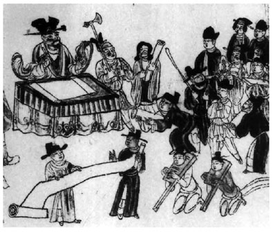
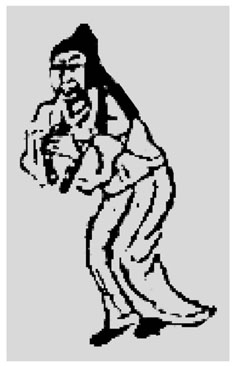
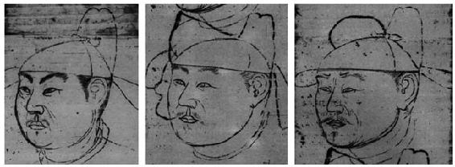
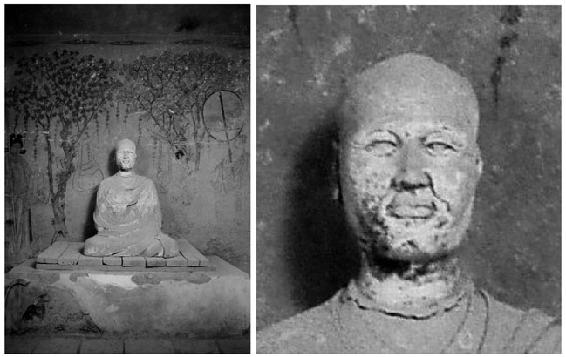
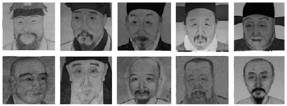

> [BREADCRUMB_CTX: 《考工记：工匠·功能·风格 (中国传统雕塑的复制与当代中国美术教育体系的建立系列丛书)》 > 五 雇主的需求与经济能力对工匠的影响]

## 五 雇主的需求与经济能力对工匠的影响

本章最初观察的两张作品所显示的四种迹象，循序引导笔者对敦煌工匠与其所处社会的关系进行了相关的探讨。现在，笔者将回归到作品本身，对工匠基于不同需求及条件采取不同画法和练习方式的可能性进行思考。《头像》Pel.chin.4514（14）明显地采取了一种简单概括的方式绘制，而经由前文对此画的分析，也已经表明画面主体的绘者对于人物五官结构的把握有深刻的体会，并非没有能力进行更细致的描绘。就前文分析得出《头像》是一张习作的角度来看，师傅也有可能选择简单的画法进行课徒的训练。对于绘画而言，简单的画法并不代表比较容易，但是从教学的角度来说，简单的图形在造型训练上确实比较容易入手，而学习者也往往会选择看似简单的图形进行临、摹、描、绘。循序渐进虽然是造型训练的一种有效过程，但是我们也不能因此而简单地将这张画的画法看作专门针对课徒才使用的画法。因为我们在编号为Pel.chin.4523的《地藏十王图》（见图2-8）中发现了与《头像》和《白画供养人物稿》（见图 2-9）极为相似的风格与画法。这说明这是练习者基于实际能成为商品的绘画风格所进行的训练。

画工能画精致却不画，这涉及的问题可能比较复杂。马德先生认为中国古代手工业在培训、考核到产品规格、样式、标准，以及对不合格产品及其制造者的惩罚等方面一直有详细严格的管理规定。而敦煌的画行受到与其他手工业等同的对待，说明它们与其他手工业一样，受手工业管理制度的制约，因此造成同一个时期内大师的作品与工匠的作品在艺术水平方面没有多大的差距。[104]前文中已经说明，在敦煌这个具有制度化宗教性质的大社会环境下，雇主拥有各种不同的身份，来自不同的阶级，这些差异也同时表明他们在经济能力上存在差异。对于以工价为生的工匠而言，现实是很重要的。虽然S.3905（901年）号文献[105]的记载显示，也有工匠基于信仰的因素，将工价所得完全奉献出来作为“功德”，如“马都料方□且空，绳墨不遵师难。若得多少功价，尽行布施与□”，但对于以工价为生的工匠而言，显然不能将这视为常态。

图2-8 《地藏十王图》（7-3）Pel.chin.4523

资料来源：法国国家图书馆。

图2-9 《白画供养人物稿》（局部）（Pel.chin.2002V°）

沙武田先生在其研究中提到，在敦煌大量的画稿中，最常见的现象和基本技法绝大多数为简笔特征的画法。[106]工价既然可以经由甲、乙双方相互协商决定，那么工价的多寡必然与做工的精巧程度有密切的关联，而这很显然也是双方协商的重点。社会的需求包含雇主的需求、经济能力及工程的大小，这直接关系到雇主对工匠的选择，当然也会影响到工匠决定采用什么方式施工。虽然画稿并不能等同于完成品，但是通过画稿的精致度，我们可以看出一个工匠所花费精力的多寡，而且通过画稿采用的风格、运用的技法，也可以看出其与完成品之间的差别。从以上的角度来看，工匠是否愿意在做工上多花心力有可能取决于工匠自身对信仰的虔诚度，同时也取决于工价的多寡和一些不成文的习惯。笔者认为这种制约也许确实存在，但是对于一个同业公会的画行而言，对于不同画法应该同时存在不同的标准，否则我们没有办法解释上述两种具有明显差异的作品为何能同时存在。

图2-10 编号Pel.chin.4522V°

资料来源：法国国家图书馆。

编号为Pel.chin.4522V°[107]的敦煌遗画中的三个头像（见图2-10）与前述两张习作及《地藏十王图》在绘画技巧与风格上存在另一种明显的差异。Pel.chin.4522V°采用了比较写实的风格绘制。从作者不断地对脸部的线条进行修改、对面部的肌肉进行描绘，几个部位具有相同特征看，此图是作者对于如何表现同一个人不同精神气韵的反复揣摩。[108]此图三个人的眼睛、鼻子、人中的深浅与嘴形基本都是不变的，所不同之处在于眼睛的斜度、瞳仁的深浅、眉毛的斜度与浓淡及脸上皱纹的位置。这种修改很显然是针对一个人精神气韵的思考；也就是说，这是一张以肖像性质为主的画稿。作者所考虑的是描绘对象在不同年龄所显示的特征及性格，而不是对不同对象的描写（这是笔者从绘画经验的角度所进行的判断，虽然未必每一个具有绘画经验的人都会有相同的看法，但是关系到整个论证的继续，笔者将自身的立场交代清楚是必要的）。前文已经提及，《头像》和《白画供养人物稿》两件画稿并不能代表敦煌工匠的制作风格与水平。而Pel.chin.4522V°这张画稿除了显示出工匠间存在技术的差别之外，也显示出他们可能针对不同需求在制作的方式上有不同的选择。敦煌壁画中存有大量的供养人画像、民俗题材画、佛教尊像画等，虽然画像功能在性质方面不尽相同，但是这些以人物形象为主的绘画取向也使得敦煌工匠有极为丰富的人像绘制经验。我们在敦煌遗书中看到的92件邈真赞文显示，在当时的敦煌，在生前或死后绘制邈真像的习俗有一定的普遍性。[109]“邈真”也称“真容”，主要是指放置在寺院、道观、陵墓或家庙的“真堂”（影堂）中作为死后葬礼或后人供奉、祭祀、瞻仰之用的遗像。[110]邈真采用的是以写实为前提的具肖像性质的绘画方法。《汜福高赞》（P.3556）：“故我大师图形留教，弟子固合奉行；遂慕良匠，丹青乃绘生前影质。日掩西山之后，将为虔仰之真仪；月流东海之昏，状表平生之法会。”像这样具有重要功能的遗像，肯定需要画行都料董保德那样具有“邈影如生”和“画蝇如活”高超技术的工匠来进行制作。而有关董保德的记载也显示他必然曾应雇主的需求绘制此类邈真、写真画像。目前，在敦煌遗留下的绘画中并没有发现与众多邈真赞文相对应的画作，但是我们通过第217窟中的洪辩真容像可以一窥这种类型的绘画对于写实性的要求（见图2-11）。

图2-11 莫高窟 五代 217窟 东壁北侧 洪辩像

资料来源：摘自《敦煌艺术之最》。

Pel.chin.4522V°画稿显示出它符合敦煌邈真赞文中对写实的要求标准，同时也与第217窟中的洪辩邈真塑像具有相类似的表现风格。此外，我们从明清的写真肖像（见图2-12）中也可以发现Pel.chin.4522V°与这些真实作品的相似性。如果将其与《头像》《白画供养人物稿》和《地藏十王图》中供养人明显不同的表现风格加以比较，其写实的特征与表现的意图就更加清晰。虽然这仍不能够作为证明Pel.chin.4522V°就是邈真像的论据，但是这里主要表明的是风格的差异与作用二者间的关系。笔者认为这足以说明工匠对于不同需求必须采取不同的制作方式。而对于要求逼真的画像、塑像，那就更需要如同董保德那样的良工巧匠来专门进行制作，不能简单地依靠粉本和画稿了。同时，这也必然会影响到师傅对徒弟进行训练的方式。

图2-12 明清人物肖像

资料来源：摘自《明清人物肖像画选》。