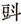

> [BREADCRUMB_CTX: 《考工记：工匠·功能·风格 (中国传统雕塑的复制与当代中国美术教育体系的建立系列丛书)》 > 六 小结 (Part 1)]

## 六 小结

敦煌的遗迹与藏经洞遗画的出土，都显示出它们与宗教信仰有密切关联。这些制作物并不同于一般生活用品或是装饰品，它们的意义在于：其存在关系到出资者对于现世与来生的愿望能否实现，而其质量也涉及出资者世俗性的需求。相关研究显示，敦煌的借贷之风非常盛行，从敦煌的借贷文书中可以发现，借贷的范围非常广泛，借贷的方式也非常多样，甚至典当人力也算是借贷的一种方式。[111]从种种借贷文献来看，借贷者的身份涉及各种不同的阶层。总的来说，敦煌在生活上并不富裕，这种贫富差距也很明显地表现在工匠之间，例如画行都料董保德与塑匠都料赵曾子就有截然不同的生活境遇（前文已述及不能将此当作整个阶层都贫困的证据）。我们也不能将工匠的阶级作为其生活是否富裕的绝对评价标准。在这种制度化的宗教社会下，敦煌的遗存一方面反映了当地一种固定的、表示虔诚的方式，以及对某一类工匠的特殊需要，另一方面也反映了工匠在商业化的环境中采用了不同的画法来面对不同的需求。敦煌的状况不同于秦始皇兵马俑，兵马俑是基于统治者的需求而具有强制性，敦煌的工匠相对来说与雇主的关系则更具有平等性。

经由前文对工匠所处的社会关系的探讨，可以认为工匠采用何种画法在很大程度上取决于雇主的经济能力。洞窟中大量的供养人像也涉及不同经济能力的出资者。同时，画面的精致度也直接影响到工价。以宗教信仰来说，供养人画像并非佛窟的主体部分，为了节省开销，不在其上花过多的时间也许是有道理的。另外，德罗绘认为佛教肖像画和雕塑更突出人物名分，不但对于捕捉外貌特征，就连对于捕捉精神特征都更不经心。[112]在敦煌，供养人画像或画在绢、麻、纸本一类之上的功德活动则更具消费性，更多的是功德主表示的一种愿心，并不一定需要照本人容貌绘制，所以往往是先由工匠画好，再由功德主题名即可。这与第一章中的秦俑存在明显的不同。秦俑虽是以部队的形式出现，但是对于以“真实原则”为主的秦俑而言，它之所以强调各具特色的每一个“人”，是为了增强部队的真实性，同时也为强化其功能性。对于秦俑而言，“真实”的意义从属于整体而非个体，它的制作是基于陪葬的“功能”的，是为了服务于一个特定对象的“需求”而制作，个人的主体性在秦兵马俑中并没有意义，所以无需题上具体的人名。供养人画像则不然，具体所指由谁供养涉及功德主的“功德”是否被确认。身份的认定是以题名或是题记的方式，借由公告社会大众后得到认同而成立。“文字”在这时的力量比“图像”更大，“图像”被观看后，只能在脑中成为一个印象而无法言传，而在社会上人与人相处的规则是，对于具体某一个人的确认更多的是经由另一种符号系统——文字（姓名）。这或许是供养人画像必须在功德主入施以后经由题名才能产生作用并被认同的理由之一。所以即使大部分供养人画像呈现“千人一面”特征，但是经由名字的确认，“图像”便产生了不同于一般的力量，并达到“象人”的功能。我们从敦煌的文献和文物中，也能发现大量功德主对于世俗欲求的线索，尤其在五代归义军时期，家窟俨然成为家庙并具备了祠堂的性质。这种性质的转变使供养像同时变成一种“预写生前”或是“忌日画施”的遗像。对于已经过世的亲人的遗像，某些功德主也会要求尽量写实；因为这种供养人画像的性质已经不再是单纯的表达一份愿心，而是起到一种“思亲”的作用。沙武田先生的研究显示，供养人画像在佛窟的位置与大小及其成员在不同程度上显示出了这些绘画为了应功德主的世俗性需求而有所改变[113]，尤其是从某些石窟逐渐转变为家庙来看，佛教明显受到世俗化、人间化的影响。经由对遗画发愿文的考察，张培君先生认为施主绘制供养人画像的动机、愿望可以分为三类：一是为亡者追福；二是为生者祈福；三是既为亡人又为生者祈福。此外，在敦煌高僧的邈真像中也发现一些世俗化的痕迹，高僧画像背后的侍仆反映出敦煌在制度化宗教下同时存在着世俗需求的另一面。以上种种显然都对工匠的制作及作品风格产生了一定的作用，这是有关工匠研究的另外一个面向。而中国的祖宗像则在这一方面为我们提供了更多线索，让我们能够从世俗需求的角度，对工匠的制作与作品风格受到的影响继续加以探讨。

---

[1] 姜伯勤认为寺户仍可拥有少量家畜和小农具，他们并不等同于奴隶。参见姜伯勤《唐五代敦煌寺户制度》，中华书局，1987，第59～67页。

[2] 姜伯勤著《唐五代敦煌寺户制度》，中华书局，1987，第279页。

[3] 姜伯勤著《敦煌的“画行”与“画院”》，载姜伯勤著《敦煌艺术宗教与礼乐文明》，中国社会科学出版社，1996，第26页。

[4] 马德著《敦煌工匠史料》，甘肃人民出版社，1997，第29～30页。姜伯勤著《敦煌的“画行”与“画院”》《论敦煌的“画师”、“绘画手”与“丹青上士”》，载姜伯勤著《敦煌艺术宗教与礼乐文明》，中国社会科学出版社，1996，第13～49页。

[5] 马德著《敦煌工匠史料》，甘肃人民出版社，1997。

[6] 郑炳林著《唐五代敦煌手工业研究》，《敦煌学辑刊》1996年第1期。姜伯勤著《唐五代敦煌寺户制度研究》，中华书局，1987。姜伯勤著《敦煌的“画行”与“画院”》《论敦煌的“画师”、“绘画手”与“丹青上士”》，载姜伯勤著《敦煌艺术宗教与礼乐文明》，中国社会科学出版社，1996。〔美〕胡素馨（Sarab E.Fraser）著《模式的形成——粉本在寺院壁画构图中的应用》，唐莉芸译，《敦煌研究》2001年第4期。沙武田著《敦煌画稿研究》，民族出版社，2006。

[7] 马德著《敦煌工匠史料》，甘肃人民出版社，1997，第7～8页。

[8] 《头像》Pel.chin.4514（14）为敦煌遗画编号Pel.chin.4514的一部分。参见上海古籍出版社、法国国家图书馆《法藏敦煌西域文献》（第31册），上海古籍出版社，2005，第253页。

[9] （唐）张彦远撰《历代名画记》（卷5），载于安澜编《画史丛书》（第1册），上海人民美术出版社，1963，第68页。

[10] 由于Pel.chin.2002V°篇幅过大，《法藏敦煌西域文献》（第1册）将此画分成7个部分，并依内容分为6个主题：（1）《白画金刚像》；（2）《白画供养人物稿》；（3）《白画菩萨像》；（4）《白画协侍菩萨像》；（5）《白画人物稿》；（6）《白画相扑图稿》。《白画供养人物稿》（Pel.chin.2002V°）参照上海古籍出版社、法国国家图书馆《法藏敦煌西域文献》（第1册），上海古籍出版社，1995，第22～25页。

[11] （清）丁皋撰《写真秘诀·附起稿先圈说》，载俞剑华编著《中国古代画论类编》（上册），人民美术出版社，1998，第547页。

[12] 中国社会科学院历史研究所、中国敦煌吐鲁番学会敦煌古文献编辑委员会、英国国家图书馆、伦敦大学亚非学院编《英藏敦煌文献（汉文佛经以外部分）》（第14卷），四川人民出版社，1995，第183页。

[13] 郑炳林先生的研究结果认为，当时敦煌人口应当为3万～4万。参见郑炳林《晚唐五代敦煌地区人口变化研究》，《江西社会科学》2004年第12期。另据方广锠、张国刚释读敦煌遗书《达多等状？》（S.11345）记载：“达多等沙州郡敦煌平时三万余口……”收录在方广锠著《宣宗关于归义军的诏敕》，《敦煌研究》2003年第3期。原文参见中国社会科学院历史研究所、中国敦煌吐鲁番学会敦煌古文献编辑委员会、英国国家图书馆、伦敦大学亚非学院《英藏敦煌文献（汉文佛经以外部分）》（第13卷），四川人民出版社，1995，第232页。

[14] 李永宁《敦煌石窟》词条，载季羡林主编《敦煌学大辞典》，上海辞书出版社，1998，第8页。

[15] 季羡林主编《敦煌学大辞典》，上海辞书出版社，1998，第9页。

[16] 樊锦诗、关友惠、刘玉权确定隋开皇元年至唐武德九年（581～626年）间凿建81窟。参见樊锦诗、关友惠、刘玉权《莫高窟隋代石窟分期》，载敦煌文物研究所编《中国石窟——敦煌莫高窟》，（中国）文物出版社、（日本）平凡社，1984。敦煌文物研究所则确定为581～618年凿建94窟。参见敦煌文物研究所《敦煌莫高窟内容总录》，文物出版社，1982。

[17] 敦煌文物研究所整理《敦煌莫高窟内容总录》，文物出版社，1982。

[18] 季羡林主编《敦煌学大辞典》，上海辞书出版社，1998，第8页。

[19] 敦煌文物研究所整理《敦煌莫高窟内容总录》，文物出版社，1982。

[20] 敦煌文物研究所整理《敦煌莫高窟内容总录》，文物出版社，1982。

[21] 刘玉权著《关于沙洲回鹘洞窟的划分》，载段文杰主编《敦煌石窟研究国际讨论会文集（石窟考古编）》，辽宁美术出版社，1990，第1～29页。

[22] 刘玉权著《敦煌莫高窟、安西榆林窟西夏洞窟分期》，载敦煌文物研究所编《敦煌研究文集》，甘肃人民出版社，1982，第273～318页。

[23] 敦煌文物研究所整理《敦煌莫高窟内容总录》，文物出版社，1982。

[24] 敦煌文物研究所整理《敦煌莫高窟内容总录》，文物出版社，1982。

[25] 参见敦煌研究院《敦煌莫高窟供养人题记》，文物出版社，1986。

[26] 敦煌文物研究所整理《敦煌莫高窟内容总录》，文物出版社，1982。

[27] 敦煌文物研究所整理《敦煌莫高窟内容总录》，文物出版社，1982。

[28] 敦煌文物研究所整理《敦煌莫高窟内容总录》，文物出版社，1982。

[29] 刘玉权著《关于沙洲回鹘洞窟的划分》，载段文杰主编《敦煌石窟研究国际讨论会文集（石窟考古编）》，辽宁美术出版社，1990，第1～29页。

[30] 此统计依据敦煌文物研究所编《敦煌莫高窟内容总录》，文物出版社，1982。另外，刘玉权著《敦煌莫高窟、安西榆林窟西夏洞窟分期》确定1036～1227年凿建1窟，重修60窟。载敦煌文物研究所编《敦煌研究文集》，甘肃人民出版社，1982。本书以《敦煌莫高窟内容总录》为准。

[31] 敦煌文物研究所整理《敦煌莫高窟内容总录》，文物出版社，1982。

[32] 敦煌文物研究所整理《敦煌莫高窟内容总录》，文物出版社，1982。

[33] 季羡林主编《敦煌学大辞典》，上海辞书出版社，1998，第9～10页。

[34] 编号北图59∶500背。参见唐耕耦、陆宏碁《寅年（822年）汜英振承造佛堂契》，载《敦煌社会经济文献真迹释录》（第2辑），全国图书馆文献缩微复制中心，1990，第54页。

[35] 郑炳林著《敦煌写本邈真赞所见真堂及其相关问题研究——关于莫高窟供养人画像研究之一》，《敦煌研究》2006年第6期。沙武田著《敦煌画稿研究》，民族出版社，2006，第372页。

[36] 张培君著《敦煌藏经洞出土遗画中供养人图像初探》，《敦煌研究》2007年第4期。

[37] 姜伯勤著《敦煌的“画行”与“画院”》，载姜伯勤著《敦煌艺术宗教与礼乐文明》，中国社会科学出版社，1996，第20～21页。

[38] 马德著《敦煌工匠史料》，甘肃人民出版社，1997，第44页。

[39] 马德著《敦煌工匠史料》，甘肃人民出版社，1997，第19页。原文参见上海古籍出版社、法国国家图书馆《长兴元年河西都僧统依宕泉建龛一所上梁文》（5-4），载上海古籍出版社、法国国家图书馆编《法藏敦煌西域文献》（第23册），上海古籍出版社，2002，第126页。

[40] 马德著《敦煌工匠史料》，甘肃人民出版社，1997，第44页。

[41] 笔者赞同画行不仅指一种行业或店肆，更倾向一种同业组织的说法。参见姜伯勤《敦煌的“画行”与“画院”》，载姜伯勤著《敦煌艺术宗教与礼乐文明》，中国社会科学出版社，1996，第19页。

[42] 马德著《敦煌工匠史料》，甘肃人民出版社，1997，第9～13页。

[43] 姜伯勤著《敦煌的“画行”与“画院”》，载姜伯勤著《敦煌艺术宗教与礼乐文明》，中国社会科学出版社，1996，第17页。

[44] 姜伯勤先生认为“博士”是一般“工匠”，在工程中与都料属于上下级的关系，与学徒厮役之间则存在一种尊卑关系。参见姜伯勤《敦煌的“画行”与“画院”》，载姜伯勤著《敦煌艺术宗教与礼乐文明》，中国社会科学出版社，1996，第18页。郑炳林先生认为从敦煌账籍类文书记载看，唐、五代把“工匠”称作“博士”是一种普遍现象。参见郑炳林《唐五代敦煌手工业研究》，《敦煌学辑刊》1996年第1期。马德先生认为9世纪以后的敦煌文献显示，“博士”是区别于一般“工匠”的高级“工匠”。这有可能是因为“工匠”队伍的庞大而从技术上区别出高级施工“工匠”和一般施工“工匠”。参见马德《敦煌工匠史料》，甘肃人民出版社，1997，第13页。笔者认为，无论“博士”属于什么样的等级，至少我们可以确定，“博士”是具有一定技术水准的“工匠”，或具备独立作业的能力，而不同于学徒或只需要力量的工人。

[45] 姜伯勤著《唐五代敦煌寺户制度》，中华书局，1987，第279页。

[46] 姜伯勤著《敦煌艺术宗教与礼乐文明》，中国社会科学出版社，1996，第28页。

[47] 姜伯勤著《敦煌艺术宗教与礼乐文明》，中国社会科学出版社，1996，第16页。

[48] 马德著《敦煌工匠史料》，甘肃人民出版社，1997，第68页。原文参见中国社会科学院历史研究所、中国敦煌吐鲁番学会敦煌古文献编辑委员会、英国国家图书馆、伦敦大学亚非学院《唐天复元年（901）十二月十八日金光明寺造窟上梁文》，载《英藏敦煌文献（汉文佛经以外部分）》（第5卷），四川人民出版社，1992，第198页。

[49] 马德著《敦煌工匠史料》，甘肃人民出版社，1997，第73页。原文参见唐耕耦、陆宏碁《诸色入破历算会稿》，载《敦煌社会经济文献真迹释录》（第3辑），全国图书馆文献缩微复制中心，1990，第442页。

[50] 马德著《敦煌工匠史料》，甘肃人民出版社，1997，第75页。原文参见唐耕耦、陆宏碁《诸色斛斗破历算会稿》，载《敦煌社会经济文献真迹释录》（第3辑），全国图书馆文献缩微复制中心，1990，第289页。

[51] 马德著《敦煌工匠史料》，甘肃人民出版社，1997，第59页。原文参见唐耕耦、陆宏碁《丙戌年（公元八六年）正月十一日已后缘修造破用斛斗布等历》，载《敦煌社会经济文献真迹释录》（第3辑），全国图书馆文献缩微复制中心，1990，第146页。另外，马德先生辑录的文字为“……六月二日，出粟七，付荣清等充仰泥手工。同日，出粟叁，麦壹硕伍·与王庶子仰泥手功”，与原文对照不符。

[52] 马德著《敦煌工匠史料》，甘肃人民出版社，1997，第63页。原文参见唐耕耦、陆宏碁《庚辰-壬午年间（公元八九-九八年）归义军衙内面油破历》，载《敦煌社会经济文献真迹释录》（第3辑），全国图书馆文献缩微复制中心，1990，第279页。

[53] 马德著《敦煌工匠史料》，甘肃人民出版社，1997，第51页。原文参见唐耕耦、陆宏碁《年代不明（公元八九-二年）归义军衙内面油破用历》，载《敦煌社会经济文献真迹释录》（第3辑），全国图书馆文献缩微复制中心，1990，第281页。

[54] 姜伯勤著《唐五代敦煌寺户制度》，中华书局，1987，第289页。

[55] 唐耕耦、陆宏碁编《后唐长兴二年（公元九三一年）正月沙洲净土寺直岁愿达手下诸色入破历算会牒》，载《敦煌社会经济文献真迹释录》（第3辑），全国图书馆文献缩微复制中心，1990，第369页。

[56] 唐耕耦、陆宏碁编《丙子年（公元九七六或九一六年）修造及诸处伐木油面粟等破历》，载《敦煌社会经济文献真迹释录》（第3辑），全国图书馆文献缩微复制中心，1990，第220页。

[57] 唐耕耦、陆宏碁编《年代不明（公元十世纪）某寺入破历算会牒残卷》，载《敦煌社会经济文献真迹释录》（第3辑），全国图书馆文献缩微复制中心，1990，第540页。

[58] 唐耕耦、陆宏碁编《后晋时期净土寺诸色入破历算会稿》，载《敦煌社会经济文献真迹释录》（第3辑），全国图书馆文献缩微复制中心，1990，第401页。

[59] 唐耕耦、陆宏碁编《后唐长兴二年（公元九三一年）正月沙洲净土寺直岁愿达手下诸色入破历算会牒》，载《敦煌社会经济文献真迹释录》（第3辑），全国图书馆文献缩微复制中心，1990，第369页。

[60] 唐耕耦、陆宏碁编《后晋时代净土寺诸色入破历算会稿》，载《敦煌社会经济文献真迹释录》（第3辑），全国图书馆文献缩微复制中心社，1990，第455页。

[61] 唐耕耦、陆宏碁编《后晋时期净土寺诸色入破历算会稿》，载《敦煌社会经济文献真迹释录》（第3辑），全国图书馆文献缩微复制中心，1990，第406页。

[62] 唐耕耦、陆宏碁编《金山国时期修文坊巷社在缉上祖兰若，标画两廊大圣功德赞并序》，载《敦煌社会经济文献真迹释录》（第1辑），书目文献出版社，1986，第385页。

[63] 姜伯勤著《唐五代敦煌寺户制度》，中华书局，1987，第286页。

[64] 马德先生认为这些记载显示，无论工匠工种为何，雇方所供的主食定量皆同，没有考虑劳动强度和劳动时间的长短，表明当时官府或寺院对工匠采取的是一种奴役的态度。参见马德《敦煌工匠史料》，甘肃人民出版社，1997，第32～33页。

[65] 〔法〕童丕（Éric Trombert）著《敦煌的借贷：中国中古时代的物质生活与社会》，余欣、陈建伟译，中华书局，2003，第46页。

[66] 1硕（石，读作shi）相当于60升。1硕有10斗，1斗有10升。参见〔法〕童丕（Éric Trombert）《敦煌的借贷：中国中古时代的物质生活与社会》，余欣、陈建伟译，中华书局，2003，第85页。

[67] 〔法〕童丕（Éric Trombert）著《敦煌的借贷：中国中古时代的物质生活与社会》，余欣、陈建伟译，中华书局，2003，第46页。

[68] 唐耕耦、陆宏碁编《丁丑年（公元九七七年？）金银匠翟信子等状并判词》，载《敦煌社会经济文献真迹释录》（第2辑），全国图书馆文献缩微复制中心，1990，第258页。

[69] 郑炳林著《唐五代敦煌手工业研究》，《敦煌学辑刊》1996第1期。

[70] 唐耕耦、陆宏碁编《敦煌社会经济文献真迹释录》（第3辑），全国图书馆文献缩微复制中心，1990，第179～181页。

[71] 李正宇《法门寺》词条，载季羡林主编《敦煌学大辞典》，1998，第632页。

[72] 唐耕耦、陆宏碁编《后晋时代净土寺诸色入破历算会稿》，载《敦煌社会经济文献真迹释录》（第3辑），全国图书馆文献缩微复制中心，1990，第465页。

[73] （清）王先谦撰《庄子集解·庄子集解内篇补正》，刘武撰，沈啸寰点校，中华书局，1987，第2页。

[74] 《老景》：“老死知无日，天公偶见宽。疾行逾百步，健啖每三餐。身瘦短裁褐，发稀低作冠。年来更小黠，不据伏波鞍。”参见（宋）陆游《陆放翁全集》（第3册），中国书店，1986，第965页。