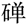
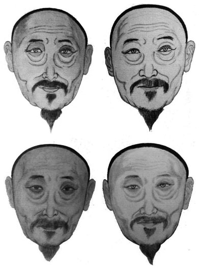
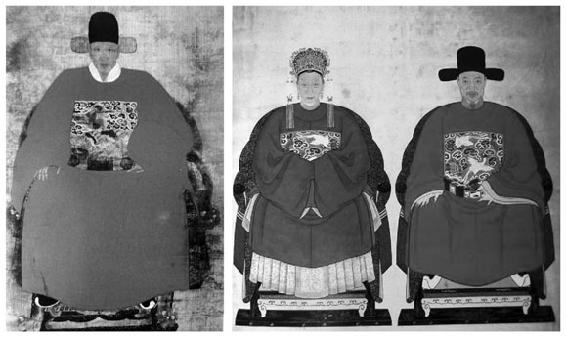
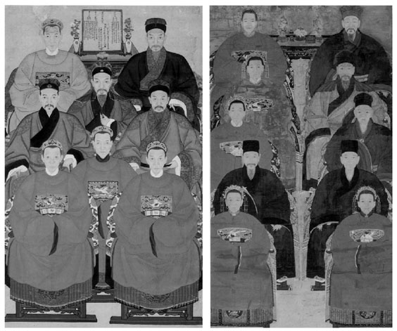

> [BREADCRUMB_CTX: 《考工记：工匠·功能·风格 (中国传统雕塑的复制与当代中国美术教育体系的建立系列丛书)》 > 第三章 世俗性需求对“工匠”制作技术与风格的影响]

# 第三章 世俗性需求对“工匠”制作技术与风格的影响

——以祖宗像为例

“工匠”作为一种职业，不论是官方还是民间、自由民还是非自由民，其制作往往都必须以符合业主的需求为主要考虑。其中，世俗性需求是众多影响工匠制作风格因素当中的一个重要因素。世俗性需求涵盖的范围相当广泛，诸如风俗信仰、生活习惯及社会风气等。这些都与工匠技术的发展、技艺的传授以及作品风格的形成有着密切的关系。涉及这一部分的发展动力并非来自单方面的工匠或雇主，而是在一定的供需关系之下所逐渐形成的必然结果。早期所遗留的祖宗像大多是属于官方或是皇家的，而现存的明清祖宗像有相当一部分来源于民间。对这些民间祖宗像的观察，为笔者提供了相当丰富的图像材料，得以从世俗性需求的角度对工匠制作的影响因素加以探讨。

本章希望借由民间祖宗画及其画稿所显示的线索，尝试探讨世俗性需求对工匠制作的影响，而并不在于考据画像的渊源与演变状况，因此只依据前贤的研究成果和历史文字材料的记载，对祖宗像的脉络做简单的陈述。

中国的人像绘画自古有之，以画像作为替代祖宗媒介的确切时间虽难于考证，但也并非无迹可寻，如《孔子家语》中描述：“孔子观乎明堂，睹四门墉，有尧舜之容，桀纣之象，而各有善恶之状，兴废之诫焉……谓从者曰，此周之所以盛也，夫明镜所以察行，往古所以知今……”[1]，西汉宣帝时画功臣图像于麒麟阁[2]，唐太宗时画功臣图于凌烟阁[3]等。这些历代帝王及功臣图主要是以“成教化”“助人伦”“鉴善诫恶”为目的，例如西凉李暠在敦煌南门外修建“靖恭堂”的目的为：“图赞自古圣帝明王、忠臣孝子、烈士贞女……以明鉴戒之义，当时文武群僚亦皆图焉。”[4]然而，外貌并不必然是现实的反映，图像也未必就是其真实的容貌；画中人物的面相是否与本人相似，我们无由得之。从时间的角度来思考，因为往圣先贤时隔久远，无法完全依照事实而逐渐加入了神话色彩，或采用不同程度的夸张手法表现人物的传奇性与历史个性也是有可能的，“尧舜之容，桀纣之象，而各有善恶之状，兴废之诫焉”就是最明显的例子。现实生活中的例子也可以为我们得出这一类壁画可能具有非肖像性的结论提供依据。《史记》记载孔子曾感叹自己因为以貌取人而“失之子羽”[5]。就人像画的功能性而言，若是依照真实人物面容绘制，就有可能导致观者犯下与孔子同样的错误，而这显然与“成教化”“助人伦”“鉴善诫恶”的目的是有所抵触的。不过，我们也能从文献中感觉到，以肖像方式表现的人像绘画或许也同时存在，例如当司马迁见到张良的画像“状貌如妇人好女”时，因为与期望不同而显得很吃惊。[6]这说明古代以“成教化”“助人伦”“鉴善诫恶”为目的的绘画也同时存在着象征性与写实性手法，而“时间”与“功能”也许是主导画像是否能够肖似的两大要素。但是，不论是象征性还是写实性，对于亲人而言，画像的指涉性也在无形中起到一定程度的追思作用。例如《汉书》载汉武帝诏令，将教子有方的金日之母图画其像于甘泉宫，而金日：“每见画常拜，乡之涕泣，然后乃去。”[7]这多少也能够反映出古代图写其像与祭祀功能之间存在着一些微妙关联，虽然两者之间的关系在这里并没有显现得很清晰。另外，我们在墓葬中也看到有大量墓主画像；建造墓室的行为与祭祀本质中“人死有灵”和儒家“视死如生、视亡如存”的思想内涵有相当密切的关联性。不过，基于一部分墓室特有的“封闭性”和“私人空间性”，所以未必全部的墓主画像都涉及后人的祭祀。[8]

祖宗像属于中国传统人物画的一类，并且有多种名称，如“太公太婆像”“画影”“画神像”“传神”“传真”“写真”“写神”“写照”“真容”“容像”“追影”“邈真”“邈影”“揭帛”“揭白”“喜神”“神子”“记眼”“祖先影像”“寿影”“寿像”“代图”“衣冠像”“整身”“花整”等。[9]从祖宗像具有如此众多的名称可以看出，一般人逐渐将这些具理论性的专业概念加以同质化与通俗化，其中不乏与其他性质画像相重叠的情形。[10]仅从“写真”一词来看，在照相术流行之后，照相、看电影也有被民间称为“写真”[11]和“看写真”[12]的情况可以作为一个显著的例子。清人李斗在《扬州画舫录》中认为传真技法为画家一派，并列举了古代传真画家的例子。对他而言，这类画像不过是传真技法的运用，并不特指具祭祀功能的祖宗像。不过他最后将传真技法的要求归结为“盖是技以肖为工，不肖无足论矣”[13]。这至少可以让我们确定他认为这一类绘画必须具有很强的表面写实性或是肖像性（见图3-1）。清人卢见曾在为《传真心领》作序时，特别强调“传真”“写真”的意义在于能让“仁人孝子亦不自觉而油然生其尊祖之心”，所以他认为“则是书所关，良非浅鲜，岂特为画像一家之学矣哉”。他似乎将“传真”技法视为一种具特定功能的绘画风格，并将这种具肖像性质的绘画风格与传统的孝道观念联结起来；这不只是文人的观点，我们从元代民间戏曲《看钱奴》第三折“你孩儿趁父亲在日，画一轴喜神，著子孙后代供养著”[14]中，也可以看出在民间替先人画像与孝道之间是密切联系着的。关于那些不同的祖宗像名称，有些是泛称，有些则是由其特定的肖像或写实性风格、内容与形式、绘制的时机或绘制对象所处的状态来决定。某些泛称，例如“传神”“写真”“邈影”“真容”之类，涉及中国绘画理论中对于“真”“形”“神”的不同标准与界定和佛教因素[15]，并不能简单地将之等同于西方的“肖像画”，也不能看作对一种风格的专称。对于这些历来存在的多层次概念，其渊源与流变并非本研究的范围，因此笔者不在此多做讨论。必须指出的是，祖宗像这一名词具有多样性与可变动性，当我们对这些画像加以定义时，不能忽视“时间”“地域”“风俗”与“行为”所造成的复杂性。

图3-1 依照丁皋《传真心领》技法绘制（王达弗绘）

资料来源：摘自《中国民间肖像画》。

从“功能”的角度来看，只要是作为祭祀用，就有成为祖宗像的可能，即使是一般文人之间的“行乐图”，若要将其作为祭祀之用，也没有严格的社会限制。不过，祖宗像的绘制动机在于“预写身前真容”或是死后“追容”，其目的是将画像放置在特定地点以供后人追思与祭祀。那些“以画明志”或“聊以自适”且同样具有肖像性质的行乐图，与祖宗像在本意与本质上显然并不相同，例如苏轼的《赠写真何充秀才》：“问君何苦写我真，君言好之聊自适。黃冠野服山家容，意欲置我山岩中”[16]，因此并不在本章的讨论之列。

依照美国Jan Stuart的分类，祖宗像具有严格的“正面性”“时间的静止性”“对称性”“形体中心性”。[17]总结以上，祖宗像中人物的画法可分为两类：一类是具有肖像性，即针对特定人物如实绘制；另一类是具有写实性，即看起来像是真人，但未必肖似，也不一定是对象的真实面貌。其共通的要求是，画像都必须画得像现实生活中的活人，至于是否肖似则依不同需求与风俗习惯来决定。祖宗像绘制的目的主要是供后代子孙祭祀用，放置的场所多为宗族的家庙或是祠堂。画中人物大多神情端庄、姿态端正、衣冠庄重正式，充分显示出受祀者的尊严与典型；其内容多以单人或双人（见图3-2）或具亲缘关系的多代祖宗为主（见图3-3），其画面有普遍相似的特征。对于这些形式特征，我们在明清时代的祖宗像中可以清楚地见到。

图3-2 明代王大恍容像（左）和明代何道享夫妇容像（右）

资料来源：摘自《徽州容像艺术》。

图3-3 明富贵二代八人全家官像（左）和明代官家四代富贵福寿大昌图（右）

资料来源：摘自《明清官像画图录》。