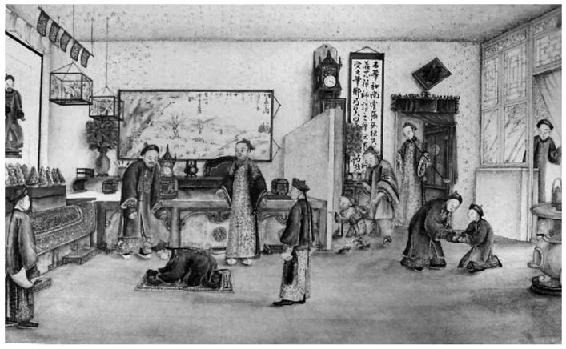

> [BREADCRUMB_CTX: 《考工记：工匠·功能·风格 (中国传统雕塑的复制与当代中国美术教育体系的建立系列丛书)》 > 一 写实的需求]

## 一 写实的需求

早在商代，祭祀活动在中国即占有重要的地位。祖宗像作为以祭祀功能为主的画像，其特点之一是具有明显的肖像性。丁皋在阐述这种画法的渊源时就曾说：“然古者祭必有尸，尸废则画像兴。人子之情，有所必至。特以时代之遥，春秋之隔几筵榱桷之间，聚其精神以求其嗜欲，发其忾闻见之思，其事诚不可苟……”[18]对这种容像的需求可以从祭祀者的内在心理与祭祀行为的外在因素两方面来理解。

从祭祀者心理的角度来看，在周代出现了以活人代死者受祭的“尸”，避免了亲人在祭祀时苦于无形象可祭的“心无所系”[19]。由此可看出，对于偶像的需求意识并不是忽然出现的，而是其来有自的。人们对朝夕相处的亲人们的容貌总是再熟悉不过，祖宗容像是一种供后代追思与祭祀的遗像，所以不难想象在“孝子慈孙想像其先人之不可得，姑托于绘事以传之”[20]的心理下，画中人物与真人是否肖似就成为一件很重要的事。宋代司马光在其《司马氏书仪》中曾经提到：“为画影像不豫择善手，或病中描写，或瞑目追摹，全不相似，是以他人为父母也。”[21]这段文字特别强调了作为人子，聘请画师描绘父母容像必须以“似”为前提。明代尹直在《謇斋琐缀录》中也提到：“先儒君子有云：‘影像一发不似，则为他人矣。’”[22]而清人卢见曾在为丁皋的《传真心领》所作序言中认为，经由写真能使“仁人孝子亦不自觉而油然生其尊祖之心”[23]。以上都说明画像与对象的形似有助于甚至会强化这种祭祀过程中以画像替代祖宗的认同心理与感受。从更深的层次来看，“人死有灵”的祖灵崇拜观念与儒家“慎终追远”的孝道传统也具体表现在对祖宗像的要求上。对祭祀者而言，画像是借由先人活着时候的容貌来象征另一种生命形态的存有。[24]所以不管是生前的“写真”还是死后的“揭帛”，抑或是凭借记忆的“追影”[25]，都必须以“活”的状态来呈现，而不能只画没有生命感的容貌（直白地说，就是画“生”不画“死”）。画面必须“望之俨然，即之也温，虽百年之久，千里之隔，恍若遇人于当前也”，必须“伯伯然如须眉之欲活”[26]。而画像的正面像很显然比传统的侧面像更有助于倾听（即便是现代礼仪，也时常强调与人对话时眼睛要看着对方），后代透过与过世亲人画像的对视，直接感觉到祖宗的存在，而且透过固定的仪式，经由祝祷、祈愿，生者也会感受到能与死者面对面进行沟通。[27]“视死如生”所强调的“如”在这里不但成为画面必须模拟真实的重要原因之一，还增强了祭祀者在精神上与画像间的交感效果，更拉近了生与死两个极端世界之间的距离（见图3-4）。

图3-4 祠堂与祭祀

资料来源：摘自*Worshiping the Ancestors：Chinese Commemorative Portraits*。

另一个对于写实的需求则来自祭祀行为的外在因素。《金瓶梅词话》中就描写了西门庆为李瓶儿办丧事，吊丧者众，因此需要画两身遗像用以悬挂之情景。[28]虽是小说家言，但其对丧葬场面的描述当是出于真实生活的体验。敦煌遗书《张和尚写真赞》（P.3792）中明确表示写真的用意在于“恐葬礼之难旋，虑门人之恳切，固召匠伯，绘影图真，帏留万代之芳，俟表千秋不朽”[29]。瞻仰遗容是整个丧礼中的重要一环，为了使来吊丧的宾客都能够如其所愿，所以请画匠绘制死者容貌作为真人的替代，因此画像显然必须如实描绘才能起到替代的作用。从亲属的角度来看，“帏流万代之芳，俟表千秋不朽”则显示出后人对于亡者的不舍之情。期望遗容能够永久保留下来，一方面是便于追思，另一方面当然也避免了往后对遗像进行祭祀时产生“以他人为父母”的感受。这种以祭祀功能为主的写实性绘画传统，一直延续到照相术发明之后的现代。[30]绘画比照相的制作程序繁杂，而且保存时间更长，能充分显示整个绘制行为背后所代表的价值观，也就是“不苟之心”。这应该可以作为世俗性需求下，这类专业画工们之所以采用写实的风格制作祖宗像，并持续受到重视与发展的一个很好的理由。这种对写实画法的需求，具体到专指特定的一个人，所以这类绘画不同于缺乏针对性的山、水、花、鸟、虫、鱼之类绘画。也正因为如此，当卢见曾希望丁皋能“继之以规矩准绳，俾肆是业者奉为法守”时，丁皋的反应则是“唯唯否否不然”[31]。因为从世代从事写真行业的丁皋的角度来说，他并没有办法将每一个具体的人脸以画谱的形式表现出来。而这也是为什么历来“各家皆有画谱而传真独无”[32]的主因。虽然我们知道某些画工有“追容画谱”并且将之作为历代操此业为生之画家的传家宝，但是“追容画谱”与这里所说的画谱显然并非同一个概念。因为“追容画谱”并不能达到当雇主要求画一张自己的面容时，画师照着“追容画谱”画一张就可以交差的结果。这中间的差别在于并非没有教人如何画人的画谱，而是教人画具体某一个人的技法无法以画谱的形式出现。这一方面显示出绘制容像的专业画工的思维方式，另一方面更说明容像的绘制必须以对象的形似为前提。所以丁皋才说：“凡诸山川、草木、鸟兽、鱼虫悉有定象，学力得而规仿之，故可以笔墨为论说，惟人之眉宇千形万态，迥不相侔，只堪意会，难以言传，从来无谱由是故也……”[33]虽然最终他还是从技术与面相分类的角度写成了《传真心领》一书，但是该书仍然不能称为画谱，所以在序言末尾他说该书是“秘诀”[34]，而书名中的“心领”二字则强调了他依然认为写真不能单靠“规矩准绳”与“奉为法守”的程序化方法。