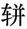
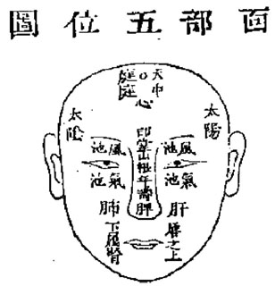
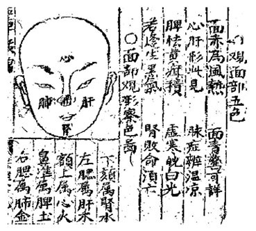
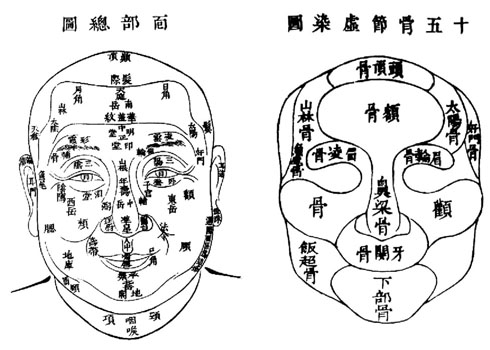
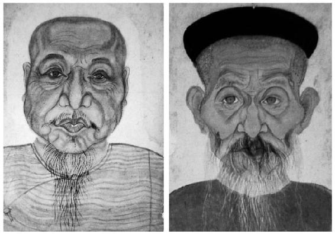
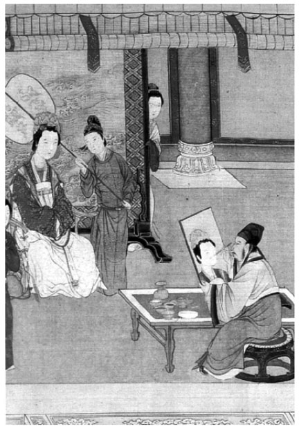
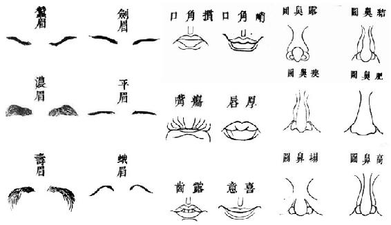
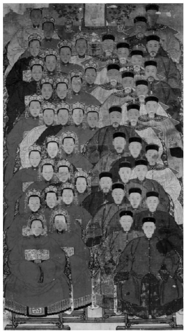
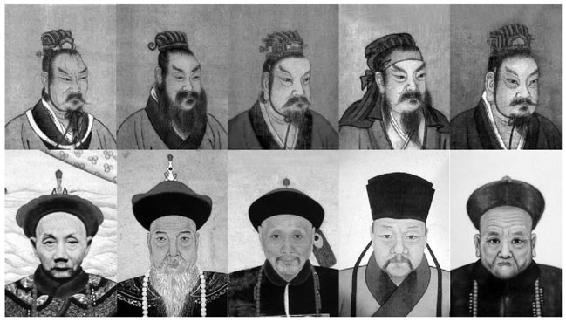
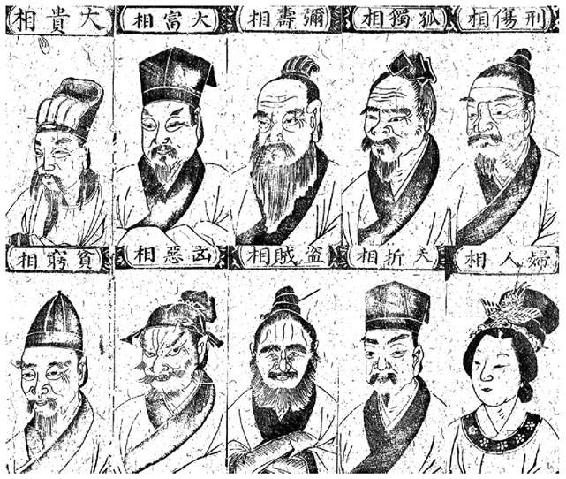

> [BREADCRUMB_CTX: 《考工记：工匠·功能·风格 (中国传统雕塑的复制与当代中国美术教育体系的建立系列丛书)》 > 二 应用技法 (Part 1)]

## 二 应用技法

丁皋一方面再三强调传真技法“只堪意会，难以言传”且“惟在学者心领而自得之”[35]，并指出特定的人像无法以画谱的形式完成，强调每个人天生长相各异的事实，且该事实是画工进行写实性表现的基本难题。另一方面，他间接指出操此业的工匠无法像其他使用画稿或粉本进行绘制的画科那样的本质差异。工匠们必须经由眼睛直接把握对象的容貌特征，然后予以再现，这就需要另一种特殊的制作方式与教学方法。画工们除了要解决技术上的困难，同时必须面临一些外在因素或世俗礼法所带来的条件限制。清人丁思铭在其《写照提纲》中列举了画像过程中的九宜六易、十病五嫌、最莫能避者拘挶之三难、最不可却者当场之二急。[36]其中所列出的由外部条件造成的困难，如“室无正光”“有狼藉秽气”和来自绘制对象的困难，如“不重斯文”“语乱心曲”“座不宁静”“随机而改容”，以及前文所提及的司马光在《司马氏书仪》中提到的不同画像时机，如“临危”“揭帛”“追容”，这三种特殊状况对于写貌都造成了不同程度的困难。所谓“临危”，大凡人在将死未死的弥留之际，容貌大多不佳，画者也不能如实照画。所谓“揭帛”，人死后往往丧失生者之精神气韵、面容僵硬，这种“生”与“死”的不同状态下所出现的容貌上的微妙差异，显然也给画者能否画得肖似带来一定程度的困难，而且丧家也能够很容易区分其间的差异与好坏。小说《醒世姻缘传》中写道：“画士道‘揭白画的，怎得十分相肖？幸得我会过晁老先生，所以还有几分光景……’”[37]又如《金瓶梅词话》在描述西门庆请韩先生对着李瓶儿的尸体画张小稿，完成后让大家看看有什么地方需要修改时写道：“月娘道：‘亏这汉子，揭白怎得画来！’玳安道：‘他在庙上曾见过六娘一面，刚才想著，就画到这等模样。’”[38]“追容”（追影）则近于无中生有，仅凭雇主的记忆与口述或者选择与亡者面容相似的图像，或将在世亲人的容貌作为参考。[39]明人归有光在《先妣事略》中记述延请画工替母亲画像时采取了“出二子命之曰‘鼻以上画有光，鼻以下画大姊’以二子肖母也”[40]的方法。对于画工而言，对象的“活”，有活的难处，“死”也有死的困扰。《司马氏书仪·魂帛》中写道：“男子生时有画像，用之。犹无所谓。至于妇人。生时深居闺闼。出则乘辎。拥蔽其面。既死。岂可使画工直入深室。揭掩面之帛。执笔望相。画其容貌。此殊为非礼。勿可用也。”[41]可以显见，世俗中的礼法与习俗也在某种程度上造成了画工在画像时的一些障碍。在面对上述种种困难时，如何寻找一些办法以快速有效地提升技术、招徕顾客显然才是画工真正关心的切身问题。

中国人物画历来重视“以形写神”和“形神兼备”，这当然是对绘画的一种最高期许与理想；但同时也有强调“形具而神生”[42]的说法。对于以替人写像为生的画工而言，世俗性需求的基本条件是“不肖无足论”，具备足够的写实能力对于工匠而言显然是一个基本的前提，而工作效率对于工匠的收入来说也是相当关键的。一部详尽的面部结构图解对于画工而言或许比如何表现一个人的精神气韵更加重要、有用和实际。古代相学与医学似乎能够提供很好的经验来满足画工在这一方面的需求。相面术是一种透过“人”面部的形、色、位置等，来判断与预测一个人的“智愚贤不肖”与“吉凶祸福”的方法。中医治病则认为：“欲知其内者，当以观乎外，诊于外者，斯以知其内，盖有诸内者形诸外”[43]（见图3-5），并因此在“望、闻、问、切”的整个看诊过程中，把“望”摆在首位。清人李学川在专门谈论针灸的著作中列举了面部呈色与脏腑的关系，如：“左腮为肝，右腮为肺，额上为心，鼻为脾，颏为肾，若色赤者，热也，随症治之……目部赤色者心实热，淡红者心虚热，青者肝实热……”[44]《新锲全补天下四民利用便观五车拔锦》中的《观面部五色》和《小儿神色论》则记载了一些通俗的察形辨色方法，如：“小儿病宜先视形症神色然后察脉”“面赤为风热，面青惊可详，心肝形此见，脉症辨温涼，脾怯黄痘积，虚寒白光，若逢生黑气，肾败命须亡”和“假如肝之为病则面青，心之为病则面赤，脾之为病则面黄，肺之为病则面白，肾之为病则面黑……”[45]（见图3-6）虽然不能将医学与相术视为等同，而且在后面的论述中相术的运用似乎比医学更为普及，但是两者对于“有诸内者形诸外”这样的观点不仅有异曲同工之妙，甚至还有一些相互影响的关系，这当中甚至还牵涉到一些民间习俗与禁忌等问题（后叙）。相学与医学为了能够更清楚地论述内、外相互间的位置与形态关系，对人体每个部分都进行了细微的区分、命名并加以图解（见图3-7）。

图3-5 面部五位图

资料来源：摘自《徽州容像艺术》。

图3-6 观面部五色和面部观形察色图

资料来源：摘自《新锲全补天下四民利用便观五车拔锦》。

图3-7 面部总图和十五骨节虚染图

资料来源：摘自《徽州容像艺术》。

元代王绎在其《写像秘诀》中曾开宗明义地说道：“凡写像需通晓相法。”宋人苏轼在《东坡论人物传神》中虽提及了“传神与相一道”[46]，但是当中的“相”更偏重于观察，即他所说的“阴察”。比较具体地跟相术关联的是宋代刘道醇在《圣朝名画评》中的记载，他认为释元霭是因为“通古人相法，遂能写真”[47]。而郭若虚在《图画见闻志》中则记载牟古“工相术，善传写……”[48]显然，在王绎之前的古代画工已经发现并开始利用相术来作为容像面部制作的参考依据。我们对图3-8中两张面容胖瘦各异的清代容像底稿进行观察，可以立刻发现，前述的学问为古代缺乏解剖学知识和以追求形似为首要目标的画师提供了非常有用的帮助。脸部丰腴的人通常骨骼并不明显，面容消瘦者通常缺乏肌肉。这两张底稿将肌肉位置与骨骼结构之间的关系表现得非常清晰，相当符合“皮肉明备，骨节暗全”的要求。相学中关于五官、肌肉、骨骼的详尽分类能让画家很容易地发现一些肉眼不易观察到的面部细节，并且有助于依照其所见特征进行绘制。甚至即使在未见其人的情况下，也可以有效地掌握一个人面容的外在特征与内部结构。虽然我们不能确定这两张底稿是否参照了相学，不过从在清人蒋骥与丁皋的著录中发现了大量利用相面学的图像和术语这一点来看，至少可以说明相术应用在肖像画在画家之间并非秘密。更重要的是，不仅明代三部生活类书《新刻天下四民辨览三台万用正宗》《顶镌崇文阁汇纂四民捷用分类学府全编》《新锲全补天下四民利用便观五车拔锦》[49]都将相术与医术列为日常生活的必备知识，而且《丹青门》中关于肖像的画法也借用了相术的名目、采用了王思善的画论。[50]这就更足以表明，不但简单的相术与医学在民间受到广泛的流传与重视，就连相术在肖像画中的应用也并不只流通于画家团体，而是众人皆知的常识并且深植人心。相学与医学应用在绘画上对制作者与雇主都有好处。虽然两者都具有专业性，但是相面术中诸如将面部以日、月、星、辰、山、川之类相对等（如“盖人之面貌部位，与夫五岳四渎，各各不侔，而四时气色亦异。”[51]）或医学中的阴阳五行、自然生克之道[52]与中国人（普遍而言）相信“天人合一”“天人交感”这些形而上的观念本身，皆存在某种对于生命与宇宙运作机制的内在联系。以上这些学问背后也都与绘画一样，关联到人与自然之间的一种超越现实、形而上的运作规律。我们或许可以这么认为，对中国人而言，在理解难度与思维模式上，不管是相学中的专有名词还是人与自然之间的形而上观念，对一般人来说反而是相对通俗的；这些耳熟能详的共同语言显然比那些对面部过于笼统而简单的一般性称呼使人感觉更专业、更具体，而画者也可以避免多花无谓的时间去向雇主解释那些“绘画”所涉及的专业名词或技术，从而更有助于双方之间的沟通。以上种种，对画家、学徒和雇主都是相当有利的。不过，虽然相学与医学为画家提供了人物面部的五官肌肉与骨骼结构，或是颜面色彩方面的参考，但实际上仍没有告诉画家应该如何去画；所以，必然还有一些画家之间秘而不宣的特殊诀窍，那才是画像真正成功的关键。

图3-8 清代容像底稿

资料来源：摘自《徽州容像艺术》。

前文所提到的那些绘制时的不同时机与状况，显然给画家带来了不少的困扰。中国传统的肖像绘制方式，虽然也有类似于西方采用“模特”（model）或“朽子”[53]当场写生的（见图3-9），但是大部分还是让画家在比较短的时间内，使用类似速写或仅凭记忆绘制草稿的方式来描绘，完成之后，再依照雇主的要求及意见加以修订及补充。实际上，不管采用哪一种方式打稿，干扰与限制其实同样存在。对于画家而言，在有限的时间里抓紧把握住对象的外貌特征是很重要的。越能在较短的时间内把握住对象的外貌特征，就越能减少绘制时来自外在的干扰，也就越能提高效率。

图3-9 （明）仇英《汉宫春晓》（局部）

资料来源：摘自《美育》（肖像画专辑）。

寻找一种合适的“方法”对于画工来说，应是势所必然的。而合适方法的神效甚至能达到清人丁以诚在《续心领》中所言“虽不知画人阅之，可以肖像也”[54]的程度。这虽然不免有夸大之嫌，但是对于画工而言，除了受到世俗间对亲人遗容的写实需求限制外，绘画技巧、做工效率也将直接影响其业务量的多寡，也是不可漠视的事实。所以，凭借经验发展一套行之有用的技巧或是提高作业效率的秘诀就显得相当重要。“口诀”与“像谱”的形成，就是对这种能够符合主雇双方共同需求的响应。这些不同形式的诀窍也因为涉及画工之间的业务竞争，所以总是秘而不宣，谨慎的程度甚至到了即便是自己的徒弟也不能轻易相信的地步。因为徒弟一旦出师，师徒彼此之间就会成为业务上的竞争对手。民间谚语“教会徒弟饿死师傅”正足以说明这种师徒之间的矛盾情结。所以，师傅也要在详加考察徒弟的品德之后，才决定是否倾囊相授。中国“一日为师，终身为父”的传统观念，似乎多少也反映了这种伦理观的另一个现实层面。

相术与医学的应用的确对画工起到了类似解剖学的作用，但是仅仅是“知道”并不代表能画。因为画工所面对的对象容貌千变万化，而替人肖像的过程也是千头万绪。在面临这些情况时，“画诀”发挥了重要的作用，例如丁皋的“画脸先圈”说中的口诀在帮助画家起稿时就有相当的实用价值：“浑圆定格，一圈准人，齐中眼位，二仪均分……”[55]在画脸时，除了一开始先画一个圆圈来帮助确定五官位置的方法外，同时还存在另一种反其道而行的画法，如：“一画鼻孔定鼻翼，二画鼻准定鼻根，三画鼻根两眼角，四画左右两眼梢……”[56]这两种画法都可以从外部或内部依循一定的顺序，让画工能在最短时间内把握住对象的整体结构、比例和布局。此外，对于面容各部位的绘画技巧也有以口诀形式表现的，比如丁皋就大体将五官中的眼睛、嘴巴、眉毛分为六种，鼻子分为八种，每一种都有相应图像与口诀与之配合（见图3-10）。俊目：“意远而神藏，望人偏灼灼，其光要细长，传真自如跃。”[57]画口：“方寸不移部位准，生动得机春风晒，阴阳染法皆有凭，笑欲开唇取含吻。”[58]画瘦鼻：“瘦鼻轻描骨骼，两边隙染追根，一路高岗悬挂，兰台清硬藏门。”画眉：“眉兼疏密须先识，轻重短长皆有式，对准挥毫展转开，断连多寡生荆棘。”[59]

图3-10 特征分解图

资料来源：摘自《传真心领》。

“画谱”则分为两种。一种是将人的面部特征以类型学的方式分类归纳。这对于学习者或是画工来说，可以很快地将对象面部五官依特征加以组合，缩短制作的时间并且提高效率，如上述丁皋在《传真心领》中用以说明各部位画法的图解。另一种画谱则被称为“追容画谱”。画师一般将其带在身上专门为顾客准备，在给顾客已过世的亲人或从未见过面的祖先画像时用作参考。[60]光凭雇主的记忆、口述来绘制遗容显然相当费事，模糊的记忆有时让雇主本身都拿捏不定亲人的长相，更何况从未一睹对象真容的画工？反复修改将花费许多时间，直接影响画工的业务量。收集大量的面容或是将画过的底稿事先罗列准备好带在身上，以图像的方式帮助雇主追忆并确认先祖的容貌是一个相当有效的办法。另外，画工的绘制依照雇主亲自确认、选好的脸谱进行重新组合与修改，可以避免双方对画像相似与否的不同认定，确保画工的权益，减少纠纷。而画谱易于携带的特性也可以让画工方便走街串巷，主动招揽生意，而这些现成的作品当然也起到了展示画工技术的作用。

“代图”是一种将历代祖先齐聚在一张滚动条中的祖宗容像[61]（见图3-11）。明人尹直曾在著述中言道：“予先世遗像，皆历年久，楮缯墨色，漫漶灭裂，不可把玩。乃命绘史王琚因旧摹新，共为一轴……庶岁时忌日，悬皆简便，久而不至于散失故也。”[62]为了达到与原本画像相同的标准，画家发明了誊像的方法。丁皋在《誊像法》开篇中提及“人家遗像至多，每欲绘为一轴，或一两代，或三五代，其间或大或小不一，大则收之，小则放之，总要一样……”，在后面则述及了誊像的具体方法。可见像“代图”这种形式的祖宗像，应该是个人或双人遗像的变体，甚至双人遗像也有可能是从个人遗像誊写而来。总而言之，“代图”是众多遗像被重新组合的一种新形式。这种形式的祖宗像是基于业主方便祭祀、易于保存和因旧摹新的目的才应运产生的。在正常情况下，每一户人家要增加一张新的遗像显然需要一段不算短的时间，更何况是多代之后的组合；时间对画面必然会造成影响，而经由再次的誊写之后，在形、色上必然也会有一定程度的失真。尹直在《謇斋琐缀录》中说了一句很有趣的话：“盖后世子孙，未尝亲睹平生之丰仪，安知其似与否？”[63]这不禁让笔者联想到，古代圣人画像经由不断的传移摹写也可能出现更大程度的失真。“时间”遗留给我们的不仅仅是历史的轨迹，它同时创造了传说，并随着认知的变焦转而成为神话。我们在史集中常常能看到古人对往圣先贤、帝王将相容貌的描述，并且对这些容貌的描述常常加入了一些异象，以显示该人物并非凡夫，甚至加进了一些神奇的故事；这些人的能力就如同其外貌的与众不同皆是出于天授。此外，这些圣贤画像也总是被赋予某种“鉴诫”与“成教化、助人伦”的功能。在这种目的下，外貌的象征意义大于纪实的意义，“好”与“坏”，“善”与“恶”，“贤”与“德”往往被程序化、标准化，而这种普遍的审美价值观很显然也对民间在善、恶、忠、奸相貌的标准上造成重大影响。例如我们在《三国演义》中可以看到对刘备外貌的描述：“两耳垂肩，双手过膝，目能自顾其耳，面如冠玉，唇若涂脂”，对张飞的描述：“身长八尺，豹头环眼，燕颔虎须，声若巨雷，势如奔马。”[64]在《水浒传》中，对宋江出场形貌的描述是：“眼如丹凤，眉似卧蚕。滴溜溜两耳垂珠，明皎皎双睛点漆。……唇方口正，髭须地阁轻盈；额润顶平，皮肉天仓饱满。”[65]百姓一看长相就能辨忠奸、明善恶，当是长期以来受到这种意识形态与形象思维影响的结果。这些深入人心的由外貌特征衡量一个人智、愚、贤、恶之类的标准长期以来所造成的影响当然也包括了对那些专门描绘人像的画工们的影响。对于百姓而言，那些人像所代表的是一种遥不可及的、神圣与崇高的彼岸。如果记载是可信的，那么我们理当相信对于那些圣人相貌记载的真实性。不过我们也不应该忽略人类在认知方式与价值上，随着时间的演进也形成了巨大的差异。这当然并不是说那些圣人的异象与事迹是由画面不断地被传移摹写造成的，但是我们却可以将“口耳相传”视为另一种形态的传移摹写。而祖宗像作为供后代子孙追思怀想与祭祀的重要亲人遗像，必然会被格外珍视并妥善保存，而且也不可能经常请画师重新绘制。但是这里所要阐述的是，一种由认知的变焦所导致的失真效应所掺杂的其他一些世俗需求意图，从而进一步反映在祖宗容貌形象的可能性上。这种联想为我们进一步探讨相面术的种种“意思”[66]是否进一步被画工们用在祖宗像制作上提供了一个思考方向。

图3-11 （清）官宦世家五十一人富贵和乐官像

资料来源：摘自《美育》（肖像画专辑）。

经由图像的排比可以发现，传统中以鉴诫功能为主的圣人先贤画像与以祭祀功能为主的容像，在面容外貌特征表现方式上的差异是非常明显的（见图3-12）。对于一个已经被历史评价定调的人物而言，如何在画面中将这种被认定的事实表现出来是很重要的。作为一个以“成教化、助人伦”为目的的相貌，需要被忠实描写的并非真实的面貌，而是被历史定调的价值及人格特质的夸大与突显。这种影响一直到清代郑绩的《论肖品》中还能看到：

凡写故实……写人不徒写其貌，要肖其品。何谓肖品？绘出古人平素性情品质也……写武侯如见韬略，写太白则显有风流，陶彭泽傲骨清风，白乐天醉吟洒脱，皆寓此意。倘不明此意，纵练成铁铸之笔力，描出生活之神情，究竟与斗牛匠无异耳。[67]

图3-12 以鉴诫功能为主的圣人先贤画像（上排）和以祭祀功能为主的容像（下排）

资料来源：上排摘自《中国历代名人画像谱》（第1册），下排摘自《徽州容像艺术》。

明代余象斗编的《新锲全补天下四民利用便观五车拔锦》中的《相法门》列出了十余种面相（见图3-13）。我们从中可以约略看出那些明清绘本中的往圣先贤与所谓的大富、大贵相具有很大的相似性。尤其是眉宇之间的特征格外明显，具有很强的公式化痕迹，可以发现和相术有某种程度的联系，也显示出和“肖品”的关联；因为圣人们大多都具有相同的“品格”。

图3-13 《相法门》中的十余种面相

资料来源：摘自《新锲全补天下四民利用便观五车拔锦》之《相法门》（卷22）。

作为祭祀用及供后代追思用的祖宗容像却显示出与古代人物肖像绘制标准有明显差别，而且它们在相互之间的外貌上差异也极大。我们是否可以因此认为，明清时代的祖宗像为了追求亲人的真容，而漠视那些大富、大贵的形象和存在于相面术中的各种各样的“意思”？法国学者德罗绘（Hubert Delahaye）在探讨中国肖像画时，曾经以丁皋为例，并认为他是从更实际的技法出发的。[68]例如丁皋在《传真心领》中虽然大量应用了相面术的图解和分类，但是在具体谈到各面容相应部位的画法，如“天庭论”“鼻准论”“两颧论”“附腮颐论”“地阁论”“眼光论”“面色论”“气血论”“海口论”等时，并没有掺杂相面术中那些形而上的说法。事实上，我们在更早的元代王绎所写的《写像秘诀》中，除了看见他使用比喻的方式和相面术中的名称之外，也看不到那些形而上的说法，尤其是他在收录的《写真古诀》中写道：“写真之法、先观八格、次看三庭。眼横五配，口约三勾。明其大局，好定分寸。”[69]采用相术的用意在于方便“明其大局”，最终的目的则在于“好定分寸”。稍早于丁皋的清人蒋骥，在《传神秘要》中同样采用相面术的专业术语，但也并未涉及相关的相术说法。这些具有代表性的肖像画论著都以相当实际的绘画技术为主，显示从画工的角度来看，他们似乎更重视技巧，并且对怎样才能使画面更加写实格外重视，反而对于相面术的那些说法避而不谈。这是很有趣的现象。